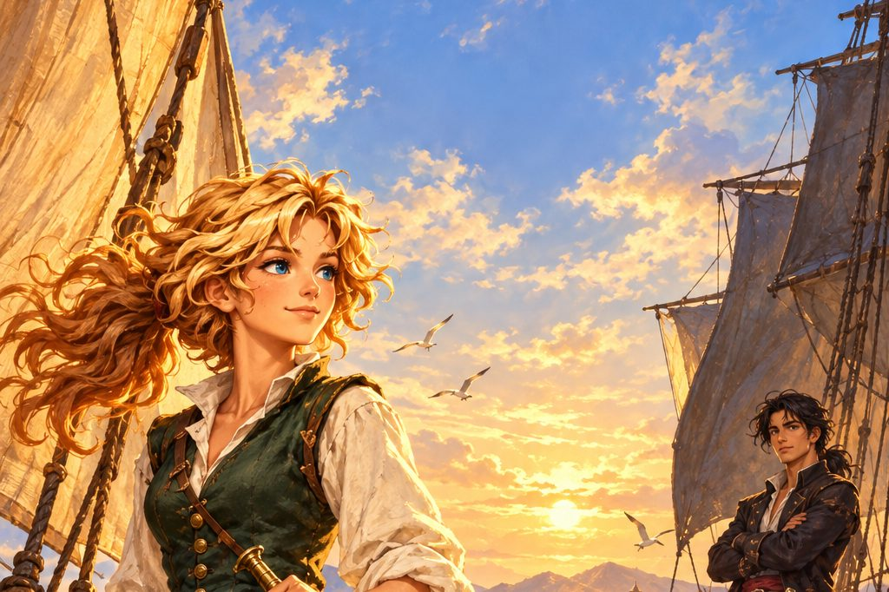

제노바의 소녀 밀란다 베르테는 빚쟁이에게 쫓겨 집으로 숨어든 피에트로 콘티를 만나고, 세 해 뒤 남서풍의 배를 타고 탐험가로 바다에 나섭니다. 신대륙의 불타는 마을과 태양의 돌을 쫓는 밀란다의 항해가 끝날 무렵, 붉은수염의 아들 살바도르의 이야기가 이어지며 니코시아의 불길과 마지막 요새의 결전까지 두 사람의 바다가 한데 얽힙니다.

:::caution[줄거리 공개]
이 소설에는 밀란다와 살바도르 이야기의 처음부터 마지막 결말까지 모든 줄거리가 들어 있습니다. 게임을 먼저 즐기고 싶다면 다 끝낸 뒤에 읽으세요.
:::

## 차례

| 차례 | 내용 |
| --- | --- |
| [서장 ― 빚의 왕이 숨어든 집](/novel/milanda/prologue/) |  |
| [1부 ― 리베치오, 남서풍의 배](/novel/milanda/part1/) | 돌아온 모험가, 놓친 돛, 제노바 상인의 약속, 남서풍의 배 |
| [2부 ― 불타는 마을의 아이](/novel/milanda/part2/) | 환상의 물고기, 연기 오르는 섬, 채찍, 카츄아파 |
| [3부 ― 태양의 돌](/novel/milanda/part3/) | 도전장, 옥으로 지은 옷, 천산갑, 꿈속의 짐승 |
| [4부 ― 붉은수염의 아들](/novel/milanda/part4/) | 해적왕의 아들, 승리자라는 이름의 배, 샤르크의 방패, 바리엔테 |
| [5부 ― 니코시아의 불](/novel/milanda/part5/) | 새벽 두 시의 출항, 동쪽 끝의 화약, 니코시아, 에스멜다 |
| [6부 ― 그와상](/novel/milanda/part6/) | 최후의 보물, 비늘과 눈물, 갚지 못한 빚, 리오노 |
| [결말 ― 신의 검](/novel/milanda/ending/) | 큰 강의 요새, 바다로 |
