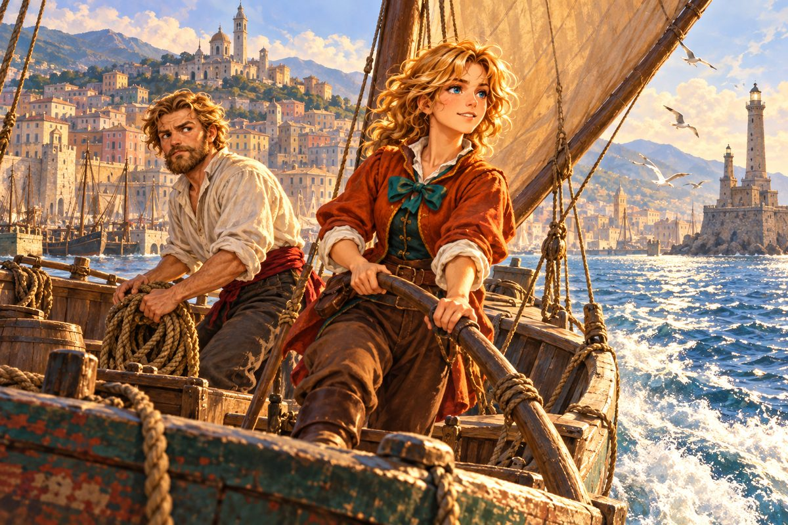

## 1. 돌아온 모험가

피에트로 콘티가 돌아왔다는 소문은 아침 생선 장이 서기도 전에 제노바를 한 바퀴 돌았다.

세 해 사이에 그는 다른 사람이 되어 있었다. 리스본의 후원을 받아 바다로 나간 그는 연이어 이름난 발견을 해냈고, 어느 나라 왕에게선가 작위까지 받았다고 했다.

"『제노바의 빚의 왕』이 화려하게도 변신했지." 조선소 아저씨가 대패를 내려놓으며 껄껄 웃었다. "실은 나도 그 녀석한테 돈 꿔 준 적이 있단다."

"그런 별명 부르지 마세요. 볼품없어요!"

밀란다는 열일곱이 되어 있었다. 땋아 늘이던 밤색 머리는 이제 하나로 묶어 등 뒤로 넘겼고, 키는 어머니 요한나를 넘어섰다. 그러나 피에트로라는 이름을 듣는 순간 가슴이 뛰는 것만은 열네 살 때 그대로였다.

그녀는 온 마을을 뛰어다녔다. 항구 관리인은 그가 술집에 갔을 거라고 했다. 술집의 마틸다 롯시는 그가 방금 총독부 병사에게 불려 갔다고 했다. 총독부 정문의 병사는 창대로 길을 막았다.

"평민은 들어갈 수 없다. 그분은 지금 총독 각하와 중요한 회담 중이시다."

"피에트로 씨가 언제부터 귀족이었는데요?"

"출신은 평민이시지. 하지만 지금은 작위를 가진 분이다. 자, 돌아가라."

밀란다는 입술을 깨물고 돌아섰다. 같은 골목에서 자랐는데, 같은 계단에서 같은 빚쟁이를 따돌렸는데, 이제는 문 하나가 둘 사이를 가로막고 있었다.

할 수 없이 술집으로 돌아가 기다리기로 했다. 그런데 술집 문을 열자마자 마틸다의 비명이 먼저 그녀를 맞았다.

"퇴학이라고? 토니오, 너 대체 무슨 짓을 한 거야!"

카운터 앞에 마틸다의 남동생 토니오가 고개를 푹 숙이고 서 있었다. 상선학교에 들어가려고 두 해를 공부한 그 토니오였다. 사연은 이랬다. 갤리선 노 젓기 실습 때마다 채찍을 휘두르는 교관이 있었다. 토니오는 그 교관의 식사에 설사약을 타서 다음 실습에 못 나오게 하려 했다. 그런데 약을 넣으려던 순간 붙잡혔고, 하필 그날 다른 생도 몇이 식중독을 일으키는 바람에 학교가 발칵 뒤집혔다. 누명까지 겹쳐, 토니오는 퇴학서를 쓰고 돌아왔다.

"……오늘은 아무 생각 하지 말고 마시자." 마틸다가 결국 잔을 내밀었다.

"난 주스가 좋은데."

한 시간 뒤, 토니오는 주스 대신 포도주를 석 잔째 비우며 교관 흉내를 내고 있었다. 밀란다는 그 혀 꼬인 신세타령을 끝까지 들어 주었다. 그리고 토니오가 테이블에 이마를 박고 코를 골기 시작했을 때, 마틸다가 미안한 얼굴로 말했다.

"그런데 밀란다, 피에트로는 벌써 총독부에서 나오지 않았을까?"

## 2. 놓친 돛

항구에 닿았을 때는 늦었다.

"조금 전에 마을에서 돌아오자마자 급히 출항했다." 항구 관리인이 수평선 쪽을 턱으로 가리켰다. "총독 각하께 무슨 보물을 찾아 달라는 부탁을 받았다던가. 일 년이 걸릴지 이 년이 걸릴지. 찾기 전에는 안 돌아오겠지."

밀란다는 부두 끝에 섰다. 바다는 세 해 전 그날 아침처럼 반짝이고 있었다. 이번에는 돛조차 보이지 않았다.

그녀는 곧장 술집으로 돌아가, 아직도 테이블에 엎드려 자고 있는 토니오의 귀를 잡아당겼다.

"아야, 아야! 귀 놔!"

"너 때문에 피에트로 씨를 못 만났잖아! 네 술주정 들어 주는 사이에 가 버렸어!"

"무슨 말인지 모르겠지만 미안해. 다음 기회를 기다리면……."

"더는 못 기다려! 언제가 될지도 모르는데."

"그럼 직접 쫓아가든가. 하하, 그건 무리겠지만."

밀란다의 눈이 반짝 빛났다. 토니오는 그 눈빛을 알았다. 어릴 때부터 그 눈빛 뒤에는 언제나 토니오가 뒷수습해야 할 일이 따라왔다.

"그거야. 기다리는 것보다 쫓아가는 거야."

"어디로 갔는지도 모르잖아."

"총독님께 물어보면 되지."

"총독님은 평민을 안 만나 주잖아."

"그러니까 모험으로 이름을 날려서 나도 작위를 받는 거야. 피에트로 씨처럼!"

"배도 없으면서? 배가 얼마나 비싼데. 너는 못 사."

밀란다는 팔짱을 끼고 토니오를 내려다보았다.

"만약에, 정말 만약에 내가 배를 손에 넣으면 어떻게 할 건데?"

"그럼 부하라도 되어 주지. 그럴 일은 없겠지만."

"말했다! 그 말 잊지 마!"

그녀는 문을 박차고 나가려다 걸음을 멈추고 돌아섰다.

"그런데 배는 어디서 팔더라?"

"조선소지! 그것도 모르면서 무슨 배를 손에 넣는다고!"

"잠깐 깜빡한 것뿐이야!"

## 3. 제노바 상인의 약속

조선소 아저씨는 웃으며 손사래를 쳤다. 그런 용돈으로는 배를 못 산다고, 차라리 아버지의 배를 한 척 얻어 보라고. 아저씨는 농담이었지만, 밀란다는 이미 집으로 달려가고 있었다.

아버지 훌리오 베르테는 라티나 배 몇 척으로 연안 교역을 하는 상인이었다. 딸이 갖고 싶은 게 있다고 하자 그는 지갑부터 만졌다.

"너무 비싼 게 아니면 사 주마."

"살 필요 없어요. 아빠가 이미 가지고 계신 거니까."

"내가 가진 거? 뭔데?"

"배요!"

훌리오는 웃지 않았다. 대신 오래 딸을 바라보았다. 그는 딸이 어릴 때부터 배에 태우고 다니며 키 잡는 법과 돛 다루는 법을 가르쳤다. 그 덕에 딸이 배를 꽤 다룰 줄 안다는 것도 알고 있었다. 그러나 그것과 선장이 되는 것은 다른 문제였다.

"선장이라는 건 경력과 관록이 있어야 하는 자리다. 유능한 부선장이라도 있으면 모를까…… 너한테 고용될 항해사가 어디 있겠니."

"찾으면요? 부선장 할 사람을 찾으면 배를 주실 거예요?"

"……거 참, 고집 센 아이로구나. 좋다. 찾으면 주마."

"약속이에요!"

밀란다가 뛰어나가자 요한나가 남편을 돌아보았다. "당신, 그런 약속 해도 괜찮아요?" 훌리오는 느긋하게 파이프를 물었다. 저 아이에게 목숨을 맡길 항해사가 제노바에 있을 리 없다고. 요한나는 고개를 갸웃했다. 그런 것치고는 딸이 이상하게 자신만만해 보였다고.

밀란다가 술집 문을 열었을 때, 토니오는 쓰린 속을 달래려 수프를 뜨고 있었다.

"토니오! 배를 구할 거야. 약속대로 부하가 되어 줘."

"뭐? 벌써? 어떻게?"

"됐으니까 따라와. 오늘부터 넌 내 부선장이야."

"……거짓말이지?"

마틸다가 행주를 내려놓았다. 그리고 동생의 등을 떠밀었다. "잘됐네, 토니오. 일거리가 생겨서."

"누나까지!"

---

훌리오는 딸이 끌고 온 청년을 보고 파이프를 떨어뜨릴 뻔했다.

"토니오? 너냐? 설마 이 아이한테 구슬려서 억지로 끌려온 건 아니겠지?"

토니오는 속으로 비명을 질렀다. 역시 아저씨는 날카로우셨다. 그러나 밀란다가 한 발 먼저 나섰다.

"제노바 상인은 반드시 약속을 지킨다고, 아빠가 늘 말씀하셨잖아요."

"얘기가 미묘하게 다른 것 같은데……." 토니오가 중얼거리자 밀란다가 그의 발을 밟았다.

요한나가 웃음을 참으며 말했다. "당신이 졌어요, 훌리오."

훌리오는 길게 숨을 내쉬었다. "너한테는 못 이기겠구나. 대체 누굴 닮았는지." 그리고 아내의 눈빛을 받고는 서둘러 덧붙였다. "아니, 아무것도 아니오. 리베치오를 가져가거라."

리베치오. 남서풍이라는 뜻의 이름이었다. 베르테 집안의 배 가운데 가장 낡은 배였다.

"좀 더 새 배는 안 돼요?"

"안 된다. 다른 배들은 일을 해야지. 엄마랑 아빠를 길바닥에 나앉게 할 셈이냐?"

그때 요한나가 묵직한 주머니를 탁자에 올려놓았다. 금화 구천 닢이었다.

"그 대신 이제부터는 아무것도 도와주지 않을 거야. 전부 네 힘으로 해내야 해."

"요한나, 그건 좀 가혹하지 않소?"

"아니에요, 아빠. 저도 이제 어린애가 아니에요."

딸과 토니오가 나간 뒤, 훌리오는 오래 창밖을 보았다. 사랑하는 자식일수록 먼 길을 보내라는 말이 있다며 요한나가 그의 어깨를 두드렸다. 훌리오는 대답 대신 식은 파이프를 다시 물었다.

## 4. 남서풍의 배

출항 전날, 마틸다가 토니오를 짐 확인하러 보내 놓고 밀란다의 손에 주머니 하나를 쥐여 주었다. 금화 삼천 닢이었다.

"가게를 내려고 모아 둔 돈이야."

"이런 소중한 돈은 못 받아요."

"받아 줘. 그리고 토니오를 부탁해." 마틸다는 동생이 나간 문 쪽을 보았다. "그 애는 머리가 나쁜 애는 아닌데 우유부단하잖아. 좀 거칠게 다뤄야 해. 너랑 같이 있으면 가만 내버려 둬도 큰일을 겪을 테니까."

"……그 말, 좀 신경 쓰이는데요."

그래도 밀란다는 주머니를 받았다. 잘 훈련시키겠다고 약속하면서.

마을 사람들도 저마다 한마디씩 거들었다. 잡화점 점원은 제노바 최초의 여자 제독이라며 축하 선물로 육분의를 내밀었다. 성당의 신부는 정말 혼자 가느냐고 물었고, 토니오가 부관으로 따라간다는 대답을 듣자 성호를 그으며 작게 중얼거렸다. 불쌍하게도. 밀란다는 그 말을 못 들은 척했다.

"기도 받고 나니까 갑자기 어깨가 무거워진 것 같아." 토니오가 성당 계단을 내려오며 투덜거렸다.

"그래? 난 상쾌한데."

리베치오는 정말로 낡은 배였다. 뱃전의 칠은 소금기에 바래 하얗게 일어나 있었고, 갑판 널빤지는 밟을 때마다 끼익 소리를 냈다. 그러나 돛대는 곧았고, 삼각돛은 바람을 받자 기다렸다는 듯이 팽팽하게 부풀었다. 밀란다는 키를 잡았다. 어릴 적 아버지 무릎 사이에서 잡던 그 감촉이었다.

제노바의 등대가 뒤로 물러났다. 언덕 위의 집들이 하나로 뭉개지고, 성당의 종탑이 바늘처럼 가늘어졌다. 밀란다는 세 해 전처럼 돌아보지 않았다. 이번에는 떠나는 쪽이 그녀였다.

"그런데 밀란다." 토니오가 밧줄을 감다 말고 물었다. "이제부터 어떻게 할 건데? 모험만 한다고 돈이 나오는 게 아니야. 모험가는 수집가나 지도공방하고 계약해서 먹고사는 거라고."

"수집가가 뭔데?"

"세상의 희귀한 물건을 사 모으는 사람들. 피에트로 덕에 모험가 지망생이 너무 늘어서 신출내기는 아무도 안 받아 주지만, 나폴리의 한 수집가는 실적을 안 따진대."

"그런 걸 잘도 아네. 그럼 나폴리로 가자!"

밀란다가 키를 돌렸다. 리베치오가 남쪽으로 고개를 틀었다. 이름처럼, 남서풍이 등을 밀어 주었다.

## 5. 히히히 교수

나폴리의 줄리아노 교수 집은 마을 북동쪽에 있었다. 길을 묻는 사람마다 교수에게 무슨 볼일이냐며 별난 사람 보듯 쳐다보았다. 그 이유는 문을 열자마자 알 수 있었다.

방 안은 이상한 물건들로 가득했다. 박제된 악어가 천장에 매달려 있었고, 유리병 속에서 무언가가 둥둥 떠 있었고, 책상 위에는 바퀴가 일곱 개 달린 정체 모를 기계가 놓여 있었다. 그 한가운데서 머리가 새 둥지처럼 헝클어진 노인이 돋보기를 들고 고개를 들었다.

"뭔가, 자네들은? 아니, 잠깐! 맞혀 볼까. 세탁소에서 왔군!"

"아니, 그게 아니고……."

"틀렸나? 그럼 발명을 의뢰하러 왔구먼!"

"전혀 아닙니다! 저희는 모험가가 되고 싶어서 왔어요!"

교수의 돋보기가 바닥에 떨어졌다. 밀란다와 토니오는 등을 맞대고 속삭였다. 이 사람 괜찮은 거야? 나도 불안하지만 다른 데는 받아 주지도 않잖아. 그러는 사이 교수가 두 사람 사이로 고개를 쑥 들이밀었다.

"히히히히. 실적 따위 없어도 상관없다네. 누구나 처음은 있는 법이니. 중요한 건 내 요구에 응할 수 있느냐지. 그래, 계약하겠나?"

밀란다는 침을 꿀꺽 삼켰다. 바다로 나온 것 자체가 이미 대모험이었다. 이 정도는 견뎌야 했다.

"……네, 부탁드립니다!"

"히히히히, 이로써 나도 후원자로군!"

첫 일은 탐험이 아니라 심부름이었다. 프랑스 보르도에 사는 몰데스 교수에게 편지를 전하는 일. 교수는 그 김에 지도공방과도 계약해 두라며, 지도 그리는 법을 손수 가르쳐 주었다. 그리고 요즘 인기라는 지도 한 장을 보여 주었다. 암스테르담의 메르카토르 지도공방. 그런데 공방 이름과 '지도공방' 사이에 깨알 같은 글씨가 끼어 있었다. 앤드 로페스.

"뭔가 수상한데, 이 공방." 밀란다가 눈을 가늘게 떴다.

"히히히, 계약하는 건 자네들이니 좋을 대로 하게."

보르도의 몰데스 교수는 놀라울 만큼 평범한 사람이었다. 그는 편지를 받아 들고 반가워하며, 줄리아노와는 대학 시절부터의 친구라고 했다.

"그 친구는 겉모습도 말투도 이상하지만, 진리를 향한 정열만큼은 누구에게도 지지 않는 학자라네. 끝까지 그 친구의 힘이 되어 주게."

밀란다는 그 말을 마음에 담았다. 그리고 암스테르담으로 올라가 메르카토르 지도공방과 계약을 맺었다. 공방 주인은 '앤드 로페스'에 관해 물으려는 밀란다의 말을 교묘하게 피해 갔다.

## 6. 하늘로 올라간 잔

첫 탐험은 이집트였다. 알렉산드리아에서 상륙해 사막을 걸어 들어가자, 모래 바다 위로 사람의 머리를 한 거대한 사자가 떠올랐다. 밀란다는 한참 동안 입을 다물지 못했다. 수천 년 동안 무언가를 기다려 온 얼굴이었다. 기다리는 일이라면 그녀도 조금은 알았다.

두 번째 의뢰는 그보다 훨씬 막막했다.

"아서왕의 성배를 찾아오게. 히히히."

"……하늘로 사라졌다는 그 잔이요?"

"그렇다네. 덕 높은 기사의 눈앞에서 하늘로 올라갔다지."

"그럼 단서가 하나도 없잖아요!"

"그걸 찾는 게 진짜 모험가지. 아니면 자네들에겐 좀 버거운가?"

"실례예요! 꼭 찾아내겠어요."

아서왕은 잉글랜드의 전설이었다. 런던의 술집 주인은 그 이야기를 잘 아는 사람이 둘 있다고 했다. 훌륭한 분과 밉살스러운 분. 밀란다는 호기심을 이기지 못하고 밉살스러운 쪽을 골랐다. 주인은 몇 번이나 정말이냐고 되물었고, 마지막에는 이해할 수 없다는 듯 고개를 저었다.

그 밉살스러운 사람은 에드먼드 길버트 남작이었다. 그는 위스키 값으로 한바탕 트집을 잡더니 밀란다를 보고 코웃음을 쳤다.

"있지도 않은 걸 찾다니, 머리 나쁜 제노바 여자가 할 만한 일이군. 하늘로 올라갔다니 가소롭지. 누가 훔쳐 갔겠지. 야만스러운 바이킹 같은 놈들이. 그놈들은 약탈한 보물을 북대서양 어딘가에 숨긴다더군. 자, 내 귀한 시간을 썼으니 값은 치르겠지?"

밀란다는 동전 몇 닢을 쥐여 주고 그를 돌려보냈다. 그리고 토니오에게 이를 갈았다. 최악이야, 저 사람. 토니오는 그러니까 말렸잖아, 하고 중얼거렸다.

훌륭한 분은 그날 밤늦게 나타났다. 은빛이 섞인 머리를 단정히 빗어 넘긴 사내였다. 술집 주인이 스피노라 경이라고 부르자 그는 어깨가 결린다며 손을 내저었다. 그냥 제독이라고 부르게.

"옷토 스피노라라네. 잉글랜드 사략선대를 맡고 있지."

그는 밀란다의 이야기를 끝까지 들었다. 그리고 천천히 말했다.

"전설이 생기면 많든 적든 아름답게 꾸며지는 법이지. 성배가 실제로 있었다면, 하늘로 올라간 게 아니라 누군가 가지고 사라졌을지도 모르네. 그렇다면 무적의 기사들을 따돌린 자는 누구일까. 그 무렵 북쪽 바다를 지배하던 바이킹이라면 어쩌면 가능했겠지. 그들은 보물을 얼음의 섬에 숨겼다고 하네. 잉글랜드 북서쪽에 일 년 내내 얼음에 덮인 큰 섬이 있지."

"그 섬을 찾으면 되겠네요!"

"기뻐하긴 이르네. 가정에 가정을 쌓은 억지일 뿐이니까." 옷토가 잔을 들며 웃었다. "다만 북쪽 바다는 보급이 어렵네. 땅을 보면 우선 항구부터 찾게."

길버트와 같은 말이었다. 그러나 같은 말도 누가 하느냐에 따라 이렇게 다르게 들렸다.

북쪽 바다는 잿빛이었다. 바람은 칼날 같았고, 돛에는 서리가 앉았다. 얼음의 섬에서 그들은 바닷가 동굴 깊숙한 곳에 이끼 낀 돌 상자를 발견했다. 상자 안, 썩은 가죽에 싸여 있던 것은 소박한 금빛 잔이었다. 동굴 틈으로 들어온 희미한 빛이 잔의 테두리에 닿자, 밀란다는 저도 모르게 숨을 멈추었다.

"전설대로라면 고결한 기사만 만질 수 있다던데." 그녀가 손을 뻗다 말고 토니오를 보았다. "나 만져도 될까?"

"이제 와서?"

## 7. 부딪친 남자

성배를 안고 나폴리 항구에 내렸을 때, 밀란다는 들떠 있었다.

"기다려, 밀란다. 그렇게 서두르지 않아도 돼."

"모험가잖아. 행동은 민첩해야지."

"모험가한테는 신중함도 필요해. 밀란다도 좀 더……."

"잠깐, 토니오! 그렇게 말하면 내가 덜렁이 같잖아."

"앗, 밀란다! 앞을 봐!"

쿵. 이마가 단단한 무언가에 부딪쳤다. 사람의 가슴이었다. 밀란다는 이마를 문지르며 고개를 들었다. 검은 머리를 아무렇게나 묶은 청년이 그녀를 내려다보고 있었다. 나이는 그녀와 비슷해 보였다. 햇볕에 그을린 얼굴, 날카로운 눈매, 허리에 찬 굽은 칼. 그런데 그 날카로운 눈이 그녀와 마주치는 순간 이상하게 흔들렸다.

"미안해요." 밀란다는 일단 사과했다. 토니오의 말대로, 앞을 보지 않은 건 그녀였다.

청년은 아무 말도 하지 않았다. 그리고 그녀를 지나쳐 가 버렸다.

"이봐요! 사람이 사과했는데 그 태도는 뭐예요!"

청년 뒤를 따르던 나이 지긋한 사내가 대신 모자를 벗었다. "미안하오, 아가씨. 우리 제독이 여자를 좀 싫어해서."

"그만둬, 호레스! 가자."

"아, 제독! 기다리십시오!"

두 사람이 인파 속으로 사라졌다. 밀란다는 씩씩거리며 발을 굴렀다. 여자를 싫어한다니, 그런 게 사과를 받고 모른 척할 이유가 된단 말인가.

---

교수에게 성배를 넘기고 다시 바다로 나선 지 사흘째 되는 날이었다. 망대에 올라가 있던 선원이 소리쳤다.

"수상한 배가 다가옵니다! 깃발이…… 저게 뭐야?"

번쩍번쩍한 금박을 입힌 뱃머리, 쓸데없이 커다란 해골 깃발. 해적선이었다. 갑판 위에서 화려한 깃털 모자를 쓴 사내가 확성 나팔을 들었다.

"네가 밀란다로구나! 배를 멈춰라! 얌전히 성배를 내놔라! 안 그러면 공격하겠다!"

"뭐야? 왜? 어째서 이렇게 되는 거야?"

토니오가 망원경을 들여다보더니 맥이 빠진 얼굴로 말했다. "저건…… 해적 야콥 울웨이크야. 지중해에서 제일 약하다고 소문난."

"해적인데 약해?"

"시끄럽다! 약하다고 하지 마라!" 바람이 그 말을 고스란히 실어 왔다. 이어 야콥의 부하가 외치는 소리도 들렸다. 두목, 이번에야말로 첫 승리를 거둡시다! 쓸데없는 소리 마라!

"첫 승리……." 밀란다는 웃어야 할지 울어야 할지 몰랐다. "성배는 없어요! 줄리아노 교수님께 드렸다고요!"

그때 토니오가 뱃전을 붙잡았다. "밀란다, 저기! 다른 함대가 온다. 큰일이다, 또 해적이야!"

새로 나타난 함대는 야콥의 배와 전혀 달랐다. 장식 하나 없이 검게 그을린 선체가 물살을 가르며 미끄러지듯 다가왔다. 야콥이 허둥지둥 소리쳤다. 이건 내 수확물이다, 손대지 마라!

"네 수확물에 관심 없다." 새 함대의 기함에서 낮은 목소리가 울렸다. "내 수확물은 너다. 전 함대, 공격 개시!"

포성이 바다를 흔들었다. 리베치오는 그 틈에 돛을 활짝 펴고 해역을 빠져나갔다. 밀란다는 고물에 서서 뒤를 돌아보았다. 야콥의 금박 배가 순식간에 돛을 꺾이고 기울었다. 으아악, 또 졌다! 하는 비명이 들렸다. 목숨만은 살려 주겠다, 열심히 벌어서 또 바쳐라, 하는 차가운 목소리가 뒤를 이었다.

그리고 검은 기함이 리베치오 쪽으로 뱃머리를 돌렸다.

"안심해라. 너희를 습격할 생각은 없다."

뱃전에 선 사내를 보고 밀란다는 손가락을 들었다. "저, 저 사람! 항구에서 나랑 부딪친 사람이야!"

"너랑 부딪친 게 아니라 네가 부딪친 거지." 토니오가 정정했다.

검은 머리의 청년도 그녀를 알아보았다. 그리고 그 자리에서 돌처럼 굳었다. 옆에 있던 호레스라는 사내가 한숨을 쉬며 청년의 어깨를 흔들었다. 제독, 제독. 아이고, 완전히 굳어 버렸군. 그러고는 리베치오 쪽으로 손을 흔들었다.

"미안하오. 우리 제독이 여자를 싫어해서…… 또 당신이오? 습격하지 않을 테니 어서 가시오."

"그럼 말씀대로 하죠." 밀란다는 키를 돌렸다. 멀어지는 검은 배를 보며 그녀는 생각했다. 해적이 사람을 구해 주기도 하는구나. 고맙다는 말은 하지 못했다. 다음에 만나면 하리라고, 그런 날이 올 리 없다는 걸 알면서도 생각했다.

## 8. 성배의 값

"교수님! 성배 탐색을 의뢰한 사람이 누구예요?"

밀란다가 문을 박차고 들어서자 교수는 박제 악어 밑에서 고개를 들었다. 해적에게 습격당할 뻔했다는 이야기를 듣자 그는 진심으로 놀란 얼굴을 했다.

"무사해서 다행이네. 의뢰인은 어떤 나라의 귀족이었지. 자기한테 관록을 좀 붙이고 싶었던 게야. 아무에게나 닥치는 대로 의뢰했으니, 해적 귀에까지 들어갔겠지."

"그런 사람한테 한마디 해 주지 않으면 분이 안 풀려요."

"히히히, 그런 자에겐 진짜 아서왕의 성배를 가질 자격 따위 없다네."

"네? 그럼 제가 찾아온 건 가짜예요?"

"뭐라 말하기 어렵군. 상당히 값진 물건이긴 하지만." 교수가 눈을 찡긋했다. "받은 보수도 딱 그 잔 값 정도였다네."

밀란다는 묘한 기분으로 교수의 집을 나섰다. 진짜인지 가짜인지 모를 잔을 위해 얼음 바다를 건넜다. 그래도 그녀는 그 동굴에서 잔에 빛이 닿던 순간을 잊지 못할 것 같았다. 그것만은 진짜였다.

"해적한테까지 이름이 알려졌으니까, 무기랑 갑옷부터 좋은 걸로 사 두자." 토니오가 말했다. "튼튼하고 빠른 배도 있어야 하고."

"탐험은 하고 싶고 돈은 없고. 가난뱅이는 싫어."

밀란다는 그렇게 투덜거리면서도 웃었다. 나폴리의 저녁 바다가 붉게 물들고 있었다. 저 바다 어딘가에 피에트로가 있었다. 그리고 이제는, 그녀도 그 바다 위에 있었다.
