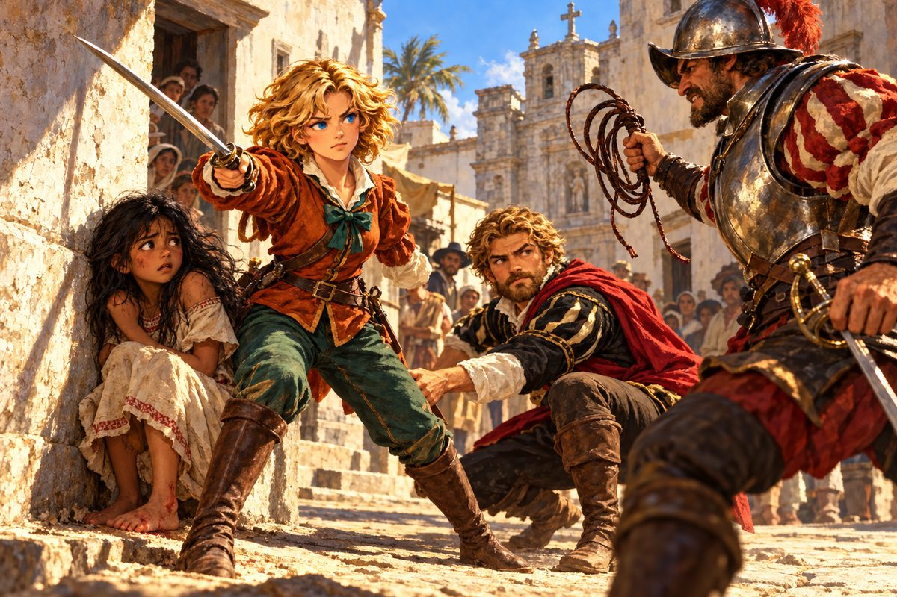

## 9. 환상의 물고기

세 번째 의뢰는 아프리카 동쪽, 마다가스카르라는 큰 섬 근처에서 가끔 잡힌다는 이상한 물고기였다.

"이름이 없으면 불편하니 우선 환상의 물고기라고 부르세. 아프리카 연안은 폭풍의 소굴이니 이걸 가져가게. 자네들이 난파라도 하면 내 꿈자리가 사나울 테니. 히히히."

교수가 내민 것은 작은 유리병에 담긴 성스러운 향유였다. 폭풍 속에서 바다에 몇 방울 떨어뜨리면 파도가 잦아든다는 기름이었다. 밀란다는 반신반의했지만, 희망봉을 돌 때 그 병을 꼭 쥐고 있었다. 하늘이 검게 내려앉고 파도가 뱃머리를 집어삼킬 때, 그녀는 마개를 열고 기름을 바다에 부었다. 파도가 정말로 잦아들었는지, 아니면 폭풍이 마침 지나간 것인지는 알 수 없었다. 다만 리베치오는 살아남았다.

마다가스카르의 어부들은 그 물고기를 알고 있었다. 깊은 바다에서 가끔 그물에 걸려 올라오는, 지느러미가 다리처럼 생긴 푸르스름한 물고기. 그들은 그것을 먹지 않았다. 너무 오래된 것처럼 생겼다고 했다. 밀란다가 그 물고기를 소금에 절여 가져가자, 교수는 재미있는 모양이라며 아이처럼 손뼉을 쳤다.

그 무렵 밀란다의 이름은 지중해 곳곳의 항구에 퍼져 있었다. 나폴리의 별난 교수와 계약한, 어리석은…… 아니, 용감한 제노바 아가씨. 사람들은 반쯤은 놀리듯, 반쯤은 감탄하듯 그 이름을 입에 올렸다. 그리고 마침내 왕궁에서 부름이 왔다. 그녀는 왕실이 맡긴 임무를 해결했고, 여자에게 작위를 주는 일은 처음 듣는다며 수군거리는 귀족들 앞에서 작위를 받았다.

제노바로 돌아오자 아버지는 그녀를 번쩍 들어 올렸다.

"솔직히 말하면, 네가 금방 약한 소리를 하며 돌아올 줄 알았다."

"저는 아빠랑 엄마 딸이에요. 이 정도는 대단한 일도 아니에요."

조선소 아저씨는 귀족님 행차시라며 너스레를 떨었고, 밀란다는 예전처럼 대해 달라고 손을 내저었다. 이제 그녀는 당당히 총독부 정문을 지날 수 있었다. 그런데 총독은 고개를 저었다.

"피에트로 말인가. 그자는 신출귀몰해서 말이지. 내가 맡긴 보물은 훌륭하게 찾아냈지만, 그 뒤로는 소식이 없네. 신대륙에 있는지 아시아 어딘가를 떠도는지, 신이 아닌 나로서는 알 수 없군."

작위를 받으면 모든 게 풀릴 줄 알았다. 그러나 바다는 그보다 넓었다.

## 10. 연기 오르는 섬

다음 의뢰는 신대륙이었다. 그곳에는 독자적인 문명이 있었다고 했다. 놀랄 만한 유적이 있을 것이라고. 다만 야심 많은 에스파냐 사람들이 건너와 제멋대로 날뛴다는 소문이 있으니 조심하라고.

신대륙에 피에트로가 있을까. 밀란다는 서쪽 수평선을 볼 때마다 그 생각을 했다.

카리브해의 한 항구 술집에서 그들은 이상한 이야기를 들었다. 북위 십 도, 서경 육십사 도 부근의 무인도에서 연기가 오르는 것을 보았다는 이야기였다. 가 보니 정말로 작은 섬 하나의 모래톱에서 가느다란 연기가 피어오르고 있었다. 그 옆에는 돛대가 부러진 작은 배 한 척이 얹혀 있었다.

"이봐요! 거기 누구 있어요?"

나무 그늘에서 두 사람이 걸어 나왔다. 밀란다는 눈을 의심했다. 나폴리 항구에서 부딪친 그 검은 머리의 청년과, 호레스라는 사내였다. 둘 다 몰골이 말이 아니었다. 청년의 팔에는 피가 밴 천이 감겨 있었다.

"배가 너무 상해서 항해를 할 수가 없어서……." 호레스가 말했다.

"가까운 항구까지 태워 드릴까요?"

"그거 고맙…… 다행입니다, 제독!"

"……알제까지 데려다 주겠나."

청년이 처음으로 그녀에게 직접 말을 걸었다. 낮고 갈라진 목소리였다. 호레스가 놀라 그를 돌아보았다. 여기서 알제까지가 얼마나 먼데, 그렇게까지 부탁하다니요. 그러나 청년은 고개를 숙였다.

"이 배로는 돌아갈 수 없다. 꼭 가서 확인해야 할 일이 있다. 부탁한다."

"밀란다, 여기까지 와서 지중해로 돌아가자고?" 토니오가 소매를 끌었다.

"바보야. 곤경에 처한 사람을 내버려 둘 순 없잖아!"

알제까지의 긴 항해 동안 청년은 거의 말이 없었다. 밀란다와 눈이 마주치면 고개를 돌렸고, 식사도 혼자 고물에서 했다. 그러나 그가 밤마다 잠들지 못하고 별을 올려다보는 것을 밀란다는 알았다. 무언가를 잃은 사람의 얼굴이었다. 그녀는 그것이 무엇인지 묻지 않았다.

알제 항구에 내리던 날, 청년이 처음으로 그녀를 똑바로 보았다.

"신세를 졌다. 이 빚은 반드시 갚겠다."

호레스는 그들이 신대륙에서 유적을 찾는다는 말을 듣고 한 가지를 귀띔해 주었다. 얼마 전까지 아즈텍이라는 왕국이 있었다고, 베라크루스 근처가 그 중심이었다고. 그리고 덧붙였다. 신대륙에서 곤란한 일이 생기면 카르타헤나 항구의 술집에 말을 남기라고. 해적에게도 의리라는 게 있다고.

## 11. 채찍

베라크루스의 술집 주인은 젊은 아가씨가 이런 곳에 오다니 드문 일이라며 목소리를 낮추었다.

"이 근처엔 콘키스타도르가 있으니 조심하십시오. 에스파냐 말로 정복자라는 뜻이지요. 그자들이 아즈텍 왕국을 무너뜨린 뒤로 이 마을도 영 시끄러워졌습니다."

유적에 대해 묻고 다니던 밀란다는 광장 모퉁이에서 걸음을 멈추었다. 열한두 살쯤 되어 보이는 소녀가 벽에 몰려 있었다. 검은 머리는 흙투성이였고, 맨발에는 피가 맺혀 있었다. 그 앞에 갑옷을 걸친 사내가 채찍을 감아쥐고 서 있었다.

"아즈텍의 잔당 주제에 꽤나 애를 먹였구나. 그것도 오늘로 끝이다. 얌전히 따라와라. 아니면 채찍 맛을 봐야겠느냐."

"잠깐! 뭐 하는 거예요!"

밀란다의 목소리가 광장을 울렸다. 사내가 고개를 돌렸다.

"넌 뭐냐. 방해하지 마라."

"그 아이를 채찍질하겠다고요? 그런 건 신이 용서해도 내가 용서 못 해."

"이 어린 것이! 말버릇부터 가르쳐 주랴?"

사내가 칼을 뽑았다. 밀란다도 칼을 뽑았다. 아버지가 호신용으로 가르쳐 준 검술이었다. 그 짧은 틈에 토니오가 소녀의 손을 잡고 골목으로 달렸다. 잘했어, 토니오! 그 아이를 부탁해!

칼끝이 부딪쳤다. 사내의 칼은 무거웠고, 밀란다의 손목이 저렸다. 두 번 밀리고 세 번째에 그녀가 사내의 칼날을 흘리며 파고들었다. 칼등이 사내의 팔목을 쳤다. 칼이 돌바닥에 떨어졌다.

"이, 이런 계집아이한테 내가……."

"당신은 어차피 연약한 아이나 협박하는 정도예요!"

그러나 다른 사내가 골목에서 나타났다. 이런 데서 뭘 꾸물거리나. 계집아이한테 당했다고? 그럼 이번엔 내가 상대해 주지. 둘이 동시에 칼을 겨누었다.

"두 사람이 한 사람한테 덤비다니, 부끄럽지도 않아요?"

"시끄럽다! 각오해라!"

"기다려!"

젊은 남자의 목소리였다. 광장 반대편에서 키 큰 청년 하나가 걸어 나왔다. 구릿빛 피부에 검은 머리를 길게 늘어뜨리고, 손에는 흑요석 날을 박은 나무 칼을 들고 있었다. 콘키스타도르들의 얼굴이 굳었다. 너도 아즈텍의 잔당이로구나.

청년의 칼은 바람 같았다. 한 사내가 이 녀석은 괴물인가 하고 비명을 지르며 물러섰고, 나머지 하나도 두고 보자는 말을 남기고 도망쳤다. 밀란다는 숨을 몰아쉬며 고개를 숙였다.

"고마워요, 살았어요."

청년은 그녀를 내려다보았다. 고마움 같은 건 담기지 않은, 차가운 눈이었다.

"흥. 백인 여자였나. 구해 주는 게 아니었는데."

"네? 사람이 인사를 하는데 그런 법이 어딨어요?"

청년은 대답하지 않고 사라졌다. 밀란다는 그 자리에 오래 서 있었다. 그 눈빛이 이상하게 마음에 걸렸다. 분노만이 아니었다. 그 밑에 깔린 것은, 깊고 오래된 슬픔이었다.

## 12. 카츄아파

소녀는 리베치오의 짐칸 구석에 숨어 있었다. 무릎을 끌어안고, 들어오는 사람을 짐승 새끼처럼 노려보았다.

"얘기하기 싫으면 안 해도 돼. 하지만 이름만은 알려 줘. 뭐라고 불러야 할지 모르니까. 나는 밀란다. 제노바에서 온 모험가야."

"난 토니오 롯시. 잘 부탁해."

한참 만에 소녀가 입을 열었다.

"……카츄아파. 나를 어떻게 할 거예요?"

"안전한 곳까지 데려다줄 거야. 네 집 근처 항구를 알려 줄래?"

"……집은 없어요. 당신들 백인이 불태웠으니까."

토니오가 발끈했다. 우리가 그런 것처럼 말하지 마, 우린 너를 구해 줬잖아. 밀란다가 그의 팔을 잡았다.

"그만둬, 토니오. 나도 제노바가 불바다가 되었다면……."

카츄아파는 담담하게 말했다. 마을에서 떨어져 있던 자신과 오빠만 살아남았다고. 엄마는 크게 다쳤고, 손을 쓸 수 없었다고. 오빠는 백인에게 복수하겠다며 떠났고, 지금은 어디서 무엇을 하는지 모른다고. 백인은 다 똑같다고.

밀란다는 아무 말도 할 수 없었다. 대신 쪼그리고 앉아 소녀와 눈높이를 맞추었다.

"그럼 이 배에 타. 우리랑 모험하는 건 어때? 바다 위라면 그자들도 손대지 못할 거고, 세상을 돌아다니니 심심하지도 않을 거야. 싫으면 내리고 싶은 곳에 내려 줄게."

"……내가 있으면 재앙이 올지도 몰라요."

"상관없어. 바다 한가운데서 폭풍을 만나는 것에 비하면 아무것도 아니야."

카츄아파는 오래 밀란다를 보았다. 그리고 아주 작게 말했다. 고마워요.

그날 밤 카츄아파는 처음으로 갑판에 나와 별을 보았다. 그리고 유적을 찾는다는 말을 듣고, 먼 남쪽 땅에 대지에 그려진 거대한 그림이 있다는 이야기를 들려주었다. 누가, 무엇 때문에 그렸는지 아무도 모른다고.

그들은 남쪽으로 내려가 그 그림을 찾았다. 메마른 고원 위, 하늘에서나 온전히 보일 만큼 커다란 선들이 땅을 가로지르고 있었다. 새의 날개, 거미의 다리, 원숭이의 꼬리. 밀란다는 언덕에 올라 그 선을 오래 내려다보았다. 이 그림을 그린 사람들은 하늘의 누구에게 보여 주려 했을까. 카츄아파는 그녀 옆에 앉아 아무 말도 하지 않았다.

베라크루스 근처 항구에 다시 들렀을 때, 그들은 한 번 더 습격을 받았다. 잔인한 얼굴을 한 사내였다. 부하를 방해한 게 너로구나. 칼솜씨가 제법이라던데, 내 앞에선 어림없다. 밀란다는 그를 간신히 물리쳤다. 쓰러진 사내가 이를 갈며 내뱉었다.

"너 따위는 질 님에 비하면 아무것도 아니다. 언젠가 질 님이 따끔한 맛을 보여 주실 거다."

"질? 그게 너희 두목 이름이야?"

사내는 아차 하는 얼굴로 입을 다물고 달아났다. 질. 밀란다는 그 이름을 기억해 두었다.

## 13. 제노바의 빈방

제노바의 부모님은 카츄아파를 보고 말을 잃었다. 밀란다가 신대륙에서 본 것을 이야기하자, 어머니 요한나는 소녀를 끌어안았다. 아버지 훌리오는 오래 침묵하다가 말했다.

"나는 그저 상인일 뿐이다. 대단한 일은 못 해도, 힘닿는 데까지는 돕겠다. 배가 싫으면 밀란다가 쓰던 방이 비어 있으니 우리 집에 와도 된다."

"어떻게 할래, 카츄아파?"

소녀는 잠시 고민하더니 밀란다의 소매를 잡았다.

"……저는 배가 좋아요."

"그래? 땅이 그리워지면 언제든 말하거라."

나폴리의 교수는 땅에 그려진 거대한 그림 이야기에 펄쩍 뛰었다. 신대륙이 위험하다니 포기할까 했는데 역시 자네로군, 하며 금화 육천 닢을 내놓았다. 그리고 카츄아파를 보고는 갑자기 진지해졌다. 그 아이의 마을이 어떻게 되었는지 듣고, 그는 주먹으로 책상을 쳤다.

"괘씸하군! 그러면 신대륙의 문화가 엉망이 되어 버리지 않나. 이 아이가 유럽 사람을 경계하는 것도 무리가 아니야."

밀란다는 속으로 생각했다. 교수님은 나폴리 사람들한테도 경계받고 있는데.

## 14. 라플라타의 지리학자

암스테르담의 메르카토르 공방 주인이 그들을 반겼다. 마침 잘 오셨다고. 지도의 공동 작성자인 에르네스트 로페스가 행방불명이라고.

"그는 제게 중요한 돈줄…… 아니, 절친한 친구입니다."

"……본인은 어찌 되든 상관없는 거예요?"

"아, 아닙니다. 말이 헛나왔을 뿐입니다."

그제야 밀란다는 공방 이름 사이의 깨알 같은 글씨를 이해했다. 앤드 로페스. 지도를 실제로 그리는 사람은 따로 있었던 것이다.

황갈색 머리의 예쁘장한 학자를 사람들은 잘 기억했다. 희망봉을 넘는다고 했다는 소문, 남미 동해안을 조사한다고 했다는 소문을 따라가다 보니 마지막 단서는 라플라타 강이었다.

라플라타 강어귀의 작은 항구에서 그들은 마침내 그를 찾았다. 측량 도구를 끌어안은 채 부두에 앉아 있던 그는 그들의 배를 보자 벌떡 일어났다.

"혹시 급하지 않으면 나를 좀 도와주지 않겠소? 수심을 재다가 배가 암초에 걸려서, 보트로 겨우 빠져나왔다오. 자재를 옮길 수가 없어 꼼짝도 못 하고 있었지."

"혹시 에르네스트 로페스 씨?"

"내 이름을 어떻게?"

"메르카토르 씨 부탁으로 찾으러 왔어요."

"메르카토르가! 역시 친구는 사귀어 둘 만하군!"

이 사람은 정말로 사람을 좋아하는구나, 하고 밀란다는 생각했다. 돈줄이라는 말은 전하지 않기로 했다. 그들은 리베치오의 밧줄로 그의 배를 끌어내고, 실어 온 목재로 구멍 난 선체를 메웠다. 에르네스트는 고맙다며 측량을 계속하겠다고 했다. 그리고 바람 좋은 날 남쪽으로 떠났다.

메르카토르는 소식을 듣고 안도의 한숨을 쉬며 사례로 비단 옷 한 벌을 내밀었다. 명나라 여인들이 입는 옷이라고 했다. 이걸 입고 있으면 명나라 항구에 들어가기가 수월할 거라고.

## 15. 춤추는 신

인도의 술집은 향신료 냄새로 가득했다. 이국적인 작품을 만들고 싶다는 예술가가 영감을 줄 물건을 원한다는, 교수다운 막연한 의뢰였다.

인도다운 물건을 아느냐는 밀란다의 물음에 술집 주인이 눈만 껌뻑이자, 구석에서 술에 취한 사내가 손을 들었다. 알고 있지, 하지만 공짜로는 안 돼. 금화 일만 닢. 밀란다가 반으로 깎자 사내는 트림을 하며 투덜거렸지만 결국 입을 열었다.

"시바 신을 아나? 인도 사람들이 섬기는 신이지. 그 신상을 만드는 마을이 서해안에 있네. 나도 한 번 봤는데, 지금이라도 춤을 출 것 같더군."

서해안의 작은 마을에서 그들은 그 신상을 보았다. 청동으로 된 신이 불꽃 고리 안에서 한쪽 다리를 들고 있었다. 정말로 춤추는 것 같았다. 밀란다는 그 신상을 사서 나폴리로 가져갔고, 교수는 이거라면 불평할 수 없겠다며 흡족해했다.

## 16. 교수의 카레

"이번엔 찾는 게 아닐세. 사 오는 거지. 후추를 사 오게."

후추는 인도에서 사면 그만이었다. 교수는 그것으로 오랜 꿈에 도전하겠다고 했다. 인도의 전통 요리, 카레. 만드는 법이 적힌 책을 손에 넣었다고. 잘 만들어지면 자네들에게도 나눠 주겠다고. 밀란다와 토니오는 눈빛으로 같은 말을 주고받았다. 사양하는 게 좋겠어.

다음은 피멘트였다. 아무도 그게 뭔지 몰랐다. 카츄아파가 조용히 말했다. 고추예요. 우리 마을에서도 키웠어요. 신대륙이었다.

신대륙의 한 마을에서 고추를 사는 동안, 밀란다는 카츄아파를 부두에 남겨 두었다. 마을은 위험했다. 그런데 돌아와 보니 카츄아파가 누군가와 말다툼을 하고 있었다. 베라크루스 광장의 그 청년이었다.

"카츄아파, 왜 백인이랑 같이 있어? 그놈들이 무슨 짓을 했는지 잊었어?"

"백인이 다 나쁜 사람은 아니야. 밀란다와 토니오는 나를 구해 줬어."

"속지 마! 백인은 모두 없애야 해!"

"오빠!"

오빠. 밀란다는 그 자리에 얼어붙었다. 청년이 그녀를 알아보았다. 너였나. 네가 카츄아파를 꾀어낸 거로군. 역시 구해 주는 게 아니었어. 그가 칼을 뽑았다. 카츄아파가 그 앞을 막아섰다. 오빠, 그만둬!

그때 마을 쪽에서 젊은 여자가 달려왔다.

"티노카톨 님, 큰일이에요! 콘키스타도르가 마을로 오고 있어요!"

청년은 이를 악물었다. 그리고 떠나기 전에 동생에게 한 번 더 소리쳤다. 다시 생각해라. 하얀 악마들에게 속지 마라. 그의 뒷모습이 숲으로 사라졌다.

"……저 사람이 네 오빠야?"

"네. 예전에는 아주 다정한 사람이었는데."

카츄아파는 그 뒤로 사흘 동안 말이 없었다.

마지막은 향료제도의 육두구였다. 암보이나와 반다의 숲에서 육두구를 사서 돌아오자, 교수의 집에서 연기가 피어오르고 있었다. 나폴리 골목마다 이상한 냄새가 난다고 사람들이 수군거렸다. 밀란다와 토니오는 서로 눈을 마주쳤다. 교수님 탓이야.

교수는 방 안을 뛰어다니고 있었다. 마침내 완성했다고. 유럽 사람의, 유럽 사람에 의한, 유럽 사람을 위한 카레라고. 이걸 팔면 큰돈이 된다고. 그리고 냄비를 내밀었다.

"토니오, 네가 먼저 먹어 봐."

"왜 내가?"

"교수님이 모처럼 만드셨잖아."

토니오는 한 숟갈을 떠 넣었다. 그리고 비명을 질렀다. 매, 매워! 물, 물! 교수는 역시 누가 먹어도 매운가 보다며 손뼉을 치며 웃었다. 이 놀라움을 누군가와 나누고 싶었다고.

카츄아파가 냄비를 들여다보더니 한 숟갈을 떠먹었다. 그리고 담담하게 말했다.

"……피멘트를 너무 넣었네요."

"카츄아파, 괜찮아?"

"어릴 때부터 매운 건 익숙해요."

사흘 만에 보는 그녀의 웃음이었다. 밀란다는 그것만으로 교수의 카레를 용서하기로 했다.

## 17. 맛사와의 재회

"피에트로는 리스본의 무슨 공작가와 관계가 있다던데."

술집의 마틸다가 흘린 그 한마디에 밀란다는 그날로 리스본으로 달려갔다. 페레로 공작가의 주인 레온 페레로는 위엄 있는 노인이었다.

"콘티는 지금 내 아들의 의뢰로 성자의 지팡이라는 보물을 찾고 있네. 찾는 대로 아프리카 동쪽의 맛사와 항구로 가져오기로 했지. 그러나 맛사와는 위험하네. 오스만 제국이 그 항구를 노리고 있어. 여러 정치적 사정이 얽혀 있지. 그는 일류 모험가이니 제 몸은 지킬 걸세. 제노바로 돌아올 때를 기다리는 게 어떤가."

밀란다는 기다리지 않았다.

맛사와에 닿은 것은 해전이 끝난 다음 날이었다. 오스만 함대가 항구를 치려 했고, 리스본의 조안 페레로라는 사람 덕에 항구가 무사했다고 술집 주인이 말했다. 그리고 피에트로라는 사람도 은인 중 하나라고. 지금 여관에 있을 거라고.

여관 문 앞에서 그녀는 그를 보았다.

햇볕에 그을린 얼굴, 짧게 다듬은 턱수염, 세 해 전보다 넓어진 어깨. 그는 동료와 이야기하며 걸어오고 있었다. 성자의 지팡이 건도 이걸로 처리됐군. 그 목소리만은 그대로였다.

"피에트로 씨!"

그가 고개를 들었다. 그리고 웃었다. 낯선 사람에게 짓는 웃음이었다.

"허허, 꽤 정열적이군, 귀여운 아가씨. 이 피에트로에게 무슨 볼일이지?"

"……저를 기억 못 하세요?"

"잠깐만…… 그래, 생각났다! 요즘 소문이 자자한 제노바의 여자 모험가로군. 이름은 들었지."

"그게 아니라요! 다섯 해 전에 저한테 청혼하셨잖아요! 크면 시집오라고!"

피에트로의 얼굴이 하얘졌다. 청혼? 내가? 뭔가 오해겠지. 그때 아가씨가 대체 몇 살이었는데. 그리고 마침내 기억이 난 듯, 그는 어색하게 웃었다.

"그건, 그러니까…… 실없는 농담이었네. 하하, 하하하……."

밀란다의 귀에서 무언가가 윙 하고 울렸다. 토니오가 앞으로 나섰다.

"너무하지 않습니까? 밀란다는 당신 말만 믿고, 당신을 쫓으려고 모험가까지 됐다고요!"

"뭐라고? 그런 이유로 바다에 나왔단 말인가?"

"네, 그러니까 밀란다한테 사과를……."

"시끄럽다!"

피에트로의 목소리가 여관 앞마당을 울렸다. 그의 얼굴에서 웃음이 사라져 있었다.

"모험이라는 건 목숨을 거는 일이다. 그런 단순한 이유로 바다에 나오지 마라. 젊은 녀석들이 조난당했다는 이야기는 더 이상 듣고 싶지 않다."

그는 돌아서서 가 버렸다. 밀란다는 그 자리에 서 있었다. 다섯 해를 기다렸고, 세 해를 쫓아왔다. 그 끝에서 들은 말이 그것이었다.

"밀란다…… 기운 내."

토니오가 어깨에 손을 얹었다. 밀란다는 오래 땅만 내려다보았다. 그리고 고개를 들었을 때, 토니오는 한 발 물러섰다. 그 눈빛을 알았기 때문이다.

"……쫓을 거야."

"응?"

"피에트로를 쫓을 거라고! 그 사람한테 인정하게 만들 거야. 내가 만만한 사람이 아니라는 걸. 사람을 그렇게 우습게 보다니! 내가 그 사람보다 더 뛰어난 모험가라는 걸 깨닫게 해 주겠어!"

토니오는 피식 웃었다. 그래, 그래야 밀란다답지.

여관 여주인이 말했다. 그분은 일이 끝났으니 고향으로 돌아간다고 하셨어요. 고향. 제노바였다.
