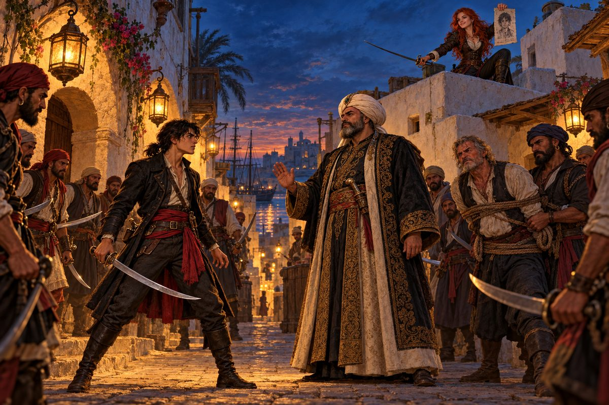

## 32. 새벽 두 시의 출항

바리엔테가 되어 돌아온 날, 본부 대청 앞에 파수꾼이 없었다. 문틈으로 목소리가 새어 나왔다.

"드디어 다음 차례요, 형님?"

"준비에 시간이 더 걸리겠지만, 방해자도 없어졌으니 남은 건 본거지를 치는 것뿐이다. 이번에야말로 샤르크의 숨통을 끊겠다."

"선봉은 어떻게 하실 거요? 살바도르와 조커가 요즘 실적을 올리고 있는데."

"살바도르에게는 다른 일이 있다. 함부르크에 그 물건을 전해야 해. 샤르크전에는 조커를 쓰겠다."

살바도르는 주먹을 쥐었다. 바리엔테가 되었는데도 배달부였다. 그는 등을 돌려 숙소로 걸어가며 낮게 말했다. 선수를 친다. 조커보다 먼저 샤르크를 친다.

대기 명령이 내려진 본부를 빠져나가는 일은 쉽지 않았다. 호레스는 한숨을 쉬면서도 결국 알려 주었다. 이곳 파수꾼은 밤 두 시부터 네 시까지 느슨해진다고. 리오노는 샤르크가 키프로스 섬 니코시아 항구 근처에 자주 나타난다고 귀띔했다.

새벽 두 시, 가나돌은 불을 끈 채 알제 항구를 빠져나갔다.

키프로스 앞바다에서 그들은 샤르크의 함대를 찾아냈다. 그러나 함대 한가운데 휘날리는 깃발을 보고 리오노의 얼굴이 하얘졌다. 초승달. 오스만 함대였다. 우르그와 함께 무너졌어야 할 그 원군이 샤르크 곁에 버티고 있었다. 살바도르는 돌입하자고 고집했고, 포탄이 가나돌의 뱃전을 때리기 시작하자 호레스가 그의 팔을 붙잡았다. 여기서 죽으면 모든 게 헛수고가 됩니다.

"……알겠다. 퇴각한다."

본부로는 돌아갈 수 없었다. 샤르크는 쓰러뜨릴 수 없었다. 갈 곳이 없었다. 여관 방에서 머리를 감싸 쥔 살바도르에게 호레스가 말했다.

"함부르크에 가 보시는 건 어떻습니까? 월프 박사라는 전술가가 있는데, 대포 연구로 이름난 사람입니다. 그 사람이라면 샤르크 함대에 맞설 대포를 만들 수 있을지도 모릅니다."

함부르크의 월프 박사는 백발에 안경을 쓴 깡마른 노인이었다. 그는 살바도르의 부탁을 듣고 쓴웃음을 지었다. 자네도 신형 대포를 원하는군. 예전부터 알제의 해적왕에게 의뢰를 받았지만 개발이 막혀 있다고. 성능 좋은 화약이 없다고. 예전에 들여온 물건은 동방에서 왔다고 들었다고.

세우타의 안나가 단서를 주었다. 포르투갈 선원에게서 들었다며, 아프리카보다 인도보다 먼 항구에 대포용 특별한 화약이 있다고. 그 항구에서는 이런 것도 판다며 그녀는 선물로 받았다는 비단 숄을 펼쳐 보였다. 그리고 문간에서 덧붙였다. 아, 그 항구는 건물이 전부 붉게 칠해져 있대요.

## 33. 동쪽 끝의 화약

긴 항해였다. 아프리카를 돌고, 인도양을 건너고, 낯선 별자리 아래를 지났다. 그 사이 한 번은 잉글랜드 함대에 포위되기도 했다. 기함에서 들려온 목소리는 정중하고 단단했다. 해적 행위 보고를 많이 받았다고, 무장을 풀고 대기하라고. 호레스가 그 깃발을 알아보았다. 얼마 전 에스파냐의 무적함대를 꺾은 옷토 스피노라였다. 신형 대포 없이는 무리라는 호레스의 말에 살바도르는 처음으로 싸우지 않고 달아났다.

명나라의 항구 관리는 외국인 입항은 금지라고 말하고는 곧장 밤에는 괜찮다고 덧붙였다. 어느 항구에서 한 노파가 살바도르의 소매를 붙잡았다.

"아이고, 가스팔 님! 아들이 신세를 많이 졌는데……."

"할머니, 사람을 잘못 봤소. 나는 가스팔이 아니오."

노파는 남만에서 온 사람이라기에 그만 착각했다며 사과했다. 가스팔이라는 사람이 관리에게 붙잡혀 죽을 뻔한 자기 아들을 구해 주었다고. 부끄럽지만 아들은 해적이라고, 명나라 제일의 해적이 되겠다며 여기저기 휘젓고 다닌다고. 이런 곳에도 우리 같은 녀석이 있군, 하고 살바도르는 웃었다. 화약에 대해 묻자 노파는 아들이라면 알지도 모른다고 했다. 지금은 열이 식을 때까지 가스팔 님과 함께 일본에 있다고.

사카이의 가스팔 피렐리는 유럽 사람을 오랜만에 본다며 그들을 끌어안을 기세로 반겼다. 곁에는 일본인 부하 시오미 후우기치와, 수염이 덥수룩한 사내 유괴성이 있었다. 대명국 제일의 대해적이라고 그는 스스로를 소개했다.

가스팔은 자기 사연이 길다고 했다. 정말 길어지는데 괜찮으냐고. 간단히 부탁한다는 살바도르의 말에도 그는 삼 년 육 개월 전 고아 항구를 떠나던 날의 하늘색부터 이야기를 시작했다. 호레스는 졸았고, 리오노는 코를 골았다. 결국 유괴성이 한 줄로 정리했다. 이 자의 함대가 태풍으로 전멸해서 혼자 일본에 표착했다는 이야기라고.

화약이라면 왕수신이 가지고 있을 거라고 그들은 말했다. 해적을 원수로 여기는 관리, 무기 수집이 취미인 자. 가스팔은 무언가 재미있는 생각이 난 얼굴로 장안 가는 길을 알려 주었다.

장안 거리에서 살바도르는 병사들에게 붙잡혔다. 왕수신은 그를 보더니 또 남만인이냐며 혀를 찼다. 금괴 백 개를 내면 성의를 알아주겠다고. 살바도르는 그 얼굴에 침을 뱉고 싶었다. 장난하지 마라, 그런 돈을 낼까 보냐. 왕수신은 웃으며 손을 저었다. 황하에 던져 물고기 밥으로 만들어라.

밧줄에 묶여 강가로 끌려가던 밤, 어둠 속에서 복면을 쓴 자들이 병사들을 덮쳤다. 그 사람들은 우리가 데려가겠다! 살바도르와 호레스는 그 틈에 배로 달렸다. 왕수신의 함대가 뒤를 쫓아왔고, 살바도르는 이번에는 돌아서서 싸웠다. 함대를 꺾고 기함을 뒤졌지만 화약은 없었다. 흔해 빠진 물건과, 커다란 청룡언월도 한 자루뿐이었다.

그때 작은 배 한 척이 다가왔다. 가스팔이 손을 흔들고 있었다.

"무사한가? 왕수신이 집을 비우고 출격한 덕에 우리가 마음껏 털 수 있었지. 녀석, 많이도 쌓아 놨더군!"

"너희들, 우리를 미끼로 썼구나!"

"그렇게 화내지 말게. 자네가 찾는 물건도 찾았으니." 가스팔이 작은 상자 하나를 던졌다. "딱 한 상자지만 최고의 화약이네."

"일단 고맙다고는 하겠다. 하지만 다음에 또 나를 이용하면 가만두지 않는다."

"하하, 미안하네. 목숨은 소중히 하게."

---

함부르크로 돌아오는 길에 그들은 이상한 소문을 들었다. 니코시아의 용왕 샤르크가 주변 주민들에게 인기가 높다고. 그 사람 덕분에 요즘은 소란이 일어나지 않는다고, 꼭 인사를 드리고 싶다고 항구 관리가 말했다. 해적에게 인사라니. 살바도르는 그 말이 오래 마음에 걸렸다.

월프 박사는 화약 상자를 열어 보고 눈을 반짝였다. 한 달 뒤, 그는 가나돌의 뱃전에 새 대포를 얹었다. 캐논포를 바탕으로 사정거리를 늘린 중캐논포였다.

알제에서 하이레딘은 아들이 사라졌던 일을 묻지 않았다. 다만 신형 대포를 보고 고개를 한 번 끄덕였을 뿐이었다.

## 34. 니코시아

"샤르크가 오스만과 정식으로 손을 잡았다. 본진이 움직이기 전에 친다."

오즈월드의 설명은 짧았다. 살바도르가 먼저 니코시아에 숨어 들어가 도시 곳곳에 불을 지른다. 불길이 오르면 바다에서 대기하던 토고와 조커의 함대가 정박 중인 샤르크 함대를 포격한다. 살바도르가 빠져나오면 세 함대가 합류해 끝장을 낸다.

"이번 싸움은 바리엔테만으로 치른다. 자부심을 가져라. 실패는 용서치 않는다."

니코시아는 생각보다 평화로운 항구였다. 아이들이 부두에서 낚시를 했고, 시장에는 올리브와 무화과가 쌓여 있었다. 호레스는 조선소 쪽을 살피러 가고, 리오노는 인적 드문 곳을 찾으러 갔다. 그런데 호레스가 약속한 곳에 나타나지 않았다.

그를 찾아 골목을 헤매던 중이었다. 낯선 사내들이 그들을 둘러쌌다. 못 보던 얼굴인데. 너희, 이곳 사람이 아니로군.

"리오노, 너는 먼저 호레스를 찾아 출항소로 가라."

"제독 혼자서 저 녀석들을……."

"가라!"

리오노가 달려갔다. 살바도르는 칼을 뽑았다. 하나를 쓰러뜨리고, 둘을 쓰러뜨렸다. 다음은 누구냐고 외쳤을 때, 골목 끝에서 굵은 목소리가 울렸다. 잠깐!

사내들이 일제히 물러섰다. 샤르크 님! 골목 끝에 체격이 큰 중년의 사내가 서 있었다. 터번 아래로 은빛이 섞인 수염이 흘러내렸다. 그 곁에서 한 사내가 밧줄에 묶인 채 끌려 나왔다. 호레스였다.

"검을 거두고 물러가라. 손님에게 실례다." 샤르크가 부하들에게 말하고 살바도르를 보았다. "나는 마지막으로 이야기를 하러 왔다."

"인질을 잡아 놓고 이야기라고!"

"하이레딘에 비하면 꽤 정중한 편이다. 나도 이런 짓은 하고 싶지 않았지만, 보낸 사자들이 전부 죽어 돌아오니 거친 수단을 쓸 수밖에 없었지."

"사자가 죽었다고? 무슨 소리지?"

"자네는 아무것도 모르는군. 호레스, 이 젊은이는 누구인가?"

"나는 살바도르 레이스. 하이레딘의 아들이다."

샤르크의 눈이 조금 커졌다. 그리고 천천히 말했다. 오스만 황제가 바다에 사는 자들의 힘을 원한다고. 그들과 손잡으면 작은 배나 쫓아다닐 필요가 없다고. 해적끼리 으르렁대는 시대는 끝났다고. 하이레딘에게 전하라고. 예전처럼 손을 잡자고.

"……예전처럼?"

그때 여자 목소리가 끼어들었다. 샤르크의 등 뒤, 지붕 위에 붉은 머리의 여자가 종이 한 장을 펄럭이고 있었다.

"마호멧 샤르크, 통칭 니코시아의 용왕. 오스만과 동맹을 맺고 세력을 키우는 중. 현상금 백이십만, 생사 불문." 레베카 커트랜드였다. "당신은 곧 백이십만 닢이 될 거거든요. 방해하지 말아요, 해적 씨. 이자는 내 수확물이니까!"

골목이 아수라장이 되었다. 그 혼란 속에서 호레스가 스스로 밧줄을 끊었다. 살바도르는 그의 팔을 끌고 달렸다. 등 뒤에서 샤르크가 외쳤다. 기억해 둬라, 살바도르!

---

가나돌이 니코시아 항구를 빠져나왔을 때, 바다에는 불길이 없었다. 토고와 조커의 함대도 없었다. 대신 바다 위에 부서진 널빤지와 찢어진 돛이 떠다니고 있었다.

샤르크의 함대가 앞을 막았다.

"찾아도 소용없다, 살바도르. 그들은 이미 이 세상에 없다. 자네 동료가 원군을 부르러 갔던데, 우리 이야기에 방해가 될 것 같아서 부하들을 시켰지."

리오노가. 나 때문에. 살바도르의 손이 떨렸다.

"유감이군. 방침을 바꾸겠다. 에스멜다의 아들을 죽이게 될 줄이야."

"기다려라. 예전처럼 아버지와 손을 잡는다고 했지? 그건 대체……."

"거역하는 자에게는 죽음뿐. 원래 하이레딘의 말이다."

포성이 터졌다. 살바도르는 처음으로 중캐논포를 쏘았다. 먼 거리에서 날아간 포탄이 샤르크 함대의 돛대를 하나씩 꺾었다. 바다가 끓었다. 살바도르는 아무것도 생각하지 않았다. 생각하면 무너질 것 같았다. 기함끼리 맞붙었을 때, 샤르크는 갑판 위에서 그를 기다리고 있었다.

칼이 부딪쳤다. 샤르크의 칼은 무겁고 정직했다. 마지막 합에서 살바도르의 칼이 그의 가슴을 베었다. 샤르크가 무릎을 꿇었다. 그리고 웃었다.

"과연…… 자네는 어머니의 피는 이어받지 않았군."

"어머니? 내 어머니라고?"

샤르크의 눈이 살바도르 너머의 호레스를 향했다.

"호레스, 네가 곁에 있으면서…… 이 아이에게 하이레딘과 같은 길을 걷게 할 작정이냐."

그리고 하늘을 보았다.

"하이레딘…… 내가 졌다. 원하는 대로, 피로 물든 역사를 되풀이해라……."

## 35. 에스멜다

"어떻게 된 거지, 호레스! 샤르크는 우리 숙적이 아니었나? 왜 그자가 너를 알지? 나조차 모르는 어머니를, 왜 그자가 알고 있느냐고!"

호레스는 오래 갑판을 내려다보았다. 그리고 입을 열었다.

"지금까지 도련님께는 알리지 않는 편이 좋다고 생각했습니다. 그게 도련님을 위하는 거라고. 하지만 아무 말도 하지 않아서 도련님을 이렇게 만든 건지도 모르겠군요."

---

이십 년 가까이 전의 알제였다. 본부 마당에서 잡부 호세가 빗자루질을 하고 있었다. 담력이 없어 싸움은 못 하니 청소라도 잘해야 한다고 그는 웃었다. 에스멜다는 그런 그에게 담력이 없는 게 아니라 마음이 고운 거라고 말해 주었다. 해적에게 고운 마음은 쓸데없다고 호세는 머리를 긁적였다.

에스멜다는 두목의 여인이었다. 바닷바람에도 꺾이지 않는 꽃 같은 사람이었다고 호레스는 말했다. 본부의 거친 사내들도 그녀 앞에서는 모자를 벗었다.

그날 두목이 돌아와 부하들을 모아 놓고 말했다. 이 가운데 배신자가 있다고. 하급 해적 벳키오가 끌려 나왔다. 아내가 병들어 돈을 조금 빼돌렸다고, 돌려드리겠다고, 제가 죽으면 아내를 돌볼 사람이 없다고 그는 울며 빌었다. 호세가 나서서 두둔하다 호통을 들었다. 그때 두목 곁에 섰던 사내가 말했다. 이제 됐지 않으냐, 하이레딘. 언제까지 이런 일을 되풀이할 셈이냐. 여기 있는 건 함께 살아갈 동료다. 그 사내가 샤르크였다. 당시 두목의 맹우였던.

두목은 칼을 내리쳤다.

그날 밤 에스멜다는 본부에서 사라졌다. 호세가 그녀를 데리고 도망친 것이다. 두목은 끈질기게 두 사람을 쫓아 그녀가 숨은 마을을 찾아냈다. 그리고 바리엔테들을 이끌고 마을을 습격했다. 그녀를 숨겨 준 사람들 모두를, 마을 전체를 불태웠다. 함께 끌려갔던 샤르크는 그 일을 계기로 두목 곁을 떠났다.

돌아온 두목의 품에는 갓난아기 하나가 안겨 있었다.

---

"그게 도련님입니다. 누님과 호세가 어떻게 되었는지는 모릅니다. 아마 두 사람도……."

살바도르는 아무 말도 하지 않았다. 바다는 고요했다. 니코시아의 불타지 않은 지붕들이 멀리 보였다. 그는 오래 그것을 보다가 말했다.

"……그런가."

## 36. 배 밑바닥에서

리오노는 갑판 구석에서 무릎을 끌어안고 있었다. 자기가 원군을 부르러 가지 않았다면 토고와 조커는 죽지 않았을 거라고. 보좌를 그만두겠다고. 살바도르는 고개를 저었다. 내가 붙잡혔기 때문이다. 내 책임이다. 보고는 내가 하겠다. 너희는 절대 끼어들지 마라. 아버지에게 묻고 싶은 것도 있다.

본부 대청에서 하이레딘은 아들을 맞았다. 샤르크를 쓰러뜨렸다니 수고했다고. 이제 알제 해적의 천하라고. 그런데 왜 그런 얼굴이냐고. 토고와 조커는 어떻게 되었느냐고.

"그게……."

"얼간이 탓에 샤르크한테 전멸당했다고 말할 셈이냐!"

문이 부서질 듯 열렸다. 조커였다. 팔에 붕대를 감고, 얼굴에 그을음을 묻힌 채. 살아 있었나! 하고 살바도르가 외치는 순간 조커의 주먹이 그의 턱을 쳤다.

"방해하지 말라고 했지. 바리엔테에게 실패는 허락되지 않는다. 내가 무슨 꼴을 당했는지 지금 똑똑히 알게 해 주마."

조커가 칼을 뽑았다. 그때 검은수염이 그 앞을 막았다. 그쯤 해 둬라. 아니면 네 목이 날아간다. 조커는 두목이 실패한 자는 아들이라도 용서치 않는다고 했다며 이를 갈았다. 형님께는 내가 말하겠다, 너는 잠자코 있어라. 그때 조커의 부하가 들어와 보고했다. 남은 두 사람을 명령대로 처리했습니다. 조커가 칼을 거두었다. 부두목, 살바도르는 당신에게 맡기겠소. 하지만 부하들은 내 마음대로 하게 해 주시오. 그놈 실수 때문에 토고가…….

리오노……. 살바도르의 의식이 거기서 끊어졌다.

---

눈을 뜨자 어둠 속에서 나무 삐걱이는 소리가 들렸다. 팔이 아팠다. 배였다. 트레볼의 목소리가 위에서 들려왔다. 너도 악운이 강하구나. 이 일이 끝나면 네 배를 끌고 본부로 돌아갈 테니, 목숨이 붙어 있으면 또 보자.

밤이 깊었을 때 누군가 파수꾼을 쓰러뜨리고 내려왔다. 호레스였다. 그는 스스로 밧줄을 끊고 도망쳐 나왔다고 했다. 여기는 전선으로 향하는 배의 밑바닥이라고. 이대로 있으면 장비도 배도 없이 최전선에 버려질 거라고.

"미안하다, 호레스. 너까지 이런 일을……."

"무슨 말씀을. 두목께서 도련님 신변을 맡기셨는걸요. 잘못하면 알제에 돌아가 야단맞습니다."

"리오노는? 리오노는 어떻게 됐지?"

호레스는 눈을 내리깔았다. 두목이 데려갔다고.

갑판으로 올라가는 계단 끝에 고스가 서 있었다. 하이레딘의 오랜 부하, 알제 본부에서 살바도르에게 장난도 정도껏 하라고 혀를 차던 그 사내였다.

"돌아가라, 살바도르. 실패한 자에게 용서는 없다. 그게 우리 방식이다."

"고스, 리오노는 어떻게 했지?"

"녀석 탓에 두 함대가 전멸했고, 위대한 바리엔테 토고가 죽었다. 리오노는 두목이 직접 처분했다. 당연한 결과다."

"……잘도, 내 동료를!"

살바도르는 맨손으로 덤볐다. 고스의 칼을 피하고, 그 팔을 꺾고, 칼을 빼앗았다. 고스는 제법이라며 웃었다. 이번엔 봐주지 않겠다고. 두 번째 합에서 살바도르의 칼이 고스의 가슴을 꿰뚫었다. 그는 자기가 무엇을 했는지 한참 뒤에야 알았다. 계단 위에서 트레볼의 비명이 들렸다. 살바도르가 고스를 죽였다! 놓치지 마라!

"제독, 이쪽에 보트가 있습니다! 빨리!"

작은 배는 밤바다로 미끄러졌다. 트레볼의 배가 포를 쏘았고, 돛대 하나가 부러졌다. 그래도 그들은 살아남았다. 며칠을 표류한 끝에 그들은 이름 모를 작은 섬의 모래톱에 닿았다. 북위 십 도, 서경 육십사 도 근처였다는 것은 나중에 알았다.

연기를 피워 올린 지 사흘째 되는 날, 낡은 라티나 배 한 척이 다가왔다. 뱃전에 밤색 머리의 소녀가 서 있었다.

"이봐요! 거기 누구 있어요?"

살바도르는 그 목소리를 알았다. 나폴리 항구에서 부딪친 그 소녀였다. 그는 이번에는 굳지 않았다. 굳을 힘조차 남아 있지 않았다. 그는 그녀에게 처음으로 부탁을 했다. 알제까지 데려다 달라고. 꼭 가서 확인해야 할 일이 있다고.

---

알제 본부는 텅 비어 있었다. 파수꾼도, 간부도, 하이레딘도 없었다. 바닷바람만이 빈 대청을 지나갔다.

항구에서 그들은 트레볼을 찾아냈다. 운송을 마치고 돌아온 그가 살바도르의 가나돌을 정박시키고 있었다. 살바도르는 칼을 뽑았다. 배를 돌려받겠다. 트레볼은 해적이라면 완력으로 빼앗아 보라며 덤볐고, 세 번째 합에서 칼을 떨어뜨렸다.

"하이레딘은 어디 있지?"

"정말 모른다! 두목은 갑옷을 찾으러 갔다. 전설의 갑옷이라던가. 알제를 비워 두고까지 찾으러 간 보물이다. 어딘지는 나도 모른다."

갑옷. 살바도르는 그 말을 곱씹었다. 아버지는 무엇을 찾고 있는가. 무엇을 위해 어머니를 쫓고, 마을을 태우고, 리오노를 죽였는가. 그는 알아야 했다.
