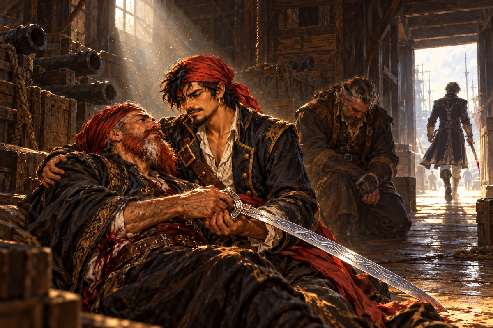

## 37. 최후의 보물

"그 아가씨가 말했잖습니까. 나폴리에 세상의 희귀한 물건을 모으는 박식한 교수가 있다고."

호레스의 말에 그들은 나폴리로 향했다. 줄리아노 교수의 집 문을 열자 매캐한 냄새가 코를 찔렀다. 머리가 새 둥지 같은 노인이 냄비를 휘저으며 소리치고 있었다.

"늦다! 밀란다는 뭘 하는 게야! 피멘트가 있어야 완성인데!"

전설의 갑옷 이야기를 꺼내자 교수의 손이 멈추었다. 그는 처음으로 진지한 얼굴을 했다.

"태곳적부터 힘을 원하는 자들이 서로 차지하려 했던 갑옷이지. 그걸 둘러싸고 많은 피가 흘렀네. 지금은 어딘가의 땅에 봉인되어 있다더군. 찾으려면 두 가지 보물이 필요하네. 악룡의 비늘과 요정의 눈물. 비늘이 있는 항구를 표시한 지도라면 내게 있지."

교수는 그 지도를 돈으로는 넘길 수 없다고 했다. 대신 지금껏 아무도 보지 못한 최후의 보물을 찾아오면 넘기겠다고.

세우타의 안나가 서아프리카 비사우의 술집에서 그런 지도를 가진 사람을 보았다는 선원의 이야기를 들려주었다. 비사우에서 그들은 소팔라 근처 큰 섬 주변의 무인도를 가리키는 낡은 지도를 손에 넣었다. 그 섬의 숲에서 살바도르는 이상한 새를 보았다. 칠면조보다 크고 뚱뚱한 몸에, 굽은 부리를 달고, 날개는 손바닥만 해서 날지 못하는 새였다. 그 새는 사람을 무서워하지 않고 뒤뚱뒤뚱 다가와 살바도르의 장화를 쪼았다. 교수는 그 새를 보고 감격해 눈물을 흘리며 비늘의 지도와 금화 일만 오천 닢을 내주었다.

나폴리 부두에서 그들을 기다리는 사람이 있었다. 검은 수염을 가슴까지 기른 사내였다.

"찾았다, 반역자 놈."

"숙부님……."

"그때 불쌍히 여겨 살려 둔 게 실수였구나. 전선으로 가던 배에서 고스를 죽이고 달아나, 트레볼에게서 배를 빼앗다니. 훌륭한 해적 흉내를 내는군. 배신자는 살려 둘 수 없다. 바리엔테의 긍지를 걸고 너를 묻어 주마."

"나는 그저……."

숙부의 칼은 아버지의 칼과 닮아 있었다. 무겁고, 망설임이 없었다. 살바도르는 세 번 밀렸다. 네 번째에 그는 칼날 아래로 파고들었다. 숙부가 무릎을 꿇었다. 부두의 돌바닥에 피가 번졌다. 숙부는 고개를 들고, 이상하게도 웃었다.

"……형님과 똑같구나. 이걸로 너도, 참…… 알제 해적이 되었군……."

살바도르는 그 말을 오래 잊지 못했다.

## 38. 비늘과 눈물

비늘의 지도에 그려진 해안선은 지중해의 것이 아니었다. 깊고 좁은 만이 톱니처럼 들쑥날쑥한, 북유럽의 피오르였다. 베르겐의 여관 여주인이 실마리를 쥐고 있었다. 요정의 눈물이라는 보석을 대대로 맡아 왔는데 오래전 도둑맞았다고. 그런데 함께 맡았던 붉은 돌은 아직 있다고. 둘 다 아주 옛날 북쪽에서 흘러온 표류자가 맡긴 물건이라고. 증조할머니 때부터 찾으러 오기만 기다렸다고. 그녀는 살바도르의 눈을 오래 들여다보더니 그 돌을 내주었다. 손바닥만 한, 비늘 모양의 붉은 돌이었다.

요정의 눈물은 교수의 전문 밖이었다. 교수는 보르도의 몰데스에게 부탁해 두었다고 했다. 몰데스 교수는 그 갑옷을 알고 있었다. 신의 가호가 있다는 갑옷. 북방의 해적왕이 새로운 땅을 치러 갈 때 입었다는. 요정의 눈물은 지금 잉글랜드 함대를 이끄는 길버트 경이 가지고 있다고.

"수확물이 바다 위에 있다면 받은 거나 다름없지."

잉글랜드 함대의 기함에서 에드먼드 길버트 남작이 칼을 휘두르며 외쳤다. 공해를 어지럽히는 괘씸한 해적, 내가 퇴치해 주마! 옷토, 잘 봐라, 내가 잉글랜드 제일의 사령관임을 증명하겠다! 중캐논포가 세 번 울리자 남작의 기함은 돛을 내렸다. 왜 내가 이런 꼴을, 하고 중얼거리는 남작의 품에서 물방울 모양의 푸른 보석이 나왔다.

몰데스 교수는 요정의 눈물을 통해 악룡의 비늘을 들여다보라고 했다. 살바도르가 푸른 보석을 눈에 대고 붉은 돌을 비추자, 돌의 결 속에서 가느다란 선들이 떠올랐다. 해안선, 강, 그리고 작은 표식 하나. 호레스가 서둘러 그것을 종이에 옮겨 그렸다.

부두로 나서던 길에 한 사내가 호레스와 부딪쳤다. 죄송합니다, 앞을 안 보고 걸어서. 사내는 허둥지둥 사라졌다. 그리고 몇 걸음 뒤, 호레스가 비명을 질렀다. 비늘과 눈물이 없어졌다고.

항구 관리인이 말했다. 방금 배 한 척이 출항했다고. 알제 해적이었다고.

"역시 아버지가 걸려들었군. 우리에겐 옮겨 그린 지도가 있다. 갑옷이 있는 곳에 하이레딘이 나타날 거다. 호레스, 출항이다!"

## 39. 갚지 못한 빚

지도가 가리킨 해안에 내렸을 때, 바위 위에 붉은 머리의 여자가 앉아 있었다.

"그 사람 말대로 역시 여기 왔군요. 우리 꽤 인연이 있네요, 해적 씨."

"니코시아에서 만났지. 그때는 도와줘서 고마웠다."

"도와줘요? 그 섬은 최악이었어요. 모처럼 잘 숨어들었는데 당신이 소란을 피워서 다 엉망이 됐어요. 현상금도 날아갔고요." 레베카가 바위에서 뛰어내렸다. "요즘 꽤 요란하게 날뛰었더군요. 여기저기 당신한테 현상금이 걸렸어요. 얌전히 따라오면 목숨만은 살려 줄게요."

"그 사람이라고 했지. 내가 여기 올 걸 누구한테 들었지?"

"그런 게 무슨 상관이에요? 갚으려면 지금 갚으세요!"

그녀의 찌르기는 바늘처럼 빨랐다. 살바도르의 소매가 찢기고, 뺨에 붉은 줄이 그어졌다. 그러나 그는 물러서지 않았다. 일곱 번째 찌르기가 빗나간 순간, 그의 칼등이 그녀의 손목을 쳤다. 레베카의 칼이 모래에 박혔다. 그녀는 숨을 몰아쉬며 그를 노려보았다. 내가 찌르기에서 지다니. 어디 마음대로 해 봐요, 돈은 없으니까.

"미안하지만 너를 상대할 시간이 없다." 살바도르가 칼을 거두었다. "빚이라면 나중에 갚겠다."

그가 떠난 뒤, 레베카는 오래 그 뒷모습을 보았다. 빚은 나중에 갚겠다? 그리고 자기 지갑을 열어 보고 비명을 질렀다. 이걸로 갚을 돈이 없어졌잖아요…….

---

바다로 나서자 수평선이 함대로 메워져 있었다. 잉글랜드 함대였다. 기함의 뱃머리에 은빛 머리의 사내가 서 있었다.

"또 만나서 영광이다, 살바도르. 자네 소문은 들었네. 샤르크를 무너뜨리고 하이레딘을 적으로 돌렸다지. 다시 싸울 날을 기다렸네."

"옷토 스피노라……."

"지금은 알제 해적을 쫓는 중이다. 당신과 이러고 있을 여유가 없다."

살바도르는 잉글랜드 함대 사이를 뚫고 알제 해적의 배를 쫓았다. 옷토는 추격하지 않았다. 부관 마슈가 이제부터가 승부인데 왜 돌아가느냐고 묻자, 그는 저 자는 우리를 적대할 생각이 없다고 했다. 그보다 신대륙에서 올라온 보고가 걱정이라고. 언젠가 또 싸우게 되겠지, 하고 그는 웃었다.

그다음은 에스파냐와 포르투갈의 연합 함대였다. 기함에 선 사람은 둘이었다. 여해적 카탈리나 에란쪼, 그리고 리스본의 조안 페레로. 그 사람 말대로 저들이 알제 최강의 해적이라고 조안이 말했다. 그러나 그는 고개를 갸웃했다. 저 해적이 정말 우리의 적일까. 샤르크를 무너뜨리고 하이레딘에게 등을 돌렸다면 무언가 이유가 있을 거라고.

살바도르는 돛대 꼭대기에 신호기를 올리라고 명했다. 언젠가 카탈리나에게서 받았던 그 신호였다.

귀선과 싸울 뜻 없음. 행운을 빈다.

연합 함대의 기함 위에서 카탈리나가 웃음을 터뜨렸다. 아무래도 당신 말대로 저 해적은 적이 아닌가 봐요, 조안. 우리도 돌아가요. 저 해적보다 신대륙 사정이 더 걱정이에요. 제2의 신성 왕국이 생기지 않아야 할 텐데.

살바도르는 그 말을 듣지 못했다. 다만 가는 곳마다 누군가 그의 앞길을 미리 알고 있다는 것만은 분명했다.

## 40. 리오노

지도의 표식은 바닷가 절벽 아래의 오래된 석실이었다. 석실 안에 누군가 서 있었다. 살바도르는 걸음을 멈추었다.

"오랜만이군, 영감."

"리오노! 살아 있었나!"

"뭐야, 영감. 오늘은 영감이라고 해도 화 안 내나?"

호레스의 목소리가 떨렸다. 리오노는 웃었다. 재회 인사는 이쯤 하자고. 이야기가 길어지면 침울해진다고. 그리고 칼을 뽑았다.

"나쁘게 생각하지 마라, 제독. 당신이 잘못한 거다. 두목을 거역했으니."

"두목……? 설마, 네가……."

"두목은 나를 거두어 주었다. 에스파냐 놈들한테 땅을 빼앗겨 갈 곳 없던 나를. 그리고 니코시아에서 실수한 나를 그래도 필요로 해 주었다. 그래서 나는 당신을 막아야 한다."

"그만둬, 리오노! 왜 우리가 싸워야 하지!"

리오노는 대답 대신 칼을 내질렀다. 살바도르는 막기만 했다. 칼끝을 흘리고, 비켜서고, 또 막았다. 마지막에 그는 리오노의 칼을 쳐 떨어뜨리고 칼끝을 그의 목 앞에서 멈추었다.

리오노가 혀를 찼다.

"제대로 하지 않았군. 제대로 했다면 나를 죽였을 텐데. 제독은 마무리가 허술해서 안 돼."

그는 석실 안쪽을 턱으로 가리켰다. 거기, 바위 받침 위에 은회색 갑옷 한 벌이 놓여 있었다. 빛이 닿자 물결 같은 무늬가 표면을 흘렀다.

"두목의 목적은 갑옷이 아니다. 그건 하나의 표식일 뿐이지. 진짜 목표는 그와상을 완성하는 거다."

"그와상?"

"하이레딘이 그걸로 무엇을 하려는지는 나도 모른다. 직접 확인해라. 나머지는 함부르크에 다 모여 있을 거다."

리오노는 떨어진 칼을 주워 들었다. 그리고 돌아서며 말했다. 나는 당신을 떠나겠소. 그의 발소리가 석실 밖 파도 소리에 섞여 사라졌다.

살바도르는 갑옷을 들어 올렸다. 놀랄 만큼 가벼웠다. 로키의 갑옷. 받침돌에 새겨진 이름이었다.

## 41. 아버지

함부르크 항구는 이상하게 조용했다. 해적들이 이 근처에 모여 있다는 소문 때문에 상선들이 발길을 끊었다고 했다. 항구 관리인은 살바도르를 보자 얼굴이 하얘져 중얼거렸다. 카, 카차스 디아블로……. 그리고 아무것도 아니라며 고개를 숙였다. 어느새 그의 이름 뒤에는 악마살인이라는 별명이 붙어 다니고 있었다.

월프 박사의 연구소 뒤편 창고에서 그는 아버지를 찾았다.

하이레딘은 혼자였다. 붉은 수염은 그새 반쯤 희어져 있었다. 그는 아들을 보고도 놀라지 않았다.

"왔느냐. 배신자가 무슨 볼일이지."

"확인하고 싶었다. 그래서 여기까지 왔다." 살바도르의 목소리는 떨리지 않았다. "처음 배를 받았을 때는 기뻤다. 당신 같은 해적이 되고 싶었다. 하지만 나는 아무것도 몰랐다. 당신은 가까운 사람들까지 배신자라며 처형했다. 화해를 청해 온 옛 맹우 샤르크도. 내 어머니 에스멜다조차 용서하지 않았다. 그리고 나를 없애려고 리오노까지 이용했다. 그게 당신의 방식인가."

"말 많은 어른이 되었군." 하이레딘이 천천히 일어섰다. "그러나 그것만으로는 우리 해적은 살아갈 수 없다. 너도 보았을 거다. 우리를 쓸어버리려고 나라들이 다시 움직이고 있다. 해적에게는 바다가 영토다. 그 바다를 빼앗으려는 자들이 있다. 나는 요새를 완성해야 한다. 그래서 수단을 가리지 않는다. 방해하는 자, 배신하는 자는 누구든 처형한다."

그는 칼을 뽑았다.

아버지의 칼은 숙부의 칼보다 무거웠고, 샤르크의 칼보다 빨랐다. 살바도르는 몇 번이고 밀려 벽에 등을 부딪쳤다. 하이레딘이 말했다. 제 역량도 모르고 싸움을 거니 이렇게 되는 거다, 그게 전장에서는 목숨을 재촉하지. 그러나 살바도르는 일어섰다. 다시, 또다시. 그리고 어느 순간, 아버지의 칼이 그의 칼에 막혀 멈추었다.

하이레딘의 눈에 무언가가 스쳤다. 자랑 같은 것이었다.

"……솜씨가 늘었구나, 살바도르."

"아…… 아버……."

"마지막이다, 하이레딘!"

등 뒤에서 그림자가 뛰어들었다. 칼날이 하이레딘의 등을 꿰뚫었다. 붉은 수염의 해적왕이 무릎을 꿇었다. 그 뒤에 조커 다 실버가 피 묻은 칼을 들고 서 있었다.

"조커! 지금까지 어디 숨어 있었지!"

"방해하는 자는 망설임 없이 처치한다. 그게 우리 해적의 방식 아니었나, 두목." 조커는 칼날의 피를 털었다. "수고했어. 그와상만 손에 넣으면 당신은 더 이상 쓸모없어. 힘 있는 자만 살아남는다. 당신이 좋아하던 말이지. 오늘부터 내가 해적왕이다. 요새는 내가 마음껏 써 주지. 나는 바다만으로 만족하는 시시한 놈이 아니거든."

그는 살바도르를 돌아보았다.

"유감이군, 살바도르. 너는 두목을 죽인 죄로 평생 알제 해적에게 쫓길 거다. 그동안의 정으로 지금은 못 본 척해 주지. 해적이라면 제 힘으로 살아남아라."

"기다려, 조커!"

조커는 이미 창고 밖으로 사라지고 있었다.

살바도르는 아버지를 끌어안았다. 하이레딘의 손이 떨리며 허리의 칼을 풀었다. 은회색 칼날에 물결 같은 무늬가 흐르는 칼이었다. 로키의 갑옷과 같은 무늬였다.

"이걸…… 가져가라. 그람이다. 조커는…… 저걸 쓸 생각이다. 놈들과 똑같은 짓을…… 하려고……."

"아버지! 정신 차려요!"

하이레딘의 손이 아들의 뺨에 닿았다. 그 손은 놀랄 만큼 따뜻했다.

"내…… 아들아……."

손이 떨어졌다. 살바도르는 아무 소리도 내지 못했다. 등 뒤에서 호레스가 무릎을 꿇었다. 도련님, 하고 아주 작게 불렀다. 살바도르는 그날 처음으로, 그 호칭을 고치라고 말하지 않았다.

## 42. 바다 주민의 영웅

알제 해적은 함부르크에서 자취를 감추었다. 그들이 어디로 갔는지 아는 사람은 없었다. 살바도르는 무작정 서쪽으로 향했다. 해적들이 신대륙에 모인다는 소문이 있었다.

카리브해를 떠도는 동안 그는 한 가지 빚을 갚았다. 카르타헤나 부두에서 콘키스타도르들에게 둘러싸였을 때, 그 제노바 소녀가 다시 그의 앞에 나타났다. 밀림 속 콘키스타도르의 탑을 무너뜨려 달라고. 그는 열흘 만에 그 탑을 무너뜨렸다. 피에트로라는 그 모험가가 함정의 위치를 미리 알아내 길을 열어 주었다. 리스본에서 이만 닢에 정보를 팔던 사내였다. 살바도르는 그와 말없이 술 한 잔을 나누었다. 그것으로 충분했다.

그러나 조커의 행방은 끝내 알 수 없었다. 단서는 뜻밖의 곳에서 왔다. 동방에서 행방불명되었다가 기적처럼 리스본으로 살아 돌아온 항해사가 있다는 소문이었다. 리스본 여관의 객실 문을 열자, 낯익은 얼굴이 웃고 있었다.

"역시 살바도르였군! 오랜만이네."

가스팔 피렐리였다. 장거리 항해가 되는 배를 어렵게 손에 넣어 마침내 고향에 돌아왔다고. 그는 이번에는 짧게 이야기했다.

"신대륙에 해적들이 모이고 있네. 원래 오스만 함대가 신대륙의 전설의 나라 유적에서 거대한 요새를 찾아냈지. 그런데 너무 커서 제 무게조차 견디지 못하는 구조물이라 쓸모가 없었네. 그걸 되살릴 단서를 니코시아 해적들이 북유럽에서 찾아냈어. 그와상이라는 금속이지."

"그와상……. 또 그 이름이군."

"자네가 가진 그람과 로키의 갑옷이 바로 그와상이네. 신의 가호가 있다는 금속. 강하면서도 놀랄 만큼 가볍지. 예부터 그와상을 쥔 자가 싸움을 결정지었다고 하네. 해적들은 그걸로 요새를 완성하려는 거야. 거점은 카옌이고, 함부르크의 대포 연구자도 그리로 끌려갔을 가능성이 크네."

월프 박사는 카옌의 한 창고에 갇혀 있었다. 조커 일당은 박사가 새 대포를 완성하자마자 서둘러 떠났다고 했다. 캐러네이드. 박사가 만든 대포 가운데 최고의 걸작이었다. 함부르크의 연구소로 돌아온 박사는 살바도르를 오래 바라보았다.

"자네에게 부탁하네. 신대륙의 요새를 무너뜨려 주게. 조커 다 실버가 해적들을 부추겨 전쟁을 시작하려 하네. 그자는 스스로 해적왕이라 하지만 하이레딘과는 달라. 조선소에 캐러네이드가 있으니 가져가게."

"고맙소, 박사."

"그러고 보니 아직 이름을 묻지 않았군."

"……살바도르 레이스."

"레이스…… 그럼 자네가 하이레딘의."

"하이레딘은 내 아버지였소."

박사는 안경을 벗어 닦았다. 그리고 말했다.

"그런가. 바다 주민들의 영웅의 아들이었군. 큰 나라들끼리의 싸움에 고향을 빼앗긴 사람들에게 살 곳은 바다밖에 없었네. 그 사람들이 살아갈 길을 열어 준 사람이 알제의 해적왕 하이레딘이었지. 나는 그를 위해 캐러네이드를 만들었네. 자네가 써 준다면 나도 기쁘겠네."

살바도르는 오래 대답하지 못했다. 아버지는 마을을 태운 사람이었다. 그리고 갈 곳 없는 사람들에게 바다를 열어 준 사람이었다. 둘 다 같은 사람이었다. 그는 그 두 얼굴을 모두 안고 바다로 나가야 했다.
