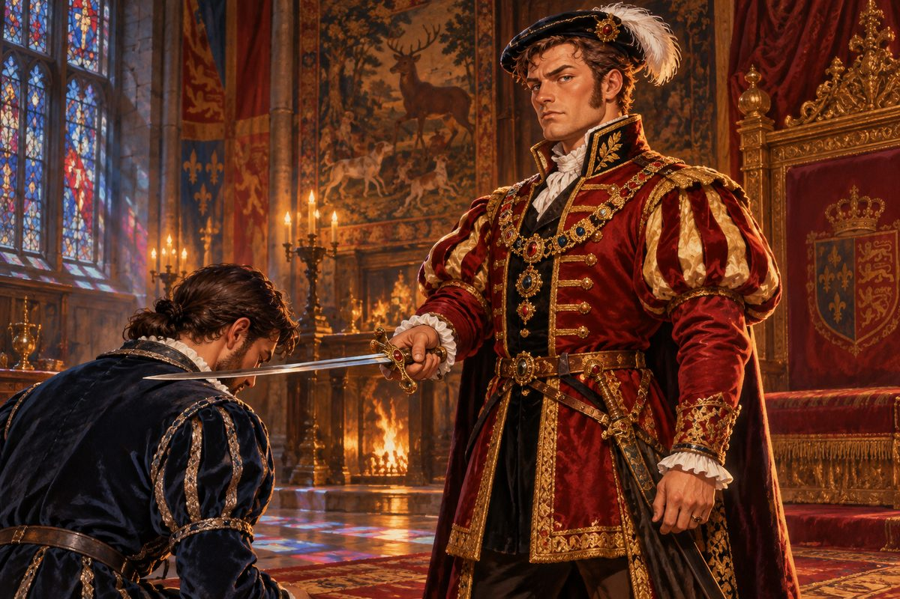

## 1. 알현실

알현실로 이어지는 회랑은 길고 서늘했다. 벽에 걸린 태피스트리 속에서 사냥꾼들이 사슴을 쫓았고, 창으로 들어온 빛이 바닥 돌판 위에 길쭉한 마름모를 그렸다. 시종 하나가 오토를 보자마자 종종걸음으로 다가왔다.

"폐하께서 기다리고 계십니다. 곧장 알현실로 드시지요."

그러나 알현실 문 앞에는 다른 사람이 먼저 서 있었다. 마른 몸에 모피 단을 두른 긴 겉옷, 가슴에 늘어뜨린 굵은 금사슬. 길버트 경은 오토를 보자마자 입꼬리를 아래로 끌어내렸다. 여관 주인의 말 그대로였다. 식초를 한 사발 들이켠 얼굴.

"이제야 오나! 폐하를 기다리시게 해 놓고 대체 어디서 늑장을 부린 겐가!"

목소리가 회랑의 둥근 천장에 부딪혀 울렸다. 오토는 걸음을 늦추지 않았다.

"송구합니다만, 길버트 경. 지금은 폐하께서 부르신 자리입니다. 경의 말씀은 알현을 마친 다음에 천천히 듣겠습니다."

길버트의 얼굴이 붉으락푸르락했다. 오토가 그를 지나쳐 문 앞에 서자 등 뒤에서 혀 차는 소리가 들렸다. 눈치라곤 없는 놈, 하는 중얼거림도 함께였다. 시종이 민망한 얼굴로 문을 열었다.

알현실은 따뜻했다. 벽난로에 장작이 타고 있었고, 높은 창의 색유리가 바닥에 붉고 푸른 얼룩을 떨어뜨렸다. 옥좌에 앉은 사내는 어깨가 넓었다. 서른 남짓의 나이, 붉은 기가 도는 수염을 짧게 다듬었고, 보석을 박은 더블릿 위로 소매가 풍성하게 부풀었다. 깃털 꽂은 납작한 모자 아래 눈이 날카로웠다. 헨리 8세였다.

오토는 한쪽 무릎을 꿇었다.

"왔구나. 그대를 부른 까닭은, 다른 이에게는 맡길 수 없는 일이 하나 있어서다."

"하명하십시오, 폐하."

"함대를 맡아 주었으면 한다."

오토는 고개를 들었다. 순간 자기가 잘못 들은 줄 알았다. 함대. 군대를 이끌어 본 적은 있어도, 함대는 이야기가 달랐다.

"함대라 하시면……."

"그래. 그대도 들어 알 것이다. 우리 잉글랜드의 바다를 넘보는 나라가 있다는 것을."

"에스파니아 말씀이십니까."

왕이 고개를 끄덕였다. 그는 옥좌의 팔걸이를 손가락으로 두드리며 말을 이었다. 에스파니아는 신대륙에서 끝도 없이 금을 퍼 오고 있었다. 그 금으로 배를 짓고, 군대를 사고, 유럽 왕실들의 혼사와 동맹을 사들였다. 그 끝에 무엇을 노리는지는 굳이 말할 필요도 없었다. 바다를 쥔 나라가 땅도 쥐게 된다는 것을, 이 방 안의 누구나 알았다.

"더는 눈감고 있을 수 없다. 왕국이 살아남으려면 강한 함대가 있어야 해. 그대가 그 일을 맡아 잘 해낸다면, 머지않아 그대를 왕실 해군의 총사령관 자리에 앉힐 생각이다."

오토는 숨을 삼켰다. 벽난로의 장작이 탁 하고 튀었다.

"다만 지금은 아직 이르다. 그러니 먼저 바다로 나가 실력을 길러 오라. 바람을 읽고, 배를 부리고, 적을 알아 오라."

"분에 넘치는 말씀이십니다, 폐하."

"그대에게 무기와 사략 허가서를 내리겠다. 잉글랜드의 이름으로 적국의 배를 칠 수 있는 권리다. 그리고 그대가 바다에서 움직이기 편하도록 작위를 주겠다." 왕이 일어섰다. 시종이 칼 한 자루를 받쳐 들고 다가왔다. 칼날이 오토의 오른쪽 어깨에, 다시 왼쪽 어깨에 가볍게 내려앉았다. "오늘부터 그대는 기사다. 온 나라에 그리 알리겠다."

차가운 쇠의 무게가 어깨 위에서 잠깐 머물렀다 떠났다. 오토는 그 무게를 오래 기억하게 될 것을 알았다.

"이 은혜, 반드시 갚겠습니다."

"모자란 것이 있거든 무엇이든 청하라. 자세한 일은 길버트 경이 챙길 것이다." 왕이 다시 옥좌에 앉으며 짧게 웃었다. "기대하겠다, 베인스 경."

"예!"

## 2. 금화 삼백 닢

알현실을 나오자 시종이 다시 오토를 붙잡았다.

"베인스 경, 감독관께서 집무실에서 뵙자고 하십니다."

경이라는 호칭이 귀에 설었다. 오토는 대답 대신 고개를 끄덕였다.

길버트의 집무실은 알현실보다 좁고 어두웠다. 창이 북쪽으로 나 있어서인지, 방 안 공기에서 오래 묵은 양피지와 밀랍 냄새가 났다. 길버트는 책상 뒤에 앉아 깃펜으로 무언가를 적고 있었다. 오토가 들어와도 고개를 들지 않았다. 한참 뒤에야 펜을 내려놓았다.

"부르셨습니까."

"배는 조선소에 주문해 두었네. 경에게는 과분할 정도로 훌륭한 배지." 길버트가 손가락 끝을 맞대었다. "그리고 쓸 만한 부하 하나를 붙여 주지. 항해사야. 물어볼 것 있나?"

"자금을 마련해 주십시오."

"자금?" 길버트가 눈썹을 치켜올렸다. 그는 서랍을 열고 작은 가죽 주머니 하나를 꺼내 책상 위에 던졌다. 쩔렁, 하고 가벼운 소리가 났다. "경은 유능한 사람이라 들었네. 금화 삼백 닢이면 넉넉하겠지."

오토는 주머니를 내려다보았다. 삼백 닢. 선원 몇 달 치 급료도 되지 않았다. 물과 식량, 대포알과 화약, 돛 천과 밧줄. 그것들을 다 사고 나면 남는 것은 빈 주머니뿐일 터였다.

"이것으로 무엇을 하라는 말씀입니까. 폐하께서는 필요한 것은 무엇이든 청하라 하셨습니다."

"불평은 그만두게!" 길버트가 책상을 내리쳤다. 깃펜이 굴러 바닥에 떨어졌다. "그거면 차고 넘쳐! 의회에서 한 푼 한 푼 따져 정한 돈일세. 기사 작위 하나 받았다고 벌써 사람이 이렇게 달라지나?"

의회가 따진 예산이 아니라는 것쯤은 오토도 알았다. 그러나 이 방에서 그것을 증명할 길은 없었다.

"받을 건가, 말 건가!"

오토는 주머니를 집어 들었다. 손바닥에 올려 보니 생각보다 더 가벼웠다.

"폐하께서 손수 고르신 사람이니, 어련히 큰일을 해내겠지?" 길버트가 웃었다. 입술만 움직이는 웃음이었다. "그럼, 분발해 주게. 기사 나리."

복도로 나온 오토는 한동안 벽에 기대어 섰다. 창밖으로 안개가 걷히고 있었다. 템스강 위로 햇빛이 비늘처럼 반짝였다.

질투, 하고 그는 생각했다. 왕이 총사령관이라는 말을 꺼냈을 때 문밖에서 그 말을 들은 사람이 있었을 것이다. 감독관 자리에 오래 앉아 있던 사람이라면, 갑자기 나타난 군인 하나가 언젠가 자기 머리 위로 올라설지 모른다는 생각에 잠을 설칠 만도 했다.

오토는 주머니를 허리춤에 매달았다. 궁정의 싸움은 칼보다 지저분했다. 그러나 그는 아직 바다에 나가 보지도 않았다. 싸움은 거기서부터였다.

## 3. 환영회

조합 사무소는 부두 가까이 있었다. 문간에서 서기가 장부에서 눈을 떼지 않고 말했다.

"여긴 조합이오. 배를 몰 줄 안다면 일거리는 얼마든지 알선해 드리지."

"일거리를 찾으러 온 게 아니오. 사람을 찾고 있소. 길버트 경이 붙여 준 항해사가 있다고 해서."

서기가 그제야 고개를 들었다. 그리고 묘한 표정으로 턱짓을 했다. 창가 의자에 다리를 꼬고 앉은 사내가 있었다.

스물대여섯쯤 되었을까. 적갈색 머리칼이 제멋대로 뻗쳤고, 턱에는 며칠 깎지 않은 수염이 거뭇했다. 소매를 팔꿈치까지 걷어붙인 셔츠 위에 해진 가죽 조끼를 걸쳤다. 햇볕에 그을린 팔뚝에 밧줄에 쓸린 자국이 희게 남아 있었다. 사내는 오토를 위아래로 훑어보더니 히죽 웃었다.

"당신이오? 날 데려가겠다는 배짱 좋은 어르신이."

"감독관이 붙여 준다던 항해사가 바로 자넨가."

"어이쿠, 꽤 거들먹거리시는데?" 사내가 일어나 기지개를 켰다. 키는 오토와 엇비슷했고 어깨가 단단했다. "뭐, 좋수다. 원하신다면 환영회를 열어 드리지. 부두 앞 술집으로 오쇼. 먼저 가 있을 테니."

그는 오토의 대답도 듣지 않고 휘파람을 불며 나가 버렸다. 서기가 장부로 고개를 숙이며 중얼거렸다.

"매튜 로이요. 저 녀석 밑에 붙었던 선장이 벌써 셋입니다. 셋 다 한 달을 못 버텼지요."

부두 앞 술집은 이른 오후인데도 뱃사람들로 그득했다. 맥주 냄새와 땀 냄새, 젖은 양털 냄새가 뒤엉켰다. 오토가 문을 열고 들어서자 웅성거림이 뚝 끊겼다. 스무 개 남짓한 눈이 일제히 그를 향했다. 가운데 탁자 위에 매튜가 걸터앉아 있었다.

"하도 안 오길래 겁먹고 도망친 줄 알았지."

"미안하군. 그래서, 나를 맞아 줄 잔치는 언제 열리나?"

술집 안에 웃음이 터졌다. 매튜가 탁자에서 뛰어내리며 사방을 향해 팔을 벌렸다.

"어이, 다들 들었어? 이 나리께서 잔치를 열어 달라신다!" 웃음소리가 더 커졌다. 매튜의 얼굴에서 웃음기가 싹 가셨다. "착각하지 마쇼. 내가 언제 당신 같은 걸 제독으로 모시겠다고 했소!"

그의 주먹이 날아왔다. 오토는 고개를 비틀어 피했다. 주먹이 귓가를 스치며 바람 소리를 냈다. 술집 안의 사내들이 의자를 밀어내며 둥글게 자리를 비켰다. 누군가 탁자를 두드리며 장단을 맞췄다.

"괜찮은 환영회로군." 오토가 모자를 벗어 옆 탁자에 내려놓았다. "그럼 주먹으로 모시게 만들어 볼까."

매튜는 빨랐다. 몸이 가볍고 발이 날랬다. 흔들리는 갑판 위에서 몸으로 익힌 싸움이었다. 오토가 왼쪽을 막으면 오른쪽에서, 오른쪽을 막으면 아래에서 주먹이 올라왔다. 첫 번째 주먹이 오토의 옆구리에 꽂혔다. 숨이 훅 빠져나갔다. 구경꾼들이 환호했다.

오토는 물러서지 않았다. 국경의 진창에서 배운 싸움은 매튜의 것과 달랐다. 빠르지 않았지만 무거웠다. 한 걸음 들어가 어깨로 매튜의 가슴을 밀어붙였다. 매튜가 비틀거리며 탁자에 부딪혔다. 맥주잔이 쏟아졌다. 매튜가 다시 달려들었고, 두 사람의 주먹이 동시에 상대의 턱을 쳤다.

둘은 나란히 바닥에 주저앉았다.

술집 안이 잠깐 조용해졌다. 매튜가 피 섞인 침을 뱉고 턱을 문질렀다. 그리고 웃음을 터뜨렸다.

"하, 당신 제법인데?"

"자네도." 오토가 입가를 훔쳤다. 손등에 피가 묻어났다. "어디서 배운 싸움인가."

"바다에서요. 바다는 학교 중에서도 제일 매질이 센 학교거든." 매튜가 먼저 일어나 손을 내밀었다. "매튜 로이요. 이게 내 식의 환영회지. 지금까지 온 제독 나리들은 다들 경비병을 부르거나, 뒤도 안 보고 나가 버렸수다. 주먹을 마주 쥔 건 당신이 처음이오. 좋수다. 오늘부터 당신은 내 제독이오."

오토는 그 손을 잡고 일어섰다. 손바닥이 거칠고 따뜻했다.

"환영회 한번 험하군. 같이 한잔하지."

"옙, 제독님!"

매튜가 고개를 돌려 주인을 불렀다. 주인이 넘친 맥주를 닦으며 고개를 저었다. 그날 밤 술값은 오토의 금화 삼백 닢에서 나갔다. 매튜가 마신 양을 생각하면, 그것이 그 주머니에서 가장 값지게 쓰인 돈이었는지도 몰랐다.

## 4. 얼간이

조선소는 강 하류에 있었다. 톱밥과 타르 냄새가 진동했고, 망치 소리가 사방에서 울렸다. 늙은 조선공 하나가 오토를 맞았다. 손가락 두 개가 반쯤 잘려 나간 손으로 모자를 벗었다.

"아, 베인스 경. 오실 줄 알았소. 따라오시오."

그가 안내한 선대 끝에 배 한 척이 물에 떠 있었다. 오토는 걸음을 멈추었다. 뒤따라오던 매튜도 멈추었다.

작았다. 돛대는 두 개뿐이었고, 뱃전은 낮았다. 선체의 판자는 새로 칠했지만 그 아래 나뭇결이 군데군데 들떠 있었다. 대포 구멍은 한쪽에 셋. 상선이라 해도 초라한 축이었다. 매튜가 휘파람을 불었다. 감탄의 휘파람이 아니었다.

"근데 경은 이 배로 뭘 하실 작정이오?" 조선공이 물었다.

"이걸로 에스파니아와 한판 붙겠다고 하면 어떻게 생각하나?"

"그런 소리를 하는 놈이 있으면 면상을 한 대 갈겨 주겠소. 요즘은 장삿배도 이것보단 낫소." 조선공이 머쓱하게 뒷머리를 긁었다. "그리고 배 이름 말인데, 주문서에 적힌 대로 『얼간이』라고 새겨 두긴 했소. 정말 괜찮겠소? 대체 누가 지은 이름이오?"

오토는 고물을 보았다. 거기 흰 페인트로 또박또박 새겨진 글자가 있었다. 얼간이.

"길버트……!"

이름이 이 사이로 새어 나왔다. 매튜가 옆에서 입을 틀어막았다. 웃음을 참느라 어깨가 들썩였다. 오토는 눈을 감고 천천히 숨을 내쉬었다. 하나, 둘, 셋. 국경에서 배운 것 중 하나였다. 화가 날 때는 숨을 세라.

"……신경 쓰지 말게. 수고 많았네."

"배는 항구에 매어 두었소." 조선공이 안됐다는 얼굴로 말했다. "바닥은 그럭저럭 튼튼하오. 그건 내가 장담하지. 나머지는…… 행운을 비오."

그날 저녁 오토는 얼간이호의 갑판에 혼자 서 있었다. 발밑 판자가 삐걱거렸다. 템스강의 물결이 낮은 뱃전을 찰싹찰싹 때렸다. 강 건너에서 왕실 해군의 갤리온 한 척이 저녁 해를 받아 붉게 빛났다. 높은 고물루, 겹겹의 돛, 줄지어 늘어선 포문들.

언젠가는, 하고 그는 생각했다. 언젠가는 저런 배를.

"제독님." 매튜가 술병 두 개를 들고 올라왔다. 하나를 오토에게 내밀었다. "이름이야 뭐 어떻습니까. 배가 이름 따라 가는 것도 아니고. 얼간이가 갤리온을 이기면, 그 갤리온은 얼간이보다 못한 게 되는 거죠."

오토는 술병을 받았다. 그리고 처음으로 소리 내어 웃었다.

## 5. 남남서로

얼간이호가 템스강 하구를 빠져나가 해협으로 나선 것은 사흘 뒤였다. 선원은 매튜가 술집에서 긁어모은 열댓 명이 전부였다. 다들 매튜의 환영회를 한 번씩은 겪어 본 얼굴이었다.

바다는 회색이었다. 하늘도 회색이었다. 그 둘 사이로 바람이 쉼 없이 불었다. 얼간이호는 파도 하나를 넘을 때마다 늙은 말처럼 끙끙 앓는 소리를 냈다. 오토는 뱃전을 붙잡고 뒤를 돌아보았다. 도버의 흰 절벽이 안개 속에서 희미하게 멀어지고 있었다.

"제독님." 매튜가 키를 잡은 채 불렀다. "일단 바다로 나오긴 했는데, 어디로 가실 생각이십니까?"

"나도 지금 그걸 궁리하던 참이야."

솔직한 대답이었다. 금화 삼백 닢에서 술값과 식량값을 빼고 나니 남은 것은 백 닢 남짓이었다. 이 배로 에스파니아 군함과 싸울 수는 없었다. 상선을 털기에도 버거웠다. 그렇다고 장사를 하기에는 밑천이 없었다.

매튜가 키를 살짝 틀며 말했다.

"싸워 이기려면 적부터 알아야 한다던데. 적을 한번 엿보러 가는 건 어떻습니까?"

오토는 매튜를 돌아보았다. 술에 절은 얼굴 뒤에 생각보다 쓸 만한 머리가 들어 있었다.

"좋은 생각이군. 그럼 세비야로 가자. 남남서 방향이었지?"

"세비야 뱃길이라면 맡겨만 주십쇼. 비스케이만이 성질을 좀 부리겠지만, 이 늙은 얼간이가 버텨 주기만 한다면야." 매튜가 고물 쪽을 툭툭 두드렸다. "버텨라, 얼간아. 너도 에스파니아 구경은 처음일 테니."

그날 밤 오토는 선장실이라 부르기도 민망한 좁은 방에서 해도를 펼쳤다. 등잔불이 흔들릴 때마다 해안선이 일렁였다. 런던에서 세비야까지. 손가락 한 뼘이 채 되지 않는 거리였다. 그러나 그 한 뼘 사이에 비스케이만이 있었고, 그 너머에 그가 한 번도 본 적 없는 적의 심장이 있었다.

오토는 해도 위에 손바닥을 펴고 오래 앉아 있었다. 배가 기울 때마다 등잔의 기름이 출렁였다. 멀리서 매튜의 콧노래가 바람에 실려 왔다. 음정이 하나도 맞지 않는 노래였다.
