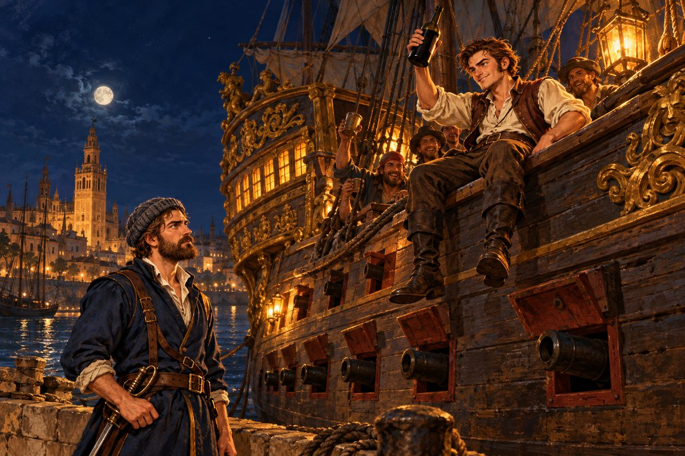

## 6. 진수식 날

과달키비르강을 거슬러 오르는 동안 바람이 달라졌다. 런던의 습한 바람이 아니었다. 마르고 뜨거운 바람, 올리브 잎과 먼지 냄새를 실은 바람이었다. 강 양안으로 오렌지 나무가 늘어섰고, 그 너머로 하얀 벽의 마을들이 햇빛에 눈을 찔렀다.

세비야는 소문보다 컸다. 강변 부두에 배들이 빽빽했다. 신대륙에서 돌아온 배, 신대륙으로 떠날 배. 짐꾼들이 등에 진 자루에서 설탕이 새어 나와 돌바닥이 끈적했다. 대성당의 종탑이 도시 한가운데 솟아 있었다. 무어인들이 세운 탑 위에 기독교도의 종을 얹은 탑이었다.

오토는 영국 상인 행세를 하기로 했다. 얼간이호는 누가 봐도 군함이 아니었으니, 그 점에서만은 길버트에게 고마워해야 할지도 몰랐다.

그런데 시장이 이상하게 조용했다. 노점은 열려 있었지만 손님이 없었다. 오토는 무두질한 가죽을 늘어놓은 가게 앞에 멈추었다. 주인이 의자에 앉아 하품을 하고 있었다.

"오늘 장사는 쉬는 날인가?"

"웬걸요. 문은 열었는데 손님이 안 오는 겁니다."

"손님이 안 오다니, 무슨 일이 있소?"

주인이 강 아래쪽을 손가락으로 가리켰다. 그쪽에서 사람들의 함성이 희미하게 건너왔다.

"오늘 같은 날 누가 가죽을 사러 오겠어요. 조선소에서 무적함대에 보낼 새 군함을 물에 띄운답니다. 온 도시 사람들이 다 구경 갔지요. 저도 가게만 아니면 진작 갔을 겁니다."

"무적함대의 새 배가 그렇게 대단한가?"

주인이 어깨를 으쓱했다. 그 어깨에 자부심이 묻어났다.

"지금 세상 어디를 뒤져도 그보다 나은 배는 없을 겁니다. 한번 보기만 하면 타 보고 싶어서 몸살이 난다더군요. 나리도 가 보시지요."

오토는 고맙다는 인사를 하고 돌아섰다. 그런데 돌아서고 보니 매튜가 없었다. 방금 전까지 뒤에서 투덜거리던 사내가, 선원들과 함께 감쪽같이 사라져 있었다.

## 7. 술잔과 고물배

"말 좀 묻지. 혹시 술 취한 패거리 못 봤소? 영국 뱃사람들인데."

물을 긷던 여자가 웃음을 참으며 강 쪽을 가리켰다.

"아, 그 시끄러운 양반들요. 술병을 들고 항구 쪽으로 몰려가던데요."

항구 앞 선술집 처마 밑에서 손 하나가 번쩍 올라왔다.

"제독님! 여기요, 여기!"

매튜는 이미 얼굴이 불콰했다. 탁자 위에 빈 병이 셋이었다. 선원들도 저마다 잔을 들고 있었다.

"매튜. 아주 신이 났군."

"헤헤헤, 오랜만에 제대로 된 술을 마셔 봐서요. 에스파니아 놈들이 밉긴 해도 포도주 하나는 기가 막히게 담근단 말이죠. 제독님도 한잔 받으십쇼."

오토는 잠시 망설이다가 앉았다. 적을 알려면 적의 술맛도 알아야 할 것 같았다. 그것이 핑계라는 것은 오토 자신도 알았다.

그로부터 몇 시간이 흘렀다. 처마 그림자가 길게 늘어졌다. 매튜가 탁자에 턱을 괴고 오토를 올려다보았다. 눈이 반쯤 풀려 있었다.

"제독님…… 끄윽. 꼭 한번 여쭤보고 싶었는데요. 제독님 같은 양반이 어째서 그런 고물배를 타고 다니시는 겁니까?"

오토는 잔을 돌렸다. 붉은 포도주가 잔 안에서 천천히 원을 그렸다.

"감독관 길버트 경의 미움을 산 모양이야. 그 배는 그 양반이 날 위해 특별히 지어 준 거지."

"특별히요?"

"내가 머지않아 자기 자리를 넘볼지 모른다고 걱정하는 거야. 궁정에선 흔한 일이지. 누군가 올라오면 누군가는 밀려날까 겁을 먹으니까."

매튜가 탁자를 쾅 내리쳤다. 빈 병 하나가 굴러떨어졌다.

"하! 그게 그 능구렁이 길버트 짓이었단 말입니까? 딸꾹! 내 그럴 줄 알았어요. 그 양반 생긴 것부터가 교활하게 생겼다니까요."

"자네도 길버트 경을 아나?"

"런던 부두에서 그 양반 모르는 사람 있으면 나와 보라 그러쇼. 세금 걷는 날마다 얼굴을 보는데요." 매튜가 다시 잔을 채웠다. "그러니까 그 양반이 저를 제독님한테 붙인 것도 다 꿍꿍이가 있어서였겠죠. 사고뭉치 매튜를 붙여 놓으면 제독님이 알아서 망할 거라고."

오토는 매튜를 보았다. 매튜는 아무렇지 않은 얼굴로 술을 마셨다. 그러나 잔을 쥔 손가락에 힘이 들어가 있었다.

"그렇다면 길버트 경이 두 번 틀린 셈이군."

매튜가 잔을 내려놓았다. 그리고 한참 오토를 보다가, 아무 말 없이 다시 잔을 들었다.

## 8. 최신예함

다시 몇 시간이 지났다. 해가 기울었다. 선술집은 진수식을 보고 돌아온 사람들로 터져 나갈 듯했다. 매튜가 비틀거리며 의자 위로 올라섰다.

"어이! 다들 이쪽을 보라고!"

선술집 안의 시선이 모였다. 영국 억양의 에스파니아 말이었다. 엉터리였지만 뜻은 통했다.

"여기 계신 베인스 제독님 배에 탈 놈은 손 들어! 이 양반 밑에 있으면 돈도 생기고 이름도 나고, 무엇보다 술이 떨어질 날이 없다! 술이 말이야!"

웃음이 터졌다. 몇몇이 손을 들었다. 항구를 떠도는 뱃사람들, 일자리를 잃은 선원들, 신대륙행 배를 놓친 떠돌이들이었다. 국적을 묻는 사람은 없었다.

"그게 다냐? 안 들려! 소리 작은 놈은 안 태운다!"

"오오!" 이번엔 함성이었다. "저 제독, 마음에 드는데!"

오토는 매튜의 허리띠를 잡아당겼다.

"매튜. 기세는 좋다만, 그 쪼끄만 배에 이 사람들을 어떻게 다 태우나."

"그럼 큰 배를 손에 넣으면 되죠."

"이만한 사람을 부리려면 적어도 갤리온급은 돼야 해."

"그럼 됐네요! 그 새 군함, 우리가 얻으면 되죠!"

"최신예함?"

"아까 그 진수식 말입니다! 그 군함! 그만한 배면 해적 따위는 한 방에 가라앉힐걸요."

오토는 웃었다. 취한 소리였지만, 묘하게 귀에 감기는 소리였다.

"에스파니아의 배로 에스파니아를 친다. 듣기엔 근사하군."

"바로 그겁니다!"

"발상은 훌륭해. 하지만 지금으로선 될 일이 아니지."

매튜는 대답하지 않았다. 대신 의자에서 뛰어내려 문 쪽으로 팔을 휘둘렀다.

"이봐, 다들 들었지? 전부 나를 따라와!"

"예이!"

"잠깐! 너희 멋대로 어딜 가는 거냐!"

오토가 일어섰을 때는 이미 늦었다. 선술집 문이 활짝 열리고, 스무 명 남짓한 사내들이 매튜를 앞세워 노을 진 거리로 쏟아져 나갔다. 술잔과 노랫소리와 웃음소리가 함께 멀어졌다. 주인이 빈 탁자를 내려다보았다. 그리고 오토를 보았다. 오토는 한숨을 쉬며 주머니를 열었다.

강변으로 나가자 사람들이 둑을 따라 길게 늘어서 있었다. 북소리가 울렸다. 조선소 쪽에서 무언가 거대한 것이 천천히 미끄러져 내려왔다.

배였다. 아니, 배라고 부르기에는 너무 컸다. 성 하나가 통째로 물 위에 떠오르는 것 같았다. 높은 고물루에 금박을 입힌 조각이 노을을 받아 번쩍였다. 돛대 셋에 접힌 돛들이 겹겹이 매달렸고, 뱃전을 따라 포문이 두 층으로 줄을 지었다. 오토는 저도 모르게 포문을 셌다. 서른, 마흔…… 양쪽을 합치면 일흔은 될 것이었다.

배가 물에 닿는 순간, 거대한 물보라가 일었다. 군중이 함성을 질렀다. 성직자가 성수를 뿌렸고, 나팔 소리가 하늘을 찢었다.

"갤리온급, 일흔 문짜리라." 오토가 중얼거렸다. "언젠가 저런 배를 한 척 가질 수 있다면."

진수식이 끝나자 최신예함은 예인선에 끌려 항구 쪽으로 옮겨 갔다. 오토는 사람들 틈에 섞여 그 뒤를 따랐다. 부두 가까이서 보니 더 근사했다. 새 나무와 새 타르 냄새가 났다. 선체에 손을 대 보고 싶은 마음을, 오토는 경비병의 창끝을 보고 접었다.

그런데 매튜는 어디에도 없었다.

해가 졌다. 오토는 선술집 몇 군데를 돌았다. 항구 관리소에도 물었다. 아무도 매튜를 보지 못했다. 이마에 땀이 맺혔다. 술 취한 영국 뱃사람 스무 명이 에스파니아 항구를 휘젓고 다닌다. 좋게 끝날 리가 없었다.

## 9. 바카스

부두 끝에 이르렀을 때, 어둠 속에서 누군가 그를 불렀다.

"딸꾹! 베인스 제독님! 한창 잘 마시다가 갑자기 사라지시면 어떡합니까. 사람 간 떨어지게."

목소리는 위에서 들려왔다. 오토는 고개를 들었다. 그리고 그대로 굳었다.

매튜가 최신예함의 뱃전에 걸터앉아 다리를 흔들고 있었다. 등불 하나가 그의 불콰한 얼굴을 비추었다. 그 뒤로 선원들의 얼굴이 줄줄이 내려다보았다. 다들 히죽거리고 있었다.

"누가 누굴 놀라게 해? 내가 너를 찾느라 온 항구를 다 뒤졌다!"

"그런 건 모르겠고요, 딸꾹! 다들 제독님 오시기만 손꼽아 기다렸어요." 매튜가 뱃전을 손바닥으로 두드렸다. "제독님, 바로 이놈이 우리 새 기함입니다!"

오토는 말을 잃었다. 부두를 둘러보았다. 경비병이 하나도 없었다. 창끝도, 횃불도.

"이건 최신예함……? 너희들, 아까 그 경비병들은 다 어쩌고?"

"아까 웬 여자 해군 장교 하나가 배를 훔쳐서 달아났대요. 그래서 경비병들이 우르르 그쪽으로 몰려가 버리더라고요." 매튜가 엄지로 뒤쪽 바다를 가리켰다. "남아 있던 몇 놈은 밧줄로 묶어서 아래 선창에 재워 뒀고요. 헤헤, 잘했죠?"

선원 하나가 낄낄거리며 끼어들었다.

"근데 그 여자 진짜 바보 아니우? 같은 값이면 새 배를 훔쳐야지, 낡아빠진 걸 끌고 가다니! 푸하하하!"

오토는 잠시 눈을 감았다. 하나, 둘, 셋. 이번에는 숨을 세어도 소용이 없었다. 웃음이 비어져 나왔다.

여자 해군 장교. 그런 사람이 이 밤에 왜 배를 훔쳐 달아났는지는 알 수 없었다. 그러나 그녀 덕분에 지금 이 부두에는 아무도 없었다.

"이런 구제 불능의 술주정뱅이 같으니……." 오토가 사다리를 잡았다. "어쨌든 다시없을 기회로구나. 매튜, 잘했다."

"딸꾹! 이봐, 다들 자리 잡아!"

"좋아. 지금 당장 출항한다!"

닻줄이 올라갔다. 선원들이 비틀거리면서도 돛줄에 매달렸다. 술 취한 손이었지만 뱃사람의 손이었다. 첫 번째 돛이 펼쳐지며 밤바람을 품었다. 거대한 선체가 부두에서 천천히 떨어져 나갔다. 오토는 키를 잡았다. 키가 손바닥에 묵직하게 감겼다. 얼간이호와는 비교도 되지 않는, 깊고 단단한 감촉이었다.

강 하류로 흘러가는 동안 오토는 한 번 뒤를 돌아보았다. 부두 한구석에 얼간이호가 덩그러니 매여 있었다. 등불도 없이 어둠 속에 웅크린 모습이 꼭 버려진 개 같았다.

"잘 있어라." 오토가 중얼거렸다. "에스파니아가 밑지는 장사를 했군."

배가 대서양으로 나선 것은 새벽녘이었다. 동쪽 하늘이 희부옇게 밝아 올 무렵, 오토는 갑판 위에서 곯아떨어진 선원들 사이를 걸어 고물로 갔다. 고물에 새 이름을 새길 자리가 비어 있었다. 에스파니아 놈들은 아직 이름을 정하지 못한 모양이었다.

오토는 갑판 위에 대자로 뻗어 코를 고는 매튜를 내려다보았다. 그의 손에는 아직도 빈 술병이 쥐어져 있었다.

"바카스." 오토가 말했다. "술의 신이 훔쳐 온 배니까."

## 10. 숙취

"제독님, 우리…… 적을 엿보러 가던 거 아니었습니까?"

이튿날 정오가 다 되어서야 매튜가 선장실 문을 열었다. 얼굴이 밀랍처럼 하얬다. 그는 문틀을 붙잡고 서서 신음했다.

"아이고, 머리야."

"정신은 좀 드나, 매튜?"

"응? 뭡니까, 이 배는?" 매튜가 선장실을 두리번거렸다. 높은 천장, 반들반들한 호두나무 책상, 금박 두른 창틀. "잠깐 안 본 사이에 얼간이가 왜 이렇게 번듯해졌대?"

"정말 생각 안 나나? 이 배를 가져온 건 자네야. 곤드레만드레 취해서."

"예? 그게 무슨 소리예요? 농담이죠?"

오토는 대답 대신 책상 위의 무거운 상자를 열어 보였다. 금화가 햇빛을 받아 출렁였다.

"그뿐인가. 선장실 궤짝을 열어 보니 금화가 만 닢이나 들어 있더군. 덕분에 이제야 뭘 좀 해 볼 수 있게 됐어."

매튜는 상자를 들여다보았다. 오토를 보았다. 다시 상자를 보았다. 그러더니 이마를 손바닥으로 쳤다.

"어…… 뭐가 뭔진 하나도 모르겠는데요." 그가 천천히 웃기 시작했다. "기왕 이렇게 된 거, 이 배로 길버트 그 양반 콧대나 꺾어 주자고요. 옛날부터 그 양반 낯짝이 마음에 안 들었거든요."

"그래. 그것도 꽤 재미있는 일이겠군."

그 뒤로 사흘 동안 매튜는 배 구석구석을 돌아다니며 감탄사를 늘어놓았다. 이 돛대 좀 봐라, 이 대포 좀 봐라, 이 선창 넓은 것 좀 봐라. 그러다 선창 한구석에서 묶여 있던 에스파니아 경비병들을 발견하고 기겁했다. 그들이 언제부터 거기 있었는지조차 기억하지 못했다.

오토는 경비병들을 포르투갈 해안의 작은 어촌에 내려 주었다. 물 한 통과 빵 한 자루를 함께 건넸다. 경비병 우두머리가 오토를 오래 노려보았다.

"이 일을 그냥 넘어갈 거라 생각하지 마시오, 영국인."

"그렇게 생각하지 않소." 오토가 대답했다. "그래서 서두르는 거요."

## 11. 추격대

바카스는 리스본에 닻을 내렸다.

리스본은 세비야와 또 달랐다. 테주강 하구의 넓은 만에 온 세상의 배가 모여 있었다. 인도에서 돌아온 카라크선은 후추 냄새를 풍겼고, 아프리카 해안을 돌아온 캐러벨은 상아와 사금을 실었다. 언덕을 따라 하얀 집들이 층층이 쌓였고, 꼭대기에는 성이 있었다.

오토는 금화 상자를 열고 처음으로 제대로 된 장보기를 했다. 물과 식량, 화약과 포탄, 여분의 돛 천과 밧줄. 선원도 더 모았다. 매튜가 술집에서 뽑아 온 이들이었지만, 이번에는 오토가 한 사람 한 사람 손바닥을 확인했다. 노를 저어 본 손인지, 밧줄을 당겨 본 손인지.

장보기를 마치고 부두로 돌아왔을 때 매튜가 뱃전에 기대어 바다를 보고 있었다. 술병을 들고 있지 않은 매튜는 처음 보는 것 같았다.

"제독님. 좀 걸리는 게 있는데요."

"뭔가, 매튜."

"사실 여기 올 때까지 줄곧 우리 뒤를 따라오던 상선이 하나 있었어요. 돛 하나에 덧댄 천이 있어서 눈에 띄었거든요."

"흠. 난 못 느꼈는데. 그냥 우연 아닐까?"

"처음엔 저도 그렇게 생각했죠. 그런데 우리가 이 항구로 들어오는 걸 확인하더니 뱃머리를 돌려 버리더라고요. 장삿배가 항구 코앞까지 와서 그냥 돌아가는 법은 없잖아요."

오토는 바다 쪽을 보았다. 테주강 하구 너머 수평선이 가물가물했다.

"미행이라……. 정말 그렇다면 세비야에서 보낸 추격대일 공산이 크군."

"만일을 위해서 배 무장을 할 수 있는 만큼 올려 두는 게 어떻겠습니까?"

그날부터 사흘 동안 오토는 바카스의 무장을 손보았다. 포를 점검하고, 포탄을 더 사들이고, 선원들에게 포 다루는 법을 다시 가르쳤다. 리스본의 무기상에서 쓸 만한 칼과 가죽 갑옷도 몇 벌 구했다. 매튜는 아무 말 없이 술을 끊었다. 그 사흘이 매튜 인생에서 가장 길었던 사흘이었을 것이다.

리스본을 떠난 지 이틀째 아침, 돛대 꼭대기의 망꾼이 소리쳤다.

"뒤쪽에 돛! 넷, 아니 다섯! 에스파니아 깃발입니다!"

오토는 망원경을 들었다. 흰 바탕에 붉은 톱니 십자를 그린 깃발이 아침 해를 받아 선명했다. 앞장선 배의 돛에 덧댄 천 조각이 보였다.

"제독님, 세비야에서 쫓아온 놈들이에요. 배를 내놓으라는 거겠죠."

"저쪽은 망신을 당했으니 배만 돌려받아서는 성에 안 차겠지. 우리를 바다에 처넣으려 들 거야."

"아이고, 질색이야! 배 한 척 가지고 저렇게 떼로 몰려오다니……."

"한 척이 아니지. 무적함대에 들어갈 최신예함이야. 저쪽 제독 목이 걸린 일일 거다." 오토가 망원경을 접었다. 목소리가 갑판 끝까지 울렸다. "모두 제자리로! 에스파니아 함대를 맞는다!"

첫 포성은 저쪽에서 먼저 울렸다. 포탄이 바카스의 고물 옆 물속에 떨어지며 하얀 물기둥을 세웠다. 짠물이 갑판 위로 쏟아졌다. 선원들이 비명을 지르며 엎드렸다.

"일어나! 아직 멀다! 저건 겁주는 거다!"

오토는 키 옆에 서서 바람을 읽었다. 북서풍. 추격대는 바람을 등지고 있었다. 정면으로 맞서면 바람을 거스르는 쪽이 진다. 다섯 척을 상대로 한 척이 싸워서도 안 되었다. 이 싸움의 목적은 이기는 것이 아니었다. 살아서 빠져나가는 것이었다.

"매튜! 돛을 다 펴라. 남서쪽으로 돌린다!"

"도망칩니까?"

"바카스가 저놈들보다 빠르다. 그걸 보여 주는 거야."

바카스가 몸을 틀었다. 거대한 돛이 일제히 바람을 품었다. 추격대의 선두함이 따라붙으려 했지만 거리가 좀처럼 줄지 않았다. 최신예함은 이름값을 했다. 두 번째 배가 옆으로 비껴 들어오며 포문을 열었다. 오토가 외쳤다.

"좌현, 쏴라!"

바카스의 좌현 포들이 처음으로 불을 뿜었다. 배 전체가 몸서리쳤다. 귀가 먹먹해졌다. 연기가 걷혔을 때, 에스파니아 배의 앞돛대가 꺾여 바다로 기울고 있었다. 그 배가 멈추자 뒤따르던 배들이 엉켰다.

"지금이다! 그대로 달려!"

해가 질 무렵 에스파니아 돛들은 수평선 아래로 가라앉았다. 바카스의 선원들이 갑판 위에 드러누워 숨을 몰아쉬었다. 누군가 웃기 시작했다. 웃음이 번졌다. 매튜가 오토 옆으로 와서 털썩 주저앉았다.

"제독님. 저 아까 진짜 죽는 줄 알았어요."

"나도 그랬네."

"근데 왜 그렇게 태연한 척하셨어요?"

오토는 키에서 손을 떼었다. 손바닥이 땀에 흠뻑 젖어 있었다. 그는 그 손을 매튜에게 보여 주었다. 매튜가 손을 보더니 껄껄 웃었다.

그날 밤 매튜는 사흘 만에 술병을 땄다. 오토는 말리지 않았다.
