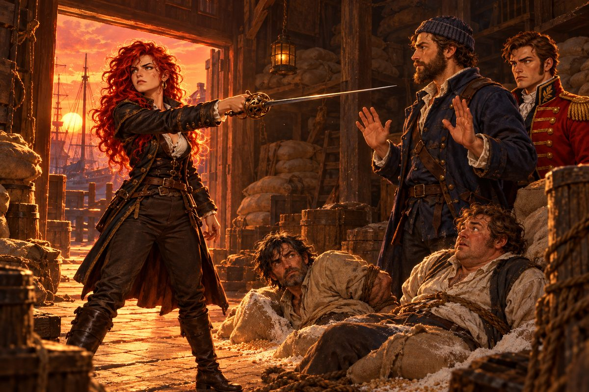

## 12. 바닥난 금고

금화 만 닢은 생각보다 빨리 줄었다.

바카스는 큰 배였다. 큰 배는 많은 사람을 먹였다. 선원 백오십 명이 하루에 마시는 물과 먹는 빵과 비우는 맥주. 한 달에 한 번 나가는 급료. 오토는 처음으로 장부를 펼쳐 놓고 밤을 새웠다. 숫자는 정직했다. 정직해서 잔인했다.

처음에는 북쪽 바다에서 장사를 해 보려 했다. 런던에서 모직을 싣고 함부르크와 코펜하겐을 오갔다. 그러나 이문이 너무 얇았다. 모직 한 꾸러미를 팔아 남는 돈이 선원들 이틀 치 밥값에 불과했다. 세 번을 오가고 나자 금고 바닥이 보였다.

"제독님, 이러다 우리 다 굶어 죽겠는데요." 매튜가 빈 술통을 두드렸다. 텅 빈 소리가 울렸다. "술통이 먼저 굶어 죽었고요."

오토는 장부를 덮었다.

"사람이 너무 많아. 이 바다에서 이 사람들을 다 먹일 장사는 없어."

결정은 쉽지 않았다. 오토는 선원들을 갑판에 모으고 사정을 솔직히 말했다. 남고 싶은 사람은 남되 급료를 줄이겠다. 떠나고 싶은 사람에게는 고향 가는 뱃삯을 주겠다. 절반이 넘는 사람이 떠났다. 남은 사람은 오십 명 남짓이었다. 매튜가 술집에서 처음 긁어모은 얼굴들이 대부분 남았다.

"쳇, 다들 의리라곤 없어서." 매튜가 투덜거렸다.

"아니야. 저 사람들도 먹여 살릴 식구가 있어." 오토가 떠나는 이들의 등을 보았다. "언젠가 다시 부를 날이 올 거다. 그때 오고 싶게 만들면 되지."

바카스는 남쪽으로 내려갔다. 지브롤터 해협을 지나 지중해로 들어갔다. 바다 빛깔이 바뀌었다. 북쪽 바다의 잿빛이 아니었다. 맑고 깊은 쪽빛, 햇빛이 물속 깊이 꽂혀 바닥의 모래까지 보이는 바다.

오토가 찾은 길은 이스탄불과 아테네 사이였다. 오스만의 수도에서 융단과 비단을 싣고, 아테네에서 올리브기름과 포도주를 실었다. 짧은 뱃길이었다. 오가는 횟수가 늘수록 금고가 다시 무거워졌다. 이스탄불의 시장에서 오토는 난생처음 커피라는 검은 물을 마셔 보았다. 쓰고 진했다. 매튜는 한 모금 마시고 바다에 뱉었다.

"이걸 사람이 왜 마십니까? 술도 아닌데."

"정신이 맑아진다더군."

"그러니까 왜 마시냐고요."

돈이 모이자 오토는 칼과 갑옷부터 바꿨다. 낭트에서 사슬 갑옷을, 앤트워프에서 날이 긴 검을 샀다. 코펜하겐의 갑옷장이는 가벼운 판금 흉갑을 오토의 몸에 맞게 두드려 주었다. 사략 허가서를 쥔 기사가 상인처럼 살 수는 없었다. 언젠가는 칼을 뽑아야 할 것이었다.

## 13. 붉은 수염

그 언젠가는 생각보다 빨리 왔다.

바카스는 사략선이었다. 에스파니아 깃발을 단 상선을 보면 오토는 망설이지 않았다. 처음에는 손이 떨렸다. 배에 올라타 칼을 겨누고, 겁에 질린 상인들에게 짐을 내놓으라고 말하는 일. 국경에서 군인끼리 칼을 맞대던 것과는 달랐다.

"왕께서 허락하신 일입니다, 제독님." 매튜가 말했다. "저쪽도 우리 상선을 똑같이 털어 가요. 바다엔 원래 착한 놈이 없어요. 덜 나쁜 놈만 있지."

오토는 한 가지 원칙을 세웠다. 항복한 배의 선원은 해치지 않는다. 짐은 가져가되 물과 식량은 남긴다. 매튜는 그 원칙을 듣고 고개를 저었지만 어기지는 않았다.

몇 번의 싸움이 이어졌다. 이길 때도 있었고 간신히 빠져나올 때도 있었다. 지중해의 항구마다 영국 기사가 모는 에스파니아 군함 이야기가 떠돌기 시작했다. 그러다 튀니스 앞바다에서, 그 배를 만났다.

갤리선이었다. 열 척이 넘었다. 노가 일제히 물을 치는 소리가 북소리처럼 바다를 울렸다. 앞장선 배의 돛대에 초록 깃발이 걸려 있었다. 매튜의 얼굴이 하얘졌다.

"제독님. 저건…… 하이레딘입니다. 붉은 수염 하이레딘."

이름은 오토도 알았다. 지중해의 모든 기독교도 뱃사람이 그 이름을 들으면 성호를 그었다. 알제를 손에 넣은 해적왕. 오스만 술탄도 그를 함부로 하지 못한다는 사내.

"돌아서라!"

그러나 늦었다. 갤리선들은 바람과 상관없이 움직였다. 노예 수백 명이 젓는 노가 바다를 갈랐다. 순식간에 바카스의 양옆으로 갤리선들이 따라붙었다. 쇠갈고리가 날아들었다.

싸움은 짧았다. 아니, 싸움이라고 부를 수도 없었다. 오토는 뱃전에서 칼을 휘둘렀다. 하나를 베고, 둘을 밀어냈다. 그러나 셋째가, 넷째가 넘어왔다. 매튜가 옆에서 소리를 질렀다. 선원 하나가 오토의 등 뒤에서 쓰러졌다.

그때 기함의 갑판 위에 붉은 수염의 사내가 나타났다. 멀리서도 그 수염은 불꽃처럼 붉었다. 그는 바카스를 잠깐 내려다보더니, 손을 한 번 저었다. 그것뿐이었다. 해적들이 갈고리를 풀고 물러났다.

"……왜 물러나는 거지?"

"모르겠습니다." 매튜가 숨을 헐떡였다. "가지고 놀다 질린 거겠죠."

갤리선들이 멀어졌다. 바카스의 돛은 찢겼고, 뱃전 곳곳에 구멍이 났다. 선원 일곱이 다쳤다. 둘은 다시 일어나지 못했다.

그날 밤 오토는 선장실에서 혼자 술을 마셨다. 처음이었다. 손이 떨려 잔이 이에 부딪혔다.

"제독님." 매튜가 문을 열고 들어왔다. 그는 아무 말 없이 맞은편에 앉아 자기 잔을 채웠다.

"내가 교만했어." 오토가 말했다. "에스파니아 군함 하나 얻었다고 바다가 다 내 것인 줄 알았지."

"다들 한 번씩은 그래요." 매튜가 잔을 비웠다. "살아서 그걸 알게 됐으면 운이 좋은 거죠. 그 두 녀석은 운이 없었고요."

오토는 이튿날 아침 두 선원을 바다에 묻었다. 그리고 그 뒤로 다시는 상대의 기함을 보기 전에 싸움을 걸지 않았다.

## 14. 교역소의 유령

남쪽 바다의 한 항구에 들렀을 때였다. 오토와 매튜가 선술집을 나서는데 늙은 짐꾼 하나가 따라붙었다.

"나리, 혹시 그 얘기 들으셨습니까? 교역소 창고에 귀신이 산다는 얘기요."

"유령?"

"밤마다 끙끙 앓는 소리가 난다지 뭡니까. 다들 무서워서 근처에도 안 가요. 나리처럼 힘깨나 쓰실 분이라면 한번 들여다봐 주실 수 있지 않을까 해서요."

매튜가 오토의 소매를 잡아끌었다.

"제독님, 제발요. 그런 이야기엔 제가 쥐약이라고요."

"이상하군. 그냥 넘기기엔 마음에 걸리는데."

"우리 생긴 대로 좀 살면 안 됩니까? 그런 데 기웃거릴 얼굴이 아니시잖아요. 제독님은 궁금한 걸 못 참는 게 병이라니까요!"

교역소 창고는 부두 끝에 있었다. 해가 지고 있었다. 문이 반쯤 열려 있었고, 안은 어두웠다. 쌀자루와 밀가루 포대가 천장까지 쌓여 있었다. 먼지 냄새, 곰팡이 냄새, 그리고 쥐 냄새. 오토는 문간에 서서 귀를 기울였다.

끙, 끙. 무언가 숨죽인 소리가 들렸다. 안쪽 깊은 곳이었다.

"매튜, 이것 좀 보게. 자루가 움직이고 있어!"

매튜가 오토의 어깨 너머로 들여다보았다. 구석에 쌓인 쌀자루 두 개가, 정말로 움직이고 있었다. 매튜가 비명을 질렀다.

"으아악! 귀신이다! 분명 내가 술값 떼먹고 도망친 술집 귀신이 앙갚음하러 온 거예요!"

"정신 차려, 매튜. 귀신이 아니라 사람이야. 누가 자루 속에 갇혀 있어."

오토가 단검을 뽑아 자루 하나의 끈을 끊었다. 그 안에서 재갈을 문 사내의 얼굴이 튀어나왔다. 다른 자루에서도. 둘 다 손발이 밧줄로 꽁꽁 묶여 있었다.

"뭐야! 자루마다 하나씩 묶여 있었네!"

"보아하니 뱃사람 같군." 오토가 재갈을 풀어 주었다.

"사…… 살려 줘……!" 한 사내가 콜록거렸다. 그러다 숨을 고르자마자 다른 소리를 냈다. "어이, 거기 너희들! 이 밧줄도 빨리 풀어!"

매튜의 눈썹이 꿈틀했다.

"너희? 빨리 풀어? 이, 이 못돼 처먹은 것 좀 보게! 살려 달라는 주제에 건방지기는! 도로 자루에 처넣어 줄까!?"

그때였다. 등 뒤에서 차가운 목소리가 들렸다.

"당신들, 거기서 뭘 하는 거지?"

오토가 돌아섰다. 창고 문간에 여자 하나가 서 있었다. 저녁노을이 그녀의 등 뒤에서 타고 있어서, 처음에는 그림자만 보였다. 이윽고 눈이 어둠에 익자 머리칼이 보였다. 불붙은 것처럼 붉은 머리. 날카로운 턱선, 가늘게 뜬 눈. 손에 쥔 가는 칼끝이 오토의 가슴을 향해 있었다.

"그 둘은 내 사람들이야. 너희, 조안이 보낸 놈들이냐?"

"누구냐, 넌."

"질문은 내가 해. 대답이 늦으면 이 칼이 먼저 말할 거야."

칼끝이 한 치 다가왔다. 매튜가 오토의 뒤로 반 걸음 숨었다. 오토는 칼에 손을 대지 않았다. 대신 두 손을 천천히 들어 보였다.

"잠깐! 잘못 짚었네. 우린 소리를 듣고 들어와 봤을 뿐이야. 이 두 사람에게 물어봐도 좋아."

여자의 눈이 바닥에 앉은 사내를 향했다.

"정말이야? 사누드."

"……그래." 사누드라 불린 사내가 손목을 문지르며 일어섰다. 마흔 가까운 나이에 말수가 적어 보였다. "이 사람 말이 맞아, 제독."

"제독, 정말 면목이 없수다……." 다른 사내가 머리를 긁적였다. 둥근 얼굴에 사람 좋아 보이는 눈이었다.

여자가 칼끝을 내렸다. 그러나 칼집에 넣지는 않았다.

"누구 짓이야? 조안이 직접 그랬어?"

"조안은 아니야. 그놈 곁에 붙어 다니는 늙은 항해사, 로코한테 당했어." 사누드가 이를 악물었다. "이 항구까지 따라붙었는데 그 늙은이가 길을 막았지. 둘이 한꺼번에 덤볐는데도 손끝 하나 못 댔어."

"듣자니 그 영감, 페레로 집안에 평생을 바친 사람이라더군. 젊었을 땐 호걸 로코라는 별명으로 이름을 날렸다고."

"그런 걸 왜 이제 말해, 기지!"

"어쩔 수 없었수. 나도 그 정도일 줄은 몰랐으니까."

여자가 길게 숨을 내쉬었다.

"됐어. 일어들 나. 지금 쫓아가 봐야 헛걸음이야."

그녀가 비로소 칼을 거두고 오토를 마주 보았다. 날 선 기운이 조금 가라앉았지만, 눈빛은 여전히 쉽게 마음을 열지 않는 사람의 것이었다.

"카탈리나 에란초입니다. 칼부터 들이댄 건 사과드리죠."

"오토 베인스라고 하네. 잉글랜드 왕의 기사로, 영국 함대를 지휘하고 있지."

카탈리나의 눈썹이 아주 조금 움직였다. 영국 함대. 그녀가 오토의 얼굴을 다시 한번 훑었다. 무언가를 가늠하는 눈이었다.

"무슨 사연이 있는 것 같은데, 들려줄 수 있겠나? 괜한 참견이라면 그만두겠네."

카탈리나는 한참 대답하지 않았다. 창고 밖에서 파도 소리가 들렸다.

"……아닙니다. 그럼 두 시간 뒤에 선술집으로 오십시오."

## 15. 두 시간 뒤

"제독님, 시간 다 돼 갑니다."

"그래, 가 볼까."

선술집에 먼저 도착한 것은 오토와 매튜였다. 카탈리나는 아직 오지 않았다. 매튜가 맥주를 두 잔 시켰다. 오토는 입만 댔다.

"그 아가씨 말인데요." 매튜가 목소리를 낮추었다. "처음에 우리한테 칼 들이댈 때, 살기가 장난이 아니었죠? 뱃사람들 사이에서 칼 좀 쓴다는 놈들 많이 봤지만 그런 눈은 처음이에요."

"음. 대체 무슨 사정인지 몹시 궁금하군."

"제독님, 알고 보니 여자 마음 사는 재주가 있으신 거 아닙니까? 만난 지 한 식경 만에 약속을 다 잡으시고. 헤헤."

"엉뚱한 소리 말게. 사연이 궁금했을 뿐이야." 오토가 잔을 내려놓았다. "그보다 아까 그 사람들이 말한 조안 말이야. 짚이는 데가 있나?"

매튜의 얼굴이 진지해졌다.

"제가 잘못 안 게 아니라면, 그 조안이란 자는 페레로 공작 집안의 후계자예요. 레온 페레로, 포르투갈 귀족 중에서도 첫손에 꼽히는 집안이죠."

"정말인가? 놀랍군." 오토가 턱을 쓸었다. "페레로 가라……. 레온 페레로는 잉글랜드에서도 이름이 알려진 사람이야. 척을 지기엔 너무 큰 상대야."

문이 열렸다. 카탈리나가 들어왔다. 칼은 허리에 그대로 차고 있었지만, 걸음걸이는 아까보다 조금 무거웠다.

"늦었네요. 기다리게 해서 미안합니다."

"아닐세. 우리도 방금 앉았네."

카탈리나가 맞은편에 앉았다. 주인이 다가오자 그녀는 포도주 한 잔을 시켰다. 잔이 나올 때까지 아무도 말하지 않았다.

"놓쳐 버렸군요." 그녀가 마침내 입을 열었다. 혼잣말에 가까웠다. "뭐, 언젠가는 반드시 내 손에 잡히겠지만."

"에란초 양."

"카탈리나라고 부르세요."

"그럼 카탈리나. 자네는 왜 그들을 뒤쫓나?"

"갚아야 할 빚이 있어서요. 피로 진 빚."

"피로 진 빚?"

카탈리나가 잔을 들었다. 마시지는 않았다. 붉은 포도주에 등잔불이 비쳐 흔들렸다.

"오빠와, 정혼자의 원수예요. 내가 세상에서 가장 아끼던 두 사람이 놈들한테 비겁하게 살해당했어요." 그녀의 손가락이 잔을 꽉 쥐었다. "상대가 이름난 집안이고 강하다는 것도 압니다. 하지만 무슨 수를 쓰더라도, 페레로 가문 사람들을 하나도 남김없이 지옥에 보낼 겁니다."

오토는 한동안 말이 없었다. 이 여자가 지닌 분노는 등잔불 하나로는 다 비출 수 없을 만큼 깊었다.

"마음이 무겁군. 그래도 한 가지만 말하자면, 페레로 가문 같은 명문이 그런 비겁한 짓을 했으리라고는 잘 믿기지 않네."

"믿고 안 믿고는 당신 마음이에요. 내가 아는 사실은 바뀌지 않아요." 카탈리나의 목소리는 낮았지만 흔들리지 않았다. "이 일 때문에 고향도, 나라도 등졌어요. 돌아갈 길은 이미 끊겼고요. 그리고 저 하나 믿고 가진 걸 다 내던진 동료들이 있어요. 그 사람들을 실망시킬 순 없어요."

조국을 버렸다. 오토의 머릿속에 세비야의 밤이 스쳐 갔다. 배를 훔쳐 달아났다는 여자 해군 장교. 경비병들을 모두 끌고 가 준 그 사람. 오토는 카탈리나의 얼굴을 보았다. 묻고 싶었지만 묻지 않았다. 묻는다고 그녀가 대답할 것 같지도 않았다.

카탈리나가 잔을 내려놓고 일어섰다.

"실례했네요. 오늘은 마음이 좀 가라앉았나 봐요. 처음 보는 분들한테 너무 많은 말을 했네요. 이만 실례하겠습니다."

"카탈리나."

그녀가 걸음을 멈추었다.

"복수를 끝내고 나면 어떻게 할 생각인가?"

카탈리나가 돌아보았다. 잠깐, 아주 잠깐 그녀의 얼굴에 무언가가 스쳤다. 지친 사람의 얼굴이었다.

"그 뒤의 일은 생각해 본 적이 없어요. 오지 않을지도 모르는 내일을 미리 그려 두는 건 내 방식이 아니라서요." 그녀가 문을 열었다. 밤바람이 들어와 등잔불을 흔들었다. "좋은 항해 되시길."

문이 닫혔다. 매튜가 참았던 숨을 몰아쉬었다.

"어휴, 무서워라……. 예쁘긴 한데, 저렇게 드센 여자는 죽어도 마누라로 못 삼겠네요!"

"마누라?" 오토가 잔을 비웠다. "망상은 술이 깨면 같이 깨는 법이네. 그만 마시고 가서 잠이나 자게."

## 16. 이야기를 파는 사내

카탈리나와 헤어지고 몇 달이 흘렀다. 그사이 바카스는 북쪽으로 올라가 스코틀랜드 해안의 항구에 들렀다.

"어서 오쇼, 손님! 우리 집 위스키는 이 동네에서 최고요!"

"주인장, 제일 좋은 스카치로 한 잔 주시오."

"저도 같은 걸로! 제독님, 잘 마시겠습니다. 헤헤." 매튜가 잔을 받아 들고 기지개를 켰다. "제독님, 바다 위는 따분해 죽겠는데 뭐 귀가 번쩍 뜨일 만한 얘기 없을까요?"

"귀가 번쩍 뜨일 얘기라면 내가 하나 갖고 있지."

옆 탁자에서 목소리가 들렸다. 깃털 꽂은 모자를 비스듬히 쓴 젊은 사내였다. 이탈리아 말씨가 섞인 영어. 웃는 입매가 장난스러웠고, 눈은 쉴 새 없이 사람들의 주머니를 가늠하는 것 같았다.

"으잉? 넌 또 뭐냐?"

"아, 소개가 늦었군. 피에트로 콘티. 모험가야. 숨은 보물 찾는 데는 뱃사람들 사이에서 내 이름이 꽤 통하지."

"이거 영 미덥지 않은 놈인데?" 매튜가 눈을 가늘게 떴다.

"어이쿠, 사납기도 하지. 이를 안 드러내도 자네가 바다 사람인 건 얼굴에 다 쓰여 있으니 좀 누그러지라고." 피에트로가 오토 쪽으로 의자를 끌어당겼다. "아무튼 그런 얘기가 듣고 싶다니 하나 팔아 볼까 해서. 실은 오스만의 어느 고리대금업자한테 쫓기는 중이라 돈이 좀 급하거든. 피도 눈물도 없는 놈이라 골치가 아파."

"이야기를 판다고?" 오토가 물었다. "일단 조건부터 듣지."

"이 이야기 값어치에 비하면 아주 싼 거야. 금화 만 닢. 어때?"

매튜가 위스키를 뿜을 뻔했다. 오토는 피에트로를 오래 보았다. 허풍인지 진짜인지, 얼굴만으로는 알 수 없었다. 그러나 이 사내의 눈에는 거짓말쟁이 특유의 초조함이 없었다. 장사꾼의 계산이 있을 뿐이었다.

"좋아. 들어 보지."

"그렇게 나와야지!" 피에트로가 몸을 숙였다. "들어 봐. 신대륙에서 캔 금을 배 밑창까지 채운 에스파니아 수송선이 지금 세비야로 가는 중이야."

"그래서?"

"뒷얘기가 궁금하면 값을 더 쳐 줘야겠어. 생각해 보니 내가 너무 싸게 불렀어. 싫으면 관두든가. 조안 페레로한테 가져가면 두말없이 사 줄 테니."

매튜가 의자를 박차고 일어나려 했다. 오토가 그의 팔을 눌렀다.

"그 정도 이야기에 만 닢은 너무 비싸군. 반으로 깎지."

피에트로가 혀를 찼다. 그러나 오토의 눈을 보고는 어깨를 으쓱했다.

"쳇! 좋아. 수송선은 베라크루즈에서 출발했어. 지휘관 이름까지 알려 주지. 내 얘긴 여기까지야."

금화 오천 닢이 든 주머니가 피에트로의 품으로 사라졌다. 그는 모자를 고쳐 쓰고 휘파람을 불며 나갔다. 문간에서 한 번 돌아보며 윙크까지 했다.

"가 버렸네요……. 묘한 녀석이에요." 매튜가 투덜거렸다. "제독님, 오천 닢이면 위스키가 몇 통인데요."

"에스파니아의 금이 어디서 어디로 흐르는지 아는 건, 위스키 몇 통보다 값진 일이야." 오토가 잔을 비웠다. "그리고 저 사내가 조안 페레로 이름을 꺼낸 것 들었나? 카탈리나가 쫓는 그 조안 말이야."

매튜가 입을 다물었다. 바다는 넓었지만, 그 위를 떠도는 사람들의 운명은 생각보다 좁은 그물 속에서 얽히고 있었다.

## 17. 베네치아의 갤리

해가 바뀌었다. 바카스의 이름은 지중해와 대서양의 항구들에 조금씩 퍼져 나갔다. 에스파니아 상선을 털면서도 선원을 해치지 않는 영국 기사. 물과 빵은 남겨 두고 가는 사략선. 소문은 과장되었고, 과장될수록 오토에게 유리했다. 저항하지 않고 항복하는 배가 늘었다.

선원도 다시 모였다. 처음 바카스를 떠났던 이들 가운데 몇이 소문을 듣고 돌아왔다. 매튜는 그들을 끌어안고 등을 두드렸다. 그리고 곧바로 술값을 물렸다.

나폴리의 무기상에서 오토는 성기사의 갑옷이라 불리는 판금 갑옷 한 벌을 샀다. 새벽 장이 서기도 전에 문을 두드려 겨우 구한 물건이었다. 보르도에서는 동방에서 건너왔다는 청룡언월도를 손에 넣었다. 긴 자루 끝에 반달 같은 날이 달린 칼이었다. 매튜가 그것을 보고 입을 떡 벌렸다.

"그걸로 뭘 하시게요? 배 위에서 휘두르면 돛대가 먼저 잘리겠는데요."

"돛대를 안 자르게 휘두르는 법을 배우면 되지."

그해 가을, 오토는 제노바의 조선소를 찾았다. 장부에 쌓인 금화가 마침내 새 배 한 척 값을 넘어선 참이었다. 그가 주문한 것은 베네치아식 대형 갤리였다. 바람이 없어도 노로 움직이고, 뱃머리에 무거운 포를 실을 수 있는 배. 하이레딘의 갤리선들에 둘러싸였던 그날을, 오토는 잊지 않았다.

조선공이 건조에 두 달 하고도 보름이 걸린다고 했다. 오토는 제노바 여관에 방을 잡고 기다렸다. 매일 아침 조선소에 나가 용골이 놓이고, 늑골이 세워지고, 판자가 한 장씩 덮이는 것을 보았다. 배가 만들어지는 것을 처음부터 끝까지 지켜보는 것은 처음이었다. 얼간이호를 처음 보았던 날이 떠올랐다. 그날의 분노가 이제는 우스웠다.

갤리가 물에 뜬 날, 오토는 바카스의 선원들을 나누어 태웠다. 그리고 그사이 끌어모은 낡은 배들을 팔았다. 바카스와 갤리, 두 척의 함대. 선원은 사백 명으로 늘었다. 런던을 떠날 때 열댓 명이었던 것을 생각하면 거짓말 같은 숫자였다.

"제독님." 매튜가 새 갤리의 뱃머리에 서서 말했다. 바람에 머리칼이 날렸다. "길버트 그 양반이 이걸 보면 무슨 얼굴을 할까요?"

"식초 두 사발쯤 들이켠 얼굴이겠지."

매튜가 배를 잡고 웃었다. 오토도 웃었다. 그러나 웃음 끝에 문득 런던의 안개가 떠올랐다. 왕은 바다에서 실력을 기르라 했다. 이제 그 실력을 보여 줄 날이 머지않았다는 예감이 들었다.
