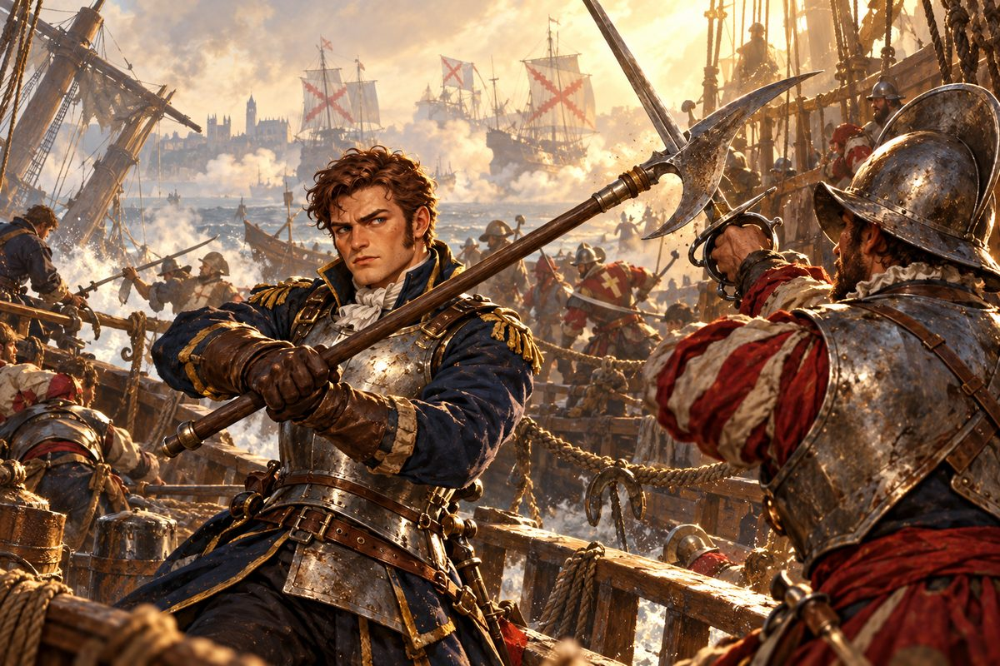
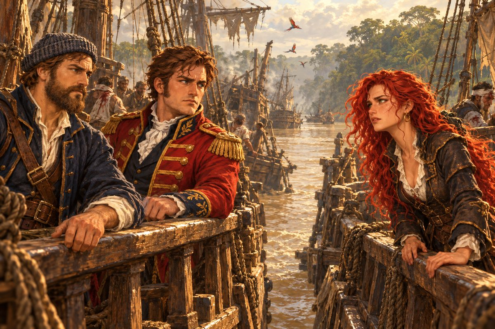

## 18. 다시 런던

1524년 봄, 바카스와 갤리가 플리머스에 들어섰을 때 부두의 짐꾼 하나가 오토를 알아보았다.

"아니, 이게 누구십니까. 그 유명한 베인스 경 아니십니까?"

오토는 걸음을 멈추었다. 런던을 떠날 때 그를 알아보는 사람은 여관 주인 하나뿐이었다.

"국왕 폐하께서 경을 찾으신답니다. 벌써 몇 주째 전령이 항구마다 돌았어요. 얼른 런던으로 올라가 보시지요." 짐꾼이 모자를 벗어 가슴에 댔다. "조국을 위해 더 힘써 주십시오, 경."

런던까지는 말을 달렸다. 템스강은 그대로였다. 안개도, 생선 비린내도, 런던 브리지 위의 집들도. 변한 것은 오토였다. 갑판 위에서 보낸 두 해가 그의 얼굴을 그을렸고, 손바닥에 밧줄 자국을 새겼다. 왕궁 회랑을 걷는 그의 걸음이 조금 넓어져 있었다. 흔들리는 바닥에 익숙해진 걸음이었다.

시종이 그를 보고 서둘러 다가왔다.

"폐하께서 기다리십니다. 바로 안으로 드시지요."

그리고 그 앞에는, 역시 그 사람이 서 있었다.

"두 해 동안 바다에서 무슨 놀음을 하다 이제야 기어 들어오는 겐가! 나랏돈을 받아 간 사람이 낯도 뜨겁지 않나!"

길버트의 얼굴은 두 해 전보다 더 말라 있었다. 금사슬은 더 굵어졌다. 오토는 그를 내려다보았다. 두 해 전에는 몰랐는데, 길버트는 생각보다 키가 작았다.

"그런 꾸지람을 들을 일은 하지 않았소. 길을 비켜 주시오, 길버트 경."

"건방지군! 작위 하나 받더니 눈에 뵈는 게 없나?" 길버트의 목소리가 떨렸다. "폐하께서 기다리시니 오늘은 봐주겠네만, 다음엔 어림없을 줄 알게!"

"……경과 더 나눌 이야기는 없소."

오토는 그를 지나쳤다. 등 뒤에서 아무 소리도 들리지 않았다. 그것이 오히려 더 불길했다.

## 19. 칙명

"오, 왔구나! 오래 기다렸다."

헨리 8세는 두 해 전보다 살이 올라 있었다. 그러나 눈빛은 그대로였다. 아니, 더 날카로워져 있었다. 옥좌 옆 탁자 위에 해도 한 장이 펼쳐져 있었고, 그 위에 작은 배 모형들이 놓여 있었다.

"급한 용건이 있으시다 들었습니다."

"언젠가 그대에게 해군을 맡겨 에스파니아를 꺾게 하겠다고 했던 말, 잊지 않았겠지?"

"하루도 잊은 적이 없습니다."

"그날을 위해 바다를 익혀 오라 한 것도."

"예. 그 말씀 또한 늘 품고 다녔습니다."

왕이 해도 위의 배 모형 몇 개를 손으로 쓸어 내렸다. 모형들이 탁자 아래로 떨어져 굴렀다.

"헌데 얼마 전, 우리 해군이 에스파니아 함대와 정면으로 부딪쳤다. 그 싸움에서 전함 절반 가까이가 바다에 가라앉았다."

오토는 숨을 멈추었다. 바다 위에서도 소문은 들었다. 그러나 왕의 입으로 듣는 것은 무게가 달랐다.

"에스파니아 사령부는 여세를 몰아 더 큰 공세를 준비하는 모양이다. 무적함대까지 불러 모은다는 첩보가 들어왔다. 이대로라면 우리 해군이 바다에서 사라지는 건 시간문제야. 한 번만 더 지면, 잉글랜드의 바다는 그들 발아래 짓밟힐 것이다."

왕이 자리에서 일어섰다. 해도 위에 남은 배 모형 하나를 집어 들었다. 깃발에 튜더 장미가 그려진 모형이었다.

"그래서 여러 날을 두고 측근들과 의논했다. 그리고 그대에게 무거운 짐을 지우기로 했다."

"무엇이든 하명하십시오."

"그대의 배들로 무적함대를 깨뜨려 다오." 왕이 모형을 오토의 손에 쥐여 주었다. "남은 해군은 이 섬을 지키기에도 벅차다. 지금으로서는 그대의 함대가 이 왕국이 부릴 수 있는 가장 큰 해상 전력이야."

오토는 손바닥 위의 작은 배를 내려다보았다. 가벼웠다. 그러나 손이 저렸다.

"받들겠습니다! 기사의 이름을 걸고, 무적함대를 바다 밑에 눕히겠습니다."

"믿음직하구나." 왕이 오토의 어깨를 짚었다. 두 해 전 칼날이 내려앉았던 바로 그 자리였다. "다른 무엇보다 이 임무를 앞에 두어라. 명심하라."

"예! 오늘부터 출항 채비를 하겠습니다."

## 20. 세 갈래 함대

런던 조합의 정보상은 오토를 보자 반색했다.

"베인스 님! 무적함대 소식을 찾으시는 거죠? 마침 따끈한 소식이 들어왔습니다."

정보상은 문을 닫고 목소리를 낮추었다. 매튜가 문에 등을 기대고 섰다.

"놈들이 자기네 나라에 손해를 끼치는 해적을 토벌하겠다고 나섰답니다. 상대는 요 근래 이베리아 근해를 휘젓고 다니며 단숨에 이름을 얻은 여해적, 카탈리나입니다."

오토의 손가락이 탁자 위에서 멈추었다.

"카탈리나……. 결국 그 정도까지 컸군."

"아는 사람입니까?"

"한 번 만났지."

정보상이 해도를 펼쳤다. 비스케이만 언저리에 세 개의 표시가 있었다.

"놈들은 함대를 세 갈래로 쪼개서 사방에서 그물을 좁혀 들어갈 셈입니다. 사흘 전 소식으로는 지금쯤 낭트, 보르도, 세비야에서 각각 보급 중일 겁니다. 그리고 이게 재미있는 대목인데, 놈들이 마지막에 모이는 곳은 남미 대륙일 가능성이 아주 높답니다."

"남미?" 매튜가 고개를 갸웃했다. "해적 하나 잡으러 대서양을 건넌다고요?"

"그건 저도 모르겠습니다." 정보상이 어깨를 으쓱했다. "아, 무적함대를 이끄는 건 에제키엘입니다. 에스파니아 왕실이 제일 아끼는 바다의 장수지요. 세 함대가 한데 모이면, 그 위용은 말로 다 못 할 겁니다."

조합을 나서자마자 매튜가 오토의 팔을 붙잡았다.

"제독님, 어쩌실 겁니까? 에스파니아 세 함대를 상대로 싸움을 건다는 건 목을 매는 거나 마찬가지예요. 그 여자한텐 안됐지만 이번엔 멀찍이서 구경만 하는 게 상책이에요."

"아니. 출격한다."

"설마……. 그 여자 편을 그렇게까지 들어 줄 이유는 없잖습니까?"

오토가 걸음을 멈추고 매튜를 돌아보았다.

"매튜, 그런 시시한 까닭이 아니야. 지금 우리는 압도적으로 유리한 자리에 서 있다."

"……그렇습니까?"

"셋이 한데 모여 우리를 에워싸면 이길 길이 없겠지. 하지만 아직 포위망은 만들어지지 않았어." 오토가 해도를 머릿속에 그렸다. 낭트, 보르도, 세비야. 세 점이 남쪽으로 내려가 하나로 모인다. 그 전에. "나는 놈들이 온전히 모이도록 내버려 두지 않을 거다. 합치기 전에 하나씩 쳐부순다."

매튜의 입이 천천히 벌어졌다.

"아, 그렇구나! 이거 참 대담한……. 어디부터 손봅니까?"

"물론 제일 가까운 낭트부터지."

## 21. 낭트 앞바다

루아르강 하구는 안개가 짙었다. 바카스와 갤리는 해가 뜨기 전에 하구 바깥에 자리를 잡았다. 오토는 성기사의 갑옷을 입었다. 판금이 어깨를 눌렀다. 차가운 쇠가 몸의 열을 빼앗아 갔다.

"제독님, 저기!"

안개가 걷히며 돛들이 나타났다. 열 척이 넘었다. 흰 바탕에 붉은 톱니 십자. 앞장선 갤리온은 바카스와 쌍둥이처럼 닮았다. 같은 조선소, 같은 설계. 아마 바카스의 형제일 것이었다.

"형제끼리 싸우게 생겼군." 오토가 중얼거렸다. "형이 이겨야지."

에스파니아 함대는 아직 닻을 반쯤 올린 채였다. 보급을 막 마친 참이었다. 그들은 영국 배가 여기까지 올 거라고는 생각하지 못한 것이 분명했다. 갑판 위에서 사람들이 우왕좌왕하는 것이 망원경 너머로 보였다.

"갤리는 바람에 상관없이 움직인다. 노를 저어 놈들의 뱃머리로 돌아라. 바카스는 바람을 타고 옆구리를 친다!"

갤리가 먼저 움직였다. 노가 일제히 물을 쳤다. 뱃머리의 무거운 포가 에스파니아 선두함의 앞돛대를 날려 버렸다. 선두함이 기울자 뒤따르던 배들이 서로 엉켰다. 그 틈으로 바카스가 미끄러져 들어갔다.

"우현, 쏴라!"

바카스의 포들이 울부짖었다. 연기가 바다를 덮었다. 화약 냄새에 눈이 따가웠다. 에스파니아 배들도 응사했다. 포탄이 바카스의 뱃전을 뚫고 들어와 나무 파편이 비처럼 쏟아졌다. 선원 하나가 파편에 맞아 쓰러졌다. 오토는 그를 돌아볼 여유가 없었다.

에스파니아 기함이 바카스 옆으로 붙었다. 쇠갈고리가 날아들었다. 갑옷 입은 병사들이 뱃전을 넘어왔다.

오토는 청룡언월도를 뽑았다. 매튜가 비웃었던 그 무기였다. 반달 같은 날이 아침 햇빛을 받아 번쩍였다. 긴 자루가 첫 번째 병사의 칼을 쳐내고, 두 번째 병사를 뱃전 밖으로 밀어냈다. 돛대는 자르지 않았다. 석 달 동안 갑판 위에서 매일 아침 연습한 덕이었다.

"제독님, 뒤!"

오토는 몸을 틀었다. 에스파니아 함장이 칼을 높이 쳐들고 있었다. 언월도의 자루가 함장의 칼을 받았다. 쇠와 쇠가 부딪혀 불꽃이 튀었다. 함장은 강했다. 두 번, 세 번. 오토의 팔이 저렸다. 네 번째에 오토가 한 걸음 들어갔다. 국경의 진창에서 배운 걸음. 어깨로 밀어붙이자 함장이 비틀거렸고, 언월도의 날이 그의 칼을 쳐서 바다로 날려 보냈다.

"항복하라!"

함장이 무릎을 꿇었다. 그것을 본 에스파니아 병사들이 하나둘 칼을 내려놓았다.

해가 중천에 떴을 때 싸움은 끝나 있었다. 낭트 앞바다에 에스파니아 배들이 돛대가 꺾인 채 떠 있었다. 오토는 바카스의 고물에 서서 숨을 골랐다. 갑옷 안이 땀으로 흥건했다.

그때 망꾼이 소리쳤다.

"제독님! 서쪽 수평선에 돛이 보입니다! 멀어지고 있습니다!"

오토가 망원경을 들었다. 수평선 끝에 작은 돛 그림자들이 보였다. 셀 수도 없을 만큼 작았다. 그것들은 서쪽으로, 대서양 한복판으로 미끄러져 가고 있었다.

"싸우는 동안 다른 함대들이 빠져나간 모양입니다."

"이런! 벌써 저렇게 멀리 갔군." 오토가 이를 악물었다. "과연 놈들이 모이기 전에 하나씩 칠 수 있을까?"

"행선지는 남미 대륙이랬죠? 어서 쫓아갑시다!"

## 22. 대서양을 건너

대서양은 넓었다. 오토는 그 넓이를 처음으로 몸으로 알았다.

닷새, 열흘, 보름. 수평선은 언제나 같은 자리에 있었다. 아무리 달려도 다가오지 않았다. 바다는 짙은 남색에서 점점 맑은 푸른색으로 바뀌었다. 날치 떼가 뱃머리 앞에서 은빛으로 날아올랐다. 밤이면 하늘에 처음 보는 별들이 떴다.

물이 귀해졌다. 오토는 선원들의 물 배급을 하루 두 잔으로 줄였다. 자기 몫도 줄였다. 매튜는 술 배급까지 줄어들자 하루 종일 돛대 밑에서 구름만 보았다.

"제독님. 저 구름에 비가 들었을까요?"

"모르겠네."

"들었으면 좋겠네요. 들었으면 제가 다 받아 마실 텐데."

스무하루째 되는 날 비가 왔다. 선원들이 갑판으로 뛰쳐나와 입을 벌렸다. 돛 천을 펼쳐 빗물을 받았다. 매튜가 빗속에서 춤을 추었다. 오토도 갑판 위에 서서 하늘을 향해 얼굴을 들었다. 미지근한 빗물이 입술을 적셨다. 그렇게 단 물은 처음이었다.

스물여드레째, 망꾼이 육지를 외쳤다.

마르가리타섬의 항구는 작았다. 진주를 캐는 섬이었다. 부두에서 그물을 손질하던 늙은 어부에게 오토가 물었다.

"영감, 혹시 이 근방에서 에스파니아 배들을 보지 못했소? 큰 함대 말이오."

"그 큰 함대 말씀이시오? 이 근방 항구 몇 군데서 물자를 채우더니 아마존강 쪽으로 떠났소." 어부가 그물코를 손가락으로 꿰었다. "그런데 제일 늦게 온 부대는 아직 산토도밍고에 머물러 있을지도 모르겠구려."

"아마존강이라고?" 매튜가 고개를 갸웃했다. "놈들, 이상한 데로 가는군요. 해적을 잡으러 간다면서 밀림 속으로요?"

오토는 대답하지 않았다. 무언가 맞지 않았다. 세 갈래로 나뉜 함대. 해적 토벌. 남미에서의 집결. 조각들이 하나의 그림을 이루지 않았다.

"일단 산토도밍고다. 남은 부대부터 친다."

## 23. 산토도밍고

산토도밍고는 에스파니아가 신대륙에 세운 첫 도시였다. 돌로 지은 성당과 요새가 바다를 내려다보았다. 항구 바깥에 에스파니아 함대가 닻을 내리고 있었다. 낭트의 함대보다 컸다.

이번에는 저쪽도 준비가 되어 있었다. 바카스가 수평선에 모습을 드러내자마자 에스파니아 배들이 닻을 올렸다.

싸움은 하루 종일 이어졌다. 열대의 해가 갑판을 달구었다. 화약 연기와 열기가 뒤섞여 숨이 막혔다. 갤리의 노꾼들이 지쳐 쓰러졌고, 바카스의 돛 하나가 불붙어 타올랐다. 매튜가 물통을 들고 뛰어다녔다.

오토는 적의 기함만 보았다. 하이레딘에게서 배운 것이었다. 바다의 싸움은 머리를 꺾으면 끝난다. 바카스가 기함의 옆구리로 파고들었다. 두 배가 맞부딪히는 충격에 오토는 갑판에 나뒹굴었다. 일어나 언월도를 쥐었다. 기함의 뱃전을 넘었다.

해가 질 무렵 에스파니아 기함의 돛대에서 톱니 십자 깃발이 내려왔다.

"제독님! 이겼습니다!"

선원들의 함성이 산토도밍고의 성벽에 부딪혀 메아리쳤다. 오토는 기함 갑판 위에 무릎을 꿇은 채 숨을 몰아쉬었다. 언월도 자루를 쥔 손가락이 펴지지 않았다.

매튜가 다가왔다. 그런데 그의 얼굴에 웃음이 없었다.

"제독님. 이번에도 나머지 함대가 그 틈에 빠져나갔습니다."

오토는 고개를 들었다. 남쪽 수평선 끝에 돛 몇 개가 멀어지고 있었다. 낭트에서와 똑같았다.

"도무지 놈들 속셈을 모르겠군. 왜 우리와 맞붙으려 하지 않는 거지?"

"어떻게 할까요?"

오토는 남쪽을 보았다. 그 너머에 아마존강이 있었다. 세상에서 가장 크다는 강. 바다처럼 넓은 하구.

"아마존강 근처에 뭔가 있다. 가서 확인하자."

## 24. 강어귀의 함대

아마존강 하구는 바다가 아니었다. 그렇다고 강도 아니었다. 끝이 보이지 않는 누런 물이 바다의 푸른 물을 밀어내며 흘러나왔다. 물에서 흙냄새와 썩은 나뭇잎 냄새가 났다. 하구 양쪽으로 밀림이 초록 벽처럼 솟아 있었다. 새들이 처음 듣는 소리로 울었다.

그리고 그 누런 물 위에 배들이 떠 있었다.

에스파니아 배들이었다. 오토가 낭트와 산토도밍고에서 놓친 함대들. 그러나 오토는 망원경을 내리지 못했다.

돛은 찢겨 너덜거렸다. 돛대가 꺾인 배, 뱃전에 커다란 구멍이 뚫린 배, 기울어진 채 겨우 떠 있는 배. 갑판 위에 붕대를 감은 사람들이 누워 있었다. 연기가 아직 피어오르는 배도 있었다.

"뭔가 이상한데. 꼭 크게 얻어맞은 배들 같지 않나……."

"제독님!" 망꾼이 외쳤다. "다른 함대가 이쪽으로 다가옵니다! 저 깃발…… 카탈리나입니다! 그 여해적의 배들이에요!"

강어귀 옆으로 배 몇 척이 미끄러져 나왔다. 앞장선 배의 뱃머리에 붉은 머리칼이 바람에 날렸다. 그 배들도 상처투성이였다.

두 함대가 가까워졌다. 카탈리나가 뱃전에 섰다. 몇 해 전 창고 문간에 섰던 그 모습 그대로였다. 아니, 조금 달랐다. 눈매의 날이 조금 무뎌져 있었다. 대신 피로가 깊었다.

"베인스. 여기서 또 만나는군요."

"이런 곳에서 다시 만나다니 묘한 인연이군. 미안하지만 잠시 비켜 주겠나? 지금은 해야 할 일이 있어서."

"잠깐만요." 카탈리나가 손을 들었다. "제가 이런 부탁을 할 처지가 아니란 건 압니다. 하지만 지금만은 에제키엘 사령관에게 칼을 겨누지 말아 주세요."

"그건 안 되겠는데. 그대에게 조안 페레로가 있었다면, 내게는 에제키엘이 있어. 나도 왕명을 받고 여기까지 왔네." 오토가 에스파니아 배들을 가리켰다. "게다가 에제키엘은 그대에게도 적이 아니었던가? 저 함대가 그대를 잡으러 나섰다고 들었는데."

"예전엔 그랬죠. 이제는 사정이 완전히 바뀌었어요."

"……달라졌다고?"

카탈리나가 숨을 골랐다. 그녀의 뒤에서 사누드와 기지가 오토를 보고 있었다. 기지가 작게 고개를 숙였다.

"최대한 짧게 말할게요. 에제키엘, 조안, 그리고 저. 셋이 한 적을 치려고 손을 잡았어요."

"조안과? 그대의 원수 아니었나?"

"아니었어요." 카탈리나의 목소리가 아주 조금 떨렸다. "우리의 공동의 적은 마르티네스 후작이에요. 세상을 손에 넣으려는 음모를 꾸민 자. 그리고 제 오빠와 정혼자를 죽인 진짜 범인이죠."

오토는 말이 없었다. 몇 해 전 선술집에서 그가 했던 말이 떠올랐다. 페레로 가문 같은 명문이 그런 짓을 했으리라고는 믿기지 않는다고. 그녀는 그때 내게 진실은 하나뿐이라고 대답했다. 그 진실이, 그사이 뒤집혀 있었다.

"그들 덕분에 저는 원수를 갚았어요. 하지만 후작과 큰 싸움을 치르느라 모두가 막대한 손실을 입었죠. 보시는 대로예요."

오토는 에스파니아 배들을 다시 보았다. 찢긴 돛, 꺾인 돛대, 붕대 감은 사람들.

뭐지, 이건. 그렇다면 쉽게 이길 수 있는 것 아닌가. 생각이 머릿속을 스쳤다. 무적함대가 지금 저 꼴이라면, 바카스와 갤리만으로도 오늘 안에 끝낼 수 있었다. 칙명을 완수하고 런던으로 돌아갈 수 있었다. 왕이 기뻐할 것이다. 길버트의 얼굴이 일그러질 것이다.

"당신은 명예를 목숨처럼 아는 기사라고 들었어요." 카탈리나가 말했다. "저 배들에 탄 사람들은 떳떳한 싸움을 치르고 다친 이들이에요."

웃기는 소리. 오토는 속으로 내뱉었다. 그러나 그 말이 누구를 향한 것인지, 오토 자신도 알 수 없었다. 카탈리나를 향한 것인지. 아니면 방금 전 머릿속을 스쳐 간 자기 생각을 향한 것인지.

그는 오래 서 있었다. 강물이 뱃전을 핥는 소리만 들렸다. 밀림에서 새 한 마리가 길게 울었다.

## 25. 철수

"매튜. 철수하자."

"예?" 매튜가 귀를 의심하는 얼굴로 돌아보았다. "제독님! 다 차려진 밥상을 걷어차자는 겁니까? 이건 아니죠!"

"내 말이 안 들리나! 철수하자고 했다."

매튜가 입술을 깨물었다. 그리고 돌아서며 들릴락 말락 중얼거렸다.

"알겠습니다, 알겠어요. 쳇, 결국 그 여자 말 몇 마디에 녹아 버리셨군."

"매튜. 방금 뭐라고 했지?"

목소리가 낮았다. 매튜가 우뚝 멈추었다. 그가 천천히 돌아섰다. 오토의 얼굴을 보고는 얼굴빛이 하얘졌다.

"아, 아무것도 아닙니다, 제독님. 말이 헛나왔습니다. 죄송합니다."

매튜가 고물로 달려가며 소리쳤다. 돛을 펴라, 뱃머리를 돌려라. 선원들이 웅성거렸지만 따랐다. 바카스와 갤리가 천천히 하구에서 멀어지기 시작했다.

카탈리나가 뱃전에서 그것을 지켜보았다. 바카스가 그녀의 배 옆을 지나칠 때, 그녀가 오토를 불렀다.

"베인스."

오토가 돌아보았다.

"부탁이에요. 이 약속, 깨지 말아 주세요."

오토는 대답하지 않았다. 다만 한 번 고개를 끄덕였다. 카탈리나가 그것을 보았는지는 알 수 없었다. 누런 강물이 두 배 사이를 벌려 놓았다.

에스파니아 배들 가운데 가장 큰 배, 고물에 금박이 반쯤 벗겨진 기함의 뱃전에 한 사람이 서 있었다. 회색 머리의 사내였다. 그는 멀어져 가는 바카스를 오래 바라보았다. 오토는 그 시선을 등으로 느꼈다. 뒤를 돌아보지는 않았다.
