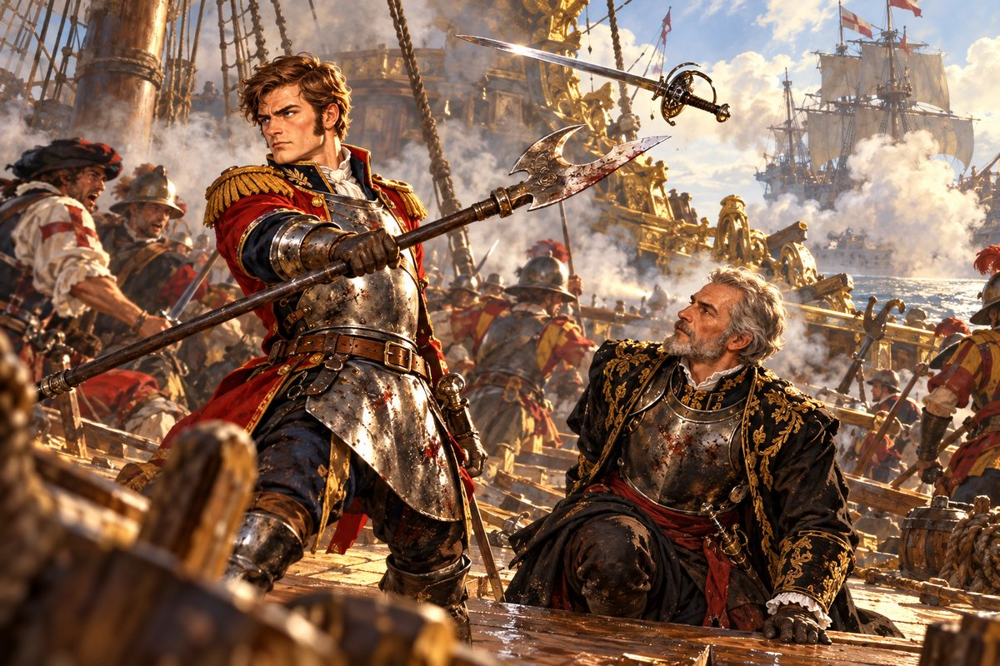

## 26. 매튜의 질문

돌아가는 대서양은 올 때보다 길었다.

바람이 맞바람이었던 탓도 있었다. 그러나 그보다는 배 위의 공기가 무거웠다. 선원들은 말이 없었다. 다 잡은 고기를 놓아준 어부들 같았다. 매튜는 사흘 동안 오토와 눈을 마주치지 않았다. 술도 마시지 않았다. 그것이 무엇보다 불길했다.

나흘째 저녁, 매튜가 선장실 문을 두드렸다.

"제독님. 앞으로 어쩌실 겁니까?"

오토는 해도에서 눈을 들었다. 매튜가 문간에 서 있었다. 들어오라는 말을 기다리는 얼굴이었다. 그런 매튜는 처음이었다.

"들어오게. 자네도 알잖나. 나는 무적함대를 없애라는 명을 받은 사람이야."

"하나 여쭤봐도 되겠습니까?"

"뭔가?"

매튜가 문을 닫고 들어와 섰다. 앉지 않았다.

"그걸 아시는 분이 어째서 아마존강에서는 그냥 돌아서셨습니까? 이제부턴 갈수록 힘들어질 텐데요. 놈들이 배를 고치고 사람을 채우면, 다시는 그런 기회가 없을 겁니다."

"글쎄……. 어째서였을까."

"카탈리나 때문입니까?"

매튜의 목소리에 비난은 없었다. 그저 알고 싶어 하는 목소리였다. 오토는 등잔불을 보았다. 불꽃이 배가 흔들릴 때마다 함께 흔들렸다.

"그건 아니야." 그가 천천히 말했다. "자네도 언젠가 이만한 함대를 이끄는 자리에 서게 되면 알게 될 거다."

매튜는 한참 오토를 보았다. 그리고 고개를 끄덕였다. 납득한 끄덕임은 아니었다. 그래도 일단은 믿어 보겠다는 끄덕임이었다.

"그럼 이제 어디로 갑니까?"

"에제키엘은 반드시 본국으로 돌아갈 거다. 그 뒤를 쫓자."

매튜가 문을 열고 나가려다 멈추었다.

"제독님. 그때…… 제가 한 말, 정말 죄송합니다."

"알고 있네."

매튜가 나갔다. 잠시 뒤 갑판에서 그의 목소리가 들렸다. 돛 줄 똑바로 매라, 이 굼벵이들아. 평소의 목소리였다. 오토는 해도로 눈을 돌렸다. 그리고 처음으로 오래 참았던 숨을 내쉬었다.

## 27. 합석

이베리아 반도 서쪽 해안의 한 항구에 들렀을 때였다. 물과 식량을 채우는 동안 오토와 매튜는 부두 앞 선술집에 앉았다.

"아, 역시 술집 의자에 앉아야 사람이 사는 것 같다니까요."

"자네도 참 지독한 술꾼이야."

"그런데 오늘따라 가게가 꽤 붐비네요. 어디 함대라도 들어온 걸까요?"

정말로 선술집은 빈자리가 없었다. 뱃사람들이 벽에 기대어 선 채로 잔을 기울였다. 그때 뒤에서 누군가 말을 걸었다.

"실례하오. 빈자리가 통 없구려. 이 탁자 한쪽을 좀 빌려도 되겠소?"

오토가 돌아보았다. 예순 가까워 보이는 사내였다. 회색 머리를 짧게 깎았고, 같은 빛깔의 수염을 단정하게 다듬었다. 수수한 갈색 외투를 입었지만, 등이 곧고 어깨가 넓었다. 바다에서 오래 산 사람 특유의, 바람에 깎인 얼굴이었다.

"앉으시오. 우린 괜찮소."

"고맙소. 여기서 누굴 좀 기다리는 중이라."

"편히 한잔하시오."

사내가 자리에 앉았다. 그는 오토와 매튜를 차례로 훑어보았다. 날카롭지는 않았지만 빈틈없는 눈이었다.

"보아하니 당신들도 뱃사람인 듯한데. 영국 사람이오?"

"맞소. 볼일이 있어 잠깐 들렀소. 노형은 어디서 오셨소?"

"세비야에서 왔소. 여기서 볼일이 하나 있는데, 아직 시작도 못 했소." 사내가 손을 들어 주인을 불렀다. "합석을 허락해 준 답례로 한 잔 사고 싶은데."

"이야, 그거 반가운 소리네요, 영감님!"

"매튜. 말조심하게." 오토가 낮게 말했다. "지금 자넨 흔한 뱃사람이 아니야. 왕실의 지원을 받는 함대의 일원이야."

매튜가 목을 움츠렸다. 오토가 사내에게 고개를 숙였다.

"이 사람의 무례를 너그러이 봐주시오. 혈기가 넘쳐서 그럴 뿐, 천성이 나쁜 사람은 아니오."

"개의치 마시오. 나도 평생 갑판 위에서 늙은 사람이라, 뱃사람 입버릇쯤은 귀에 익소." 사내가 엷게 웃었다. "주인장, 이분들께 제일 좋은 라임주를 내주게."

"예예, 곧 갑니다!"

연둣빛 술이 잔에 담겨 나왔다. 상큼하고 독한 향이 코를 찔렀다. 신대륙의 라임으로 담근 술이었다.

"그럼 염치 불고하고 받겠소."

"캬아! 남이 사 주는 술이 제일 달다더니, 딱 그 말이네!"

"매튜." 오토가 한숨을 쉬었다. "자네도 이제 어엿한 무인 축에 들었어. 조금은 겸손할 줄도 알아야 하지 않겠나."

"무인이라……." 사내가 잔을 돌리며 혼잣말처럼 말했다. "듣자니 영국 함대 하나에 배짱 두둑하고 시원시원한 부관이 있다더군."

오토의 손이 잔 위에서 멈추었다.

"아, 실례했소. 소개가 늦었구려." 사내가 잔을 내려놓았다. "에스파니아 해군에 몸담은 에제키엘이오."

매튜가 라임주를 뿜었다. 오토는 그대로 앉아 있었다. 등줄기를 타고 찬 것이 흘러내렸다.

"뭐…… 당신이!?"

"에제키엘 사령관……."

선술집의 소란은 그대로였다. 아무도 이 탁자를 보지 않았다. 무적함대의 총사령관이 이 시끄러운 선술집 구석에 앉아 영국 사략선 선장과 라임주를 마시고 있다는 것을, 누구도 알지 못했다.

오토는 숨을 한 번 골랐다. 그리고 바로 앉았다.

"오토 베인스요. 헨리 8세 폐하의 명으로 함대를 맡고 있소."

"흠. 역시 당신이 그날의 그 함대 지휘관이었군." 에제키엘이 오토의 눈을 똑바로 보았다. "그럼 꼭 물어야겠군. 그날 왜 포문을 열지 않았소?"

선술집의 소음이 멀어지는 것 같았다.

"그날 우리 배들은 화약도, 사람도 바닥나 있었소. 마음만 먹었다면 한나절이면 우리를 전부 물고기 밥으로 만들 수 있었을 거요."

"별것 아니오. 칼을 든 사람으로서 지킬 체면이 있었을 뿐이오. 더구나 나는 기사의 맹세를 한 몸이오."

"명예라……." 에제키엘이 그 말을 혀끝에서 굴렸다. "그 말을 입에 올리며 얼굴 붉히지 않는 사람이 요즘 몇이나 될까."

"고민할 것도 없었소. 상처 입은 적의 등에 칼을 꽂은 자로 기억되기 싫었을 뿐이오." 오토가 잔을 내려놓았다. 그리고 그는 매튜에게도 하지 않았던 말을 했다. "그리고 솔직히 말하면, 당신과는 제대로 붙어 보고 싶었소. 에스파니아에서 첫손에 꼽힌다는 장수와, 서로 온전한 몸으로."

매튜가 오토를 돌아보았다. 입이 반쯤 벌어져 있었다.

에제키엘은 한동안 말이 없었다. 그러다 낮게 웃었다. 오래 닫혀 있던 문이 삐걱 열리는 것 같은 웃음이었다.

"당신은 요즘 세상에 보기 드문 제독이로군. 좋소. 그렇게 원한다면, 무적함대가 정면에서 당신을 맞아 주지."

그가 탁자 위에 손가락으로 선을 그었다. 엎질러진 라임주가 해안선이 되었다.

"한 달 뒤요. 장소는 런던과 세비야 사이, 보르도 앞바다. 우리 함대는 그곳을 떠나 싸울 채비를 한 채 세비야까지 내려가겠소. 그 길 어디에서든, 원하는 때에 덤벼 오시오."

"……."

"어떻소, 받겠소?"

오토는 탁자 위의 젖은 선을 보았다. 보르도에서 세비야까지. 그 짧은 선 위에서 두 나라의 운명이 갈릴 것이었다.

"잘 알겠소. 거절할 이유가 하나도 없지. 받아들이겠소."

"기대되는군. 한 달 뒤를 손꼽아 기다리겠소." 에제키엘이 일어나 외투를 여몄다. 그리고 탁자 위에 금화 한 닢을 놓았다. "라임주 값이오. 그럼 이만."

그가 선술집 문을 나섰다. 문이 닫히고 나서야 매튜가 숨을 쉬었다.

"제독님. 정말 괜찮겠습니까?"

"이기고 지는 건 그날 바람이 정하겠지." 오토가 남은 라임주를 비웠다. 상큼하고 독했다. "그보다 그 노장과 미련 없이 겨룰 수 있게 됐으니, 그걸 반겨야지."

"방금 그 사람, 처음부터 우릴 알아보고 들어온 거죠?"

"그랬겠지."

"사람을 만나기로 했다는 게 우리였고요."

"아마도."

매튜가 머리를 감싸 쥐었다.

"아이고. 무적함대 사령관한테 영감님이라고 했어."

## 28. 한 달

한 달은 짧았다.

오토는 항구에서 항구로 바카스와 갤리를 몰았다. 찢긴 돛을 갈고, 뱃전의 구멍을 메웠다. 포를 새로 들이고 화약을 쌓았다. 선원도 더 모았다. 산토도밍고에서 잃은 자리를 채웠다. 매튜가 술집을 돌며 사람을 뽑았다. 이번에는 환영회를 열지 않았다. 대신 새로 온 사람들에게 바카스가 세비야에서 어떻게 손에 들어왔는지 이야기해 주었다. 이야기는 할 때마다 조금씩 커졌다.

"제독님, 보르도 약속까지 이제 열이틀입니다."

"마지막 싸움을 준비하자."

그날 밤 오토는 선장실에서 편지를 썼다. 런던의 왕에게 보내는 보고였다. 몇 번을 고쳐 썼다. 결국 그는 있는 그대로를 적었다.

> 폐하.
> 신은 아마존강 어귀에서 무적함대를 만났으나 치지 않았습니다. 그들은 다른 적과의 싸움으로 크게 상해 있었고, 신은 그렇게 얻은 승리가 잉글랜드의 이름을 높이지 못하리라 여겼습니다.
> 이후 에제키엘 사령관이 신에게 정면 대결을 청해 왔고 신은 이를 받아들였습니다. 열이틀 뒤 보르도 앞바다에서 싸웁니다.
> 신이 이기면 칙명을 다할 것이요, 지면 그 허물은 오로지 신에게 있습니다. 어느 쪽이든 폐하께 거짓을 아뢰지는 않겠습니다.
> 오토 베인스

봉투를 밀랍으로 봉하면서 오토는 길버트의 얼굴을 떠올렸다. 이 편지가 왕에게 닿기 전에 그 손을 거칠지도 몰랐다. 그래서 그는 편지를 두 통 썼다. 한 통은 조합의 정보상 편으로, 한 통은 플리머스로 가는 상선 편으로.

## 29. 결전 전야

결전 전날 밤, 바다는 이상할 만큼 잔잔했다.

달이 떴다. 보름에 가까운 달이 바다 위에 은빛 길을 깔았다. 그 길 끝, 수평선 너머에 보르도가 있었다. 그리고 내일, 그 앞바다에 무적함대가 있을 것이었다.

오토는 고물에 기대어 달을 보았다. 매튜가 술병 두 개를 들고 올라왔다. 하나를 오토에게 내밀었다. 얼간이호의 갑판에서 처음 그랬던 것처럼.

"이번엔 마셔도 됩니까? 내일 싸움인데."

"한 병이면 괜찮겠지. 두 병째부터는 안 되네."

"한 병이요? 그거 가지고 어디 취하겠어요." 매튜가 병마개를 이로 뽑았다. 둘은 한동안 말없이 마셨다.

"제독님." 매튜가 먼저 입을 열었다. "그 선술집에서 하신 말씀요. 정면으로 맞서고 싶었다는 거. 그게 진짜 이유였습니까?"

"반은."

"나머지 반은요?"

오토는 병을 내려다보았다. 달빛이 유리병 속에서 흔들렸다.

"아마존강에서 그 배들을 보는 순간 생각했어. 지금 치면 쉽게 이긴다. 칙명도 다하고, 런던에 돌아가면 다들 박수를 치겠지. 그런데 그 생각을 하는 내가 싫었네." 오토가 술을 한 모금 마셨다. "그 순간의 나는 길버트와 다를 게 없었어. 누가 약해진 틈을 노려서 올라서려는 사람. 그 사람이 되기 싫었던 거야."

매튜는 오래 말이 없었다. 그러다 혼잣말처럼 중얼거렸다.

"……제가 지금껏 모신 제독 중에, 그런 이유로 승리를 버린 사람은 없었어요."

"버린 게 아니야. 미뤄 둔 거지." 오토가 웃었다. "그러니 내일은 꼭 이겨야 해. 안 그러면 진짜로 버린 게 되니까."

매튜가 병을 들어 올렸다. 오토도 들었다. 두 병이 부딪히며 맑은 소리를 냈다.

"내일 이기면 제가 런던에서 제일 큰 술통을 사겠습니다."

"자네 돈으로?"

"제독님 돈으로요."

## 30. 보르도 앞바다

새벽안개가 걷히자 그들이 있었다.

수평선을 가득 메운 돛. 아마존강에서 보았던 상처투성이 배들이 아니었다. 한 달 사이 고친 돛과 새로 칠한 뱃전이 아침 해를 받아 빛났다. 그 한가운데, 금박 입힌 고물루가 높이 솟은 기함이 있었다. 그리고 그 옆을 지키는 또 한 척의 거대한 갤리온. 원군의 기함이었다. 포문이 바카스보다 많았다.

"제독님…… 저건 아마존강에 있던 그 함대가 아닌데요. 본국에서 원군까지 붙었어요."

"정면 대결을 청했으니, 저쪽도 정면으로 오는 게 예의겠지."

에스파니아 기함에서 작은 보트 한 척이 내려졌다. 노 젓는 병사 넷과 고물에 앉은 회색 머리의 사내. 보트는 두 함대 사이 한가운데에 멈추었다. 오토도 단정을 내리게 했다. 두 보트가 파도 위에서 마주 보았다.

에제키엘은 선술집에서와 다른 차림이었다. 검은 바탕에 금실로 수놓은 군복, 가슴을 덮은 흉갑. 허리에는 오래 쓴 칼이 걸려 있었다.

"에제키엘 사령관." 오토가 먼저 말했다. "오늘 이 바다에서, 우리 둘 중 하나는 돌아가지 못하겠지요."

"부디 가진 것을 다 보여 주시오." 에제키엘이 대답했다. 그의 목소리는 잔잔했다. "오늘 하루에 우리 둘의 명운도, 두 나라의 앞날도 함께 실려 있으니."

두 사람은 서로에게 고개를 숙였다. 보트가 각자의 함대로 돌아갔다.

오토는 바카스의 갑판에 올라섰다. 성기사의 갑옷을 입고, 청룡언월도를 손에 쥐었다. 선원들이 자리를 잡았다. 포수들이 심지에 불을 붙였다. 매튜가 키를 잡았다.

"원군 기함이 먼저 나오는데요. 저놈부터 칩니까?"

오토는 두 기함을 번갈아 보았다. 원군의 갤리온은 크고 강했다. 그것과 먼저 맞붙으면 바카스는 이기더라도 너덜너덜해질 것이었다. 그 꼴로 에제키엘의 기함 앞에 서면 끝이었다.

"아니. 원군은 갤리에 맡긴다. 노를 저어 놈의 뱃머리를 막고 시간만 끌라고 해. 바카스는 곧장 에제키엘에게 간다."

"본대 기함으로요? 원군 놈을 등 뒤에 두고요?"

"머리를 꺾으면 몸은 멈춘다. 하이레딘에게 배운 거다."

매튜가 히죽 웃었다. 그리고 키를 꺾었다.

"전 돛 펴라! 기함으로 간다!"

갤리가 노를 저어 원군 갤리온의 앞을 가로막았다. 갤리의 뱃머리 포가 불을 뿜었다. 원군 갤리온이 몸을 틀며 응사했다. 두 배가 엉키는 사이, 바카스가 그 옆을 스쳐 지나갔다. 바람이 등 뒤에서 불었다. 돛이 터질 듯 부풀었다.

에제키엘의 기함이 기다리고 있었다. 도망치지 않았다. 피하지도 않았다. 기함의 포문이 일제히 열렸다.

"엎드려!"

포성이 바다를 찢었다. 바카스의 뱃전이 터져 나갔다. 나무 파편이 갑판을 휩쓸었다. 앞돛대의 활대가 부러져 떨어졌다. 비명이 들렸다. 오토는 일어섰다. 귀에서 웅웅 소리가 났다.

"쏴라! 전부 쏴라!"

바카스가 응사했다. 기함의 고물루에서 금박 입힌 조각이 부서져 흩어졌다. 두 배가 서로를 향해 계속 다가갔다. 연기 속에서, 마침내 두 뱃전이 맞부딪혔다.

---

갈고리가 양쪽에서 날아들었다. 바카스의 선원들과 에스파니아 병사들이 동시에 뱃전을 넘었다. 오토는 기함의 갑판으로 뛰어내렸다. 갑옷이 무거웠다. 무릎이 갑판에 부딪혔다. 일어서자 눈앞에 그가 있었다.

에제키엘은 칼을 뽑아 들고 서 있었다. 흉갑에 그을음이 묻었고 회색 머리칼이 바람에 흩날렸다. 그러나 칼끝은 흔들리지 않았다.

"오시오, 베인스 경."

오토가 언월도를 휘둘렀다. 에제키엘의 칼이 그것을 비껴 냈다. 언월도의 무게가 갑판에 처박혔다. 에제키엘의 칼끝이 오토의 목을 향해 들어왔다. 오토는 자루로 그것을 막았다. 쇠와 나무가 부딪히는 둔탁한 소리.

노장은 빨랐다. 예순의 몸이라고는 믿기지 않았다. 군더더기 없는 칼이었다. 한 번 휘두를 때마다 수십 년의 바다가 실려 있었다. 오토는 밀렸다. 한 걸음, 두 걸음. 등 뒤로 뱃전이 다가왔다.

국경의 진창. 오토는 숨을 세었다. 하나, 둘.

셋에 그는 물러서지 않고 들어갔다. 언월도의 긴 자루를 버리듯 짧게 쥐고, 어깨로 에제키엘의 흉갑을 밀었다. 노장의 균형이 아주 조금 흔들렸다. 그 틈으로 언월도의 날이 올라갔다. 에제키엘의 칼이 손을 떠나 허공을 돌다가, 갑판에 꽂혔다.

에제키엘이 한쪽 무릎을 꿇었다.

기함 위의 싸움이 멈추었다. 에스파니아 병사들이 칼을 든 채 굳어 섰다. 멀리서 갤리와 원군 갤리온의 포성이 잦아들었다. 원군 기함의 돛대에서 깃발이 천천히 내려오고 있었다.

## 31. 단정

"으윽…… 완전히 졌군." 에제키엘이 숨을 몰아쉬었다. "변명할 여지도 없는, 완벽한 패배요."

"행운의 여신이 내 쪽으로 웃어 준 것 같소." 오토가 언월도를 내렸다. "이제 매듭을 지을 때로군."

에제키엘이 고개를 들었다. 그의 눈에 두려움은 없었다.

"청이 하나 있소. 부하들은 놓아주시오. 이 싸움의 값은 내 목 하나로 치르겠소." 그가 목깃을 풀어 목을 드러냈다. "자, 명예롭게 베어 주시오."

바람이 불었다. 연기가 걷혀 가고 있었다. 갑판 위의 모든 눈이 오토를 보았다. 영국 선원들도, 에스파니아 병사들도.

오토는 오래 서 있었다. 그리고 언월도를 등 뒤로 돌려 세웠다.

"매튜. 단정을 준비해라."

"예?" 매튜가 피투성이 얼굴로 돌아보았다. "뭐 하시게요?"

"에제키엘 사령관을 원군 기함까지 모셔다 드려라."

"말도 안 돼요!" 매튜가 소리를 질렀다. "적장을 또 놓아주시겠다고요!"

"무적함대는 무너졌다. 우리 임무는 거기서 끝난 거야."

매튜가 입을 벌렸다가 다물었다. 그리고 다시 벌렸다. 결국 그는 머리를 북북 긁으며 돌아섰다.

"어휴! 제독님은 대체 왜 이렇게 사람이 좋으신 거예요……?"

그래도 그는 단정을 내렸다. 직접 노를 잡았다.

에제키엘이 천천히 일어섰다. 그는 갑판에 꽂힌 자기 칼을 보았다. 오토가 그것을 뽑아 손잡이 쪽을 내밀었다. 에제키엘은 오토를 오래 보았다. 그리고 칼을 받아 칼집에 넣었다.

"사령관. 다음에 또 전장에서 봅시다."

"아니오." 에제키엘이 고개를 저었다. 그의 얼굴에 희미한 웃음이 떠올랐다. "오늘 칼을 놓치는 순간 깨달았소. 늙은 군인이 물러설 때가 왔다는 걸."

"에제키엘 사령관……."

에제키엘이 단정으로 내려가는 줄사다리에 발을 걸었다. 그러다 멈추고 오토를 올려다보았다.

"이만한 싸움을 해냈으니, 당신더러 겁이 많다고 할 사람은 세상에 없을 거요."

"……."

"대신 이제부터 당신 별명은 닭대가리 제독이 될 거요. 다 잡은 적장을 두 번이나 놓아준 사람이니까." 노장이 고개를 젖히고 크게 웃었다. 바다 위로 웃음소리가 퍼졌다. "하하하!"

단정의 노를 쥔 매튜가 아래에서 투덜거렸다. 그 말엔 반박할 수가 없네.

"그럼, 안녕히……."

단정이 바카스를 떠나 원군 기함 쪽으로 미끄러져 갔다. 에제키엘은 단정 고물에 꼿꼿이 앉아 있었다. 한 번도 뒤를 돌아보지 않았다.

오토는 뱃전에 기대어 그 모습을 지켜보았다. 언월도를 쥔 손이 그제야 떨리기 시작했다. 갑옷 안이 땀으로 흠뻑 젖어 있었다. 등 뒤에서 누군가 웃음을 터뜨렸다. 웃음이 번졌다. 바카스의 선원들이, 갤리의 노꾼들이, 함성을 지르기 시작했다.

닭대가리 제독. 오토는 그 말을 입속으로 굴려 보았다. 나쁘지 않았다. 얼간이호보다는 나았다.
