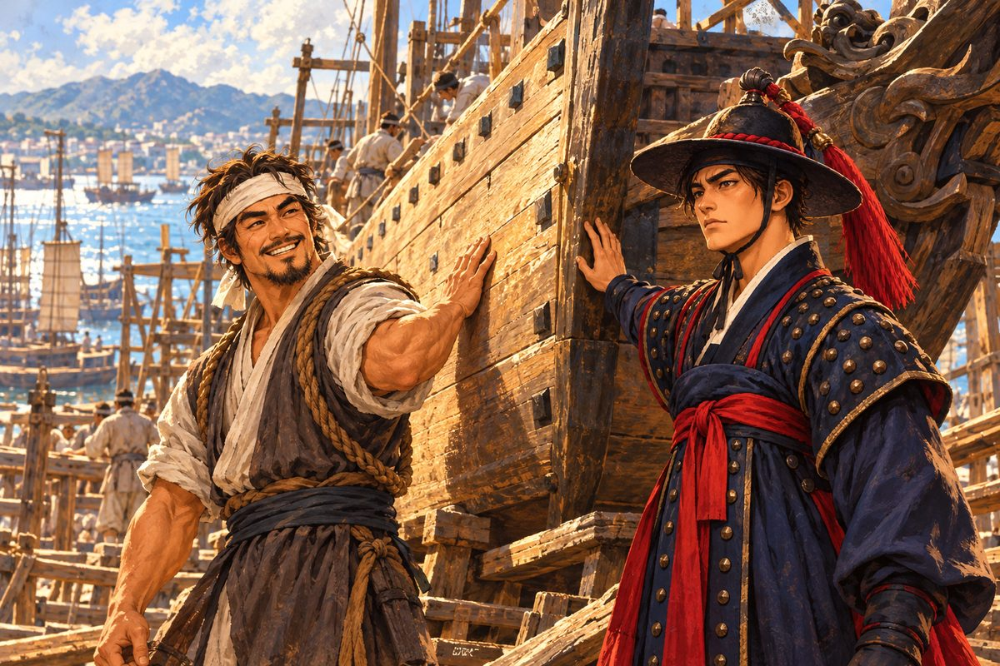
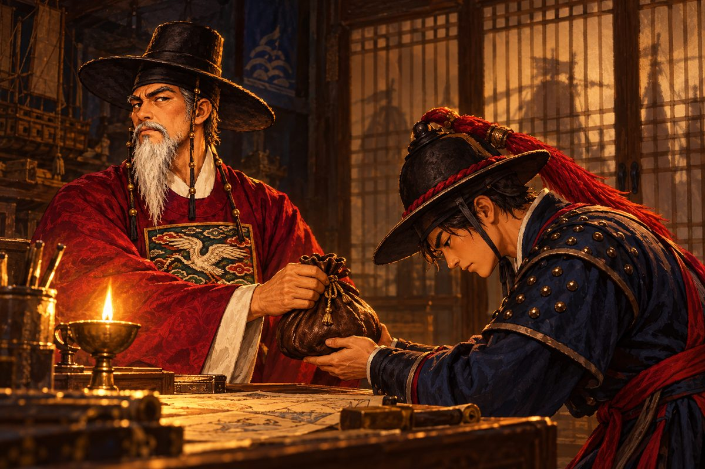
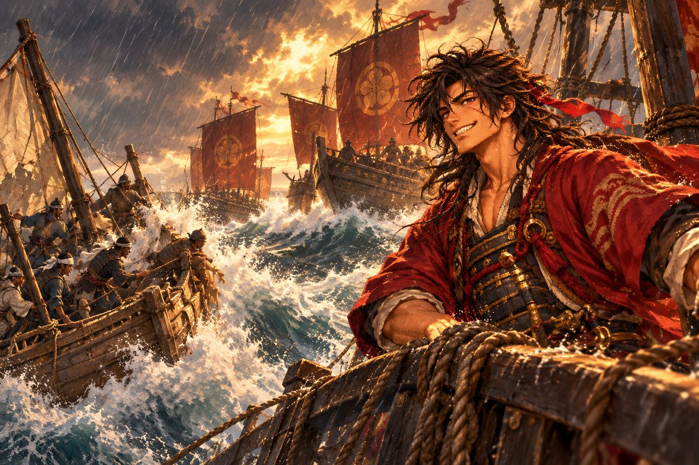

## 1. 좌수영 관아

경상좌수사는 예순이 넘은 노장이었다. 흰 수염이 가슴께까지 내려왔고, 붉은 관복 가슴에 수놓은 흉배의 학이 등불에 반짝였다. 해강은 그 학을 보고 저도 모르게 눈을 돌렸다. 하얀 학. 수놓은 학의 날개가 오늘따라 지나치게 넓어 보였다.

관아 대청은 서늘했다. 바닥에 깔린 돗자리에서 묵은 먹 냄새가 났다. 좌수사는 서안 앞에 앉아 이미 몇 통의 보고서를 읽은 얼굴이었다.

"윤 만호, 왔는가. 다대포 일은 들었네."

"좌수사 영감. 살아남은 사람이 거의 없습니다."

목소리가 갈라졌다. 해강은 마른침을 삼키고 다시 말했다. 집이 몇 채 탔는지, 포구의 배가 몇 척 남았는지, 수습한 시신이 몇인지. 숫자를 말하는 동안에는 견딜 만했다. 숫자는 사람이 아니었으니까.

좌수사는 오래 한숨을 쉬었다. "왜관이 다시 열린 지 한 해도 되지 않았는데…… 이번 왜구는 보통 무리가 아니야. 삼포의 난리 뒤로 열두 해를 막아 두었던 문을 겨우 다시 연 참이네. 그 틈을 노린 게지."

그는 서안 위의 종이 한 장을 손가락으로 두드렸다.

"대마도 쪽에서 들려오는 이름이 있네. 구로세 도겐."

"구로세 도겐……."

해강은 그 이름을 입속으로 굴렸다. 낯선 왜의 이름이었지만, 혀끝에 쇠 맛이 났다.

"검은 학 깃발을 쓰는 자라더군. 남해 여기저기를 휩쓸고 다닌다지. 거제에서도, 고성에서도 그 깃발을 보았다는 말이 올라왔네. 그런데 이번만큼 크게 친 적은 없었어."

해강은 무릎을 꿇었다. 이마가 돗자리에 닿았다.

"영감, 그자를 쫓게 해 주십시오."

"서두르지 말게." 좌수사의 목소리는 낮고 단단했다. "원수를 갚겠다는 마음이야 내 어찌 모르겠나. 그러나 칼을 뽑기 전에 눈부터 떠야 하네. 먼저 마을에서 본 사람들의 말을 모아 오게. 원수를 갚으려면 원수의 얼굴부터 알아야지."

해강은 고개를 들지 않은 채 대답했다. "……예."

관아를 나설 때 등 뒤에서 좌수사가 한 마디를 더 했다.

"윤 만호. 자네 아버지도 꼭 그렇게 꿇어앉곤 했네. 성미 급한 것까지 닮았군."

## 2. 주막의 노인

부산포 주막은 그날따라 조용했다. 평소라면 뱃사람들의 웃음소리와 노랫가락이 떠나지 않는 곳이었다. 오늘은 누구도 노래하지 않았다. 다대포에 친척 하나쯤 두지 않은 사람이 부산포에는 드물었다.

주모가 해강을 알아보고 턱으로 구석 자리를 가리켰다.

"만호 나리, 저쪽 구석에 다대포에서 살아 나온 영감이 있습니다. 새벽에 배 한 척 타고 겨우 닿았는데, 아직 한 마디도 안 했어요."

노인은 해강이 어릴 적부터 알던 어부였다. 해강이 코흘리개일 때 갓 잡은 전어를 구워 주던 사람이었다. 그물을 깁던 굵은 손가락이 막걸리 사발을 감싸 쥐고 있었다. 사발은 가득 찬 채였다.

"나리…… 나리시군요." 노인의 눈이 해강을 알아보고 젖었다. "저는 배 밑에 숨어 겨우 살았습니다. 뒤집힌 배 밑에서 숨도 못 쉬고, 그 소리를 다 들으면서."

해강은 노인 맞은편에 앉았다. 노인의 손을 잡아 주어야 할지 망설이다가, 결국 사발을 쥔 그 손 위에 자기 손을 얹었다.

"그날 무엇을 보았는지 말해 주게. 무엇이든."

"검은 학 깃발을 단 배가 다섯 척이었습니다." 노인은 천천히 말을 골랐다. "앞장선 배는 지붕 같은 망루가 높이 솟은 큰 배였지요. 우리네 판옥과도 다르고, 그냥 왜선과도 다른, 갑판 위에 성을 올린 것 같은 배였습니다."

"두목은 보았나?"

"두목은 얼굴에 긴 흉터가 있었습니다. 여기서 여기까지." 노인은 떨리는 손가락으로 자기 왼쪽 눈썹에서 턱까지를 그었다. "그자는 웃고 있었어요. 마을이 다 타는 동안 내내. 그리고 조총 같은 쇠막대를 든 자들도 섞여 있었지요. 그게 불을 뿜으면 멀리 있던 사람이 쓰러졌습니다. 활보다 멀리서."

"조총……." 해강이 중얼거렸다. 수영에서 소문으로만 들은 무기였다. 남쪽 바다의 남만인들이 가지고 다닌다는 쇠 화살 없는 활. "남만인의 무기까지 손에 넣었단 말인가."

노인이 갑자기 해강의 소매를 붙잡았다. 거친 손이었다. 바다에서 평생을 보낸 손.

"나리, 우리 마을의 원수를 꼭 갚아 주십시오. 저 같은 늙은이는 노밖에 저을 줄 모르지만…… 나리라면."

해강은 그 손을 마주 잡았다. 대답 대신이었다.

## 3. 해령호

조선소 비탈에 낡은 맹선 한 척이 올라 있었다.

뱃전 칠은 군데군데 벗겨졌고, 돛대 하나는 새로 깎은 생나무라 색이 달랐다. 그러나 용골은 곧았고, 바닥판은 소나무 진이 배어 묵직하게 빛났다. 오래 바다를 탄 배에서만 나는, 소금과 송진과 땀이 섞인 냄새가 났다.

그 아래에서 망치질하던 사내가 고개를 들었다. 마흔이 넘은 갑판장, 박돌석이었다. 이마에 흰 수건을 질끈 동이고, 걷어 올린 소매 밑으로 굵은 팔뚝이 드러났다. 해강을 보자 그의 얼굴에 웃음이 번졌다가, 이내 무언가를 알아차리고 굳었다.

"이게 누구야. 해강이 아니냐!"

"돌석 아저씨! 살아 계셨군요."

"그날 나는 조선소에서 밤을 새웠다. 네 아버지와 함께 탔던 배를 손보느라." 돌석은 망치를 내려놓고 잠시 말이 없었다. 다대포에 무슨 일이 있었는지, 그도 이미 알고 있었다. "……네 어머니는."

해강은 고개를 저었다. 돌석은 더 묻지 않았다. 대신 배 옆구리를 손바닥으로 두드렸다. 텅, 하고 깊은 소리가 울렸다.

"맹선 해령호. 낡았지만 바닥이 튼튼한 놈이다. 네 아버지가 마지막으로 탄 배가 이놈이었지. 그날 폭풍에 다른 배는 다 부서졌는데 이놈만 돌아왔어. 사람은 못 데리고 왔지만." 돌석이 해강을 보았다. "이 배를 끌고 나갈 생각이지?"

"네. 아버지가 타시던 배라면 더 바랄 게 없습니다."

"그럼 나도 따라가마. 노 젓는 놈들 다루는 데는 내가 제일이지. 그리고." 돌석은 코를 한 번 훌쩍였다. "네 아버지한테 진 빚이 있다. 그 빚을 갚을 데가 이제 너밖에 없구나."

해강은 뱃머리에 손을 얹었다. 나무가 바닷물을 오래 먹어 서늘했다. 아버지도 이 자리에 손을 얹었을 것이다. 해강은 눈을 감고, 아버지의 손이 닿았을 나뭇결을 손끝으로 더듬었다.

항구 관리소 서리는 빈 배를 보고 혀를 찼다.

"해령호를 띄우시려고요? 배에 사람이 없으면 한 치도 못 나갑니다. 술집에서 선원을 모으시고, 물과 식량도 넉넉히 실으십시오. 바다에서는 물 한 독이 금 한 냥입니다."

"바다는 사흘이면 사람을 바꿔 놓는다." 돌석이 거들었다. "채비는 꼼꼼히 하자. 성급한 놈부터 바다에 먹힌다."

## 4. 첫 해전

순찰 이틀째, 물안개가 짙었다.

새벽 바다는 우유를 풀어 놓은 듯 희었다. 뱃머리에서 열 걸음 앞도 보이지 않았다. 격군들이 노를 젓는 소리와 물이 뱃전을 핥는 소리만 들렸다. 해강은 뱃머리에 서서 안개 속을 노려보았다. 이틀 동안 거의 잠을 자지 않았다.

"해강아." 돌석이 낮게 불렀다. "저기 동쪽 물안개 속에 배 그림자가 있다."

해강은 눈을 가늘게 떴다. 처음에는 아무것도 보이지 않았다. 그러다 안개가 바람에 잠깐 찢어지는 틈으로, 검은 돛 하나가 보였다. 그리고 그 위에 걸린 깃발.

검은 바탕, 흰 학.

심장이 한 번 크게 뛰었다. 다대포의 연기 냄새가 콧속에 되살아났다.

"검은 학 깃발이다! 모두 자리에 서라!"

관선 두 척이 해령호를 향해 미끄러져 왔다. 왜의 관선은 가늘고 빨랐다. 노가 양옆으로 지네 다리처럼 뻗어 물을 쳤다. 앞 배의 뱃머리에서 사내 하나가 외쳤다. 갑옷 위에 짐승 가죽을 걸친 사내, 구로세의 선봉 이누카이 겐이었다.

"조선 수군이냐? 혼자서 무슨 배짱이지. 구로세 님의 선봉이 상대해 주마!"

"다대포의 원수, 여기서 갚는다!"

해강의 첫 지휘였다. 수군에서 여섯 해를 보냈지만, 배 한 척을 오롯이 맡아 싸운 적은 없었다. 그는 아버지에게서 배운 것들을, 수영의 늙은 장수들에게서 들은 것들을 하나씩 떠올렸다. 바람을 등져라. 적이 붙기 전에 쳐라. 뱃머리를 적의 옆구리로 돌려라.

포가 울렸다. 화살이 비처럼 쏟아졌다. 왜구들이 갈고리를 던져 뱃전에 매달렸다. 쇠갈고리가 나무에 박히는 소리가 소름 끼치게 울렸다.

"노를 거꾸로! 거꾸로 저어라!" 돌석이 고함쳤다.

격군들이 이를 악물고 노를 뒤로 밀었다. 해령호가 몸을 비틀며 갈고리를 끊어 냈다. 줄이 끊어지며 매달려 있던 왜구 둘이 바다로 떨어졌다. 배가 옆으로 비껴 서는 순간, 해강이 외쳤다.

"지금이다, 쏴라!"

해령호 옆구리의 화포들이 한꺼번에 불을 뿜었다. 굉음이 바다를 갈랐다. 연기가 걷혔을 때, 이누카이의 관선은 돛대가 꺾인 채 기울어 있었다.

싸움이 끝났을 때 이누카이는 무릎을 꿇은 채 피를 뱉었다. 해강은 그 앞에 섰다. 칼을 쥔 손이 떨렸다. 이자가 그날 다대포에 있었을까. 이자의 손이 어머니에게, 누이에게 닿았을까.

"크윽…… 구로세 님은 나가사키에서 은을 실어 나르고 계시다. 너희 같은 것은……."

"은을? 나가사키에서……."

돌석이 턱수염을 쓸었다. "왜구 두목이 장사까지 한다니, 뒤에 뭔가 큰 손이 있는 게로구나."

해강은 칼을 거두었다. 이자를 베는 것으로는 아무것도 끝나지 않는다는 것을, 그때 처음으로 알았다.

## 5. 밀명

"영감, 구로세는 나가사키에서 은을 실어 나른다고 합니다. 추격을 허락해 주십시오."

좌수사는 오래 대답하지 않았다. 대청 밖에서 바람이 처마의 풍경을 흔들었다. 땡그랑, 땡그랑.

"……윤 만호, 조정은 지금 왜관을 다시 닫을 생각이 없네. 수군이 왜의 땅으로 넘어가면 그것은 곧 싸움을 거는 일이 되지. 열두 해 만에 겨우 다시 연 장삿길이야. 한양의 대감들은 다대포 하나보다 그 길이 더 무겁다고 여길 걸세."

"그럼 다대포 사람들은 그냥 묻히고 마는 겁니까!"

자기도 모르게 소리가 커졌다. 대청 밖의 군졸들이 흠칫 돌아보았다.

"목소리를 낮추게." 좌수사의 눈이 문 쪽을 향했다. 그는 아주 작게 말했다. "오늘 밤, 다시 오게. 혼자서."

그날 밤 관아에는 등불 하나만 켜져 있었다. 군졸도, 아전도 없었다. 좌수사는 혼자 서안 앞에 앉아 있었다. 등잔 불꽃이 흔들릴 때마다 노장의 그림자가 장지문 위에서 크게 일렁였다.

"윤 만호. 지금부터 하는 말은 어디에도 적히지 않네."

해강은 숨을 죽였다.

"자네는 오늘부로 병을 핑계로 물러난 것으로 하겠네. 다대포 만호 자리는 비워 두지. 그리고 기록에 없는 배 한 척이 바다로 나가는 걸세. 그 배는 조선 수군의 배가 아니야. 어느 나라의 배도 아니지. 그 배가 무슨 일을 하든, 조정은 모르는 일이 되네."

"영감……!"

"구로세를 쫓게. 그 뒤에 누가 있는지 알아내게. 왜구 두목이 은을 나른다면 그 은을 받는 자가 있을 테지. 조정이 움직일 수 있는 증거를 가져오게. 그것이 자네가 다대포를 위해 할 수 있는 가장 큰 일일세."

좌수사는 서안 밑에서 묵직한 주머니를 꺼내 내밀었다.

"이건 내 녹봉에서 떼어 낸 것이네. 많지는 않아. 배 한 척 굴리기에는 턱없지. 나머지는 자네가 바다에서 벌어야 할 걸세."

해강은 두 손으로 주머니를 받았다. 생각보다 무거웠다. 노장이 몇 해 동안 모았을 무게였다.

"이 은혜, 결코 잊지 않겠습니다."

"은혜라 생각하지 말게." 좌수사가 등잔 불을 바라보았다. "나는 자네에게 짐을 지우는 걸세. 그것도 아주 무거운 짐을. 자네가 잘못되면 아무도 자네 이름을 불러 주지 않을 거야. 기록에 없는 배니까."

그날부터 해령호는 어느 나라의 깃발도 달지 않았다.

## 6. 거북의 등

출항을 앞두고 해강은 할 수 있는 일을 다 했다.

먼저 왜관 상인에게 은전을 쥐여 주고 나가사키 소식을 샀다. 왜관 거리의 교역소는 왜의 말과 조선 말이 뒤섞여 시끄러웠다. 주인은 은전을 손바닥에서 굴려 보고서야 입을 열었다.

"나가사키 소식이라면 저희 왜관 상인들이 제일 빠르지요. 요즘 나가사키 은값이 수상합니다. 누군가 엄청난 양을 사들이고 있어요. 그 은이 사카이 상인 회합을 거쳐 어디론가 흘러간다는 소문입니다. 어디로 가는지는, 글쎄요. 그걸 아는 사람은 오래 못 살더군요."

은의 흐름을 쫓으면 구로세 뒤에 있는 자가 보이리라. 해강은 그 말을 가슴에 새겼다.

수영 무기고에서는 늙은 군관이 장검 한 자루와 사슬 갑옷 한 벌을 내주었다. 칼집의 옻칠은 벗겨졌고 갑옷의 고리 몇 개는 새것으로 갈아 끼운 자국이 있었다.

"병을 핑계로 물러난 사람한테 내줄 물건은 아닙니다만." 군관이 장부에 무언가를 적는 시늉만 하고 붓을 내려놓았다. "좌수사 영감께서 장부에 적지 말라 하셨지요. 맨손으로 왜구를 쫓을 수는 없지 않습니까."

해강은 칼을 뽑아 날을 비춰 보았다. 무겁고 곧은 칼이었다. 화려하지 않았지만, 배 위에서 흔들리는 발판을 딛고 휘두르기에 알맞았다. 그는 사슬 갑옷을 철릭 안에 받쳐 입었다. 쇠고리가 어깨를 눌렀다. 그 무게가 오히려 마음을 가라앉혔다.

선원을 모으러 길드에 가자 뜻밖의 광경이 기다리고 있었다. 다대포 출신 젊은이들이 줄을 서 있었다. 열일곱 살 막동이부터 서른 넘은 어부까지, 스무 명이 넘었다. 모두 그날 마을 밖에 있다가 살아남은 이들이었다. 장에 갔거나, 먼바다에 고기잡이를 나갔거나, 해강처럼 수영에 있었거나.

"다들 가족을 잃은 녀석들이다." 돌석이 말했다. "눈빛이 다르지."

해강은 한 사람 한 사람의 얼굴을 보았다. 아는 얼굴이 많았다. 누이와 혼담이 오가던 집의 둘째도 있었다. 그는 해강과 눈이 마주치자 고개를 숙였다.

"고맙다." 해강이 말했다. "함께 돌아오자. 반드시."

마지막으로 해강은 돌석의 손에 끌려 바닷가 무당집에 들렀다. 해강은 귀신이나 점을 믿는 사람이 아니었다. 그러나 돌석은 뱃사람이었고, 뱃사람은 바다에 나가기 전에 무당을 찾는 법이었다.

방울 소리가 울리는 어둑한 방이었다. 벽에는 오방색 천이 걸렸고, 향 연기가 낮게 깔렸다. 무당은 붉은 쾌자에 방울을 쥔 중년 여인이었다. 그녀가 해강의 얼굴을 오래 들여다보았다. 해강은 그 눈길이 불편했다. 무언가를 꿰뚫어 보는 눈이었다.

"어서 오시게, 젊은 무관 양반. 바다 냄새가 짙게 배었구먼. 그리고 재 냄새도."

해강은 대답하지 않았다.

"어디 보자……." 무당이 방울을 흔들었다. 짤랑, 짤랑. "불길 속에서 학이 날아오르고…… 그 학을 거북이 등으로 받아치는구나."

"거북이요?"

"쇠처럼 단단한 등을 가진 거북이지. 화살도 불도 튕겨 내는 등. 그 거북을 만나는 날, 자네의 싸움도 끝날 걸세."

해강은 웃지 않았다. 다만 그 말을 가슴 어딘가에 접어 넣었다. 언젠가 펼쳐 볼 날이 올지도 모르는 편지처럼.

## 7. 폭풍 속 붉은 깃발

대마도 해협은 성질이 고약했다. 반나절 만에 하늘이 뒤집혔다.

아침까지만 해도 바다는 순했다. 남서풍이 돛을 알맞게 부풀렸고, 갈매기가 뱃전을 따라 날았다. 그러다 점심 무렵 서쪽 하늘에 먹구름이 일더니, 순식간에 해를 삼켰다. 바람이 방향을 바꾸었다. 파도가 높아지기 시작했다.

"돛을 줄여라! 이 바다는 성질이 고약하다!"

돌석의 고함이 바람에 찢겼다. 파도가 뱃전을 넘어 들어와 격군들의 발목을 휘감았다. 배가 파도 꼭대기로 들려 올라갔다가, 바닥이 빠진 듯 아래로 곤두박질쳤다. 막동이가 뱃전에 매달려 토했다. 아무도 그를 놀리지 않았다. 모두 자기 몸 하나 지탱하기도 버거웠다.

돌석이 키를 붙잡고 버텼다. 그의 팔뚝에 핏줄이 지렁이처럼 솟았다. 해강은 고물로 가서 그 옆에 섰다. 둘이서 키를 붙잡자 배가 조금 덜 흔들렸다.

그때 돌석이 턱으로 뒤를 가리켰다.

"……해강아, 폭풍 너머로 붉은 깃발이 따라온다."

빗발을 뚫고 관선 두 척이 나타났다. 이 폭풍 속에서 저렇게 배를 모는 자라면 보통 뱃사람이 아니었다. 앞 배 뱃머리에 붉은 하오리를 걸친 젊은 사내가 서 있었다. 비에 흠뻑 젖은 채, 그는 웃고 있었다. 마치 이 폭풍이 즐거워 견딜 수 없다는 듯이.

"하하! 이누카이를 이긴 조선 배가 이 배냐? 나는 기리시마 렌. 한 수 겨뤄 보자!"

"구로세의 부하냐?"

"부하라." 기리시마가 고개를 갸웃했다. "지금은 그렇지. 언제까지 그럴지는 모르지만."

폭풍 속의 싸움은 기묘했다. 기리시마는 이길 마음이 없는 것처럼 굴었다. 치고 빠지고, 다시 치고 빠졌다. 해령호의 포가 닿을 듯하면 파도 뒤로 숨었고, 해령호가 물러서면 다시 나타나 화살을 날렸다. 마치 해강의 솜씨를 재어 보는 것 같았다.

마침내 그가 먼저 노를 돌렸다.

"제법이군, 조선 무관. 오늘은 내가 물러나지." 기리시마가 빗속에서 손을 흔들었다. "구로세 영감을 쫓을 거면 나가사키로 와라. 재미있는 걸 보게 될 거다."

붉은 하오리가 빗발 속으로 사라졌다.

"……저자는 무엇을 노리는 거지." 해강이 중얼거렸다.

"모르겠다." 돌석이 키를 놓고 손바닥을 비볐다. 굳은살이 벗겨져 피가 배어 있었다. "하지만 저런 놈이 제일 무섭다. 웃으면서 칼을 숨기는 놈."

## 8. 아버지의 말

부산포로 돌아온 날 밤, 돌석이 주막에서 해강의 사발을 채웠다.

"한잔 받아라. 오늘은 마셔도 된다."

둘은 한동안 말없이 마셨다. 탁주가 목을 타고 내려가며 몸 안의 냉기를 조금씩 밀어냈다. 주막 밖에서 파도 소리가 들렸다. 폭풍은 지나갔고, 바다는 언제 그랬냐는 듯 다시 순해져 있었다.

"네 아버지는 조용한 사람이었지." 돌석이 먼저 입을 열었다. "뭍에서는 말 한 마디 하는 걸 아까워했어. 그런데 배 위에서만은 누구보다 목소리가 컸다. 폭풍 속에서도 네 아버지 목소리는 다 들렸지."

해강은 사발을 내려다보았다. 아버지에 대한 기억은 많지 않았다. 해강이 열네 살 때 아버지는 바다에서 돌아오지 않았다. 남은 것은 커다란 손, 짠 냄새, 그리고 가끔 해강을 무릎에 앉히고 별자리를 짚어 주던 밤 몇 개.

"아저씨, 아버지는 왜 수군이 되셨을까요. 어부로 사셨어도 되었을 텐데."

돌석이 사발을 내려놓았다. 그리고 오래전 어느 밤을 떠올리는 얼굴이 되었다.

"나도 물은 적이 있다. 왜 하필 수군이냐고. 녹봉도 쥐꼬리만 하고, 왜구 나오면 제일 먼저 죽는 게 수군인데." 돌석이 웃었다. "네 아버지가 그러더라. 바다가 지켜 주는 마을이 있으면, 누군가는 바다를 지켜야 한다고."

해강은 사발을 내려놓았다. 오래도록 아무 말도 하지 않았다.

"……그 말, 이제야 알 것 같습니다."

이튿날 돌석은 조선소에서 해령호에 화포를 더 얹었다. 좌수사가 준 은전의 일부가 그렇게 쇳덩이가 되었다.

"왜구 배는 가볍지만 사람이 많다. 가까이 붙기 전에 쳐야 해. 붙으면 우리가 진다."

일을 마치고 손을 털며 그가 불쑥 말했다.

"그런데 해강아, 배를 통째로 판자로 덮어 버리면 어떨까."

"판자로요?"

"왜구는 배에 올라타서 싸운다. 갈고리 걸고, 뛰어넘고, 칼부림하고. 올라탈 데가 없으면 어쩌겠어." 돌석은 그렇게 말해 놓고 스스로 겸연쩍은지 웃었다. "허허, 늙은이 공상이다. 판자로 덮으면 돛은 어디 달고, 사람은 어디서 숨을 쉬냐."

해강도 따라 웃었다. 그때는 둘 다 몰랐다. 그 공상이 몇 해 뒤 어떤 배가 될지.

## 9. 꿈과 출항

그날 밤, 해강은 꿈을 꾸었다.

불타는 다대포. 지붕에서 지붕으로 옮겨붙는 불길. 검은 학 깃발. 그리고 흉터 진 사내의 웃음. 꿈속의 해강은 고갯마루에 서서 그 모든 것을 보고 있었다. 달려가려 했지만 발이 움직이지 않았다. 소리치려 했지만 목소리가 나오지 않았다. 불길 속에서 누이가 해강을 불렀다. 오라버니, 오라버니.

"……어머니."

눈을 뜨자 창밖으로 새벽 바다가 보였다. 회색빛 수면 위로 갈매기 한 마리가 낮게 날았다. 베갯잇이 젖어 있었다. 해강은 오래 누운 채로 천장을 보았다. 그리고 일어나 찬물에 얼굴을 씻었다.

좌수사는 마지막으로 해강을 불러 서찰 한 통을 건넸다. 겉봉에는 아무것도 적혀 있지 않았다.

"나가사키로 간다지. 이걸 가져가게. 나가사키에 조선말을 하는 통사가 있네. 왜관을 오가며 신세를 진 사람이지. 그 사람을 찾게. 그 사람이라면 자네를 도울 걸세."

"고맙습니다, 영감."

해강이 돌아서려 할 때, 좌수사가 다시 불렀다. 노장은 잠시 말을 멈추었다. 무언가 더 할 말이 있는 얼굴이었으나, 그가 꺼낸 것은 짧은 한 마디였다.

"윤 만호. 살아서 돌아오게. 그게 명령일세."

해령호는 부산포를 떠나 대마도를 지나 남쪽으로 내려갔다. 다대포 젊은이들이 노를 저었다. 그들은 부산포가 수평선 아래로 가라앉을 때까지 뒤를 돌아보지 않았다.

"왜의 땅이다." 대마도를 지날 무렵 돌석이 말했다. "말과 몸가짐을 조심하자. 여기서는 우리가 손님이고, 손님은 주인 눈 밖에 나면 끝이다."

며칠 뒤 수평선 위로 항구가 나타났다. 남만선의 높은 돛대와 명나라 정크의 대나무 돛, 왜의 배가 뒤섞인 항구. 산자락을 따라 기와지붕과 초가지붕이 층층이 쌓였고, 부두에는 온갖 빛깔의 옷을 입은 사람들이 개미처럼 오갔다. 바람에 실려 낯선 향신료 냄새가 건너왔다.

나가사키였다.

"검은 학의 둥지가 이 근처에 있을 것이다." 해강이 말했다.
