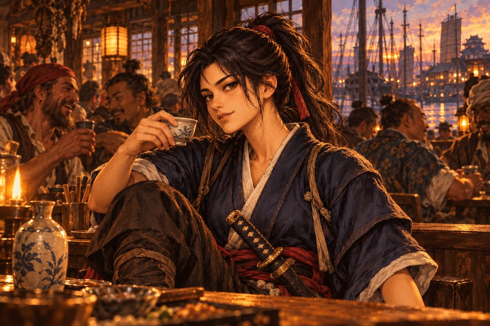
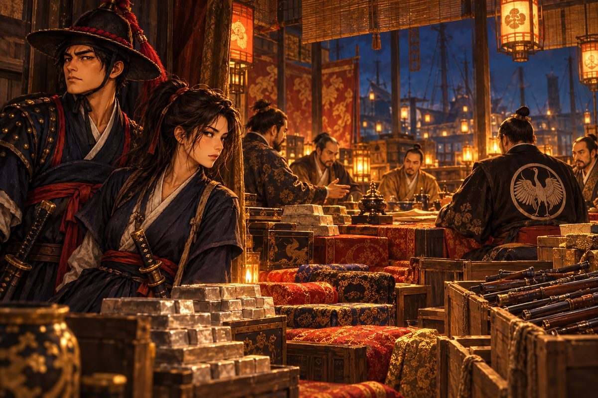
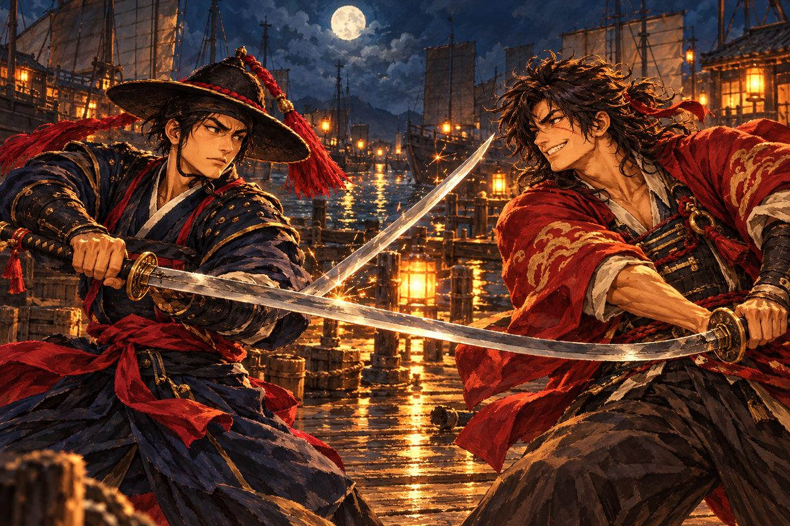
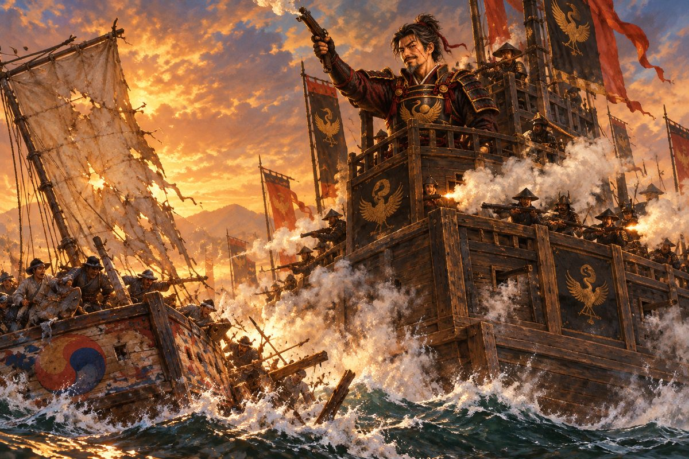

## 10. 길잡이

나가사키의 술집에는 온갖 나라의 말이 뒤섞였다. 해강이 아는 말은 그중 하나도 없었다.

천장이 낮은 술집 안은 담배 연기와 생선 굽는 냄새로 자욱했다. 한쪽에서는 남만 선원들이 탁자를 두드리며 노래를 불렀고, 다른 쪽에서는 명나라 상인들이 주판을 튕기며 값을 다퉜다. 왜의 낭인 몇이 칼을 허리에 찬 채 구석에서 술을 마셨다. 해강과 돌석이 들어서자 몇몇이 고개를 돌렸다. 조선 옷은 이 항구에서도 드물었다.

"주인장, 조선말을 하는 통사를 찾고 있소."

해강은 좌수사가 일러 준 대로 서툰 왜말을 섞어 물었다. 주인은 잠시 해강을 위아래로 훑어보더니 조선말로 대답했다. 억양은 이상했지만 알아들을 만했다.

"통사라면 요즘 통 안 보이는데……. 저기 저 아가씨한테 물어보시구려. 저 아가씨는 이 바다 소식이라면 모르는 게 없지."

창가 자리에 젊은 여자가 한쪽 무릎을 세우고 앉아 있었다. 머리를 높이 묶어 등 뒤로 늘어뜨렸고, 허리에는 짧은 칼을 찼다. 무릎 위에 술잔을 올려놓은 채, 그녀는 창밖 항구의 돛대들을 보고 있었다. 해강이 다가가자 그녀가 고개를 돌렸다. 눈매가 날카로웠다. 웃고 있었지만, 그 웃음은 상대를 재는 웃음이었다.

"조선 배? 드문 손님이네." 그녀의 조선말은 막힘이 없었다. "통사 영감은 지난달 바다에 빠져 죽었어. 술 취해서 부두를 걷다가."

"……그렇소."

해강은 품 안의 서찰을 만졌다. 받을 사람이 없어진 편지였다.

"대신 내가 길잡이를 해 주지." 여자가 술잔을 내려놓았다. "이 바다라면 내가 영감보다 훨씬 잘 아니까. 어느 항구에 누가 있는지, 어느 바다에 누구 배가 다니는지. 물론 공짜는 아니야."

돌석이 해강의 옷소매를 당겼다. 믿을 수 없다는 눈짓이었다. 해강도 알았다. 처음 보는 여자, 출신도 알 수 없는 여자. 그러나 지금 해강에게는 이 항구에서 말을 통할 사람이 아무도 없었다.

해강이 은전 꾸러미를 내밀자 여자는 손바닥 위에서 무게를 가늠해 보고 고개를 끄덕였다.

"좋아, 거래 성립. 나는 오린. 이름만 알면 돼. 성은 묻지 마."

그녀의 조선말은 지나치게 능숙했다. 왜관에서 장사하는 왜인들도 저렇게 말하지는 못했다. 어릴 때부터 조선말을 쓰는 사람들 틈에서 자란 사람의 말이었다. 해강은 그 점을 기억해 두었다.

## 11. 은을 쫓는 남자

옆자리에서 술을 마시던 남만인이 잔을 들고 다가왔다. 곱슬곱슬한 검은 머리에 햇볕에 그을린 얼굴, 붉은 비단 조끼를 입은 사내였다. 그의 얼굴에는 세상 어느 항구에서도 집처럼 편안해 보이는 사람의 웃음이 걸려 있었다.

"이봐, 동쪽 바다에서 온 친구. 은 이야기를 하던데?"

오린이 그의 말을 옮겨 주었다. 해강이 경계하는 눈으로 그를 보았다.

"당신은?"

"피에트로 콘티. 세상 끝까지 가 보는 게 일인 사람이지. 제노바에서 태어나서, 리스본, 고아, 말라카를 거쳐 여기까지 왔어. 이 항구에는 은 때문에 왔고." 그는 잔을 기울이며 목소리를 낮추었다. "그런데 요즘 나가사키 은이 수상하게 한쪽으로 쏠려. 사카이 상인 회합이 다 사들이고 있다더군. 값도 안 깎고, 있는 대로."

"그 은이 어디로 가는지 아시오?"

피에트로가 어깨를 으쓱했다. "알았으면 내가 먼저 그 길을 탔겠지. 다만 은이 그렇게 움직이면, 그 뒤에는 반드시 칼이 따라오더군. 그 돈줄을 쫓는 건 위험해, 친구." 그는 잔을 비우고 일어섰다. "그래도 가겠다면…… 행운을 빌지. 바다는 넓고, 우리는 언젠가 또 만날 거야."

그가 떠나자 오린이 어깨를 으쓱했다. "남만 사람치고는 눈치가 빠르네."

"믿을 만한 자요?"

"이 항구에서 믿을 만한 사람은 없어." 오린이 웃었다. "나까지 포함해서."

## 12. 영주의 가신

이튿날 영주의 저택에서 사람이 왔다. 검은 하카마에 두 자루 칼을 찬 가신이었다. 그는 해령호의 갑판에 올라와 배 안을 찬찬히 둘러보았다. 화포에 눈길이 오래 머물렀다.

"조선 배가 무슨 일로 이 항구에 들어왔소? 영주님께서 수상히 여기신다. 상선치고는 대포가 너무 많군."

해강이 입을 열기 전에 오린이 한 걸음 나섰다. 그녀의 얼굴이 순식간에 바뀌었다. 날카롭던 눈매가 부드러워지고, 목소리가 높고 상냥해졌다.

"이분은 왜관과 장사하는 상인이에요. 은을 사러 왔을 뿐이랍니다. 대포는…… 요즘 바다에 해적이 하도 많아서요. 나리께서도 아시잖아요."

가신이 오린을 한참 보았다. 오린은 눈을 내리깔고 공손히 서 있었다. 마침내 가신이 코웃음을 쳤다.

"……상인이라. 소란을 피우면 그대로 바다에 던질 것이오."

가신이 배에서 내려가자 해강이 낮게 말했다. "오린, 말솜씨가 대단하군."

"입 다물고 있어." 오린의 목소리가 원래대로 돌아왔다. "그게 살길이야. 그리고 그 무관 같은 눈빛 좀 감춰. 누가 봐도 장사꾼이 아니잖아."

해강은 무관 같은 눈빛이 어떤 것인지 몰랐다. 그러나 돌석이 옆에서 킥킥거리는 것을 보니, 오린의 말이 틀리지 않은 모양이었다.

오린의 계획은 간단했다. 나가사키 교역소에서 은을 사서 사카이에 넘긴다. 사카이 상인 회합은 은을 가져오는 자를 환영한다. 그러면 회합에 끼어들 명분이 생긴다.

"사카이 회합에 끼려면 은을 들고 가는 게 제일 빨라. 회합 사람들은 돈 냄새를 맡으면 문을 열거든."

"장사꾼 흉내를 내야 한다면 내지." 해강이 말했다.

"흉내가 아니라 진짜로 해야 해." 오린이 손가락으로 해강의 가슴을 찔렀다. "손해 보면 안 된다고. 우리 배 돈 없잖아."

## 13. 사카이 회합

세토 내해는 크고 작은 섬 사이로 물길이 굽이쳤다. 섬마다 푸른 소나무가 빽빽했고, 물은 거울처럼 맑았다. 그러나 그 아름다운 물 밑에는 바위가 숨어 있었다. 물살은 썰물과 밀물에 따라 방향을 바꾸었고, 어떤 곳에서는 소용돌이가 일었다.

돌석은 내내 뱃머리에 붙어 물빛을 읽었다.

"물살이 빠르다. 배 밑이 바위에 닿지 않게 조심해라. 물빛이 옅은 데는 얕은 데다. 거기는 피해."

오린이 그 옆에 와서 섰다. "아저씨, 저 섬 왼쪽으로 돌아요. 오른쪽은 썰물 때 바위가 드러나요."

돌석이 오린을 힐끗 보았다. 그리고 말없이 키를 왼쪽으로 꺾었다. 그 뒤로 둘은 뱃머리에서 나란히 물길을 읽었다. 돌석은 오린을 믿지 않는다고 말하지 않았지만, 해강은 그의 어깨에서 긴장이 조금 풀린 것을 보았다.

사카이는 상인의 도시였다. 성벽 대신 해자가 도시를 둘렀고, 거리마다 창고와 가게가 늘어섰다. 사카이 교역소 주인은 은 상자를 보고 눈을 반짝였다.

"나가사키에서 은을 실어 왔다고요? 회합 어르신들께서 좋아하시겠군. 요즘 은이라면 얼마든지 받으시니." 주인은 은전 꾸러미를 해강 앞에 내밀었다. 나가사키에서 산 값보다 꽤 많았다. 오린이 해강에게 눈을 찡긋했다. "오늘 저녁 회합이 열립니다. 손님도 한자리 끼실 수 있게 말씀드리지요."

그날 밤, 회합이 열린 저택은 등불로 대낮처럼 밝았다. 넓은 다다미방에 비단 방석이 줄지어 깔렸고, 그 위에 사카이의 큰 상인들이 앉았다. 방 한가운데에 은괴가 쌓였고, 벽 쪽에는 나무 상자들이 놓였다. 상자 하나의 뚜껑이 열려 있었다. 그 안에 기름 먹인 천에 싸인 긴 쇠막대들이 누워 있었다.

조총이었다.

등불 아래 은과 칼과 조총이 오갔다. 상인들은 찻잔 너머로 값을 불렀다. 목소리는 낮고 점잖았지만, 오가는 것은 사람의 목숨값이었다.

오린이 해강의 귀에 속삭였다. "저 끝자리. 소매에 검은 학 문양을 단 사내가 구로세의 대리인이야."

해강은 그쪽을 보았다. 마른 체구의 중년 사내였다. 그는 말없이 차를 마시며 다른 상인들의 말을 듣고 있었다. 소매 끝에 수놓은 작은 학 한 마리. 해강은 그것을 보는 순간 찻잔을 쥔 손에 힘이 들어갔다.

상석의 상인이 말했다. "다음 철포 쉰 자루는 남만 배가 들어오는 대로 넘기겠소. 값은 은으로."

검은 학의 사내가 고개를 끄덕였다.

해강은 찻잔을 쥔 손이 떨리는 것을 느꼈다. 조총을, 남만인에게서 사서 왜구에게 넘기고 있었구나. 다대포 사람들을 쓰러뜨린 그 쇠막대를. 이 사람들은 다대포가 어디 있는지도 모를 것이다. 그들에게 다대포는 장부의 한 줄도 되지 못할 것이다.

오린이 탁자 밑에서 해강의 손등을 꼬집었다. 아팠다. 해강은 숨을 깊이 들이쉬고 찻잔을 내려놓았다.

## 14. 부둣가의 결투

회합이 끝나자 해강은 대리인의 뒤를 밟았다. 사내는 골목을 몇 번 꺾더니 부둣가의 술집으로 들어갔다. 해강이 뒤따라 들어서자, 낯익은 붉은 하오리가 그를 맞았다.

"또 만났군, 조선 무관." 기리시마 렌이 술잔을 든 채 웃었다. 대리인은 이미 뒷문으로 빠져나간 뒤였다. "대리인을 미행하던 게 너였나. 서툴러. 저 영감이 눈치를 챘으면 지금쯤 네 목이 부두에 굴러다녔을 거다."

"기리시마 렌. 너는 구로세의 부하라고 했지."

"부하였지." 기리시마가 잔을 내려놓았다. 웃음이 조금 옅어졌다. "영감은 은도 철포도 혼자 다 먹으려 해. 우리 같은 졸개들에게는 뼈다귀나 던져 주고. 그래서 나는 내 몫을 챙기기로 했다."

"그 몫이 무엇이오?"

"그건 말로 할 수 없지." 기리시마가 칼자루를 두드렸다. "말로는 안 통하겠군. 칼로 하자. 네가 이기면 좋은 걸 알려 주지. 내가 이기면…… 글쎄, 그때 생각하지."

달빛 아래 사카이 부둣가. 바다 위로 둥근 달이 떠 있었고, 정박한 배들의 돛대가 그 앞에 검은 줄처럼 서 있었다. 부두의 널빤지가 발밑에서 삐걱거렸다. 두 사람의 그림자가 널빤지 위에 길게 누웠다.

기리시마의 칼은 빠르고 가벼웠다. 물 위를 스치는 제비 같았다. 해강이 막으면 이미 다른 쪽에서 칼끝이 들어왔다. 해강의 소매가 찢어졌다. 뺨에 가는 상처가 났다.

해강의 칼은 느렸지만 물러서지 않았다. 수영에서 배운 칼이었다. 화려하지 않았다. 배 위에서 흔들리는 발판을 딛고 싸우는 칼, 한 걸음도 물러설 곳이 없는 칼이었다. 해강은 기리시마의 빠른 칼을 받고, 받고, 또 받았다. 그리고 기리시마의 숨이 아주 조금 거칠어진 순간, 처음으로 한 걸음 나섰다.

몇 합인지 셀 수 없게 칼이 부딪친 끝에, 기리시마의 칼끝이 바닥에 닿았다.

기리시마는 한동안 자기 칼을 내려다보았다. 그리고 고개를 젖히고 웃었다. 진심으로 즐거운 웃음이었다.

"하, 하하…… 좋아, 좋은 솜씨다. 영감 밑에 있는 놈들 중에 너만 한 칼은 없어."

그는 약속을 지켰다.

"구로세의 수송선이 사흘 뒤 은과 철포를 싣고 나간다. 사카이 남쪽 바다로. 호위는 관선 둘에 안택선 하나. 그 배를 치면 영감은 길길이 날뛸 거다. 나머지는 네 마음대로 해."

"왜 나에게 알려 주는 거지?"

기리시마가 칼을 칼집에 넣었다. 달빛이 그의 얼굴을 반쯤 비추었다.

"영감이 무너지면 이 바다가 비지. 빈 바다는 내가 차지할 거다." 그는 돌아서며 손을 흔들었다. "그때 다시 만나자, 조선 무관. 그때는 네가 내 적일지, 아닐지 모르겠군."

## 15. 판자로 덮은 배

사카이 조선소에는 처음 보는 배가 있었다.

갑판 위에 집을 올린 듯 판자를 높이 둘러친 배였다. 판자벽에는 작은 구멍들이 줄지어 뚫려 있었고, 그 위로 이층 누각 같은 망루가 솟았다. 배라기보다는 물 위에 띄운 성채 같았다.

"안택선이라더군." 돌석이 팔짱을 끼고 그 배를 올려다보았다. "갑판 위에 집을 지어 놓았어. 다대포 영감이 말한 그 배가 이거구나."

해강도 그 배를 보았다. 그날 수평선으로 멀어지던 배. 망루가 높이 솟은 배.

"저렇게 판자를 둘러치면 화살도 총알도 막겠지. 구멍으로 조총을 쏘고." 돌석은 배 둘레를 천천히 걸으며 손으로 판자를 두드려 보았다. "그런데 위가 뚫려 있으니 올라타기는 쉽겠어. 사다리 하나 걸치면 그만이야."

"위까지 덮으면요?"

해강이 무심코 한 말이었다. 돌석이 걸음을 멈추었다. 그리고 입을 다물었다. 한참 동안 그는 아무 말도 하지 않고 안택선의 망루를 올려다보았다. 그의 눈이 무언가를 재고, 깎고, 맞추는 것 같았다.

"……덮으면 아무도 못 올라탄다." 돌석이 중얼거렸다. "판자를 덮고, 그 위에 뭘 박아서 발을 못 딛게 하면…… 허, 그래. 그거다. 그거야."

그날부터 돌석은 밤마다 나무판에 숯으로 무언가를 그렸다. 그리다가 지우고, 지우다가 다시 그렸다. 해강이 무엇을 그리느냐고 물으면 돌석은 손을 내저었다. "아직 공상이다. 공상이 쓸 만해지면 보여 주마."

## 16. 장부

사카이 은행의 장부실은 서늘하고 어두웠다. 선반마다 두꺼운 장부가 빽빽이 꽂혀 있었다. 은을 맡긴 자, 은을 찾아간 자, 은이 어디서 와서 어디로 갔는지가 모두 그 안에 적혀 있었다.

"회합의 장부는 여기 있어." 오린이 속삭였다. "내가 서기의 시선을 끌 테니 넌 저쪽 장부를 봐. 회합 이름으로 된 거, 이번 달 거."

오린이 서기에게 다가가 무언가를 묻기 시작했다. 다시 그 높고 상냥한 목소리였다. 서기가 얼굴을 붉히며 대답하는 사이, 해강은 선반에서 장부를 꺼내 빠르게 넘겼다. 왜의 글자와 한자가 섞인 장부였다. 해강은 한자만 겨우 읽을 수 있었다. 그것으로 충분했다.

은의 양. 날짜. 그리고 받는 자의 이름이 줄마다 같았다.

"……천주, 왕한. 은은 모두 이 이름으로 넘어간다."

장부실을 나와서 해강이 그 이름을 말하자, 오린의 얼굴이 굳었다.

"왕한? 명나라 밀무역 두목이야. 명 조정은 바다를 막았어. 허가 없는 배는 한 척도 못 나가게. 그런데 왕한은 그 몰래 장사를 해. 관리들한테 뇌물을 먹이고, 왜구랑 손을 잡고." 오린이 이를 악물었다. "그자가 구로세의 물주였구나."

"구로세는 손발이고, 머리는 천주에 있었군."

해강은 처음으로 이 싸움의 모양을 어렴풋이 보았다. 다대포를 태운 것은 구로세의 칼이었다. 그러나 그 칼을 쥐여 준 손은 다른 곳에 있었다. 그리고 그 손 뒤에는 또 다른 손이 있을지도 몰랐다.

## 17. 수송선단

기리시마가 말한 바로 그날, 수송선단이 나타났다.

사카이 남쪽 바다, 해가 중천에 떠 있었다. 관선 두 척이 안택선 한 척을 앞뒤로 호위했다. 안택선은 무거운 짐을 실어 물에 깊이 잠겨 있었다. 은과 철포였다.

호위대장이 해령호를 발견하고 외쳤다. 사가라 쿠로, 구로세의 오랜 부하였다.

"조선 배라고? 이 수송선단을 건드리면 구로세 님이 가만두지 않는다!"

"그 구로세를 만나러 온 거다."

해령호는 바람을 등지고 달려들었다. 돌석이 격군들을 다그쳤다. 다대포 젊은이들의 노가 일제히 물을 쳤다. 그들은 이제 처음 바다에 나왔을 때의 그 어설픈 격군들이 아니었다. 폭풍을 넘고, 한 번의 해전을 치르며, 그들의 노는 하나의 심장처럼 뛰었다.

안택선의 높은 판자벽 너머로 조총 소리가 울렸다. 탕, 탕, 탕. 해령호의 뱃전에 구멍이 났다. 격군 하나가 어깨를 맞고 쓰러졌다. 막동이였다. 해강은 이를 악물었다.

"안택선의 옆구리를 노려라! 저 판자벽, 대포는 못 막는다!"

화포 한 발이 그 벽을 뚫었다. 또 한 발. 판자벽이 무너지며 그 뒤에 숨었던 조총수들이 드러났다. 해령호가 더 가까이 붙었다. 마침내 안택선이 기울기 시작했다.

싸움이 끝났을 때 바다 위에는 남만제 철포가 담긴 나무 상자들이 떠다녔다. 기름 먹인 천이 풀려 쇠막대가 햇빛에 번쩍였다. 사가라의 관선은 달아났다.

"이걸로 놈들의 조총이 줄겠구나." 돌석이 말했다.

해강은 막동이 곁에 무릎을 꿇었다. 다행히 총알은 어깨를 스쳤을 뿐이었다. 막동이는 창백한 얼굴로 웃었다.

"나리, 저 안 죽어요. 아직 원수 못 갚았는데."

## 18. 오린의 고백

나가사키로 돌아온 날 밤, 오린이 먼저 말을 꺼냈다.

술집 구석 자리였다. 오린은 그날 밤 내내 말이 없었다. 술잔을 비우지도 않고 손안에서 굴리기만 했다. 해강이 무슨 일이냐고 물으려는 순간, 그녀가 먼저 입을 열었다.

"……해강. 할 말이 있어."

해강은 기다렸다.

"나는 대마도 왜구 집안 딸이야." 오린은 해강을 보지 않았다. 술잔 속을 보았다. "우리 아버지도 배를 몰고 너희 바다를 털었어. 조선 배도 털었고, 명나라 배도 털었어. 나는 그 배에서 자랐어. 조선말은 아버지 배에 탄 조선 포로들한테 배웠고."

해강은 대답하지 않았다. 대답할 수 없었다. 가슴속에서 무언가가 차갑게 굳었다. 왜구. 다대포를 태운 것과 같은 바다에서 온 사람. 그 사람과 여러 날을 한배에서 먹고 잤다.

"그래도 다대포는 아니야." 오린이 고개를 들었다. 그녀의 눈이 젖어 있었다. "아버지는 그런 짓은 안 했어. 배는 털어도 마을은 안 태웠어. 아이들은 안 건드렸어. 그게 아버지의 법이었어. 그리고……"

오린의 목소리가 떨렸다.

"구로세가 아버지를 죽였어. 세 해 전에. 아버지가 구로세 밑으로 들어가지 않겠다고 하니까, 바다 한가운데서 아버지 배를 불태웠어. 나는 작은 배를 타고 겨우 도망쳤고."

긴 침묵이 흘렀다.

"그래서 나를 따라왔나." 해강의 목소리는 자기가 듣기에도 차가웠다.

"처음엔 너를 이용하려고 했어." 오린이 솔직하게 말했다. "구로세를 쫓는 조선 배. 대포도 있고, 사람도 있고. 나 혼자서는 할 수 없는 일을 너라면 해 줄 것 같았어." 그녀는 쓸쓸하게 웃었다. "지금은 잘 모르겠어."

해강은 그날 밤 잠들지 못했다.

해령호 갑판에 나와 앉아 밤바다를 보았다. 나가사키 항구의 불빛이 물 위에 길게 흔들렸다. 왜구의 딸. 다대포를 태운 것과 같은 바다에서 온 사람. 그러나 같은 원수를 가진 사람. 아버지를 바다에서 잃은 사람.

새벽 무렵 돌석이 나와서 그 옆에 앉았다. 그는 아무것도 묻지 않았다. 다만 한참 뒤에 혼잣말처럼 말했다.

"바다에는 국경이 없다더라. 바다에서 사람을 가르는 건 어디서 왔느냐가 아니라, 무엇을 하느냐라고. 네 아버지가 한 말이다."

이튿날 아침, 해강은 길드 앞에서 오린을 기다렸다. 오린은 짐 꾸러미를 메고 나왔다. 떠날 채비였다. 해강을 보자 그녀가 걸음을 멈추었다.

"오린." 해강이 말했다. "구로세를 쫓는 건 우리 둘 다 같다. 왜구의 딸이든 뭐든, 내 배에 탈 사람은 내가 정한다."

오린은 한참 해강을 보았다. 그리고 웃음을 터뜨렸다. 처음 보는, 꾸밈없는 웃음이었다. 남을 재는 웃음도, 상냥한 척하는 웃음도 아닌.

"……정말 고집 센 무관이네." 그녀가 짐 꾸러미를 해강에게 던졌다. 해강이 엉겁결에 받았다. "좋아. 길잡이 값은 이제 안 받을게. 대신 밥은 제대로 줘. 너희 배 밥 진짜 맛없어."

멀리서 돌석이 그 모습을 보고 수염 속으로 웃었다.

## 19. 첫 패배

수송선단이 당한 소식에 검은 학이 움직였다.

나가사키를 떠난 지 이틀째 되는 날이었다. 수평선 위로 돛이 하나, 둘, 셋…… 다섯. 그리고 그 한가운데에 다른 배들보다 머리 하나는 더 큰 배가 있었다. 망루가 이층, 삼층으로 솟은 배.

"저 망루 높은 배……" 오린이 뱃전을 움켜쥐었다. 손가락 마디가 하얘졌다. "구로세의 기함이야!"

안택선 세 척, 관선 두 척. 다대포를 태운 그 배들이었다. 해강은 그 배들을 보는 순간 그날 새벽의 냄새를 다시 맡았다. 소나무 타는 냄새, 그리고 그보다 무겁고 눅진한 무언가가 타는 냄새.

기함이 가까워졌다. 망루 꼭대기에 사내 하나가 서 있었다. 검은 갑옷, 가슴에 금빛 학 문양. 그리고 얼굴에 긴 흉터. 왼쪽 눈썹에서 턱까지.

"네가 내 배를 건드린 조선 놈이냐." 구로세 도겐의 목소리는 굵고 느긋했다. 마치 귀찮은 파리를 내려다보는 사람 같았다. "다대포라고? 기억도 안 나는군. 그런 마을이 한둘이어야지."

"구로세 도겐……!"

해강의 목소리가 갈라졌다. 몇 달 동안 가슴속에서 수천 번 불렀던 이름이었다.

"바다는 힘센 자의 것이다." 구로세가 웃었다. "덤벼 봐라. 아니면 도망치든가. 어느 쪽이든 재미있겠군."

싸움은 처음부터 기울어 있었다.

검은 학의 함대는 바다를 벽처럼 막아섰다. 안택선 세 척이 나란히 서자 그 판자벽은 정말로 물 위의 성벽 같았다. 그 벽의 구멍마다 조총이 불을 뿜었다. 탕, 탕, 탕, 탕. 해령호의 뱃전을 쉴 새 없이 두드렸다. 해령호의 화포가 응사했지만, 한 척의 판자벽을 무너뜨리면 다른 한 척이 그 앞을 막았다.

돛 하나가 찢어졌다. 격군 여럿이 쓰러졌다. 관선 두 척이 옆으로 돌아 해령호를 감싸려 했다. 돌석이 키를 꺾어 겨우 빠져나왔지만, 다시 안택선의 조총이 쏟아졌다.

해강은 이를 악물고 버텼다. 버티고 또 버텼다. 물러서면 안 된다고, 여기서 물러서면 다대포는 영영 묻힌다고 생각했다. 그의 눈에는 오직 망루 위의 흉터 진 얼굴만 보였다.

마침내 돌석이 그의 팔을 붙잡았다. 돌석의 팔에서 피가 흘렀다.

"해강아, 물러나야 한다!" 돌석이 고함쳤다. "여기서 다 죽으면 누가 다대포를 기억하냐! 네 아버지가 지키려던 게 뭐였는지 생각해라!"

해강은 돌석을 보았다. 그리고 쓰러진 격군들을 보았다. 다대포의 젊은이들이었다. 함께 돌아오자고, 반드시 돌아오자고 약속한 이들이었다.

"……물러난다. 남쪽으로, 전속으로!"

해령호는 겨우 물러났다. 등 뒤에서 구로세의 웃음소리가 바람을 타고 들려왔다.

"목숨은 붙여 두마, 조선 무관. 쫓는 놈이 있어야 바다가 심심하지 않지. 다음엔 천주 앞바다에서 만나자."

나가사키 여관에서 일행은 상처를 싸맸다. 다행히 죽은 사람은 없었다. 그러나 다치지 않은 사람도 없었다. 해령호의 돛은 누더기가 되었고, 뱃전에는 총알구멍이 벌집처럼 났다.

"배도 사람도 많이 다쳤다." 돌석이 팔에 붕대를 감으며 말했다. "하지만 아무도 죽지 않았어. 그거면 됐다. 배는 고치면 되고, 상처는 아물면 된다."

"……아직 멀었습니다." 해강이 주먹을 쥐었다. 손톱이 손바닥을 파고들었다. "그자는 저를 상대도 하지 않았어요. 다대포를 기억도 못 한다고 했습니다."

방 안이 조용해졌다. 오린이 해강 앞에 지도를 펼쳤다. 그녀의 아버지가 쓰던 낡은 해도였다. 바다 위에 먹으로 그은 선들이 거미줄처럼 얽혀 있었다.

"구로세는 천주로 갔을 거야. 왕한한테. 패한 놈을 쫓는 건 쉬워도, 이긴 놈을 쫓는 건 어려워. 이긴 놈은 쉬러 가거든. 물주한테." 오린이 손가락으로 남쪽 바다의 한 점을 짚었다. "천주로 가는 뱃길은 내가 알아."

해강이 고개를 들었다. 그의 눈에서 무언가가 바뀌어 있었다. 분노는 그대로였다. 그러나 그 분노가 이제 한 방향으로 모여 있었다.

"가자. 이번엔 머리부터 친다."
