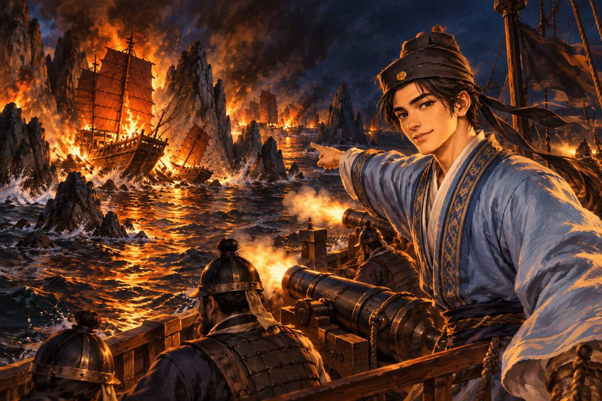
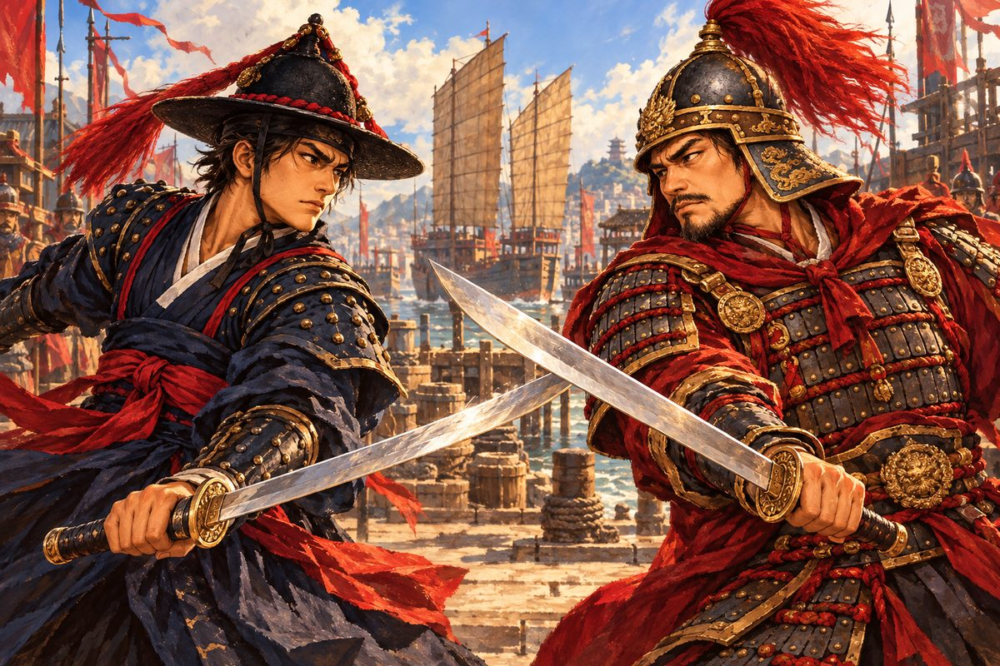

## 20. 닫힌 항구

명나라는 바다를 막았다. 허가 없는 배는 항구에 들어올 수 없었다. 백성이 바다에 나가는 것도, 외국 배가 들어오는 것도 모두 금했다. 해금(海禁)이라 했다.

그러나 천주의 바다는 막혀 있지 않았다. 해령호가 천주 앞바다에 닿았을 때, 항구는 정크선으로 빽빽했다. 대나무 돛을 단 배들이 줄지어 정박했고, 부두에는 비단 꾸러미와 도자기 상자가 산처럼 쌓였다. 막혔다는 바다가 이렇게 붐볐다.

"해금은 겉으로만이야." 오린이 말했다. "조정은 막으라 하고, 관리는 돈을 받고 열어 줘. 그 틈에서 왕한 같은 자가 살찌는 거지."

천주 항구 관리는 해령호를 보자마자 손을 내저었다. 비단 관복을 입은 뚱뚱한 사내였다.

"조선 배? 허가증이 없으면 돌아가시오. 해금령을 모르시오?"

오린이 해강의 옆구리를 찔렀다. "돈이면 다 통해."

해강은 은전 꾸러미를 꺼냈다. 좌수사의 녹봉, 사카이에서 번 은, 수송선단에서 건진 것들. 그 꾸러미가 관리의 넓은 소매 속으로 사라졌다. 관리의 얼굴이 순식간에 부드러워졌다.

"……오늘 이 배는 못 본 걸로 하겠소. 오래 머물지는 마시오. 위에서 눈이 많으니."

해강은 그 소매를 바라보며 생각했다. 바다를 막은 나라. 그 막은 바다를 돈으로 여는 관리. 그리고 그 사이를 오가는 왜구와 밀무역선. 다대포의 불길은 이렇게 먼 곳에서부터 지펴진 것이었다.

## 21. 장부를 보는 사람

천주 술집은 나가사키의 술집과 달랐다. 소란스럽지 않았다. 사람들은 낮은 목소리로 이야기했고, 서로의 얼굴을 오래 보지 않았다. 해금의 항구에서는 모두가 무언가를 숨기고 있었다.

해강 일행이 자리를 잡자 한 젊은이가 맞은편에 앉았다. 단정한 푸른 옷에 주판을 허리에 찬, 마른 체구의 사내였다. 손가락이 길고 깨끗했다. 칼을 쥐어 본 적 없는 손이었다.

"조선 분들이시군요. 나가사키에서 은 회합을 흔들었다는 소문, 여기까지 들렸습니다. 수송선단이 조선 배 한 척에 당했다고."

"당신은 누구요?"

"진소백이라 합니다." 젊은이가 정중하게 고개를 숙였다. "원래는 이 천주의 상인 집안이었지요. 할아버지 때는 배가 열두 척이었습니다. 남쪽 바다 끝까지 비단을 실어 날랐지요. 그런데 바다가 막히고, 배를 띄울 수 없게 되고, 빚이 쌓이고…… 집안이 무너졌습니다."

그는 쓴웃음을 지었다.

"지금은 왕한 선단의 장부를 봅니다. 먹고살아야 하니까요. 할아버지를 망하게 한 해금 덕에 살찐 자의 장부를, 할아버지의 손자가 보고 있는 겁니다. 우습지요."

"왕한의 장부라니." 오린이 눈을 반짝였다. "딱 우리가 찾던 거네."

소백이 오린을 보고, 다시 해강을 보았다. "그래서 왔습니다. 당신들이 찾는 것과 제가 버리고 싶은 것이 같은 것 같아서."

천주에는 남만인의 작은 교회가 있었다. 붉은 벽돌로 지은 낮은 건물이었고, 지붕 위에 나무 십자가가 서 있었다. 그 안에서 늙은 신부가 해강 일행을 조용히 맞았다. 신부는 서툰 명나라 말을 했고, 오린이 그것을 옮겼다.

"남만 배에서 내린 철포가 이 항구를 지나 북쪽 왕한의 창고로 갑니다. 저는 그 배들이 들어오는 것을 이 창문으로 봅니다. 매달, 매달." 신부가 창밖의 부두를 가리켰다. "하느님 앞에서 부끄러운 장사지요. 저희 나라 사람들이 하는 일입니다. 저는 신부로서 그것만은 말해 두고 싶었습니다."

해강은 교회를 나서며 생각했다.

남만인이 철포를 판다. 왕한이 그것을 산다. 왕한이 구로세에게 은을 대고, 구로세는 그 철포로 조선의 마을을 태운다. 그리고 그 은은 다시 사카이를 거쳐 왕한에게 돌아간다.

"남만인, 왜구, 밀무역 두목…… 이 바다는 서로 얽혀 있군."

"바다는 원래 그래." 오린이 말했다. "한 군데를 당기면 다른 데가 끌려와."

소백이 다시 찾아온 것은 그날 저녁이었다. 그는 품에서 기름종이에 싼 두꺼운 꾸러미를 꺼냈다.

"부탁이 있습니다. 왕한의 진짜 장부를 빼돌려 두었어요. 남들에게 보여 주는 장부 말고, 왕한이 자기만 보는 장부. 누구에게 얼마를 주었는지 다 적혀 있습니다." 그는 꾸러미를 해강 앞에 내려놓았다. "장안의 옛 스승께 전해야 합니다. 스승은 조정의 관리입니다. 청렴하기로 이름난 분이지요. 이 장부면 왕한 뒤를 봐주는 자들을 끌어낼 수 있어요."

"당신이 직접 가지 않고?"

"제가 천주를 떠나면 왕한이 바로 알아챕니다. 그리고 장안까지 가는 길에는 왕한의 배와 명 수군이 모두 있지요. 저 혼자서는 열흘도 못 살 겁니다." 소백이 해강을 똑바로 보았다. "조선 배라면, 대포가 있는 배라면."

해강은 꾸러미를 받았다.

"장안까지 가져다주지. 우리에게도 필요한 증거다. 그리고." 해강이 소백을 보았다. "당신도 같이 가시오."

## 22. 명 수군

천주를 떠난 지 이틀째, 수평선 위로 붉은 깃발들이 솟았다.

"관선이야." 오린이 돛대 위에서 외쳤다. "명나라 수군! 우리를 왜구로 본 모양이야!"

명 수군의 정크 세 척이 해령호를 향해 다가왔다. 대나무 돛에 붉은 깃발, 뱃머리에 그려진 커다란 눈. 앞 배의 갑판에 장수 하나가 서 있었다. 붉은 갑옷에 깃 달린 투구, 손에 든 긴 칼. 그가 해령호를 향해 외쳤다.

"해금을 어긴 왜구 배다! 명 수군 파총 척문룡이 상대한다! 돛을 내리고 항복하라!"

"우리는 왜구가 아니오!" 해강이 외쳤다. 오린이 그 말을 명나라 말로 다시 외쳤다.

"변명은 붙잡힌 뒤에 해라!"

정크선의 화포가 불을 뿜었다. 포탄이 해령호 뱃머리 앞에 떨어져 물기둥을 일으켰다.

해강은 싸우지 않기로 했다. 척문룡은 해강의 원수가 아니었다. 그는 자기 나라의 바다를 지키는 수군이었다. 해강 자신이 그랬던 것처럼.

"돌석 아저씨, 빠져나갈 길은?"

"저놈들 배는 크지만 느리다. 바람을 옆으로 받으면 우리가 빠르지." 돌석이 키를 꺾었다. "오린, 저 섬 사이로 빠질 수 있냐?"

"물길이 좁지만 돼요. 썰물 전이라 지금이 아니면 안 돼요!"

해령호는 포위의 빈틈을 찾아 섬 사이 좁은 물길로 빠져나갔다. 정크선들이 뒤따라오려 했지만 그 큰 몸집으로는 좁은 물길을 지날 수 없었다. 척문룡의 고함 소리가 멀어졌다.

"명나라 수군까지 적으로 돌리면 갈 곳이 없어진다." 돌석이 땀을 훔쳤다. "조심해야겠어."

"저 장수." 해강이 멀어지는 붉은 깃발을 돌아보았다. "눈빛이 곧았습니다. 우리를 정말로 왜구라고 믿고 있었어요."

"그래서 더 골치 아프지." 오린이 말했다. "곧은 놈은 오해를 풀기도 어렵거든."

## 23. 지도를 그리는 사람

북쪽으로, 명나라의 도읍으로 이어지는 바다를 따라 올라갔다. 바닷바람이 조금씩 차가워졌다. 소백은 처음 며칠 뱃멀미로 고생했다. 그는 뱃전에 매달려 토하면서도 장부 꾸러미만은 품에서 놓지 않았다.

"상인 집안 손자가 뱃멀미라니." 오린이 놀렸다.

"할아버지는 배를 열두 척 가지셨지만 한 번도 타지 않으셨습니다." 소백이 창백한 얼굴로 대답했다. "장부는 뭍에서 보는 거라고."

장안은 거대한 도시였다. 성벽이 끝없이 이어졌고, 그 안으로 기와지붕의 바다가 펼쳐졌다. 해강은 한양을 본 적이 있었지만, 장안은 한양을 몇 개나 합친 것 같았다.

장안의 한 술집 구석에서, 금발의 남만인이 커다란 종이 위에 펜을 놀리고 있었다. 탁자 위에는 컴퍼스와 자, 잉크병, 그리고 둘둘 만 종이가 수북했다. 그는 해강 일행이 다가오자 안경 너머로 고개를 들었다.

"동쪽 바다 사람이군요. 조선 옷이네요. 처음 봅니다." 그가 손을 내밀었다. "나는 에르네스트 폰 보어, 지도를 그리는 사람입니다. 이 동쪽 바다의 지도를 제대로 그린 사람이 아직 없어서, 내가 그려 보려고 왔지요."

그는 해강에게 자기 지도를 보여 주었다. 해강이 아는 바다가 거기 있었다. 조선의 남해안, 대마도, 나가사키, 그리고 천주와 장안. 그러나 조선 쪽은 많이 비어 있었다.

"조선 바다는 아직 못 갔습니다. 언젠가 꼭 가 보고 싶은데." 에르네스트가 웃다가 목소리를 낮추었다. "그런데 여순 앞바다를 그리다가 이상한 걸 봤소. 암초 사이에 숨은 정박지가 있더군. 바깥에서는 절대 보이지 않는 자리에, 정크선이 잔뜩."

"왕한의 정박지인가……." 소백이 중얼거렸다.

에르네스트는 해도 한 장을 둘둘 말아 내밀었다. 종이 위에 여순 앞바다가 그려져 있었다. 암초마다 작은 표시가 있었고, 그 사이로 가는 붉은 선이 구불구불 이어졌다.

"이걸 가져가시오. 암초를 피하는 길이 그려져 있소. 사흘 동안 작은 배로 재어 가며 그린 거요." 그가 해강을 보았다. "그 대신 무사히 돌아와서 이야기를 들려주시오. 그리고 언젠가 조선 바다도 보여 주시오."

해강은 해도를 받고 깊이 고개를 숙였다. 오늘 처음 본 남만인이었다. 그러나 그의 눈은 피에트로처럼, 바다 너머를 보고 싶어 하는 사람의 눈이었다.

## 24. 스승의 저택

소백의 스승은 일흔이 넘은 노학자였다. 그의 저택은 장안의 다른 관리들 집에 비해 놀랄 만큼 소박했다. 마당에는 대나무 몇 그루가 서 있었고, 서재는 책으로 가득했다.

노인은 장부를 한 장씩 넘겼다. 처음에는 천천히, 그다음에는 빠르게. 넘기는 손이 점점 떨렸다. 마침내 그는 손을 멈추었다.

"……이 이름들." 노인의 목소리가 쉬었다. "조정 안에 왕한의 돈을 받은 자가 이렇게 많았다니. 해금을 지키라고 목소리를 높이던 자들이, 뒤에서는 해금으로 돈을 벌고 있었구나."

그는 장부를 덮고 소백을 보았다.

"소백아. 네가 이걸 가져오기까지 얼마나 위험했겠느냐."

"스승님께서 가르쳐 주신 대로 했을 뿐입니다. 장부는 거짓말을 하지 않는다고 하셨지요."

노인은 해강에게 몸을 돌려 정중하게 절했다.

"고맙소, 조선의 무관. 이것으로 저들을 칠 수 있겠소. 약소하지만 받아 주시오. 배를 굴리는 데 보태시오."

"우리가 원하는 건 왕한과 구로세의 연결입니다."

"왕한은 여순 앞바다에 배를 숨겨 두었다고 하오. 구로세의 은도 거기로 간다지. 은을 받고, 철포를 넘기고, 다시 은을 받는 곳." 노인이 장부의 한 줄을 짚었다. "여기, 이 날짜를 보시오. 매달 보름이오."

장안 은행에서 소백은 돈의 길을 짚었다. 그는 은행 장부를 넘기는 동안 다른 사람이 되었다. 뱃멀미로 창백하던 얼굴에 생기가 돌았고, 긴 손가락이 주판 위에서 춤을 추었다.

"왕한의 돈은 여기서 두 갈래로 나뉩니다. 하나는 사카이로. 그건 구로세에게 가는 은입니다. 다른 하나는…… 마카오로." 소백이 고개를 들었다. "마카오. 남만인의 항구죠."

"철포를 파는 남만인이 마카오에 있다는 얘기네." 오린이 말했다.

"먼저 왕한이다." 해강이 말했다. "그다음이 남쪽."

길드 앞에서 소백이 걸음을 멈추었다. 그는 한참 망설이다가 입을 열었다.

"장부를 넘겼으니 저는 이제 왕한 쪽에도, 관리 쪽에도 돌아갈 곳이 없습니다. 왕한은 저를 죽이려 할 것이고, 스승님 곁에 있으면 스승님께 누가 됩니다." 그는 허리의 주판을 만졌다. "숫자와 장사라면 자신 있습니다. 칼은 못 쓰지만, 배를 굶기지 않을 자신은 있어요. 해령호의 장부를 맡겨 주시겠습니까?"

해강이 웃었다. 오랜만의 웃음이었다.

"환영하오. 우리 배는 늘 돈이 모자라니까."

"그건 이미 봤습니다." 소백도 웃었다. "솔직히 말씀드리면, 그 장부는 좀 심각하더군요."

## 25. 여순 앞바다

여순 앞바다는 암초가 이빨처럼 솟은 바다였다.

보름날 밤이었다. 달이 밝아 바다가 은빛으로 빛났다. 그 은빛 위로 검은 바위들이 여기저기 고개를 내밀었다. 어떤 것은 물 위로 솟아 있었고, 어떤 것은 물 밑에 숨어 파도가 부서질 때만 하얗게 드러났다.

해령호는 에르네스트의 해도를 따라 그 사이를 한 땀 한 땀 꿰어 나아갔다. 오린이 뱃머리에서 해도를 들고 방향을 불렀고, 돌석이 키를 잡았다. 격군들은 숨소리도 죽인 채 노를 저었다.

"왼쪽으로 두 뼘. 됐어요. 이제 곧장." 오린의 목소리가 낮았다. "앞에 큰 바위 두 개가 있을 거예요. 그 사이로."

바위 두 개가 나타났다. 배 한 척이 겨우 지나갈 만한 틈이었다. 해령호의 양 뱃전이 바위에 닿을 듯 스쳤다. 돌석의 이마에 땀이 맺혔다.

틈을 빠져나가자 갑자기 시야가 열렸다. 사방이 암초로 둘러싸인 넓은 물웅덩이. 그리고 그 안에 정크선들이 횃불을 밝힌 채 정박해 있었다.

"저기입니다!" 소백이 외쳤다. "정크선이 넷, 왕한의 깃발!"

가장 큰 정크선의 갑판에 사내 하나가 나와 섰다. 뚱뚱한 몸에 보랏빛 비단옷을 걸치고, 손가락마다 옥가락지를 낀 사내였다. 그가 해령호를 보고, 그 갑판의 소백을 알아보고 얼굴이 시뻘게졌다.

"조선 쥐새끼가 내 장부를 훔쳐 갔다지? 소백, 너도 거기 있느냐! 너를 거두어 밥을 먹인 게 누구인데!"

"왕한 어른." 소백의 목소리는 떨리지 않았다. 뱃멀미하던 그 젊은이가 아니었다. "제 할아버지의 배를 빼앗은 것도 어른이었지요. 빚을 갚으라고. 바다를 막은 건 조정이지만, 바다를 더럽힌 건 당신입니다."

왕한이 손을 휘둘렀다. "저놈들을 바다에 처넣어라!"

암초 사이의 싸움은 해도를 가진 쪽이 이겼다.

왕한의 정크들은 닻을 올리고 해령호를 에워싸려 했다. 그러나 그들은 이 정박지의 암초를 낮에만 알았다. 밤에, 그것도 급하게 움직이자 큰 정크선 하나가 물 밑 바위에 부딪혀 멈춰 섰다. 다른 하나가 그것을 피하려다 옆 배와 부딪쳤다.

해령호는 에르네스트의 붉은 선을 따라 그 사이를 미끄러지듯 지났다. 그리고 지날 때마다 옆구리의 화포가 불을 뿜었다.

이윽고 왕한의 선단이 불길에 휩싸였다. 불타는 정크선들이 검은 바다 위에 거대한 횃불처럼 서 있었다. 그 불빛이 암초를, 물을, 하늘을 붉게 물들였다. 다대포의 새벽처럼.

해강은 그 불길을 보며 아무것도 느끼지 않으려 애썼다.

"구로세는?" 그가 외쳤다. "구로세는 어디 있지?"

오린이 불타는 정박지를 둘러보았다. 안택선은 한 척도 보이지 않았다.

"이미 떠났어." 오린이 고개를 저었다. "남쪽으로…… 남만 배를 만나러."

## 26. 두 무인

천주로 돌아오자 소문이 먼저 와 있었다. 왕한의 선단이 무너졌다고. 왕한 자신은 작은 배를 타고 달아났다고. 그리고 장안에서 관리 여럿이 잡혀갔다고.

"구로세는 마카오 쪽으로 갔답니다." 소백이 술집에서 들은 소식을 전했다. "남만인의 철포를 더 사들이려고요. 왕한이 무너졌으니 이제 직접 사야겠지요."

"놈은 늘 한발 앞서 있군." 해강이 중얼거렸다. 나가사키에서도, 여순에서도. 해강이 닿으면 구로세는 늘 이미 떠난 뒤였다.

항구 관리소 앞에서 낯익은 투구 깃이 해강을 막아섰다. 척문룡이었다. 그 뒤로 명 수군 병사 열댓이 창을 들고 서 있었다.

"드디어 찾았다. 해금을 어기고 바다를 휘젓는 조선 배."

"척 파총." 해강이 앞으로 나섰다. "우리는 왕한의 선단을 쳤소. 왜구가 아니오. 천주 사람이라면 다 아는 일이오."

"왕한의 선단을 친 건 안다." 척문룡의 눈이 가늘어졌다. "그러나 왜구끼리도 서로 친다. 먹이를 두고 다투는 늑대들처럼. 네가 왕한을 친 게 정의 때문인지, 왕한의 몫을 차지하려는 건지 내가 어찌 아느냐."

"그럼 어찌하면 믿겠소?"

척문룡이 칼을 뽑았다.

"말로는 못 믿는다. 무인이라면 칼로 증명해라. 칼은 거짓말을 못 하니까."

천주 부두, 한낮이었다. 햇볕이 돌바닥을 하얗게 달구었다. 정크선의 붉은 깃발들이 바람에 펄럭였다. 부두 노동자들이 짐을 내려놓고 멀찍이 둘러섰다. 오린과 돌석과 소백도 그 틈에 섞였다. 오린의 손이 칼자루에 가 있었다.

두 무인이 마주 섰다.

척문룡의 칼은 군대의 칼이었다. 정직하고, 무겁고, 쉬지 않았다. 기리시마의 칼이 제비였다면 척문룡의 칼은 파도였다. 한 번 밀려오면 그 뒤에 또 한 번, 또 한 번. 해강은 몇 번이나 밀렸다. 발뒤꿈치가 부두 끝에 닿았다. 뒤는 바다였다.

해강은 물러서지 않았다. 더 물러설 곳이 없다는 것이 오히려 그를 단단하게 만들었다. 해령호의 갑판처럼. 그는 척문룡의 파도를 받고, 받고, 받았다. 그리고 파도와 파도 사이의 아주 짧은 틈, 척문룡이 숨을 고르는 그 순간을 찾았다.

끝내 무릎을 꿇은 것은 척문룡이었다. 해강의 칼끝이 그의 투구 깃을 베어 떨어뜨렸다.

척문룡은 바닥에 떨어진 붉은 깃을 내려다보았다. 그리고 칼을 거두고 일어나 해강을 오래 보았다.

"……네 칼에는 원한은 있어도 탐욕이 없군."

그날 밤 척문룡은 혼자 해령호를 찾아왔다. 병사도 없이, 갑옷도 없이. 소백이 그에게 장안의 장부 이야기를 했고, 오린이 사카이의 회합 이야기를 했고, 해강이 다대포 이야기를 했다. 척문룡은 끝까지 말없이 들었다.

이튿날, 그가 길드로 해강을 찾아왔다.

"장안에서 소식이 왔다. 왕한 뒤를 봐주던 관리들이 잡혀갔다더군. 조선 무관이 가져온 장부 덕이라고." 척문룡이 해강 앞에 앉았다. "조선 무관, 손을 잡자. 구로세는 우리 바다도 털고 있다. 복건의 마을도 셋이나 태웠다."

해강은 다대포를 떠올렸다. 이 사람의 바다에도 다대포가 있었다.

"좋소. 다만 이 일은……."

"조정에는 비밀로." 척문룡이 처음으로 웃었다. 굳은 얼굴이 웃자 뜻밖에 젊어 보였다. "너희 조정처럼 우리 조정도 겉과 속이 다르니까. 왜구 쫓는 조선 배와 손을 잡았다고 하면, 나는 내일 목이 날아갈 거다."

"그건 나도 마찬가지요. 나는 기록에 없는 사람이니까."

두 사람은 술잔을 부딪쳤다.

헤어질 무렵 척문룡이 부하를 시켜 나무 궤짝 하나를 가져오게 했다. 뚜껑을 열자 쇳조각을 비늘처럼 엮은 갑옷이 들어 있었다. 사슬 갑옷보다 가볍고, 가슴과 어깨는 얇은 쇠판으로 덮여 있었다.

"이걸 입어라. 명 수군 장교의 갑옷이다." 척문룡이 말했다. "구로세의 조총도 한두 발은 막아 줄 거다. 내 칼이 네 사슬 갑옷을 몇 번이나 뚫을 뻔했는지 기억하지?"

해강은 갑옷을 받아 들었다. 차가운 쇠판 위에 작은 칼자국 하나가 나 있었다. 누군가 이 갑옷을 입고 살아 돌아왔다는 표시였다.

"고맙소, 척 파총. 돌려줄 날이 오기를 바라오."

"돌려주지 마라. 구로세의 목을 가져와라. 그게 값이다."

## 27. 거북의 그림

천주 조선소에서 돌석이 나무판 몇 장을 내밀었다. 사카이에서부터 밤마다 그리던 그림이었다. 숯으로 그린 선 위에 다시 그린 선, 지우고 다시 그은 선이 겹겹이 쌓여 나무판이 거의 검었다. 그러나 그 안에 배 한 척이 또렷이 있었다.

"해강아, 이걸 봐라. 그동안 그린 배다."

해강은 나무판을 받아 들었다. 소백과 오린도 어깨 너머로 들여다보았다.

판옥선만 한 크기의 배였다. 그런데 갑판이 없었다. 아니, 갑판 위를 판자로 완전히 덮었다. 지붕처럼, 등딱지처럼. 그리고 그 지붕 위에 작은 점들이 촘촘히 찍혀 있었다.

"갑판을 판자로 완전히 덮고, 그 위에 쇠못을 박는다." 돌석이 손가락으로 점들을 짚었다. "적이 뛰어오르면 발을 딛는 순간 못에 찔린다. 올라탈 데가 없지. 노 젓는 놈들과 포 쏘는 놈들은 그 지붕 아래에 있다. 조총도 화살도 지붕을 못 뚫어. 앞에는 화포를 놓고, 옆으로도 구멍을 내서 포를 놓고."

"뱃머리는요?" 오린이 물었다.

"뱃머리에는……" 돌석이 다른 나무판을 넘겼다. 거기에 용의 머리가 그려져 있었다. "여기서도 연기를 뿜게 하면 어떨까 싶다. 적이 겁을 먹게."

해강은 그림을 오래 들여다보았다. 둥근 지붕, 촘촘한 쇠못, 앞으로 쑥 내민 머리. 어디서 본 모양이었다.

"거북이 등 같군요……. 무당이 말한 거북이."

돌석이 고개를 끄덕였다. 그도 같은 생각을 하고 있었던 모양이다.

"쇠처럼 단단한 등을 가진 거북. 그 거북을 만나는 날, 네 싸움이 끝난다고 했지." 돌석이 나무판을 쓰다듬었다. "목재와 쇠, 그리고 화포 다루는 사람이 필요하다. 조선 소나무여야 해. 이 남쪽 나무는 너무 무르다. 그리고 수영의 목수들. 부산포에서만 지을 수 있겠지."

천주의 점쟁이는 늙은 사내였다. 그는 해강의 손금을 오래 보다가 고개를 들었다. 오린이 그의 말을 옮겼다.

"남쪽, 붉은 십자가를 단 배가 보이는구려. 그 배가 검은 학에게 불을 건네고 있소."

"붉은 십자가…… 남만, 포르투갈 배야." 오린이 말했다.

"마카오로 가자."

해령호는 이제 더 이상 혼자가 아니었다. 갑판장 돌석, 길잡이 오린, 회계 소백. 그리고 등 뒤의 바다에는 척문룡이 있었다. 해강은 천주를 떠나는 뱃머리에서 처음으로 그 사실을 느꼈다. 혼자 시작한 싸움이 어느새 혼자의 싸움이 아니게 되었다는 것을.
