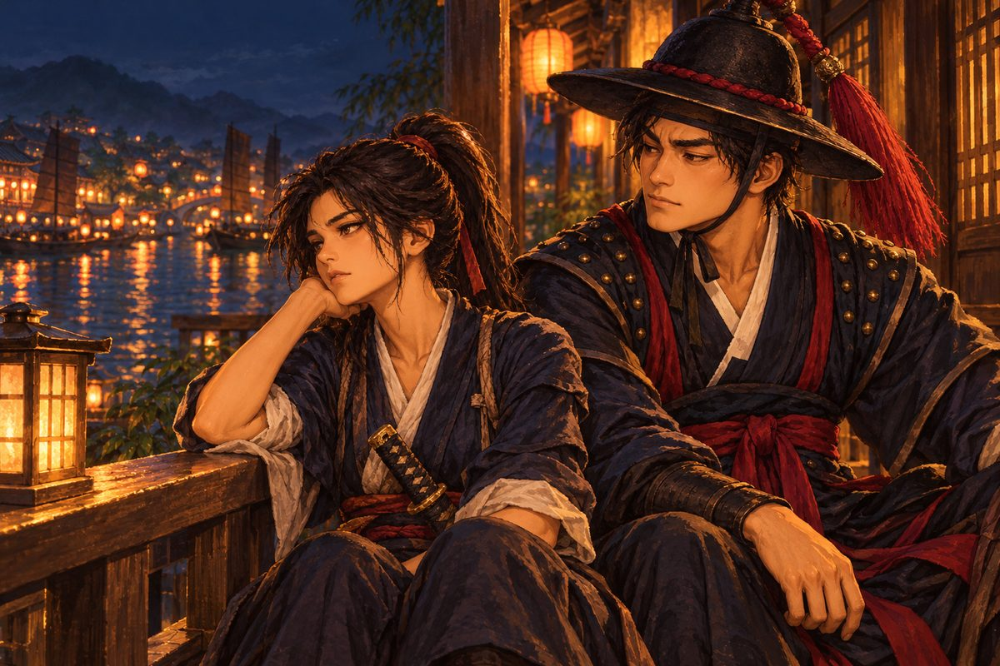

## 28. 마카오

마카오는 남만인들이 머물기 시작한 작은 반도의 항구였다. 명나라 땅 끝에 혀처럼 내민 반도. 언덕 위에는 남만식 돌집과 교회가 하나둘 들어서기 시작했고, 그 아래 해안에는 명나라의 초가와 어선이 그대로 남아 있었다. 두 세계가 한 항구에서 어깨를 비비고 있었다.

항구에는 해강이 처음 보는 배들이 정박해 있었다. 둥근 배 몸통에 높은 고물, 세 개의 돛대에 걸린 네모난 돛과 세모난 돛. 돛마다 붉은 십자가가 그려져 있었다.

"카락이야." 오린이 말했다. "남만인의 큰 배. 대포를 수십 문 싣고 바다 반대편에서 여기까지 와."

포르투갈 상관의 창고는 항구에서 가장 큰 건물이었다. 문이 열려 있었고, 그 안에 향신료 자루와 비단 꾸러미, 그리고 나무 상자들이 천장까지 쌓여 있었다. 상자 몇 개의 뚜껑이 열려 있었다. 사카이 회합에서 본 것과 같은, 기름 먹인 천에 싼 쇠막대들.

"철포라면 얼마든지 있소." 상관의 서기가 오린의 통역을 듣고 웃었다. "값도 싸지. 누구한테 파는지는 묻지 마시오. 그건 이 항구의 예의라오."

소백이 벽에 붙은 값표를 훑어보고 눈살을 찌푸렸다. 그는 주판을 꺼내 몇 번 튕겼다.

"이 값이면 손해 보는 장사입니다." 소백이 낮게 말했다. "남만에서 여기까지 실어 오는 뱃삯만 해도 이 값의 반은 넘을 텐데. 누군가 뒤에서 돈을 대고 있어요. 철포를 싸게 퍼뜨리려는 누군가가."

## 29. 탈영 포수

술집에서는 남만인 하나가 술에 취해 탁자를 두드리고 있었다.

거구의 사내였다. 그을린 얼굴에 덥수룩한 수염, 목에 붉은 수건을 맸다. 손등과 팔뚝에 화약에 덴 자국이 점점이 박혀 있었다. 그는 빈 술병들 사이에 엎드리다시피 하여 남만 말로 뭔가를 중얼거렸다.

"뭐라는 거요?" 해강이 물었다.

오린이 귀를 기울이다가 눈을 가늘게 떴다. "선장 욕을 하고 있어. '또 한 잔! 소자 선장 그 개자식……. 철포를 해적한테 팔고 그 돈으로 배를 사지.' 그런 말이야."

해강이 그 앞에 앉았다. 사내가 흐린 눈을 들어 해강을 보았다.

"소자 선장이라고?" 해강이 물었다. 오린이 옮겼다.

사내가 껄껄 웃었다. "마누엘 드 소자. 나는 그 배의 포수였소. 십 년을 그 배에서 포를 쐈지. 고아에서, 말라카에서, 여기서." 그가 손등의 화약 자국을 보였다. "이젠 아니지만. 지난달에 뛰쳐나왔소. 그런 장사에 손 보태기 싫어서."

"그런 장사라니?"

"철포를 해적들한테 팔아. 이 바다의 해적이란 해적한테는 다. 그리고 그 해적들이 상선을 털면, 소자는 그 상선을 보호해 준다며 또 돈을 받지. 불을 지르고 물을 파는 장사야." 사내가 술잔을 바닥에 내리쳤다. "나는 포수요. 적의 배를 향해 쏘는 게 일이지. 그런데 내가 쏜 포로 산 철포가 어느 마을을 태우고 있는지 생각하면……."

"철포를 사 가는 해적이 혹시 검은 학 깃발이야?" 오린이 불쑥 물었다.

사내의 흐린 눈이 순간 맑아졌다. 그가 오린을 보고, 해강을 보았다.

"……그걸 어떻게 아시오?"

해강이 다대포 이야기를 했다. 짧게. 사내는 끝까지 들었다. 이야기가 끝나자 그는 오랫동안 아무 말도 하지 않았다. 그리고 남은 술을 바닥에 쏟았다.

교회의 신부는 더 많은 것을 알고 있었다. 마카오 언덕 위의 작은 교회였다. 천주의 신부보다 젊었지만, 눈빛은 더 지쳐 있었다.

"소자 선장은 일요일마다 이 교회에 옵니다. 맨 앞자리에 앉아 가장 큰 소리로 기도하지요. 그리고 그 주 내내 그 돈으로 이교도 해적에게 무기를 팝니다." 신부가 성호를 그었다. "그가 동쪽 해적의 두목과 손을 잡았다는 건 이 항구 사람이라면 다 압니다. 아무도 말하지 않을 뿐."

"증언해 주시겠소? 글로 남겨서."

신부는 한참 망설였다. 십자가를 올려다보았다. 그리고 고개를 끄덕였다.

"기록으로 남겨 드리지요. 제 이름을 걸고. 하느님도 이건 용서하지 않으실 겁니다. 그리고 저도 언젠가는 하느님 앞에 서야 하니까요."

마카오 은행에서 소백이 소자의 거래 장부를 찾아냈다. 왕한의 장부에 비하면 훨씬 허술했다. 남만인들은 이 먼 땅에서 누가 자기 장부를 들여다보리라고는 생각하지 않은 모양이었다.

"다음 인도처는…… 하노이 남쪽 섬. 날짜도 적혀 있어요. 열흘 뒤." 소백이 고개를 들었다. "철포 이백 자루. 받는 사람은 이름이 없고 그림만 있습니다. 학."

"구로세도 그곳에 나타나겠군."

## 30. 술집의 칼

술집으로 돌아오자 소란이 벌어지고 있었다. 남만 선원 하나가 아까 그 포수의 멱살을 잡고 있었다. 마른 체격에 날카로운 얼굴, 허리에 긴 칼을 찬 사내였다.

"안토니우! 여기 있었군." 사내가 비웃었다. "선장님이 너를 데려오라신다. 탈영병은 돛대에 매달아야 한다고."

"난 안 돌아가, 디오구." 안토니우라 불린 포수가 멱살을 쥔 손을 뿌리쳤다.

"그럼 억지로라도." 디오구가 칼을 반쯤 뽑았다. 그리고 해강 일행을 보았다. "거기 조선인, 끼어들 생각 마라. 남만인 일이다."

해강이 일어섰다. 돌석이 말리려고 팔을 뻗었다가, 해강의 얼굴을 보고 손을 거두었다.

"내 손님이오." 해강이 말했다. 오린이 옮겼다. 그녀의 목소리가 조금 즐거워 보였다. "데려가려면 나를 넘어야 하오."

디오구 페레스의 칼은 거칠었지만 힘이 있었다. 기리시마의 칼처럼 빠르지도, 척문룡의 칼처럼 정직하지도 않았다. 술집 싸움에서 단련된 칼, 이기기 위해서라면 무엇이든 하는 칼이었다. 디오구는 탁자를 걷어차 해강의 발을 노렸고, 술병을 던졌고, 의자를 방패 삼았다.

해강은 그 힘을 흘려보냈다. 정면으로 받지 않고, 비스듬히 비켜서 흘려보냈다. 흘려보내고, 흘려보내고. 디오구의 숨이 차오를 때까지. 그리고 디오구가 크게 휘두른 칼이 허공을 가르는 순간, 해강은 한 걸음 안으로 들어가 칼끝을 디오구의 목 앞에 멈추었다.

술집이 조용해졌다.

"……크윽." 디오구가 칼을 떨어뜨렸다. "선장님께 그대로 전하지. 조선인 하나가 안토니우를 데려갔다고."

디오구가 나가자 술집에 다시 소란이 돌아왔다. 누군가 휘파람을 불었다.

안토니우는 탁자에 남은 술을 마저 비우고 해강을 보았다. 이제 그의 눈은 완전히 맑았다.

"고맙소. 빚을 졌군." 그가 손을 내밀었다. 화약 자국투성이의 큰 손이었다. "나는 안토니우 코레아. 포 쏘는 거라면 누구에게도 안 지오. 바람이 불든, 배가 흔들리든."

"우리 배에 타겠소?" 해강이 그 손을 잡았다. "철포를 든 해적과 싸우려면 당신 같은 사람이 필요하오. 그리고 소자를 아는 사람이."

안토니우는 잠시 해강의 손을 쥔 채 생각했다.

"그 해적에게 내가 쏜 포탄이 날아간 적도 있겠지." 그가 쓴웃음을 지었다. "아니, 내가 쏜 포탄 값으로 산 철포가 당신 마을을 태웠겠지. 이번엔 반대로 쏴 주지. 그걸로 빚이 다 갚아지지는 않겠지만."

그날 밤 해령호의 식탁은 처음으로 네 나라 말이 섞여 시끄러웠다.

## 31. 붉은 강

하노이로 가는 바다는 따뜻했다. 물빛이 북쪽 바다와 달랐다. 짙은 남색이 아니라 맑은 비취색이었다. 해령호의 격군들은 웃통을 벗고 노를 저었고, 소백은 처음으로 뱃멀미 없이 갑판에 앉아 장부를 정리했다.

하노이는 붉은 강이 바다로 흘러드는 곳이었다. 강물이 정말로 붉었다. 상류에서 흙을 싣고 내려온 물이 바다와 만나 붉은 띠를 이루었다. 그 강을 따라 올라가면 대월의 도읍이 있었다.

대월의 상인들은 낯선 배를 경계했다. 교역소 주인은 해령호를 보자마자 팔짱을 끼었다.

"왜구도 남만도 다 싫소. 바다를 어지럽히고 값만 올리니까. 작년에는 왜구가 해안 마을 둘을 털었고, 올해는 남만 배가 와서 철포를 사라고 협박이오."

"우리는 그 둘을 막으러 왔습니다." 소백이 대월 말을 몇 마디 섞어 말했다. 그는 어느새 이 바다의 말들을 조금씩 익히고 있었다. 장사꾼의 귀였다.

주인이 소백을 보았다. 해강을 보았다. 그리고 해령호의 깃발 없는 돛대를 보았다.

"……그렇다면 이야기가 다르지."

하노이 길드에서는 은전 몇 닢에 귀한 소식이 나왔다. 남쪽 섬의 만에 남만 배 둘이 이미 닻을 내렸다고. 그리고 곧 동쪽에서 다른 배가 온다고.

"동쪽에서 오는 배." 해강이 말했다. "검은 학이군."

"그곳이 맞군." 소백이 은전을 세어 건넸다. 그는 언제나처럼 한 닢도 더 주지 않았다.

하노이 상점에서 돌석은 쇠를 손으로 두드려 보았다. 대장장이가 내민 쇳덩이를 들어 무게를 가늠하고, 망치로 쳐서 소리를 들었다. 맑고 높은 소리가 울렸다.

"하노이의 쇠는 질이 좋다. 조선 쇠보다 단단해." 돌석이 만족스럽게 고개를 끄덕였다. "귀선 등판에 박을 쇠못을 여기서 사 가자. 넉넉히."

안토니우가 돌석의 어깨 너머로 그의 나무판 설계도를 들여다보았다. 처음에는 무심하게, 그다음에는 진지하게.

"이건…… 이런 배는 처음 보오." 안토니우가 손가락으로 지붕의 쇠못을 짚었다. "등을 덮었으니 위에서 쏘는 조총은 소용이 없겠군. 화포를 앞과 옆에 두면 어느 쪽으로 붙어도 불을 뿜겠고." 그가 돌석을 보았다. "옆 구멍은 한쪽에 다섯은 되어야 하오. 그리고 포가 쏠 때 뒤로 밀리니 그 자리를 넓게 잡아야지. 좋은 배요. 정말 좋은 배요."

돌석이 안토니우를 보았다. 처음으로 이 남만인을 동료로 보는 눈이었다.

"그대가 포를 맡아 주겠소?"

"맡지 않으면 내가 서운하지."

## 32. 남쪽 섬

남쪽 섬의 만은 야자나무가 우거진 고요한 곳이었다. 하얀 모래사장, 맑은 물. 그리고 그 물 위에 붉은 십자가를 단 배들이 정박해 있었다. 선원들이 작은 배로 철포 상자를 모래사장에 내리고 있었다.

"저건 소자의 카락이오!" 안토니우가 외쳤다. "그리고 나오 둘. 산타 마리아호, 상 주앙호…… 다 내가 포를 쏘던 배들이오."

카락 두 척, 나오 두 척. 지금까지 상대한 어떤 배보다 컸다. 카락 한 척이 해령호 셋을 합친 만 했다. 고물은 성처럼 높았고, 뱃전에는 포문이 두 줄로 나 있었다.

해령호를 발견한 카락의 고물 난간에 사내 하나가 나와 섰다. 검은 벨벳 옷에 하얀 주름 깃, 깃털 달린 모자. 가슴에 금 십자가. 마누엘 드 소자였다. 그가 망원경으로 해령호를 보다가, 그 갑판의 안토니우를 발견했다.

"안토니우, 배신자 녀석." 그의 목소리가 바다를 건너왔다. 안토니우가 그 말을 해강에게 옮겼다. 목소리가 떨렸다. "조선인 따위와 손을 잡았나. 너를 거두어 포수로 만들어 준 게 누구였지?"

"철포를 해적한테 파는 자에게 배신자 소리 들을 이유는 없소!" 안토니우가 포르투갈 말로 외쳤다. 그리고 해강에게 돌아섰다. "선장, 저놈의 배를 내가 압니다. 내 말대로 해 주시오."

해강이 고개를 끄덕였다. "말해 보시오."

안토니우는 남만 배의 약점을 알고 있었다. 높은 고물은 바람을 많이 받아 배를 돌리기 어렵게 만든다. 뱃머리는 느리고, 돌 때 크게 돈다. 그리고 바람을 옆으로 받으면 배가 한쪽으로 기울어, 그쪽 아래 포문은 바다만 보게 된다.

"바람 아래쪽으로 붙으시오! 저놈들 아래 포문은 물만 쏘게 될 거요!"

돌석이 키를 꺾었다. 해령호가 카락의 바람 아래쪽으로 파고들었다. 카락이 기울었다. 정말로 아래 포문들이 수면을 향했다. 위 포문들이 불을 뿜었지만, 해령호는 이미 그 사각에 들어가 있었다.

안토니우는 해령호의 포수들을 다그쳐 포각을 고쳐 잡게 했다. 한 문, 한 문, 직접 조준했다.

"카락의 키를 노려라. 고물 아래, 물에 닿는 데. 저기만 부수면 저 큰 놈은 제자리를 빙빙 돌 거다."

포탄은 그가 말한 곳에 정확히 떨어졌다. 카락의 키가 부서졌다. 거대한 배가 바람에 밀려 천천히 돌기 시작했다. 다른 배들이 그것을 피하느라 진형이 흐트러졌다.

싸움이 끝나자 바다 위에 철포 상자가 떠다녔다. 모래사장에 내리던 상자들도 반쯤 물에 잠겼다. 이백 자루의 철포 중 검은 학에게 넘어간 것은 한 자루도 없었다.

소자는 남은 나오 한 척에 옮겨 타 달아나며 외쳤다.

"이걸로 끝났다고 생각하지 마라, 조선인. 구로세와 나는 북쪽에서 다시 만나기로 했다. 그때는 이 바다의 모든 배가 너를 노릴 거다!"

안토니우는 멀어지는 옛 선장을 오래 바라보았다. 그의 얼굴에는 기쁨도 분노도 없었다. 다만 피로가 있었다.

"십 년이오." 그가 혼잣말처럼 말했다. "십 년을 저 사람 배에서 포를 쐈소."

해강이 그의 어깨에 손을 얹었다. 안토니우는 그 손을 뿌리치지 않았다.

## 33. 살아 돌아올 이유

하노이로 돌아오자 술집 주인이 소식을 전했다.

"남만 선장이 북쪽으로 달아났다더군. 동쪽 해적 두목과 합류하러. 붉은 십자가 배가 검은 학 배를 따라 북으로 올라가는 걸 어부들이 봤소."

"구로세와 소자가 손을 잡으면 함대가 두 배가 돼." 오린이 지도 위에 손을 짚었다. "안택선에 카락까지. 조총에 대포까지."

"놈들이 모이는 곳이 결판낼 곳이다." 해강이 말했다.

그날 밤, 해강은 잠이 오지 않았다. 여관 툇마루로 나가 앉았다. 붉은 강이 어둠 속에서 검게 흘렀다. 강 건너 마을의 등불이 물 위에 길게 흔들렸다. 개구리 우는 소리, 강물 소리. 습한 바람이 불어왔다. 고향의 바닷바람과는 다른, 흙냄새와 꽃냄새가 섞인 바람이었다.

발소리가 들렸다. 오린이 해강 옆에 앉았다. 그녀도 잠이 오지 않는 모양이었다. 둘은 한동안 말없이 강을 보았다.

"해강." 오린이 먼저 말을 꺼냈다. "구로세를 쓰러뜨리면 그다음엔 어떻게 할 거야?"

"……."

해강은 대답하지 못했다. 질문이 이상하게 낯설었다. 그다음. 다대포가 불탄 날부터, 해강에게 그다음이란 없었다. 구로세가 있을 뿐이었다. 구로세를 쫓고, 구로세를 찾고, 구로세를 쓰러뜨리는 것. 그것이 해강의 하루였고, 한 해였고, 삶이었다.

"끝나면 어디로 갈 거냐고." 오린이 다시 물었다. "부산포로 돌아가? 다시 만호가 돼서 수영에서 살아? 아니면 계속 바다에 있을 거야?"

"생각해 본 적이 없소." 해강이 솔직하게 말했다. "복수 말고는."

오린은 오래 강물을 보았다. 등불 하나가 강을 따라 천천히 떠내려갔다. 누군가 띄운 연등이었다. 오린의 눈이 그 불빛을 따라갔다.

"우리 아버지도 그랬어." 그녀가 조용히 말했다. "아버지는 평생 다음 배만 생각했어. 다음에 털 배, 다음에 갈 바다. 그러다 그 바다에서 죽었어. 나는 아버지가 뭍에서 웃는 걸 한 번도 못 봤어."

그녀가 해강을 보았다. 등불 빛이 그녀의 눈에 비쳤다.

"……그럼 지금부터 생각해. 살아서 돌아올 이유가 있어야 살아 돌아오는 법이야. 복수만 보고 가는 사람은 복수가 끝나는 자리에서 같이 끝나."

해강은 대답하지 못했다. 다만 오린의 얼굴을 보았다. 날카롭던 눈매가 지금은 조금 슬퍼 보였다.

오린이 먼저 일어섰다. "잘 자, 무관 나리."

그녀가 들어간 뒤에도 해강은 오래 툇마루에 앉아 있었다. 그리고 그날 밤, 처음으로 복수가 끝난 뒤의 바다를 떠올려 보았다. 잘 떠오르지 않았다. 다만 그 바다 어딘가에, 누군가가 서 있는 것 같았다.

## 34. 북쪽에서 온 편지

마카오에 다시 들르자, 항구 관리소에 편지 한 통이 와 있었다.

"편지가 와 있습니다. 명나라 수군 파총이라는 분이 보냈더군요. 조선 배 선장 앞으로."

척문룡의 편지였다. 군인다운 짧고 굵은 글씨였다.

> 구로세와 남만 선장이 대마도 앞바다에 함대를 모으고 있다. 조선 바다를 칠 생각이다. 왜구 잔당과 밀무역선까지 끌어모아 그 수가 서른을 넘는다고 한다. 서둘러라. ― 척

해강의 손이 떨렸다. 편지가 바스락거렸다.

"부산포를……!"

다대포만으로는 모자랐던 것이다. 구로세는 이제 부산포를, 경상좌수영을, 해강이 지키려던 모든 것을 노리고 있었다. 해강이 그를 쫓는 동안, 그는 해강의 등 뒤를 노리고 있었다.

돌석이 설계도를 말아 쥐었다. 그의 얼굴이 굳어 있었다.

"귀선은 여기서는 못 짓는다. 조선 소나무와 수영의 목수들이 있어야 해. 그리고 시간. 넉넉잡아 두 달."

"두 달……."

"서두르면 한 달 반. 그 이상은 안 된다. 그 이상 서두르면 물에 띄우자마자 가라앉아."

"부산포로 돌아가지요." 해강이 편지를 접었다. "시간이 없습니다."

## 35. 붉은 하오리

북쪽으로 먼 항해였다. 바닷바람이 점점 차가워졌다. 비취색 바다가 다시 남색으로, 남색이 다시 회색으로 바뀌었다. 격군들이 벗었던 웃옷을 다시 입었다.

나가사키 앞바다에 이르렀을 때, 수평선에 붉은 깃발이 나타났다. 관선 세 척. 그리고 앞 배 뱃머리에 붉은 하오리를 걸친 사내.

"기다렸다, 조선 무관." 기리시마 렌의 목소리가 바다를 건너왔다. 그는 여전히 웃고 있었다. 그러나 예전보다 조금 덜 즐거워 보였다. "구로세 영감이 너를 막으라더군. 대마도 앞바다에 오기 전에 바다에 처넣으라고."

"그래서 막을 거요?"

"말했잖나, 언제까지 부하일지는 모른다고." 기리시마가 칼을 뽑았다. 칼날이 햇빛에 번쩍였다. "하지만 공짜로 돌아설 수는 없지. 내가 누구 편에 설지는 내가 정한다. 실력부터 보자! 사카이에서 진 건 칼이었으니, 이번엔 배로!"

기리시마의 관선 세 척은 이번에는 진심이었다. 폭풍 속에서처럼 치고 빠지지 않았다. 세 척이 날개처럼 펼쳐져 해령호를 감싸려 했다.

그러나 해령호는 이제 그 폭풍 속의 해령호가 아니었다.

돌석이 키를 잡았다. 오린이 뱃머리에서 바람과 물길을 읽었다. 소백은 화약과 포탄을 아껴 나누었다. 그리고 안토니우가 포를 조준했다. 다대포의 젊은이들은 수십 번의 바다를 건너며 단단해진 팔로 노를 저었다. 막동이의 어깨 상처는 흉터가 되어 있었다.

싸움은 길지 않았다. 안토니우의 첫 포탄이 기리시마 기함의 돛대를 부러뜨렸다. 두 번째가 오른쪽 관선의 노를 절반쯤 날렸다. 해령호는 날개 사이를 꿰뚫고 지나 기리시마의 기함 바로 옆에 붙었다.

"졌다, 졌어." 기리시마가 칼을 칼집에 넣고 하늘을 보며 웃었다. 이번에는 정말로 즐거운 웃음이었다. "좋아, 이제 영감 편은 그만둔다. 그 영감은 내가 두 번 진 놈한테 질 거다."

그날 밤 나가사키 술집에서 기리시마가 해강의 잔을 채웠다. 그는 술을 따르는 동안 아무 말도 하지 않았다. 잔이 넘칠 듯 찰랑거릴 때까지.

"한잔해라." 그가 자기 잔을 들었다. "그리고 들어라. 구로세의 함대는 안택선 다섯, 관선 셋. 남만 배 넷이 붙는다. 소자의 카락이 남쪽 날개를 맡고, 영감의 안택선이 한가운데에 선다. 그리고 왕한이 남긴 정크선 몇 척도."

"……."

"대마도 앞바다에서 바람이 바뀌는 날, 부산포로 들이친다더군. 남서풍이 북동풍으로 바뀌는 날. 늦어도 한 달 안이다."

"왜 알려 주는 거요?" 해강이 물었다. 사카이에서 했던 것과 같은 질문이었다.

기리시마는 잔을 비웠다. 그리고 빈 잔을 오래 들여다보았다.

"영감이 이기면 이 바다는 남만 철포의 바다가 된다. 왜구도 해적도 다 남만인의 철포를 사야 살아남는 바다. 남만인 배를 따라다니며 개처럼 꼬리를 쳐야 하는 바다." 그가 잔을 탁자에 엎었다. "그건 나도 싫거든. 나는 해적이지만, 이 바다는 우리 바다다."

그가 일어서며 해강의 어깨를 두드렸다.

"살아남아라, 조선 무관. 영감이 사라진 바다에서 너랑 한판 더 붙고 싶으니까."
