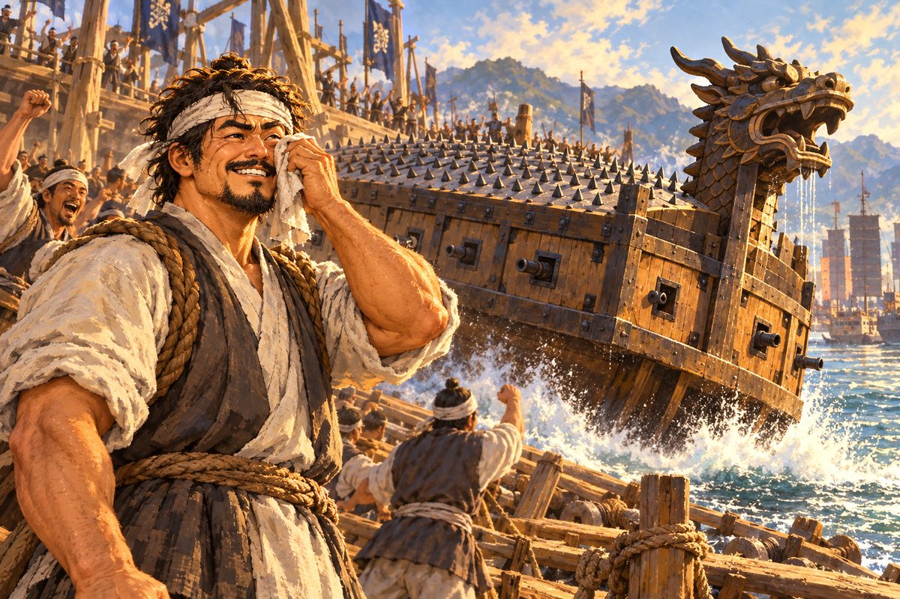
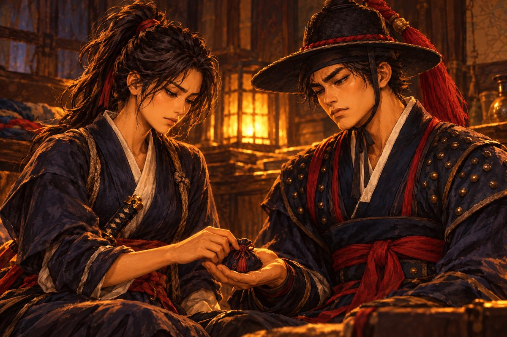
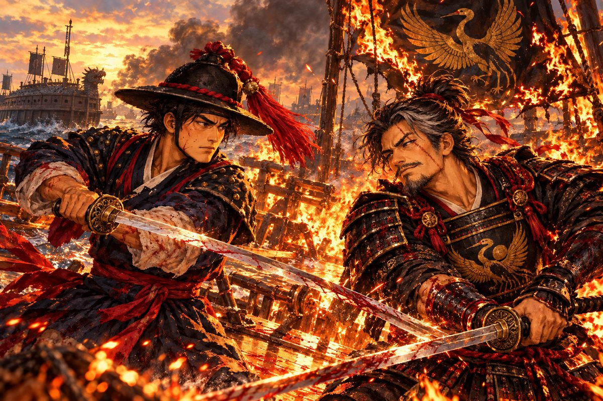

## 36. 돌아온 만호

부산포는 그대로였다. 해강이 떠난 지 두 해가 넘었다. 그동안 해강은 다섯 나라의 바다를 건넜고, 세 번의 결투와 열 번이 넘는 해전을 치렀다. 그러나 부산포의 산과 바다와 조선소의 비탈은 떠나던 날 그대로였다. 그것이 이상하게 고마웠다.

"윤 만호! 살아 돌아왔구먼."

좌수사는 관아 대청에서 버선발로 뛰어나와 해강의 어깨를 두 손으로 붙잡았다. 노장의 손이 전보다 가벼웠다. 흰 수염이 더 길어졌고, 등이 조금 굽었다. 두 해는 노인에게 짧지 않은 시간이었다.

"영감." 해강은 무릎을 꿇고 품에서 꾸러미 두 개를 꺼냈다. "왕한의 장부 사본과 마카오 남만 신부의 증언입니다. 구로세에게 은을 댄 자, 철포를 판 자, 그 뒤를 봐준 명나라 관리들의 이름이 다 들어 있습니다."

좌수사는 서류를 한참 넘겼다. 그의 눈이 젖어 갔다.

"그리고 영감. 구로세가 대마도 앞바다에 함대를 모으고 있습니다. 부산포를 노립니다. 한 달 안입니다."

좌수사가 서류를 내려놓았다. 대청 밖에서 풍경이 울었다. 땡그랑. 두 해 전 그날 밤처럼.

"……조정은 여전히 움직이지 않겠지만." 좌수사가 쓰게 웃었다. "왜관은 여전히 열려 있고, 한양의 대감들은 여전히 장삿길을 더 무겁게 여기지. 그러나 이 증거라면 훗날 반드시 쓰일 걸세. 내가 죽더라도, 누군가는 이걸 꺼내 볼 걸세."

그는 서안 밑에서 다시 주머니 하나를 꺼냈다. 두 해 전의 것보다 무거웠다.

"밀명은 그대로네. 이건 그동안 모아 둔 걸세. 자네가 돌아오면 줄 생각으로."

좌수사는 대청 구석의 낡은 궤를 열었다. 그 안에 쇠판을 촘촘히 박은 두툼한 갑옷 한 벌이 접혀 있었다. 군데군데 녹을 닦아 낸 자국이 있었다.

"이 갑옷도 가져가게. 삼포의 난리 때 내가 입고 왜구와 싸우던 걸세. 그 뒤로 열다섯 해 동안 궤짝 밖으로 나온 적이 없지." 노장은 갑옷의 쇠판을 손바닥으로 쓸었다. "마지막 싸움에는 이게 자네를 지켜 줄 거야. 늙은이의 갑옷이라 무겁겠지만, 무거운 만큼 단단하네."

해강은 무릎을 꿇고 두 손으로 갑옷을 받았다. 척문룡의 갑옷은 조선소의 목수 하나에게 맡겼다. 언젠가 명나라 바다에 가면 돌려줄 생각이었다.

## 37. 거북을 짓다

부산포 조선소에 조선 소나무가 쌓였다.

경상도 깊은 산에서 베어 온 금강송이었다. 나뭇결이 곧고 촘촘했으며, 송진 냄새가 조선소 비탈을 가득 채웠다. 그 옆에 하노이에서 실어 온 쇠못 상자들이 놓였다. 수영의 목수들이 모였다. 돌석의 옛 동료들, 해강의 아버지와 함께 배를 짓던 늙은 목수들이었다.

"자, 이제 지어 보자." 돌석이 소매를 걷었다. 그의 눈이 젊은이처럼 빛났다. "조선 소나무로 몸통을, 하노이 쇠로 등판을."

"화포는 내가 맡지." 안토니우가 말했다. 그는 조선소 한쪽에 화포들을 늘어놓고 하나하나 포신을 닦고 있었다. 좌수영 창고에서 빌려 온 천자총통, 지자총통. 남만의 대포와는 생김새가 달랐지만, 안토니우는 첫날 하루 만에 그 쓰임을 익혔다. "앞에 둘, 옆에 다섯씩. 용머리에도 하나."

"용머리에서 연기를 뿜는 건 어찌하지?" 돌석이 물었다.

"유황을 태우면 되오. 냄새가 지독할 거요. 적이 겁먹기 전에 우리가 먼저 질식하지 않게 조심해야겠지만."

목수들의 망치 소리가 밤낮없이 이어졌다. 용골이 놓이고, 늑골이 세워지고, 뱃전이 올라갔다. 그리고 그 위로 둥근 지붕이 덮이기 시작했다. 판자 한 장 한 장을 겹쳐 비늘처럼. 마을 사람들이 조선소 비탈에 모여 그 이상한 배를 구경했다. 거북 같다고 하는 사람도 있었고, 관 같다고 하는 사람도 있었다.

소백은 장부를 끌어안고 남은 돈을 셌다. 좌수사의 주머니, 마카오와 하노이에서 번 은, 소자의 배에서 건진 것들. 그는 밤마다 주판을 튕기며 한숨을 쉬었다.

"쇠못 값이 생각보다 듭니다. 목수 품삯도. 이대로면 배가 다 지어질 무렵엔 화약 살 돈이 빠듯해요." 그리고 다음 날 아침이면 어디선가 돈을 구해 왔다. 어떻게 구했는지 물으면 그는 웃기만 했다. "장사꾼의 비밀입니다."

오린은 날마다 높은 곳에 올라 대마도 쪽 바다를 살폈다. 아침에도, 저녁에도. 바람의 방향을 재고, 구름의 모양을 보았다. 남서풍이 북동풍으로 바뀌는 날. 그날이 언제 올지 아는 사람은 이 바다에서 오린밖에 없었다.

어느 날 주막에서 다대포의 노인이 해강을 찾아왔다. 두 해 전 배 밑에 숨어 살아남았던 그 어부였다. 그 뒤로 노인은 더 늙어 보였지만, 눈빛은 오히려 또렷했다. 그의 뒤에 사람들이 서 있었다. 열 명, 스무 명. 늙은이도 있고 젊은이도 있었다. 모두 다대포 사람들이었다.

"나리, 다대포에서 살아남은 놈들이 노를 젓겠다고 모였습니다. 장에 갔던 놈, 고기잡이 나갔던 놈, 그날 산에 나무하러 갔던 놈." 노인이 굽은 허리를 폈다. "늙은이도 노 하나는 저을 수 있지요. 평생 저은 게 노니까요. 이번엔 우리 손으로 원수를 갚게 해 주십시오. 나리 혼자 지게 하지 말고."

해강은 그들의 얼굴을 하나하나 보았다. 누이의 혼처였던 집안의 늙은 아버지가 있었다. 어릴 때 해강에게 연 만드는 법을 가르쳐 준 이웃 아저씨가 있었다. 해강은 목이 메었다.

"……고맙소. 함께 갑시다."

무당은 해강을 보자 방울을 흔들며 웃었다. 두 해 전과 같은 어둑한 방, 같은 향 연기.

"왔구먼, 무관 양반. 바다 냄새가 더 짙어졌어. 그런데 재 냄새는 좀 옅어졌구먼." 무당이 해강의 얼굴을 들여다보았다. "거북의 등이 다 자랐는가?"

"곧 바다에 띄웁니다."

"학은 높이 날아도 결국 물에 내려앉아야 하는 법." 무당이 방울을 내려놓았다. "그때 거북이 기다리고 있으면 되네. 서두르지 말게. 거북은 원래 느린 짐승이야. 그러나 거북은 지지 않아."

## 38. 선봉

귀선이 지어지는 동안 해강은 해령호로 부산포 앞바다를 지켰다. 날마다 순찰을 돌았다. 돌석이 조선소를 떠날 수 없어, 키는 오린이 잡았다. 오린은 돌석보다 거칠게 배를 몰았지만, 돌석만큼 바다를 알았다.

그리고 닷새째, 수평선에 검은 돛이 나타났다.

"구로세의 아들 하야토야!" 오린이 외쳤다. 그녀는 그 깃발을 알았다. 검은 학 깃발 아래에 작은 붉은 띠가 하나 더 달린 깃발. "조선소를 불태우러 왔어! 귀선이 다 지어지기 전에!"

관선 세 척이 바람을 타고 부산포를 향해 미끄러져 왔다. 앞 배의 뱃머리에 젊은 사내가 서 있었다. 구로세 하야토. 스물을 갓 넘은 얼굴은 아비를 닮아 있었다. 같은 눈매, 같은 턱. 흉터만 없을 뿐이었다.

"아버지의 앞길을 막는 조선 배는 여기서 가라앉힌다!" 하야토가 외쳤다. "그 이상한 거북 등딱지도 함께 태워 주마!"

"부산포에는 한 발짝도 들이지 않겠다!"

해강은 처음으로 지키는 싸움을 했다. 지금까지는 늘 쫓았다. 구로세를, 왕한을, 소자를. 그러나 오늘 해령호 뒤에는 조선소가 있었다. 돌석과 목수들과 반쯤 지어진 귀선이 있었다. 그리고 그 너머에 부산포가, 좌수영이, 사람들이 있었다.

다대포의 젊은이들이 노를 저었다. 그 옆에서 다대포의 늙은이들도 노를 저었다. 그들은 지치지 않았다. 해령호는 하야토의 관선 세 척 사이를 꿰뚫고 지나가며 양옆으로 불을 뿜었다. 안토니우가 조선소에서 뛰어와 해령호에 오른 참이었다. 그의 포탄이 하야토의 기함 뱃머리를 부쉈다.

선봉은 무너졌다. 하야토는 부서진 배를 버리고 작은 배로 달아났다. 그가 돌아보며 외쳤다.

"아버지가 오신다! 아버지가 오시면 이 항구는 잿더미가 된다!"

해강은 그 말에 대답하지 않았다. 대답은 바다에서 할 것이었다.

조선소는 무사했다. 돌석이 비탈에 서서 손을 흔들었다.

## 39. 귀선

그날 아침, 귀선이 물에 내려앉았다.

새벽부터 사람들이 조선소 비탈에 모였다. 좌수사가 왔고, 수영의 장졸들이 왔고, 부산포의 상인과 어부와 아이들이 왔다. 다대포 사람들은 맨 앞에 섰다.

목수들이 받침목을 하나씩 빼냈다. 거대한 배가 삐걱거리며 몸을 떨었다. 그리고 천천히, 아주 천천히, 비탈을 미끄러져 내려가기 시작했다. 용골이 물에 닿는 순간 흰 물보라가 솟았다. 사람들이 숨을 멈추었다.

배가 떴다.

함성이 터졌다. 아이들이 뛰었고, 늙은이들이 울었다.

쇠못이 박힌 등판이 아침 햇빛을 받아 번쩍였다. 수천 개의 쇠못이 모두 빛나서, 마치 배 전체가 불꽃에 덮인 것 같았다. 뱃머리에는 용의 머리가 솟았다. 입을 크게 벌리고, 눈을 부릅뜬 용. 등판 아래 옆구리마다 포문이 줄지어 났고, 그 안에서 화포들이 검은 입을 벌리고 있었다.

올라탈 곳이 없는 배. 거북의 등을 한 배.

해강은 오래 그 배를 보았다. 아무 말도 나오지 않았다. 무당의 목소리가 귓가에 되살아났다. 쇠처럼 단단한 등을 가진 거북.

돌석이 해강 옆에 섰다. 그는 오래 그 배를 보다가, 소매로 눈가를 문질렀다. 그리고 목이 메어 말했다.

"해강아…… 네 아버지가 이걸 봤으면 좋았을 텐데."

"보고 계실 겁니다." 해강이 말했다. "아버지는 바다에 계시니까요."

돌석은 대답하지 않았다. 대답할 수 없었다. 그의 어깨가 떨렸다. 해강은 그 어깨에 손을 얹었다. 두 해 전 조선소에서 돌석이 해강의 어깨에 그랬던 것처럼.

배의 이름은 귀선(龜船)이라 했다. 거북의 배. 좌수사가 지어 주었다.

## 40. 출정 전야

좌수사가 소식을 전했다.

"명나라 수군 파총이 대마도 서쪽에 함대를 대 두었다는 소식이네. 정크 세 척. 자네를 돕겠다고. 명나라 조정 몰래." 노장이 웃었다. "자네는 바다 건너에 좋은 벗을 두었구먼."

척문룡이었다. 해강은 천주 부두에서 베어 떨어뜨린 붉은 투구 깃을 떠올렸다.

"대마도 쪽 바닷길은 내가 낼게." 오린이 말했다. 그녀는 대마도 앞바다의 지도를 펼쳤다. 그녀의 아버지가 쓰던 낡은 해도였다. "아버지가 다니던 길이야. 구로세는 이 길을 몰라. 아버지가 아무한테도 안 가르쳐 줬거든. 나한테만."

"척 파총, 오린…… 모두 고맙소." 해강이 말했다.

오린이 남서쪽 하늘을 가리켰다. 구름이 길게 늘어져 있었다. 꼬리가 북동쪽을 향했다.

"모레야. 모레 새벽에 바람이 바뀌어."

출정 전야, 여관 방에 일행이 모였다. 돌석, 오린, 소백, 안토니우. 그리고 해강. 등잔 하나가 다섯 사람의 얼굴을 비추었다. 아무도 먼저 잠자리에 들지 않았다. 아무도 내일 이야기를 하지 않았다.

돌석이 먼저 입을 열었다. 그는 술잔을 손안에서 굴리고 있었다.

"해강아, 네 아버지라면 지금 웃고 있을 거다. 그 사람은 큰 싸움 전날 밤이면 꼭 웃었지. 내일 죽을지도 모르는데 왜 웃느냐고 물었더니, 오늘 밤은 살아 있으니까 웃는다더라."

"장부 걱정은 마십시오." 소백이 주판을 내려놓았다. 그의 얼굴이 등잔 빛에 붉게 빛났다. "이 싸움이 끝나도 우리 배는 굶지 않을 겁니다. 이긴 뒤의 장부는 제가 이미 다 맞춰 두었어요." 그가 머뭇거리다가 덧붙였다. "진 뒤의 장부는…… 안 맞췄습니다. 필요 없을 테니까요."

안토니우가 크게 웃었다. "포탄은 넉넉하오. 화약도. 소백이 어디서 구해 왔는지는 묻지 않겠소." 그가 웃음을 거두었다. "그리고 이번엔 내가 쏜 포탄이 옳은 쪽으로 날아갈 거요. 십 년 만에 처음으로."

해강은 동료들의 얼굴을 하나씩 보았다. 두 해 전 이 부산포를 떠날 때 해강 곁에는 돌석 하나뿐이었다. 지금은 네 사람이 있었다. 왜구의 딸, 망한 상인의 손자, 남만의 탈영병. 그리고 아버지의 옛 동료. 어느 나라의 깃발도 달지 않은 배에 탄, 어느 나라에도 온전히 속하지 않은 사람들.

밤이 깊었다. 하나씩 방을 나갔다. 돌석이 해강의 어깨를 두드리고 나갔다. 소백이 고개를 숙이고 나갔다. 안토니우가 하품을 하며 나갔다.

오린이 남았다.

그녀는 한동안 말없이 등잔을 보았다. 그리고 목에서 작은 주머니를 풀었다. 낡은 천으로 만든, 손바닥보다 작은 주머니였다. 끈이 닳아 반들거렸다.

"해강, 이거 받아." 그녀가 그것을 해강의 손에 쥐여 주었다. 그녀의 손가락이 해강의 손바닥에 잠깐 머물렀다. "아버지가 지니던 부적이야. 아버지는 이걸 차고 삼십 년을 바다에서 살아남았어. 마지막 날만 안 차고 나갔어. 나한테 두고 가서."

해강은 손바닥 위의 주머니를 내려다보았다. 가벼웠다. 그러나 그 무게가 손바닥을 지나 가슴까지 내려왔다.

"……돌려줄 때까지 잘 지니겠소."

"돌려주러 꼭 살아와."

오린은 그 말만 하고 돌아섰다. 문을 나서기 전에 잠깐 멈추었지만, 돌아보지는 않았다.

그것이 두 사람이 나눈 말의 전부였다. 고백도 약속도 없었다. 그러나 해강은 그날 밤, 살아서 돌아올 이유를 처음으로 손에 쥐고 잠들었다.

## 41. 대마도 앞바다

새벽, 바람이 바뀌었다. 오린의 말대로였다.

귀선이 앞장섰다. 그 뒤로 해령호가, 그리고 좌수사가 몰래 내어 준 수영의 판옥선 두 척이 따랐다. 기록에 없는 배들의 함대였다. 노를 젓는 사람의 절반이 다대포 사람이었다.

대마도 앞바다. 해가 떠오르며 바다가 금빛으로 물들었다. 그리고 남쪽 수평선에 붉은 십자가가 먼저 보였다.

"소자의 함대다!" 안토니우가 귀선의 포문 틈으로 내다보며 외쳤다. "카락 둘, 나오 둘. 남쪽 날개요! 남쪽 날개부터 무너뜨립시다! 구로세의 본대가 오기 전에!"

카락과 나오가 줄지어 다가왔다. 남쪽 섬에서 키를 잃었던 카락은 새 키를 달고 있었다. 소자가 고물 난간에서 망원경을 내렸다. 그는 귀선을 보고 잠시 말을 잃었다가, 이내 크게 웃었다.

"또 너희냐. 그건 대체 무슨 배냐? 관이냐, 거북이냐?" 그가 외쳤다. "이번에는 구로세의 함대가 뒤에 있다! 그 등딱지째로 바다에 묻어 주마!"

"그럼 당신 먼저요, 선장!" 안토니우가 포르투갈 말로 외쳤다. 그리고 첫 포의 심지에 불을 붙였다.

귀선이 앞으로 나섰다. 느렸다. 거북처럼. 그러나 멈추지 않았다.

남만 배의 포탄이 귀선의 등판에 부딪혔다. 쾅. 쾅. 귀선 안의 사람들이 귀를 막았다. 배가 흔들렸다. 그러나 포탄은 비늘처럼 겹친 판자와 쇠못에 맞아 비스듬히 튕겨 나갔다. 등판이 움푹 팼을 뿐, 뚫리지 않았다.

소자의 선원들이 갈고리를 던졌다. 갈고리가 등판 위에 떨어졌다. 그리고 쇠못에 걸리지 않고 미끄러져 바다로 떨어졌다. 몇몇이 밧줄을 타고 뛰어올랐다. 그리고 등판에 발을 딛는 순간 비명을 지르며 바다로 굴러떨어졌다.

귀선은 카락의 옆구리에 바짝 붙었다. 카락의 높은 뱃전에서는 귀선이 너무 낮아 포를 쏠 수 없었다. 그러나 귀선의 옆구리 포문은 카락의 배 밑동을 정면으로 보고 있었다.

"쏴라!"

안토니우의 고함과 함께 다섯 문의 화포가 동시에 불을 뿜었다. 카락의 배 밑동에 커다란 구멍이 났다. 물이 쏟아져 들어갔다.

용머리에서 유황 연기가 뿜어져 나왔다. 노랗고 매캐한 연기가 바다 위를 덮었다. 나오의 선원들이 연기 속에서 기침을 하며 허둥댔다. 그 틈에 해령호가 뒤에서 달려들었다.

남만 함대가 무너졌다. 소자는 기우는 카락에서 작은 배로 옮겨 타 달아났다. 이번에는 아무것도 외치지 않았다.

그리고 바다 저편에서, 검은 학 깃발이 떠올랐다.

## 42. 검은 학

안택선이 바다를 가득 메웠다.

안택선 다섯 척, 그 날개에 붙은 관선 세 척. 기리시마가 말한 그대로였다. 높은 판자벽을 두른 배들이 나란히 서자 바다 위에 성벽이 솟은 것 같았다. 검은 돛이 수평선을 덮었다. 그 한가운데에 망루 높은 기함이 있었다. 두 해 전 나가사키 앞바다에서 해령호를 짓밟았던 그 배. 다대포의 새벽, 수평선으로 멀어지던 그 배.

기함의 망루 꼭대기에 흉터 진 사내가 서 있었다.

"구로세의 기함이야!" 오린이 외쳤다.

해강은 귀선의 지붕 위, 용머리 바로 뒤에 난 작은 지휘 구멍으로 몸을 내밀었다. 바람이 얼굴을 때렸다. 그는 뒤를 돌아보았다.

다대포의 젊은이들이 노를 쥐고 그를 보았다. 막동이가, 누이의 혼처였던 집 둘째가. 노인이 굽은 허리로 노를 쥐고 그를 보았다. 돌석과 소백과 안토니우가 그를 보았다. 그리고 해령호의 뱃머리에서, 오린이 그를 보았다.

해강은 숨을 깊이 들이쉬었다. 아버지가 그랬던 것처럼, 바다 위에서는 누구보다 크게 외쳤다.

"모두 들어라! 다대포를 위해, 이 바다를 위해!"

함성이 바다를 울렸다. 귀선의 지붕 아래에서, 해령호의 갑판에서, 판옥선들에서.

구로세가 망루에서 그 함성을 내려다보았다. 그는 귀선을 보고 눈썹을 치켜올렸다. 그리고 웃었다. 두 해 전과 같은 웃음이었다.

"거북 등딱지 같은 배를 끌고 왔구나, 조선 무관. 재미있군. 등딱지를 벗겨 거북탕을 끓여 주마."

"구로세 도겐." 해강의 목소리는 떨리지 않았다. "다대포를 기억하게 해 주마!"

그것은 해강이 겪은 어떤 싸움과도 달랐다.

검은 학의 함대가 날개를 펼쳤다. 안택선들이 가운데에서 벽을 이루고, 관선들이 양옆으로 돌아 귀선을 감싸려 했다. 두 해 전과 같은 진형이었다. 두 해 전 해령호를 무너뜨렸던 진형.

그러나 두 해 전과 달랐다.

조총이 비처럼 쏟아졌다. 탕탕탕탕. 그러나 귀선의 등판을 뚫지 못했다. 총알이 쇠못에 맞아 불꽃을 튀기며 튕겨 나갔다. 화살도, 불화살도 마찬가지였다. 불화살이 등판에 꽂혔지만 젖은 판자 위에서 금세 꺼졌다.

왜구들이 뛰어올랐다. 갈고리를 걸고, 밧줄을 타고. 그들은 늘 그렇게 싸워 왔다. 배에 올라타서, 칼로. 그러나 귀선에는 올라탈 데가 없었다. 쇠못에 찔려 바다로 떨어졌다.

서쪽에서 붉은 깃발이 나타났다. 척문룡의 정크 세 척이 검은 학의 왼쪽 날개를 물어뜯었다. 관선들이 당황해 진형이 흐트러졌다.

오린이 해령호의 뱃머리에서 깃발을 흔들었다. 그녀 아버지의 길. 구로세가 모르는 길. 암초와 암초 사이, 물살이 빠른 좁은 물목. 귀선이 그 길을 따라 안택선의 벽 옆구리로 파고들었다.

귀선은 안택선 사이를 헤집고 다니며 앞과 옆으로 불을 뿜었다. 안택선의 판자벽은 조총을 막도록 지어졌지, 바로 옆에서 쏘는 대포를 막도록 지어지지 않았다. 판자벽이 무너졌다. 망루가 기울었다. 한 척, 두 척.

안토니우는 포문에서 포문으로 뛰어다니며 조준했다. 땀과 화약 연기로 얼굴이 새까맸다. 그는 웃고 있었다. 그의 포탄은 정말로 옳은 쪽으로 날아갔다.

소백은 귀선의 배 속에서 화약과 포탄을 나누었다. 한 톨도 낭비하지 않았다. 그의 주판알 같은 손가락이 화약 자루를 정확히 나누었다.

돌석은 노를 지휘했다. 노 젓는 사람들의 장단을 맞추며 고함을 질렀다. 지칠 법도 한 나이였지만, 그의 목소리는 어떤 노보다 힘찼다.

해가 중천에 떴을 때, 검은 학의 함대는 부서져 있었다. 바다 위에 부서진 판자와 찢어진 검은 돛이 떠다녔다. 남은 배들은 흩어져 달아났다.

그리고 기함에 불이 붙었다.

망루 꼭대기의 흉터 진 사내는 달아나지 않았다. 그는 불길 속에 서서 귀선을 내려다보았다.

해강은 칼을 뽑았다. 그리고 귀선의 지붕 위로 올라가, 불타는 기함의 뱃전으로 건너뛰었다.

"해강아!" 돌석이 외쳤다.

"해강!" 오린의 목소리가 해령호에서 들렸다.

해강은 돌아보지 않았다. 품 안의 작은 주머니가 가슴에 닿았다.

## 43. 마지막 칼

연기 속에서 구로세가 기다리고 있었다.

기함의 갑판은 불바다였다. 망루가 불타며 내려앉았고, 검은 학 깃발이 돛대 꼭대기에서 불꽃을 날리고 있었다. 열기에 숨이 막혔다. 그 한가운데에 구로세 도겐이 칼을 뽑아 들고 서 있었다. 그는 웃고 있었다.

"하하…… 이 바다에서 나를 쓰러뜨릴 자가 있을 줄이야." 구로세의 목소리는 여전히 느긋했다. 그러나 그 눈은 웃고 있지 않았다. "이십 년이다. 이십 년 동안 이 바다에서 나를 이긴 놈은 없었다. 명나라 수군도, 조선 수군도, 남만인도." 그가 칼을 들었다. "좋다, 마지막은 칼로 하자! 배로는 졌지만, 칼로는 아직 지지 않았다."

구로세의 칼은 이십 년 바다를 휩쓴 칼이었다. 무겁고, 잔인하고, 망설임이 없었다. 기리시마의 빠름도, 척문룡의 정직함도, 디오구의 거칢도 모두 그 안에 있었다. 그리고 그 위에 무엇보다 무서운 것이 있었다. 사람을 베는 데 아무 거리낌이 없다는 것.

첫 합에 해강의 칼이 튕겨 나갈 뻔했다. 기리시마의 일본도가 아니었다면 정말로 튕겨 나갔을 것이다. 둘째 합에 구로세의 칼이 어깨를 내리쳤다. 좌수사의 갑옷이 그 칼을 받아 냈다. 쇠판 하나가 찌그러지며 비명 같은 소리를 냈다. 셋째 합에 해강은 쓰러졌다. 불타는 갑판에 등이 닿았다. 등이 뜨거웠다.

"그게 다냐, 조선 무관." 구로세가 내려다보았다. "다대포 놈들도 그렇게 쓰러졌지. 기억은 안 나지만."

해강은 일어났다.

다시 칼이 부딪쳤다. 해강은 다시 쓰러졌다. 이번에는 옆구리를 베였다. 피가 갑판에 떨어져 불꽃 속에서 지글거렸다. 연기가 눈을 찔렀다. 숨이 찼다. 칼을 쥔 손에 힘이 빠졌다.

해강은 다시 일어났다.

구로세의 얼굴에서 처음으로 웃음이 사라졌다.

세 번째, 해강은 아버지의 목소리를 들은 것 같았다. 불길이 타오르는 소리 너머, 파도 소리 너머에서.

바다가 지켜 주는 마을이 있으면, 누군가는 바다를 지켜야 한다.

그리고 다른 목소리들이 들렸다. 돌석의 목소리. 물러나야 한다, 여기서 다 죽으면 누가 다대포를 기억하냐. 오린의 목소리. 살아서 돌아올 이유가 있어야 살아 돌아오는 법이야. 좌수사의 목소리. 살아서 돌아오게, 그게 명령일세.

해강은 복수를 위해 칼을 들지 않았다. 처음으로.

구로세의 칼이 내려왔다. 해강은 그것을 받지 않았다. 흘려보냈다. 디오구에게 그랬던 것처럼. 그리고 척문룡의 파도 사이에서 찾았던 그 짧은 틈. 기리시마의 빠른 칼을 받으며 기다렸던 그 한순간.

해강의 칼이 구로세의 칼을 지나쳤다.

구로세는 갑판에 무릎을 꿇었다. 그의 칼이 손에서 미끄러져 불길 속으로 굴러갔다. 그는 자기 가슴을 내려다보았다. 그리고 천천히 고개를 들어 해강을 보았다. 그의 눈이 해강을 오래 보았다. 이번에는 정말로 보는 눈이었다. 귀찮은 파리가 아니라, 한 사람을.

"……다대포라 했나." 구로세가 중얼거렸다. 피가 그의 턱을 타고 흘렀다. 흉터를 따라. "이제 기억하마. 저승에서."

그는 앞으로 쓰러졌다.

돛대 꼭대기에서 검은 학 깃발이 마지막 불꽃을 날리며 떨어졌다. 깃발은 바람에 한 번 펄럭이더니, 천천히, 아주 천천히 바다로 내려앉았다. 학은 높이 날아도 결국 물에 내려앉아야 하는 법.

해강은 칼을 떨어뜨렸다. 다리에 힘이 풀렸다. 그는 불타는 갑판 위에 무릎을 꿇었다.

"해강아!" 돌석이 귀선 위에서 소리쳤다. 그의 목소리가 갈라져 있었다. "끝났다…… 해강아, 끝났어!"

해강은 고개를 들었다. 북쪽, 다대포가 있는 쪽 하늘을 보았다. 연기 너머로 파란 하늘이 보였다. 갈매기 한 마리가 날았다. 그날 새벽 부산포 여관 창밖에서 보았던 것처럼.

"……어머니, 누이." 해강이 속삭였다. "이제 편히 쉬세요."

그리고 그는 두 해 만에 처음으로 울었다.

## 44. 적히지 않는 공

해강은 사흘을 앓았다. 어깨와 옆구리의 상처가 깊었다. 오린이 사흘 밤을 그 곁에서 새웠다. 돌석이 그것을 보고 아무 말도 하지 않았다. 소백은 그동안 전리품을 정리해 장부를 맞추었고, 안토니우는 귀선의 등판에 박힌 총알을 하나씩 뽑아 세었다. 천이백 개가 넘었다.

나흘째 되는 날 해강은 일어나 부산포 관아로 갔다.

좌수사가 해강을 맞았다. 노장은 대청에서 내려와 해강의 두 손을 잡았다. 오래 아무 말도 하지 않았다.

"수고했네, 윤 만호. 아니." 노장이 웃었다. 쓸쓸한 웃음이었다. "이제 다시 윤 만호라 불러도 되겠지. 다대포 만호 자리는 비워 두었네. 두 해 동안."

"영감……."

"자네의 공은 어디에도 적히지 않을 걸세." 좌수사가 말했다. "조정에는 대마도 앞바다에서 왜구끼리 싸우다 자멸했다고 올라갈 거야. 기록에 없는 배가 한 일이니까. 귀선도, 해령호도, 다대포 사람들도. 아무도 자네 이름을 부르지 않을 걸세. 미안하네. 정말 미안하네."

해강은 고개를 저었다.

"적히지 않아도 괜찮습니다." 그가 말했다. 창밖으로 부산포 앞바다가 보였다. 햇빛에 반짝이는 바다. 그 위에 귀선이 정박해 있었다. "바다가 기억할 테니까요."

좌수사는 서안에서 마지막 주머니를 꺼냈다.

"이건 내가 줄 수 있는 마지막 상일세. 내 녹봉에서 떼어 낸 것이 아니야. 왜구 함대에서 건진 은일세. 원래 이 바다 사람들의 것이었으니, 이 바다 사람들에게 돌려주는 걸세."

## 45. 갈림길

부산포 주막. 두 해 전 해강과 돌석이 처음 술잔을 나누었던 그 주막이었다. 오늘은 노랫소리가 넘쳤다. 다대포 사람들이, 부산포 뱃사람들이, 수영의 장졸들이 술잔을 부딪쳤다. 누군가 장구를 쳤고, 누군가 춤을 추었다.

구석 자리에 일행이 한자리에 모였다. 돌석, 오린, 소백, 안토니우. 그리고 해강.

돌석이 해강의 잔을 채웠다. 두 해 전 그날 밤처럼.

"자, 이제 어떻게 할 거냐?" 돌석이 물었다. "다들 네 말을 기다린다."

소백이 주판을 내려놓았다. 안토니우가 술잔을 내려놓았다. 모두 해강을 보았다.

오린이 해강을 보았다. 그녀는 웃고 있었지만, 그 웃음 아래에 무언가가 있었다.

"생각해 봤어? 하노이에서 내가 물었잖아. 끝나면 어디로 갈지."

해강은 오래 대답하지 않았다.

창밖으로 부산포 앞바다가 보였다. 해가 지고 있었다. 바다가 붉게 물들었다. 그날 새벽의 하늘과 같은 빛이었지만, 이제 그 빛은 다르게 보였다. 불길이 아니라 노을이었다.

그 바다 너머로 대마도가, 나가사키가, 사카이가 있었다. 천주와 장안과 마카오와 하노이가 있었다. 기리시마가 차지할 빈 바다가, 척문룡이 지키는 바다가, 에르네스트가 그리는 바다가, 피에트로가 건너는 바다가 있었다. 이름 없는 배를 기다리는 바다.

그리고 등 뒤 언덕 너머에는 다대포가 있었다. 잿더미가 된 마을. 다시 집을 지어야 할 마을. 살아남은 사람들이 돌아가고 싶어 하는 마을.

해강은 품 안의 작은 주머니를 만졌다. 오린의 아버지가 삼십 년을 지닌 부적. 돌려주겠다고 약속한 부적.

해강은 입을 열었다.
