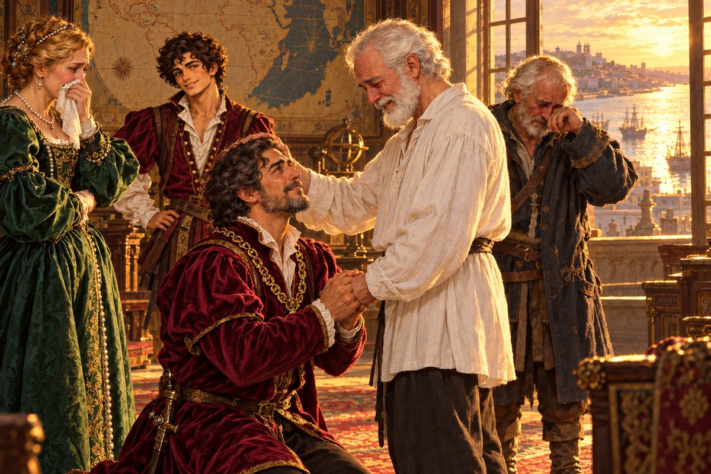

## 28. 리스본의 가을

1524년 가을, 가비아노는 테주강 어귀로 들어섰다.

강가의 언덕들이 늦은 오후의 햇살을 받아 꿀빛으로 물들어 있었다. 부두에는 여전히 돛이 숲처럼 빽빽했다. 처음 이 항구에 닿았던 날과 다를 것이 없었다. 다른 것은 피에트로 자신이었다. 그때 그는 해진 소매와 이끼 묻은 장화로 이 부두에 뛰어내렸다. 지금 그의 장화에는 세상 여러 땅의 흙이 묻어 있었다. 나일강의 모래, 붉은 벼랑의 흙, 마사와의 산호 가루, 사카이의 진흙, 그리고 남쪽 대륙의 축축한 검은 흙.

파블리스 옹은 뱃머리에 서 있었다. 가비아노가 대서양을 건너는 동안 그는 조금씩 살이 붙었다. 수염을 다듬고 카밀로가 내준 깨끗한 셔츠를 입자, 넝마 속에 숨어 있던 사람이 드러났다. 등이 곧고 눈매가 깊은, 한때 이 바다를 누빈 모험가의 얼굴이었다. 그는 리스본의 언덕을 보며 한마디도 하지 않았다. 난간을 쥔 손등에 핏줄이 섰다.

"카밀로." 피에트로가 말했다. "옹을 모시고 조금 천천히 와. 나 먼저 가서 자리를 마련해 둘게."

"뭘 꾸미는 거야?"

"선물은 포장을 벗길 때가 제일 재밌는 법이야."

## 29. 선물

"마님! 마님, 피에트로 씨입니다. 금으로 된 도시를 찾겠다고 떠나셨던 그분이 돌아오셨습니다."

마르코의 목소리가 현관에서 응접실까지 울렸다. 이 집사가 큰 소리로 손님을 알리는 것도, 그 목소리가 조금 들떠 있는 것도 처음이었다.

응접실에서 부인이 일어섰다. 금빛 머리에 은실이 몇 가닥 늘었지만, 맑은 눈은 그대로였다.

"돌아왔군요! 그래서, 찾았어요? 그 도시를?"

"그게……" 피에트로는 모자를 벗어 가슴에 댔다. "저보다 먼저 거기 다녀가신 분이 계시더군요. 그것도 한참 먼저."

"어머, 그렇게 고생을 하고서……. 속상했겠어요."

부인의 얼굴에 진심으로 아쉬워하는 빛이 스쳤다. 피에트로는 그 얼굴을 보며 속으로 웃었다. 이 사람은 처음 만난 날부터 늘 이랬다. 남의 일을 제 일처럼 기뻐하고, 제 일처럼 아쉬워했다.

"하지만 마님, 제가 어디 빈손으로 돌아올 사람입니까. 이 댁에 진 신세를 갚을 만한 것을 하나 구해 왔습니다. 금보다 귀한 걸로요."

"금보다 귀한 거요?"

"보시면 아실 겁니다. 지금 카밀로가 그걸 싣고 언덕을 오르는 중이거든요." 피에트로는 창밖을 한 번 보았다. 언덕길 아래에서 마차 한 대가 천천히 올라오고 있었다. "그 전에, 공작 각하께서 댁에 계시면 꼭 함께 보셨으면 하는데요."

"마침 서재에 계세요. 모셔 오라고 할게요."

부인이 마르코에게 눈짓을 했다. 마르코가 고개를 숙이고 나갔다.

피에트로는 기다리는 동안 벽의 세계 지도를 보았다. 처음 이 방에 들어왔을 때 그를 붙들었던 지도. 이제 그는 그 지도의 빈 곳을 몇 군데 알았다. 인도 남쪽의 비어 있는 바다에는 붉은 벼랑이 있었다. 중국 동쪽의 금박 구름 밑에는 칼을 두 자루 찬 사람들의 나라가 있었다. 그리고 대서양 건너 초록빛 대륙의 텅 빈 안쪽 어딘가에는, 황금 도시가 있었다.

복도에서 묵직한 발소리가 들렸다.

들어온 사람은 쉰 가까운 사내였다. 어깨가 넓고 키가 컸다. 희끗한 수염을 짧게 다듬었고, 짙은 자줏빛 웃옷에 금줄을 늘어뜨렸다. 그러나 피에트로의 눈을 끈 것은 옷차림이 아니었다. 그의 손이었다. 공작의 손은 밧줄 굳은살이 아직 빠지지 않은 뱃사람의 손이었다.

"당신이 그 제노바 사람이군. 레온 페레로요. 얼굴은 처음이지만, 이야기는 질리도록 들었소."

"피에트로 콘티입니다. 각하의 망원경 덕분에 세상을 꽤 많이 보았습니다."

레온이 피에트로의 허리에 매달린 놋쇠 망원경을 보고 웃었다. "아직 잘 굴러가는 모양이군. 다행이오. 그놈이 나보다 바다를 더 많이 봤을 거요."

그때 현관 쪽이 소란해졌다. 마르코가 무언가 말하는 소리, 카밀로의 목소리, 그리고 그 사이로 낯선 쉰 목소리 하나가 섞였다. 피에트로는 고개를 갸웃했다. 카밀로가 누구를 더 데려온 모양이었다.

응접실 문이 열렸다.

카밀로가 먼저 들어와 옆으로 비켜섰다. 그 뒤에 백발의 노인 둘이 서 있었다. 한 사람은 파블리스 옹이었다. 다른 한 사람은 피에트로가 처음 보는 얼굴이었다. 등이 조금 굽었지만 다부진 체구, 바닷바람에 깊이 팬 주름, 투박한 선원의 웃옷. 그 노인이 파블리스 옹의 팔을 붙들어 부축하고 있었다. 그의 눈가가 벌겋게 젖어 있었다.

"부두에서 만났어." 카밀로가 피에트로에게 속삭였다. "마침 리스본에 와 계셨대. 옹의 얼굴을 보자마자 그 자리에 주저앉으시더라."

로코였다. 당차고 젊던 항해사는 이제 파블리스 옹만큼이나 늙어 있었다.

로코가 레온을 보았다. 그리고 오랜 세월 몸에 밴 그 호칭으로, 목이 멘 채 말했다.

"제독. 파블리스 어르신이 돌아오셨소."

## 30. 아버지와 아들

"파블리스……? 로코, 지금 무슨 소리를……."

레온의 목소리가 거기서 끊겼다. 그의 눈이 로코에게서, 로코가 부축한 노인에게로 옮겨 갔다. 노인의 하얀 수염, 깊은 눈매, 곧은 등. 레온의 얼굴에서 천천히 무언가가 무너졌다. 공작의 얼굴이, 제독의 얼굴이, 쉰 해를 살아온 사내의 얼굴이 하나씩 벗겨지고, 그 아래에서 아주 오래전의 얼굴이 드러났다.

"그럴 리가……!"

노인이 로코의 팔을 놓았다. 그리고 혼자 한 걸음을 내디뎠다. 다리가 떨렸다. 그러나 그는 넘어지지 않았다.

"레온……." 노인의 목소리가 갈라졌다. "그 눈썹, 그 턱……. 네 어미를 꼭 빼닮았구나. 내 아들이 이렇게…… 이렇게 장한 어른이 되었구나……."

레온이 성큼 다가갔다. 공작의 걸음이 아니었다. 부두에서 아버지의 배가 들어오는 것을 보고 달려가는 아이의 걸음이었다. 그는 노인 앞에 무릎을 꿇었다. 그리고 앙상한 두 손을 제 두 손으로 감쌌다.

"아버지……."

그 한 마디를 하고 나서 레온은 한동안 아무 말도 하지 못했다. 그의 넓은 어깨가 흔들렸다.

"어디 계셨습니까. 그 긴 세월 동안. 저는 바다에 나갈 때마다…… 수평선에 낯선 돛이 보일 때마다, 혹시나, 혹시나 하고……."

노인은 아들의 희끗한 머리를 쓰다듬었다. 이십 년 전, 그가 마지막으로 쓰다듬었을 때 그 머리는 그의 허리께에 있었을 것이다. 이제 무릎을 꿇은 아들의 머리가 서 있는 그의 가슴께에 닿았다.

부인이 손수건으로 입을 막고 있었다. 마르코는 문가에서 등을 돌리고 서 있었다. 그 등이 아주 조금 떨렸다. 로코는 소매로 눈가를 마구 문질렀다. 카밀로는 숨기지도 않고 울었다.

피에트로는 창가로 물러났다. 이 순간은 그의 것이 아니었다. 그는 창밖으로 테주강을 보았다. 저녁 해가 강물 위에 금빛 길을 깔고 있었다. 그 길은 강 어귀를 지나 바다로, 수평선까지 이어졌다.

한참 뒤, 레온이 일어나 피에트로를 돌아보았다. 공작의 눈이 붉었다. 그는 무언가 말하려 했지만, 말이 되지 않는 모양이었다. 피에트로가 먼저 웃었다.

"보아하니 선물 고르는 눈은 제가 좀 있는 모양입니다. 마음에 드셨다니 저야말로 한숨 돌렸습니다."

레온이 그의 손을 잡았다. 밧줄 굳은살이 박인 두 손이 맞닿았다.

"……이 은혜를 무엇으로 갚아야 할지 모르겠소."

"벌써 갚으셨습니다. 제 빚을 갚아 주셨잖아요. 제노바의 빚쟁이들이 지금도 각하께 감사 기도를 드리고 있을 겁니다."

응접실에 웃음이 터졌다. 울음과 웃음이 뒤섞인, 이상하고 따뜻한 웃음이었다.

---

제노바에서 온 모험가가 스무 해 전에 사라진 공작의 아버지를 세상 반대편에서 찾아 모셔 왔다는 이야기는 그 주가 가기 전에 리스본 온 항구에 퍼졌다. 이야기는 사람의 입을 건널 때마다 조금씩 부풀었다. 피에트로는 이번에도 굳이 바로잡지 않았다. 다만 누가 엘도라도를 찾았느냐고 물으면, 늘 같은 대답을 했다.

"내가 아니야. 파블리스 페레로라는 위대한 모험가가 찾았지. 나는 그분을 모셔 왔을 뿐이야."

그 말이 퍼지자 이상하게도 그의 이름은 더 높아졌다.

어느 이른 아침, 피에트로는 리스본 부두 끝에 앉아 있었다. 안개가 강 위에 낮게 깔려 있었다. 가비아노가 물결에 흔들리며 삐걱거렸다. 품속에서 메달이 조용히 무게를 더했다. 파블리스 옹은 그 메달을 돌려받지 않았다. 그것은 자네를 여기까지 이끈 물건이니, 자네가 다음 길에도 지니고 가라고 했다.

카밀로가 하품을 하며 다가와 옆에 앉았다.

"또 지붕 위에서 잤어?"

"아니. 이번엔 침대에서 잤어. 근데 일찍 깼어."

"왜?"

피에트로는 대답 대신 한쪽 눈을 감았다. 그리고 엄지손가락을 세워 안개 너머 수평선을 가늠했다. 오래전 제노바의 지붕 위에서 하던 그 장난이었다. 엄지 한 마디 너머에 무엇이 있을지 상상하는 장난.

이제 그는 그 너머에 무엇이 있는지 조금 알았다. 붉은 벼랑과 꼬리로 서는 짐승, 칼을 두 자루 찬 사람들의 섬, 바다까지 민물을 밀어내는 강. 그리고 그것들 너머에 아직도 그가 모르는 것들이 훨씬 더 많다는 것도 알았다. 에르네스트의 지도에는 여전히 빈 곳이 많았다. 아버지의 해도에도.

"카밀로."

"응."

"다음엔 어디로 갈까."

카밀로는 오래 대답하지 않았다. 그러다 그도 한쪽 눈을 감고 엄지손가락을 세웠다.

"어디든." 그가 말했다. "금 침대가 있는 데로."

피에트로가 웃었다. 안개가 걷히기 시작했다. 수평선 위로 해가 떠올랐다. 테주강이 금빛으로 물들었다. 그것은 저녁에만 잠깐 있는 금이 아니라, 아침에 떠오르는 금이었다.

피에트로 콘티의 모험은 거기서 끝나지 않았다. 사실은, 이제 막 시작된 것이었다.
