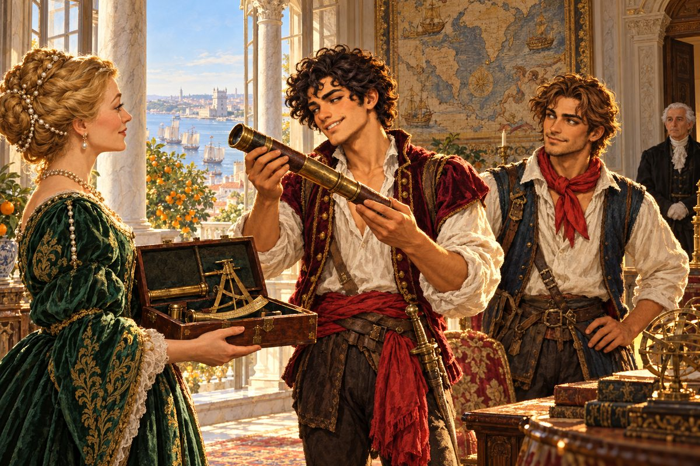

## 1. 골목의 도망자

항구로 내려가는 길에 피에트로는 팔콘 영감과 마주쳤다.

팔콘은 제노바 부두에서 밧줄을 꼬며 늙은 뱃사람이었다. 손가락 마디가 굵게 불거졌고, 한쪽 귀에 놋쇠 귀고리를 달았다. 아버지와 함께 배를 탔던 사람이라 피에트로에게는 삼촌이나 다름없었다. 빚 독촉을 하지 않는 몇 안 되는 제노바 사람이기도 했다.

"카밀로는 만나 봤나?"

영감은 인사도 없이 물었다. 피에트로는 눈을 깜빡였다.

"카밀로요? 아니, 아직요. 그 녀석 리스본에 있는 거 아니었어요?"

"어제 저녁 배로 들어왔어. 그 녀석 버릇이야 너도 알잖니. 지금쯤 닻 간판 밑에 앉아 있을 게다. 가 봐라. 네 사정 듣고 할 말이 있다더라."

카밀로는 피에트로의 어릴 적 친구였다. 같은 골목에서 자랐고, 같은 부두에서 게를 잡았고, 같은 선술집에서 처음 술을 마셨다. 두 해 전 그는 리스본으로 건너가 큰 귀족 집안의 상선대에 들어갔다. 떠나는 날 카밀로는 부두에서 피에트로의 어깨를 두드리며 말했다. 내가 거기서 자리를 잡으면 너도 부르마. 피에트로는 웃으며 기대하지 않겠다고 했다.

얼마 전 그는 카밀로에게 편지를 보냈다. 빚 때문에 숨이 막힌다고, 리스본에 일자리가 없겠느냐고. 답장이 온다면 몇 달은 걸리리라 생각했다. 그런데 카밀로가 직접 왔다.

피에트로는 영감에게 고맙다고 손을 들어 보이고 부두를 가로질렀다. 그러나 열 걸음도 가지 못해 누군가 그의 소매를 잡았다.

"어이, 피에트로. 이제 슬슬 갚아 줄 때가 되지 않았나?"

직물상 베네데토였다. 배가 불룩하고 볼이 처진 사내였다. 지난밤 그 조카를 보낸 장본인이기도 했다.

"베네데토 아저씨, 갚을 마음이야 하루에도 열두 번씩 듭니다. 문제는 주머니가 그 마음을 못 따라온다는 거죠."

"부친의 빚이라는 건 나도 안다. 너한테 이러는 내 마음도 편치 않아. 하지만 돈을 꿔 준 쪽은 받아 낼 사람이 너밖에 없으니 어쩌겠냐." 베네데토는 한숨을 쉬었다. 진심으로 곤란한 얼굴이었다. 그래서 피에트로는 이 사람을 미워할 수가 없었다.

"카밀로하고 연락이 닿았어요. 그 녀석이 무슨 수를 내 줄 거예요. 한 달만, 아니 보름만 눈감아 주세요."

"카밀로? 리스본의 그 공작 집안 상선대에 들어간 녀석 말이냐?" 베네데토가 턱을 쓸었다. "그 녀석이라면 아까 봤는데. 주점 쪽으로 올라가더라."

"정말요?"

피에트로는 대답도 듣지 않고 달렸다.

그러나 제노바의 골목은 그에게 친절하지 않았다. 지름길로 들어선 첫 번째 문은 하필 은행이었다. 장부 앞에 앉은 서기가 안경 너머로 그를 보더니 얼굴이 환해졌다.

"콘티 님! 드디어 갚으러 오셨군요. 물론 전액이시겠지요?"

"전액이요? 하하, 아뇨, 그냥 길을 좀 물으려고……. 실례했습니다!"

두 번째로 뛰어든 곳은 성당 뒷문이었다. 회계를 맡은 수사가 촛대를 닦다가 고개를 들었다.

"콘티 형제님? 헌금을 하러 오셨습니까, 아니면 빌려 가신 것을 돌려주러 오셨습니까?"

"그게…… 발을 헛디뎌서요. 좋은 하루 되십시오, 수사님."

세 번째 문은 조선소였고, 거기서 망치를 든 목수장이 "마침 잘 왔다!" 하고 소리치는 바람에 피에트로는 문지방도 넘지 않고 돌아섰다. 네 번째로 들어간 여관에서야 겨우 숨을 돌렸다. 안주인 로사가 앞치마에 손을 닦으며 혀를 찼다.

"오늘도 빚쟁이들한테 쫓기는 거예요? 걱정 말아요. 뒷방에 숨겨 줄 테니까."

"로사, 당신은 제노바의 성녀예요."

"성녀 말고 숙박비나 내요. 그건 나중에."

피에트로는 여관 뒷방 창문으로 빠져나가 골목 둘을 더 지났다. 그리고 마침내 낯익은 간판 아래에 섰다. 닻 두 개가 엇갈린 모양으로 그려진 간판. 그가 처음 술을 배운 선술집이었다.

## 2. 친구 카밀로

선술집 안은 어둑하고 시큼했다. 묵은 포도주와 생선 기름과 톱밥 냄새가 뒤섞였다. 주인이 술통 뒤에서 피에트로를 보고 껄껄 웃었다.

"어서 와, 피에트로! 오늘 들어온 맥주는 이 근방에서 제일이지. 근데 넌 마실 생각 말고 외상부터 갚아야 하지 않나?"

"오늘은 냄새만 맡을게요. 외상은…… 곧, 정말 곧이요."

"피에트로! 이 녀석, 살아 있었구나!"

구석 자리에서 사내 하나가 일어섰다. 키는 피에트로보다 머리 반 개쯤 작았지만 어깨가 두꺼웠다. 검은 곱슬머리를 짧게 쳤고, 턱에는 짧은 수염을 길렀다. 감색 상의의 소매 끝에 포르투갈 상선대의 문장이 수놓여 있었다. 두 해 전보다 살이 조금 붙었고, 얼굴이 햇볕에 더 그을렸다.

"카밀로! 너 진짜 왔구나."

두 사람은 서로 어깨를 끌어안았다. 카밀로가 피에트로의 등을 두 번 세게 두드렸다.

"앉아 봐. 나 리스본에서 어떻게 지냈는지부터 말해 줄게……."

"미안하지만 그건 나중에 듣자. 그보다 내 돈 문제 좀 어떻게 해 줘. 요즘 너무 시달려서 정말 죽을 것 같아. 오늘 아침엔 지붕 위에서 잤어."

"급하긴. 내 얘기가 바로 그 얘기야." 카밀로가 그를 의자에 앉혔다. "너한테 돈을 대겠다는 분을 찾았어. 네 빚 문제까지 한 번에 풀어 줄 수 있는 분이야."

"후원자? 그게 무슨 소리야? 나 같은 놈한테 돈을 대겠다는 괴짜가 대체 누군데?"

"내 고용주. 리스본 페레로 공작가의 안주인이시지." 카밀로는 목소리를 낮추었다. 마치 그 이름이 이런 선술집에서 나오기에는 너무 귀하다는 듯이. "네가 어떤 놈인지 이것저것 말씀드렸더니, 그런 사람이라면 밀어 주고 싶다고 하시더라."

피에트로는 잠시 멍하니 친구를 보았다. 그러다 탁자를 내리쳤다.

"진짜야? 세상에, 하늘에서 금화가 떨어지네! 그럼 나 이제 정말로 배를 타는 거야?"

"그래! 너랑 나랑, 바다 끝까지 가 보는 거야!"

"잠깐." 피에트로가 손을 들었다. 기쁨이 가라앉자 다른 것이 떠올랐다. "그 돈이 빚 갚는 데 몽땅 들어가면 정작 배 띄울 돈이 없잖아. 얼마나 주신대?"

"그게 말이지, 빚은 빚대로 마님이 통째로 정리해 주시고, 모험 자금은 따로 대 주신대. 얼마인지는 나도 못 들었지만." 카밀로가 뿌듯하게 팔짱을 꼈다. "그런 분 흔치 않다고."

피에트로는 대답하지 않았다. 그는 탁자 위의 나뭇결을 손톱으로 긁었다.

"이상하잖아. 생판 모르는 사람 빚을 갚아 주는 귀족이 어디 있어. 세상에 공짜는 없다고 우리 아버지가 그랬어. 아버지는 그 말을 하고 나서 꼭 공짜에 걸려들었지만."

"속셈이 있는지 없는지야 나도 모르지. 그래도 내가 두 해 동안 그 집 일을 해 봤잖아. 남 등쳐 먹을 분은 아니야." 카밀로가 그의 눈을 보았다. "어때, 갈래, 말래?"

피에트로는 오래 생각하지 않았다. 생각할 거리가 많지 않았다. 지붕 위에서 자는 아침이 내일도, 모레도 이어질 것이었다.

"좋아, 가자. 어차피 더 나빠질 것도 없고. 일이 꼬이면 그때 도망칠 길이야 내가 귀신같이 찾으니까."

"넌 늘 도망칠 길부터 찾지." 카밀로가 웃었다. "배는 내가 상선대에서 얻어 올게. 대신 리스본까지 곧장 가는 거야. 가는 길에 섬마다 기웃거리면 안 돼."

---

카밀로가 구해 온 배는 페레로 상선대에서 쓰다 내놓은 작은 캐러벨이었다. 삼각돛 둘에 사각돛 하나, 선원 열 명 남짓이면 넉넉히 부릴 수 있는 배였다. 뱃머리에 갈매기를 새긴 낡은 조각이 붙어 있었다. 피에트로는 그 갈매기를 손바닥으로 쓸어 보고 배 이름을 가비아노라고 지었다. 이탈리아 말로 갈매기라는 뜻이었다.

"멋대로 이름 붙이지 마. 상선대 장부엔 다른 이름으로 올라 있어."

"장부는 장부고, 바다는 바다야. 이 녀석은 지금부터 가비아노야."

제노바를 떠나던 날, 팔콘 영감이 부두에 나와 밧줄을 풀어 주었다. 로사는 여관 창문에서 손수건을 흔들었다. 베네데토는 오지 않았다. 대신 그 조카가 부두 끝에서 팔짱을 끼고 서 있었다. 피에트로는 그에게 가장 크게 손을 흔들었다.

지중해를 가로질러 지브롤터 해협을 빠져나가는 동안, 카밀로는 하루에 세 번씩 같은 말을 했다.

"딴 데 보지 마. 곧장 리스본이야. 물통 바닥 보이기 전에."

"알았어, 알았어. 저기 저 섬에 잠깐만……."

"안 돼."

## 3. 동쪽의 저택

리스본은 언덕 위의 도시였다.

테주강이 바다로 넓게 열리는 어귀에, 하얀 벽과 붉은 지붕이 일곱 언덕을 덮고 있었다. 강 위에는 돛이 숲처럼 빽빽했다. 인도에서 돌아온 큰 배들이 후추와 비단 냄새를 풍기며 정박해 있었고, 부두에는 흑인 노꾼과 플랑드르 상인과 유대인 환전상이 뒤섞여 북적였다. 제노바도 큰 항구였지만, 리스본에는 세상의 끝에서 막 돌아온 사람들의 들뜬 공기가 있었다.

피에트로는 가비아노가 닻을 내리자마자 부두로 뛰어내렸다. 그리고 곧장 반대쪽 골목으로 걸어갔다.

"야, 피에트로! 후원자 댁은 반대쪽이야. 인사도 안 드리고 어디 가?"

"아, 그렇지." 피에트로가 머리를 긁었다. "그런데 그 후원자 댁이 어디야?"

"항구 동쪽에서 제일 으리으리한 저택. 다른 건물이랑 비교하면 금방 알 거야. 혼자 화려하거든."

카밀로의 말은 과장이 아니었다. 언덕 중턱에 선 저택은 하얀 대리석 기둥이 늘어선 회랑을 두르고 있었고, 철책 대문에는 금박 문장이 박혀 있었다. 대문 너머 정원에는 오렌지 나무가 줄지어 섰다. 하얀 꽃 냄새가 대문 밖까지 흘러나왔다.

피에트로는 걸음을 멈추고 자기 옷을 내려다보았다. 소매 끝이 해졌고, 무릎에 기운 자국이 있었다. 장화에는 제노바 지붕의 이끼가 아직 묻어 있었다.

"카밀로, 나 이 꼴로 들어가도 되는 거야?"

"이제 와서? 마님은 네 옷을 사시려는 게 아니야."

문을 연 사람은 머리가 하얗게 센 집사였다. 검은 옷에 주름 하나 없었고, 등이 꼿꼿했다.

"카밀로 씨, 오셨군요. 마님께서 손님을 기다리고 계십니다. 이리로 오시지요."

"마르코 씨, 이쪽이 그 친구입니다."

집사 마르코의 눈길이 피에트로를 위에서 아래로 한 번 훑었다. 그 눈길은 무례하지 않았지만, 아무것도 놓치지 않았다. 피에트로는 저도 모르게 장화 앞코를 바지에 문질렀다.

## 4. 망원경과 육분의

응접실은 넓고 서늘했다. 벽에는 커다란 세계 지도가 걸려 있었다. 아프리카 해안선이 가늘게 그려졌고, 인도 너머 바다에는 금박으로 작은 배들이 떠 있었다. 피에트로의 눈이 그 지도에 붙들렸다. 아버지의 해도에서 끊겨 있던 선들이 거기서는 조금 더 길게 이어져 있었다.

"어서 와요. 먼 길 오느라 고생 많았죠."

목소리에 피에트로는 지도에서 눈을 뗐다.

창가에 마흔쯤 된 부인이 서 있었다. 금빛 머리를 땋아 진주 장식으로 고정했고, 짙은 초록빛 비단 옷을 입었다. 얼굴에는 잔주름이 있었지만, 눈이 맑고 곧았다. 사람을 내려다보는 눈이 아니라, 똑바로 마주 보는 눈이었다.

"카밀로 씨한테서 말씀 많이 들었어요. 피에트로 씨죠?"

"예, 피에트로 콘티입니다." 그는 서툴게 허리를 숙였다. 제노바 골목에서는 배울 일이 없던 예법이었다.

"카밀로 씨가 전했겠지만, 앞으로 당신 뒤를 봐 드릴 사람이 저예요."

"카밀로한테서 대충은 들었습니다. 제 빚까지 떠안아 주신다고요." 피에트로는 숨을 한 번 고르고 말을 이었다. "그런데 저는 바다에 나가서 뭘 찾고, 찾은 걸 알려 드리기만 하면 된다고 하더군요. 저한테야 꿈같은 이야기지만, 꿈같은 이야기일수록 뒤에 뭐가 붙어 있기 마련이라서요. 정말 그것뿐입니까? 혹시 사람을 잘못 보신 건 아니고요?"

방 안이 조용해졌다.

카밀로가 그의 옆구리를 팔꿈치로 찔렀다. "야, 너 지금 누구 앞에서……!"

"괜찮아요, 카밀로 씨." 부인이 손을 살짝 들었다. 입가에 웃음이 번졌다. "덥석 받는 사람보다 한 번 의심해 보는 사람이 더 믿음직하죠. 그리고 맞아요, 뒤에 붙은 게 하나 있긴 해요."

역시. 피에트로는 속으로 고개를 끄덕였다. 세상에 공짜는 없었다.

"며칠 전 제 남편 레온이 하나뿐인 아들 조안을 바다로 내보냈어요." 부인은 창밖으로 강을 바라보았다. "남편에게는 깊은 생각이 있겠지요. 그이도 젊어서 바다를 누빈 사람이니까요. 하지만 어미로서는 밤마다 바람 소리만 들어도 가슴이 내려앉아요."

"아, 역시." 피에트로가 이마를 짚었다. "그러니까 도련님 뒤를 졸졸 따라다니며 지켜 드리라는 말씀이시군요. 죄송하지만 유모 노릇은 제 적성이 아닌데요."

"그런 걸 바라는 게 아니에요." 부인이 고개를 저었다. "당신은 가고 싶은 곳에 가서 찾고 싶은 걸 찾으세요. 다만 항구마다 그 아이 이야기가 들리거든, 그걸 제게 들려주세요. 그거면 돼요."

"아, 그러니까 소문 배달부군요. 도련님이 어느 바다에 계신지 귀동냥해서 전해 드리는."

"네. 바로 그거예요."

피에트로는 지도를 한 번 보고, 부인을 한 번 보았다. 소식을 모으는 일이라면 자신이 있었다. 빚쟁이를 피해 다니려면 누가 어디서 무슨 말을 하는지 남보다 먼저 알아야 했으니까.

"좋습니다. 그 일이라면 맡겠습니다."

부인은 탁자 위의 작은 함을 열었다. 금화가 든 주머니가 하나 있었다. 그리고 그 옆에 낡았지만 잘 닦인 놋쇠 망원경과, 부채꼴 눈금이 새겨진 육분의가 놓여 있었다.

"이건 첫 항해 채비에 쓰세요. 제노바의 빚은 우리 쪽 사람이 가서 정리할 거예요. 그다음부터는 당신이 무언가를 찾아 알려 줄 때마다 그만큼 보태 드리죠. 그리고 이것들. 남편이 젊어서 바다에 들고 다니던 물건이에요. 서랍 속에서 녹슬게 두기는 아깝잖아요."

피에트로는 망원경을 두 손으로 들어 올렸다. 놋쇠 통에 작은 흠집이 수없이 나 있었다. 바닷바람과 소금과 세월이 남긴 자국들. 그는 그것을 눈에 대 보지도 않고 한참 쓰다듬었다.

"이건…… 돈보다 귀한 걸 주시는군요. 이 눈이 있으면 남보다 먼저 해안을 보고, 이 자가 있으면 해와 별만으로 제 자리를 알 수 있습니다." 그가 고개를 들었다. 웃음이 저절로 나왔다. "바다에서 길을 잃을 일은 없겠네요."

"그럼 잘 부탁드려요, 피에트로 씨."

## 5. 첫 목적지

저택 대문을 나서자마자 카밀로가 피에트로의 목덜미를 잡았다.

"너 말이야! 공작 부인 앞에서 그렇게 막 말하면 어떡해. 옆에서 심장이 멎는 줄 알았다고."

"귀한 분 앞에서 어설프게 점잖은 척하면 금방 들통나. 그럴 바엔 속에 있는 말 다 하는 게 낫지." 피에트로는 망원경을 허리에 차며 말했다. "그나저나 그 조안이라는 도련님은 지금 어디 있대?"

"그걸 누가 알아. 그걸 알아내는 게 네 일이잖아."

"하긴 상관없어. 나는 소문만 주워 들으면 되니까. 소문 줍는 방법이야 많지."

"넌 어째 늘 그렇게 자신만만하냐?"

"빚쟁이로 살아 봐. 자신감 말고는 가진 게 없거든."

두 사람은 언덕길을 내려왔다. 오후의 해가 테주강 위에 부서져 반짝였다. 강 어귀 쪽에서 큰 배 한 척이 돛을 올리고 있었다. 선원들의 노랫소리가 물을 건너왔다.

피에트로는 걸음을 멈추고 그 배를 오래 보았다. 그리고 문득 깨달았다. 지붕 위에서 엄지손가락으로 가늠하던 수평선이, 이제는 정말로 갈 수 있는 곳이 되었다는 것을. 빚이 사라진다는 것은 생각보다 이상한 기분이었다. 발목에 묶여 있던 돌이 풀리자 몸이 너무 가벼워서, 어디로 걸어야 할지 모르는 기분.

"배 있지, 돈 있지, 빚 없지. 이제 떠나기만 하면 돼." 카밀로가 그의 어깨를 쳤다.

"그런데 막상 어디로 가지? 바다는 넓고, 우린 아직 아무 데도 안 가 봤잖아."

"그건 그래." 카밀로가 턱을 쓸었다. "음…… 나일강은 어때? 그 강 위쪽은 아직 아무도 제대로 모른다던데."

"나일강이라." 피에트로의 눈이 반짝였다. 아버지의 해도 가운데 한 장에 나일강 하구가 그려져 있었다. 강은 하구에서 몇 갈래로 갈라졌다가, 내륙으로 조금 올라간 곳에서 선이 끊겨 있었다. 그 너머는 비어 있었다. "그렇다면 지중해 맨 동쪽 끝, 알렉산드리아에 닻을 내리고 거기서부터 훑어 가면 되겠다."

"좋아! 어디든 가 보자고!"

그날 밤 피에트로는 가비아노의 선실에서 아버지의 해도를 펼쳤다. 등잔불 아래에서 나일강의 끊긴 선을 손가락으로 따라가 보았다. 그리고 그 옆에, 오늘 받은 육분의를 나란히 놓았다.

창밖에서 테주강이 조용히 출렁였다. 처음으로, 그는 빚 걱정 없이 잠들었다.
