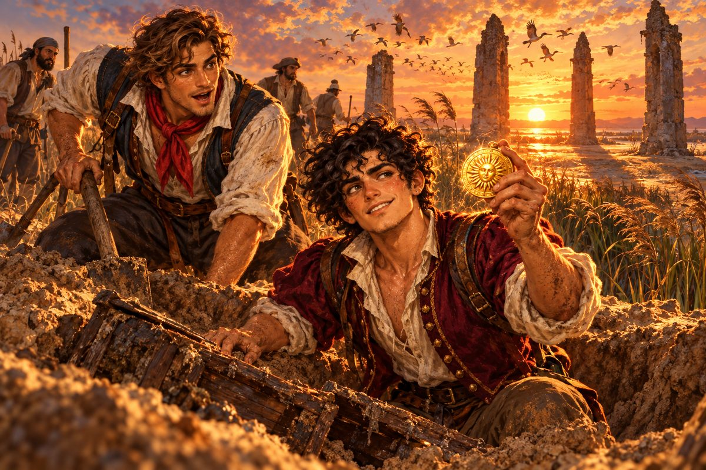

## 6. 해와 별의 눈금

나일강으로 곧장 가지는 않았다.

"새 연장은 길을 들여야 하는 법이야." 피에트로가 말했다. "처음 신는 장화로 먼 길을 가는 놈은 바보지."

그래서 가비아노는 먼저 남쪽으로 내려갔다. 포르투갈 해안을 따라 아프리카의 불룩한 어깨까지. 피에트로는 날마다 정오가 되면 갑판에 나와 육분의를 눈에 댔다. 거울에 비친 해를 수평선에 살짝 얹고, 눈금을 읽고, 아버지의 해도 귀퉁이에 숫자를 적었다. 처음에는 계산이 틀려 배가 육지 한가운데 있다는 답이 나오기도 했다. 카밀로는 그때마다 뱃전을 두드리며 놀렸다.

"축하해, 피에트로. 우리 지금 사막 위를 항해하고 있대."

"조용히 해. 바다가 흔들려서 그래."

"바다는 원래 흔들려."

열흘쯤 지나자 숫자가 맞기 시작했다. 육분의가 가리키는 위도와 해안선이 가리키는 위도가 겹쳐졌다. 밤에는 망원경으로 별을 보았다. 놋쇠 통 속에서 별이 손에 잡힐 듯 커졌다. 레온 페레로라는 사람도 이 망원경으로 같은 별을 보았을 것이다. 그는 무엇을 찾아 바다를 다녔을까. 피에트로는 아직 만나 보지 못한 공작의 얼굴을 상상해 보았다. 잘 떠오르지 않았다.

그 항해에서 그들은 몇 가지를 찾았다. 해안 절벽에 매달린 새 둥지 군락, 지도에 없던 작은 만, 바닷가 모래에 반쯤 묻힌 옛 로마인의 돌기둥. 대단한 것은 아니었다. 그러나 피에트로는 하나하나를 공들여 적었다. 위치와 모양과 크기를, 그날의 바람과 물빛까지.

리스본에 돌아와 그 기록을 내밀자 마르코가 한 장씩 넘겨 보았다. 집사의 얼굴에는 아무 표정도 없었다. 그러다 마지막 장에서 그의 손가락이 멈추었다.

"……돌기둥의 높이를 발걸음으로 재셨군요."

"자가 없어서요."

"다음에는 자를 가져가십시오." 마르코가 장부에 무언가를 적었다. 그리고 금화 주머니 하나를 내밀었다. "마님께서 기뻐하실 겁니다."

리스본 부두의 선술집에서는 다른 소식도 들렸다. 페레로 집안의 젊은 도련님이 늙은 항해사 하나를 데리고 남쪽으로 내려갔다는 것이었다. 로코라는 이름의, 공작이 젊었을 때부터 함께 바다를 다닌 노인이라고 했다. 피에트로는 그 이름을 수첩에 적었다. 조안 공. 노항해사 로코. 남쪽.

"벌써 하나 건졌네." 카밀로가 말했다.

"소문은 생선이랑 같아. 싱싱할 때 건져야 해."

## 7. 마데이라의 지도 장수

두 번째 항해는 서쪽 바다였다. 그들은 마데이라 섬에 들렀다.

섬은 바다에서 솟은 검은 바위산이었다. 비탈마다 포도밭이 계단처럼 깎여 있었고, 산꼭대기에는 늘 구름이 걸려 있었다. 항구 마을의 선술집에서는 이 섬의 진한 포도주를 팔았다. 달고 독하고, 마시고 나면 혀끝에 불에 그을린 나무 맛이 남는 술이었다.

피에트로가 막 첫 잔을 비웠을 때, 옆 탁자의 사내가 의자를 끌고 왔다. 마른 몸에 눈이 가늘고, 손톱 밑이 까맸다.

"이봐, 혹시 리스본에서 이것저것 찾아낸다는 그 제노바 사람 아니야? 이름이 피에트로였던가?"

"소문이 빠르네."

피에트로는 조금 놀랐다. 리스본에 몇 번 보고서를 냈을 뿐인데, 이 먼 섬에서 자기 이름을 듣게 될 줄은 몰랐다. 카밀로가 옆에서 어깨를 으쓱했다. 페레로 상선대 사람들이 입이 가볍지, 하는 얼굴이었다.

"그럼 얘기가 쉽겠군. 황금 메달이라고, 들어 본 적 있어?"

"메달? 금으로 된? 금시초문인데."

"허, 모험가라면서. 엘도라도는? 그 이름은 알겠지?"

"엘…… 뭐라고?"

사내는 믿을 수 없다는 듯 혀를 찼다. 그리고 탁자 위로 몸을 숙였다. 술 냄새와 생선 냄새가 함께 건너왔다.

"바다 건너 어딘가에 있다는 도시야. 숟가락도 금, 문고리도 금, 길바닥 돌까지 금이라는. 진짜 처음 들어?"

"처음이야. 그래서, 그 금 도시랑 메달이 무슨 상관인데? 아니, 그보다 그게 다 정말이긴 해?"

사내는 품에서 기름 먹인 가죽 조각을 꺼냈다. 펼치자 누렇게 바랜 종이가 나왔다. 해안선 하나와 강줄기 몇 개, 그리고 붉은 잉크로 찍은 작은 십자 표시.

"이게 바로 그 메달이 묻힌 자리야. 외상 술값이 밀린 뱃사람한테서 담보로 받았지." 사내가 눈을 가늘게 떴다. "이천 닢. 당신한테라면 이천 닢에 넘기지."

피에트로는 지도를 보았다. 그리고 사내를 보았다. 그리고 다시 지도를 보았다.

"구미는 당기는데, 당신 얼굴이 영 미덥지가 않아."

"하긴, 나라도 그렇겠지." 사내는 의외로 순순히 수긍했다. "까놓고 말해 나한텐 휴지 조각이야. 배를 띄울 돈도 배짱도 없으니까. 반으로 깎아 주지. 천 닢. 술 몇 번 덜 마셨다 치면 그만인 돈이잖아. 그런데 만에 하나 저기서 진짜 금이 나오면? 그땐 당신이 이 섬을 통째로 사겠지."

카밀로가 탁자 밑에서 피에트로의 발을 밟았다. 사지 말라는 뜻이었다.

피에트로는 지도의 해안선을 손가락으로 따라가 보았다. 낯익은 모양이었다. 몇 갈래로 갈라지며 바다로 흘러드는 강. 아버지의 해도에서, 지난밤에도 들여다본 그 하구였다.

"내가 이래서 아버지 아들이라니까." 그가 한숨을 쉬었다. "좋아, 졌다. 가져가."

카밀로가 이마를 탁자에 찧었다.

사내는 금화를 세어 주머니에 넣고 이를 드러내며 웃었다. 앞니 하나가 없었다.

"거래 잘했어. 덤으로 내력을 들려주지. 뱃사람 말로는, 맨 처음 그 황금 도시에 발을 들인 건 포르투갈 사람이었대. 그 사람이 거기서 금붙이 몇 개를 들고 나왔는데, 신세 진 원주민한테 그중 메달 하나를 답례로 주고는 감쪽같이 자취를 감췄다는 거야. 그런데 나중에 해적 놈들이 그 마을을 털면서 메달까지 쓸어 갔고, 어디 으슥한 데 묻어 놨다지. 이 지도가 바로 그 자리고."

"잠깐, 그럼 이 근처를 파면 황금 도시도 나오는 거야?"

"어, 그게……" 사내가 눈을 굴렸다. "도시는 아니고, 메달 하나겠지. 그래도 그거 하나면 오늘 낸 돈은 웃으면서 잊을걸. 찾기만 하면. 아, 참고로 술값 떼먹은 놈이 취해서 한 소리니까 반쯤만 믿어."

사내는 그 말을 남기고 휘청휘청 선술집을 나갔다. 문이 닫히자 카밀로가 고개를 들었다.

"너, 방금 사기당한 거 알지?"

"아마도." 피에트로는 지도를 접어 품에 넣었다. "그러니까 더 찾아야지. 사기를 진짜로 만들어 버리면 사기가 아니잖아."

"그 자신감은 어디서 나오는 거냐."

"이 하구 말이야." 피에트로가 품을 두드렸다. "나일강이야. 우리가 원래 가려던 곳. 우연이라기엔 너무 잘 맞잖아."

## 8. 알렉산드리아

지브롤터 해협을 지나 지중해를 동쪽 끝까지 가로지르는 데 한 달이 걸렸다.

알렉산드리아는 오래된 도시였다. 너무 오래되어서 도시가 제 나이를 잊은 것 같았다. 항구 입구에는 옛날 세상의 불가사의라던 거대한 등대의 잔해가 바위처럼 쌓여 있었고, 그 위에 이슬람 군주가 지은 요새가 올라앉아 있었다. 거리에는 그리스 기둥과 아랍 아치와 맘루크의 문장이 한데 뒤섞였다. 이 땅은 이제 오스만의 것이 되었다. 시장에서 터번을 두른 관리들이 장부를 들고 다니며 세금을 거두었다.

피에트로는 항구 뒤 언덕에 올라 망원경을 폈다. 동쪽으로 낮고 평평한 땅이 끝없이 이어졌다. 초록빛 띠와 누런 띠가 번갈아 줄무늬를 그렸다. 강이 바다로 흘러드는 자리마다 물빛이 흐린 갈색으로 번져 있었다.

"저게 다 나일강이야?" 카밀로가 물었다.

"강이 바다 앞에서 손가락을 펼친 거지. 지도의 표시는 그 손가락 가운데 하나에 있어."

그들은 시장에서 삽과 곡괭이와 물자루를 샀다. 그리고 현지 뱃사공에게 하구의 물길을 물었다. 사공은 늙은 콥트인이었다. 그는 피에트로가 내민 지도를 한참 보다가, 붉은 십자 표시를 손톱으로 톡톡 두드렸다.

"여기는 갈대밭과 모래 언덕뿐이오. 사람도 안 살지. 옛날에는 해적들이 배를 숨기던 데였다고는 하는데."

피에트로와 카밀로가 서로 얼굴을 보았다.

## 9. 나일 하구의 모래

하구의 해안은 모래와 갈대와 바람뿐이었다.

가비아노는 얕은 물에 닻을 내렸고, 피에트로와 카밀로와 선원 넷이 작은 배로 뭍에 올랐다. 발이 모래에 푹푹 빠졌다. 갈대가 사람 키보다 높이 자라 바람이 불 때마다 쉬이 쉬이 소리를 냈다. 멀리서 물새 떼가 한꺼번에 날아올랐다.

피에트로는 지도를 펼치고 육분의로 해를 쟀다. 위도는 맞았다. 그러나 지도의 표시는 너무 작았고, 해안은 너무 넓었다.

"이걸 어떻게 찾아. 모래를 다 뒤집을 거야?" 카밀로가 투덜댔다.

"지도를 그린 놈도 바보는 아니었을 거야. 아무 데나 묻어 놓고 표시만 하진 않았겠지. 뭔가 눈에 띄는 걸 기준으로 삼았을 거야."

피에트로는 지도를 다시 보았다. 붉은 십자 옆에 아주 작게 그려진 무언가가 있었다. 처음에는 잉크 얼룩인 줄 알았다. 들여다보니 위가 뾰족한 삼각형 셋이 나란히 서 있었다.

그는 고개를 들어 해안을 둘러보았다. 모래 언덕, 갈대, 또 모래 언덕. 그러다 망원경을 들었다. 남동쪽으로 반 리쯤 떨어진 곳에 무너진 돌무더기가 보였다. 옛날 망루였는지 사당이었는지 알 수 없었지만, 뾰족한 돌기둥 셋이 아직 나란히 서 있었다.

"저기다."

그들은 해가 기울 때까지 팠다. 돌기둥 셋이 만드는 그림자를 따라 이쪽을 파고, 저쪽을 팠다. 모래는 파는 족족 무너져 내렸다. 선원 하나가 전갈에 쏘일 뻔했다. 카밀로는 삽을 내던지고 모래에 드러누웠다가, 다시 일어나 삽을 주웠다.

해가 바다 쪽으로 낮게 내려앉았을 때였다. 돌기둥의 그림자가 길게 늘어나 세 줄기가 한 점에서 만났다. 피에트로는 삽을 멈추었다.

"……설마."

그는 그림자가 만나는 자리에 무릎을 꿇고 맨손으로 모래를 헤쳤다. 한 뼘, 두 뼘. 손끝에 딱딱한 것이 닿았다. 썩은 나무 상자의 모서리였다. 상자는 손이 닿자마자 바스러졌다. 그 안에서 기름 먹인 천 뭉치가 나왔다.

천을 풀었다.

석양이 그 위에 떨어졌다. 그리고 피에트로의 손바닥 위에서 불이 붙었다.

손바닥만 한 둥근 메달이었다. 가장자리를 따라 낯선 문양이 촘촘히 새겨졌고, 가운데에는 햇살을 닮은 얼굴 하나가 눈을 감고 있었다. 금은 몇십 년, 어쩌면 백 년 가까이 모래 속에 있었을 텐데도 조금도 흐려지지 않았다. 석양빛을 받아 메달은 그 자신이 작은 해인 것처럼 빛났다.

모두 숨을 멈추었다. 갈대가 바람에 쉬이 하고 울었다.

## 10. 황금의 약속

"피에트로! 그 메달 좀 보여 줘!"

가비아노로 돌아오는 작은 배 위에서 카밀로는 열 번도 넘게 같은 말을 했다. 피에트로는 그때마다 메달을 내밀었고, 카밀로는 그때마다 같은 표정을 지었다.

"봐라, 봐. 이 테두리 문양 좀 봐. 사람 손으로 이걸 새겼다는 게 믿기냐?"

"이 빛깔 좀 봐……. 백 년을 모래 속에 있었다면서 어떻게 이렇게 반짝여." 카밀로가 메달을 기울여 등잔불에 비춰 보았다. "엘도라도엔 이런 게 굴러다닌다는 거지? 길바닥에?"

"메달 하나에 이 정도라면, 도시 하나는 어떨까."

선실 안이 조용해졌다. 둘 다 같은 것을 상상하고 있었다. 황금 지붕, 황금 기둥, 황금 길. 해가 뜨면 도시 전체가 불타오르는 것처럼 빛나는 곳.

"피에트로." 카밀로가 메달을 그에게 돌려주었다. 목소리가 달라져 있었다. "우리 그거 찾으러 가자. 황금 도시. 나 한 번만, 딱 한 번만 금화 더미에 다이빙해 보고 싶어."

피에트로는 메달을 손바닥에 올려놓고 오래 보았다.

마데이라의 사내는 이 메달이 엘도라도에서 나왔다고 했다. 어떤 포르투갈 모험가가 거기서 가져 나왔다고. 그렇다면 엘도라도는 있다. 적어도 누군가 한 번은 그곳에 갔다. 그 사람은 어떻게 되었을까. 메달을 원주민에게 주고 사라진 그 모험가는.

"찾을 거야." 피에트로가 말했다. "남들이 지어낸 얘기라고 비웃는 걸 끝까지 쫓아가 보는 것. 모험이란 게 원래 그런 거 아니겠어?"

창밖에서 지중해의 밤바다가 검게 출렁였다. 하늘에는 별이 가득했다. 피에트로는 그 별들 아래 어딘가에 황금 도시가 잠들어 있다고 생각했다. 아직 누구의 지도에도 그려지지 않은 채로.

---

리스본으로 돌아온 그들은 메달 이야기를 보고서에 적었다. 마르코는 이번에도 아무 표정 없이 장부를 넘겼지만, 메달을 실제로 보았을 때는 한쪽 눈썹이 아주 조금 올라갔다. 그것만으로도 피에트로는 큰 상을 받은 기분이었다.

부두에서는 모험가 피에트로라는 이름이 오르내리기 시작했다. 나일강 모래 속에서 해적의 황금을 파냈다는 제노바 사람. 이야기는 사람의 입을 건널 때마다 조금씩 부풀었다. 메달은 상자가 되었고, 상자는 궤짝이 되었다. 피에트로는 그 소문을 굳이 바로잡지 않았다.

"그래도 돼?" 카밀로가 물었다.

"소문이 부풀면 사람들이 먼저 말을 걸어 와. 그러면 새 소문이 들어오지. 그게 모험가의 밑천이야."

그 말이 맞았다. 그 뒤로 몇 달 동안 그들은 대서양의 섬들과 아프리카 해안을 오가며 발견을 쌓았고, 피에트로의 수첩에는 조안 공에 관한 소문도 제법 쌓였다. 남쪽 어느 항구에서 보았다는 이야기, 홍해 쪽으로 갔다는 이야기, 이교도 왕을 돕는다는 이야기. 앞뒤가 맞지 않는 조각들이었다.

"이걸 마님께 어떻게 말씀드리지." 피에트로가 수첩을 덮었다. "아드님이 세상 모든 곳에 동시에 계신다고 할 수도 없고."

그래도 약속은 약속이었다. 그는 그 조각들을 들고 언덕 위 저택으로 향했다. 그곳에서 소문이 아니라 소문의 주인공 본인이 기다리고 있으리라고는 생각도 하지 못한 채.
