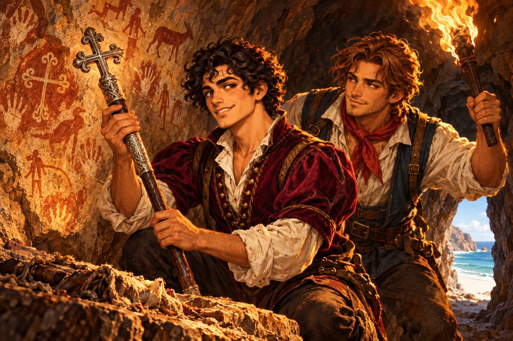

## 16. 지도가 끝나는 곳

무스카트를 떠난 가비아노는 인도양을 동쪽으로 건넜다.

계절풍이 등을 밀어 주었다. 돛이 하루 종일 팽팽하게 부풀었고, 뱃머리가 가르는 물보라에 무지개가 걸렸다. 날치 떼가 은빛 화살처럼 물 위를 스쳐 날았다. 선원 하나가 갑판에 떨어진 날치를 주워 구웠다. 카밀로는 그것을 먹고 생선이 날개를 달면 맛도 날아가는 모양이라고 투덜댔다.

인도 서해안의 항구들은 소란스럽고 화려했다. 후추 자루가 부두에 산처럼 쌓였고, 코끼리가 통나무를 끌었다. 실론 섬에서는 계피 냄새가 바다 위까지 번졌다. 말라카 해협은 좁고 붐볐다. 중국의 정크와 아라비아의 다우와 포르투갈의 캐랙이 한데 엉켜 물길을 다투었다. 피에트로는 항구마다 물과 식량을 넉넉히 실었다. 그리고 항구마다 같은 것을 물었다. 여기서 더 남쪽으로 가 본 사람이 있느냐고.

대답은 대개 같았다. 남쪽에는 아무것도 없다. 바다뿐이다. 바다가 끝나는 곳에서는 물이 폭포처럼 떨어진다는 사람도 있었다.

향료 제도를 지나 티모르 섬에 닿았을 때, 섬의 늙은 어부 하나만이 다르게 말했다.

"남쪽에 땅이 있소. 아주 큰 땅. 우리 할아버지의 할아버지가 바람에 밀려 거기 닿았다가 돌아왔다지. 땅이 붉고, 물이 귀하고, 꼬리로 서는 짐승이 산다고 했소."

"꼬리로 서는 짐승?" 카밀로가 되물었다.

"뒷다리랑 꼬리로 서서 껑충껑충 뛴다는 거요. 사람만 한 쥐처럼."

카밀로는 피에트로를 보았다. 피에트로는 지도를 보았다. 무스카트에서 받은 양가죽 지도의 붉은 벼랑이 등잔불 아래에서 조금 더 붉어 보였다.

티모르를 떠나 남서쪽으로 뱃머리를 돌린 날부터 바다가 달라졌다. 지나가는 배가 한 척도 없었다. 갈매기도 줄었다. 밤하늘에는 십자 별이 점점 높이 떠올랐다. 피에트로는 매일 정오에 육분의로 해를 재고, 매일 밤 그 숫자를 무스카트의 지도와 맞대어 보았다. 아버지의 해도는 이제 쓸모가 없었다. 거기에는 이 바다가 그려져 있지 않았다.

선원들 사이에 수군거림이 돌았다. 물을 아껴야 했다. 사흘째부터는 비스킷에 벌레가 났다. 젊은 선원 하나가 밤에 갑판 끝에 서서 오래 남쪽을 보다가 피에트로에게 물었다.

"선장님, 정말 저기 뭐가 있습니까?"

피에트로는 대답하기 전에 잠시 생각했다. 그리고 솔직하게 말했다.

"모르겠어. 하지만 누군가 이 지도를 그렸어. 몇백 년 전에, 지금 우리보다 훨씬 작은 배로 여길 지나간 사람이 있었다는 뜻이야. 그 사람이 돌아와서 지도를 남겼어. 그러니까 우리도 돌아갈 수 있어."

선원은 고개를 끄덕였다. 완전히 안심한 얼굴은 아니었지만, 그날 밤 그는 갑판 끝을 떠나 잠을 잤다.

열하루째 새벽, 망대에 올라간 선원이 소리쳤다.

"땅이다! 땅이 보인다!"

## 17. 붉은 벼랑

처음에는 수평선 위에 그어진 가는 붉은 선이었다. 해가 오르자 그 선이 점점 두꺼워졌다. 그리고 벼랑이 되었다.

피에트로는 평생 그런 빛깔의 땅을 본 적이 없었다. 벼랑은 녹슨 쇠처럼 붉었고, 그 아래 해변은 소금처럼 하얬다. 바다는 맑아서 열 길 아래 바닥의 모래 물결까지 보였다. 붉은색과 흰색과 푸른색. 세상을 처음 칠한 누군가가 다른 색은 미처 섞지 못하고 떠난 것 같았다.

"……세상의 끝이라더니." 카밀로가 숨을 내쉬었다. "끝이 이렇게 예쁠 줄은 몰랐네."

그들은 지도를 따라 해안을 이틀 동안 남쪽으로 훑었다. 지도의 표시 옆에는 작은 그림이 있었다. 바다로 튀어나온 곶, 그 곶 끝에 홀로 선 바위 하나. 바위 모양이 사람이 무릎을 꿇은 것 같았다. 사흘째 오후, 망원경 속에 그 바위가 들어왔다.

"저거야."

상륙한 것은 피에트로와 카밀로와 선원 다섯이었다. 해변에서 벼랑으로 오르는 길은 없었다. 그들은 바위틈을 짚고 기어 올라갔다. 손바닥에 붉은 흙이 묻었다. 벼랑 위에는 낮은 덤불과 은빛 잎을 단 나무들이 띄엄띄엄 서 있었다. 바람에서 처음 맡는 냄새가 났다. 박하 같기도 하고 송진 같기도 한, 맑고 쌉싸름한 냄새.

덤불 사이에서 무언가가 고개를 들었다. 갈색 털, 긴 귀, 사슴 같은 얼굴. 그것은 뒷다리와 굵은 꼬리로 꼿꼿이 서서 그들을 보았다. 그리고 껑충, 한 번에 사람 키 두 배를 뛰어 달아났다.

선원들이 일제히 소리를 질렀다. 카밀로는 칼을 뽑았다가, 짐승이 이미 저 멀리 사라진 것을 보고 슬그머니 칼을 집어넣었다.

"티모르 영감 말이 맞았네." 피에트로가 웃었다. "꼬리로 서는 짐승이야. 이걸 리스본에서 얘기하면 아무도 안 믿겠지."

"나도 지금 내 눈을 못 믿겠어."

무릎 꿇은 바위는 곶의 맨 끝에 있었다. 가까이서 보니 정말 사람의 모습이었다. 바다를 향해 고개를 숙이고, 두 손을 모은 것 같은 형상. 자연이 깎은 것인지 사람이 다듬은 것인지 알 수 없었다. 바위 발치에 좁은 틈이 있었다. 사람 하나가 몸을 옆으로 틀어야 겨우 들어갈 만한 틈.

피에트로는 횃불을 들고 먼저 들어갔다.

틈 안은 생각보다 넓었다. 서늘하고 건조했다. 바깥의 바람 소리가 아득하게 멀어졌다. 횃불이 벽을 비추자 피에트로는 숨을 멈추었다. 벽에 그림이 그려져 있었다. 붉은 흙과 하얀 재로 그린 사람들, 짐승들, 손바닥 자국들. 이 땅에 오래전부터 살아온 사람들이 남긴 것이었다. 그리고 그 그림들 사이에 다른 손으로 새긴 표식 하나가 있었다. 끝이 둥글게 말린 십자가.

그 아래, 바위를 깎아 만든 낮은 단 위에 기다란 꾸러미가 놓여 있었다.

피에트로는 무릎을 꿇었다. 꾸러미를 감싼 천은 몇백 년의 세월에 삭아 손이 닿자 부스러졌다. 그 안에서 지팡이 하나가 모습을 드러냈다.

생각보다 소박했다. 길이는 사람의 어깨쯤. 검게 윤이 나는 단단한 나무로 만들었고, 손잡이 부분에 은을 씌웠다. 은 위에는 무스카트 사내의 반지에 새겨진 것과 같은 문양이 돌아가며 새겨져 있었다. 맨 위에는 끝이 둥글게 말린 십자가가 달렸다. 보석도, 황금도 없었다. 그런데도 횃불 아래서 그것은 이상하게 무거워 보였다. 무게가 아니라, 그것을 둘러싸고 흘렀을 세월과 피와 기도의 무게.

"이게…… 성자의 지팡이야?" 카밀로가 뒤에서 속삭였다.

피에트로는 바로 손을 대지 않았다. 점술가의 노래가 귓가에 다시 울렸다. 맑은 영혼에는 천사의 힘을, 검은 영혼에는 악마의 힘을. 그는 잠시 자기 영혼이 어느 쪽인지 생각해 보았다. 빚쟁이를 피해 지붕 위에서 잔 영혼. 천 닢에 수상한 지도를 산 영혼. 그다지 맑지도, 그렇다고 검지도 않은 영혼.

"나는 이걸 쓰려는 게 아니야." 그가 지팡이에게 말하듯 중얼거렸다. "돌려주려는 거야. 너를 두려워하고, 너를 신께 바치려는 사람들한테."

그리고 그는 두 손으로 지팡이를 들어 올렸다.

아무 일도 일어나지 않았다. 번개도, 천사의 목소리도 없었다. 다만 동굴 밖에서 바람이 한 번 크게 불어 횃불이 흔들렸다. 그것뿐이었다. 피에트로는 숨을 내쉬고 웃었다. 그 웃음이 동굴 벽에 부딪쳐 메아리쳤다.

## 18. 누이의 예언

돌아가는 길은 가는 길보다 짧게 느껴졌다. 늘 그랬다.

무스카트의 주점에 들어서자 신관 가문의 사내가 벌떡 일어났다. 피에트로가 얼굴을 보이기도 전이었다. 문간에 선 그의 그림자만 보고 일어선 것 같았다.

"……가져왔나?"

"가져왔지. 봐."

피에트로가 천으로 감싼 꾸러미를 탁자 위에 내려놓고 풀었다. 은 손잡이가 등잔불을 받아 빛났다.

사내는 한동안 움직이지 못했다. 그의 손이 지팡이 위에 떠 있었다. 닿을 듯 말 듯. 마침내 그는 손을 거두고, 대신 자기 반지를 들여다보았다. 반지의 문양과 지팡이 손잡이의 문양이 같았다.

"천 년 동안 그림으로만 보던 것을…… 내 눈으로 보다니." 그의 목소리가 떨렸다. 그러나 그는 곧 고개를 저었다. "아니, 넋 놓고 있을 때가 아니야. 마사와의 왕은 하루하루를 버티고 있네. 지체하지 말고 떠나게."

"누이동생한테도 알려 줘. 당신 덕분이라고."

"이미 알고 있을 걸세." 사내가 쓴웃음을 지었다. "그 아이는 늘 그랬지. 내가 무슨 소식을 전하러 가면, 이미 알고 문 앞에서 기다리고 있었어. 아마 지금쯤 그 파란 문 안에서 혼자 웃고 있을 걸세. 오래 멈춰 있던 무언가가 다시 움직이기 시작했다고 중얼거리면서."

피에트로는 지팡이를 다시 천으로 감싸며 말했다.

"거창하네. 나는 그냥 잃어버린 물건 찾아 주는 사람인데."

"선조들도 그렇게 말했다더군. 우리는 그저 지키는 사람일 뿐이라고." 사내가 그의 손을 잡았다. "고맙네, 제노바 사람."

## 19. 마사와

홍해는 뜨거운 쇠를 담금질하는 통 같았다.

양쪽 해안이 모두 사막이었다. 바람은 불어도 시원하지 않았고, 물은 맑아도 마실 수 없었다. 선원들은 낮에는 돛 그늘 아래 늘어져 있다가 밤이 되어서야 움직였다. 밤바다에서는 물결이 푸르게 빛났다. 노가 물을 칠 때마다 작은 별들이 흩어졌다.

마사와는 산호섬 위에 지은 항구였다. 흰 산호석으로 쌓은 집들이 바다 바로 위에 옹기종기 붙어 있었다. 부두에는 무장한 사람들이 많았다. 창을 든 사람, 활을 멘 사람, 낡은 갑옷을 걸친 사람. 그들의 얼굴에는 긴장과 피로가 함께 있었다. 이 항구는 싸우고 있었다. 피에트로는 부두에 발을 딛는 순간 그것을 느꼈다.

"이봐요." 그가 부두의 짐꾼에게 말을 걸었다. "조안이라는 포르투갈 젊은이를 찾는데. 이 항구에서 모르는 사람이 없다던데?"

짐꾼은 피에트로의 옷차림을 위아래로 훑었다.

"조안 공? 그분은 낮엔 늘 주점에 계시지. 그런데 댁들은 뭐 하는 사람들이오?"

"그 양반 어머니 심부름꾼쯤 돼. 고마워."

길에서 만난 아이도, 물을 긷던 여인도 같은 말을 했다. 그분이라면 주점에 계세요. 이 항구에서 조안이라는 이름은 모두가 아는 이름이었다. 피에트로는 문득 리스본 저택의 부인을 떠올렸다. 그녀가 이 광경을 본다면 무슨 표정을 지을까.

주점은 항구에서 가장 큰 산호석 건물이었다. 안은 술집이라기보다 군막 같았다. 탁자 위에 지도가 펼쳐져 있었고, 그 둘레에 여러 나라 말을 하는 사람들이 모여 있었다. 그 한가운데에 조안이 있었다. 리스본에서 보았을 때보다 더 마르고, 더 검게 그을렸다. 그러나 눈은 그대로였다.

"조안 공! 리스본 이후로 처음이네."

조안이 고개를 들었다. 그의 눈이 피에트로의 얼굴에서, 피에트로가 어깨에 멘 기다란 꾸러미로 옮겨 갔다.

"약속한 물건, 가져왔어."

주점 안이 조용해졌다. 지도 둘레의 사람들이 하나둘 고개를 돌렸다. 피에트로는 꾸러미를 탁자 위에 내려놓고 천을 걷었다. 은 손잡이와 둥글게 말린 십자가가 드러났다.

누군가 무릎을 꿇었다. 이어 또 누군가가. 낡은 갑옷을 걸친 노인 하나가 두 손으로 얼굴을 감싸고 소리 없이 어깨를 들썩였다. 피에트로는 그들이 쓰는 말을 알아듣지 못했다. 그러나 그들이 무엇을 말하는지는 알 것 같았다.

조안은 오래 지팡이를 내려다보았다. 그리고 피에트로를 향해 깊이 고개를 숙였다.

"……정말로 해내셨군요. 이걸로 이 사람들이 살 길이 열렸습니다." 고개를 든 그의 눈이 젖어 있었다. "이 빚을 어떻게 갚아야 할지 모르겠습니다. 무엇이든 말씀해 주십시오. 제 힘이 닿는 일이라면."

피에트로는 머리를 긁적였다. 무엇을 부탁해야 할지 생각해 둔 것이 없었다. 그러다 문득 품속의 메달이 떠올랐다. 나일강 모래 속에서 석양을 받아 불타오르던 그것.

"갚을 건 없는데…… 아, 하나 있다. 혹시 엘도라도라는 이름 들어 봤어? 황금으로 된 도시라는데."

"엘도라도요?" 조안이 고개를 갸웃했다. "처음 듣는 이름입니다. 하지만 귀를 열어 두겠습니다. 뭐라도 걸리면 어떻게든 전해 드리지요."

"그거면 충분해. 너야말로 안 다니는 바다가 없다며. 그물을 넓게 치는 사람한테 고기가 걸리는 법이지."

조안이 웃었다. 처음으로 나이에 맞는 웃음이었다.

"어머니께서 피에트로 씨에게 제 소식을 모아 달라고 하셨다지요. 이번에는 제가 피에트로 씨의 소식을 모으겠습니다."

그날 밤, 마사와의 산호석 지붕들 위로 노랫소리가 늦도록 울렸다. 피에트로와 카밀로는 주점 옥상에 누워 그 노래를 들었다. 알아들을 수 없는 말이었지만, 가락은 기도처럼 느리고 낮았다. 하늘에는 별이 가득했다.

"피에트로." 카밀로가 말했다. "우리 좋은 일 한 거지?"

"아마도."

"그런데 금화는 한 닢도 안 받았어."

"그것도 아마도."

카밀로가 웃었다. 피에트로도 웃었다. 마사와의 밤이 그 웃음을 조용히 받아 주었다.
