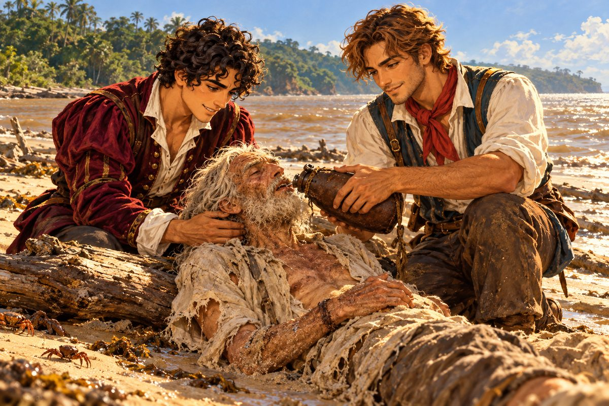

## 24. 너무 넓은 땅

지팡구에서 남쪽 대륙까지는 세상의 절반이었다.

가비아노는 왔던 길을 되짚었다. 중국 해안, 말라카, 인도양, 희망봉. 그리고 이번에는 희망봉을 돌자마자 북쪽이 아니라 서쪽으로 뱃머리를 돌렸다. 대서양을 비스듬히 가로지르는 긴 항해였다. 무역풍이 꾸준히 불어 주었다. 날마다 같은 바람, 같은 파도, 같은 수평선. 선원들은 돛을 손볼 일도 없어 갑판에서 주사위를 굴렸다.

어느 아침, 물을 길어 올린 선원이 고개를 갸웃했다.

"선장님, 물이 짜지 않습니다."

피에트로는 두레박의 물을 손으로 떠서 맛보았다. 정말이었다. 바닷물이 아니라 흐린 민물이었다. 그러나 사방 어디에도 땅은 보이지 않았다.

"강이야." 그가 말했다. "어딘가에 바다까지 민물을 밀어낼 만큼 큰 강이 있는 거야."

그날 오후 수평선 위에 초록색 선이 나타났다. 그 선은 끝없이 이어졌다. 북쪽으로도 남쪽으로도 끝이 보이지 않았다. 가까이 다가가자 그것은 숲이었다. 나무들이 바닷가까지 빽빽하게 내려와 물속에 뿌리를 담그고 있었다. 숲 위로 흰 새 떼가 구름처럼 날아올랐다. 공기가 무겁고 눅눅했다. 숨을 쉴 때마다 젖은 흙과 썩은 잎과 이름 모를 꽃 냄새가 한꺼번에 밀려들었다.

카밀로가 뱃전을 붙잡고 그 초록 벽을 올려다보았다.

"찾긴 찾았네, 남쪽 대륙. 그런데 피에트로, 이건 땅이 아니라 바다야. 초록색 바다. 이 속에서 도시 하나를 찾다간 우리 둘 다 수염이 허옇게 셀걸."

"그러게. 막막하다." 피에트로가 망원경을 접었다. 그리고 웃었다. "막막하니까 재밌는 거지. 쉬우면 벌써 누가 찾았게."

"넌 진짜 한결같구나."

"이 근처 항구를 하나도 빼놓지 말고 뒤져 보자. 황금 얘기가 끊이지 않는 땅이라고 했어. 그렇다면 누군가는 뭔가를 들었을 거야."

그들은 해안을 따라 항구를 하나씩 찾아갔다. 대부분 포르투갈이나 에스파냐 사람들이 세운 작은 교역소였다. 통나무 울타리를 두른 창고 몇 채, 진흙 바닥의 주점 하나, 그리고 열병에 시달리는 얼굴들. 피에트로는 주점마다 같은 질문을 했다.

"황금 도시 얘기 좀 들을 수 있을까?"

"엘도라도 말이지? 이 동네에서 그 얘기 모르는 놈이 있으면 데려와 봐."

어느 주점의 주인은 술잔을 닦다 말고 대답했다. 볕에 그을려 가죽처럼 된 얼굴에 앞니가 금이었다.

"그럼 가는 길도 알아?"

"길?" 주인이 금니를 드러내고 껄껄 웃었다. "이봐, 친구. 내가 그 길을 알면 이 모기 소굴에서 술잔이나 닦고 있겠나? 이 금니 말고 금 이빨을 서른두 개 다 해 넣었지. 그건 숲이 지어낸 얘기야. 이 동네에 들어온 놈들은 다 그걸 찾겠다고 숲으로 들어갔어. 돌아온 놈은 열에 하나도 안 돼. 돌아온 놈들도 다 열병에 걸려서 헛소리만 하지."

피에트로는 동전 한 닢을 탁자에 놓고 일어섰다. 주인의 웃음소리가 등 뒤로 따라왔다.

## 25. 카옌의 해변

카옌은 바다로 튀어나온 낮은 곶에 자리한 항구였다. 갈색 강물이 바다로 흘러들어 물가가 늘 흐렸다. 항구 동쪽으로 길고 넓은 모래톱이 이어졌다. 썰물이 되면 모래톱은 반 리도 넘게 드러났다. 그 위에 떠밀려 온 나무둥치와 해초가 여기저기 널려 있었다.

그날 피에트로와 카밀로는 물을 구하러 모래톱을 따라 걷고 있었다. 오후의 해가 뜨거웠다. 모래가 발바닥을 데웠다. 게들이 그들의 발소리에 놀라 구멍 속으로 숨었다.

피에트로가 걸음을 멈추었다.

"카밀로! 저기, 물가에! 사람 아니야?"

물가에 나무둥치가 하나 걸려 있었다. 그 옆에 무언가가 엎어져 있었다. 처음에는 해초 더미인 줄 알았다. 가까이 가자 그것은 사람이었다. 앙상한 등, 넝마가 된 셔츠, 모래에 뒤엉킨 하얀 머리칼과 수염.

"사람 맞아! 뛰어!"

두 사람은 달렸다. 피에트로가 무릎을 꿇고 그 사람을 돌려 눕혔다. 노인이었다. 예순은 훨씬 넘어 보였다. 뺨이 푹 꺼졌고, 입술이 갈라져 피가 말라붙어 있었다. 손목에는 오래 무언가에 묶여 있었던 듯 짙은 자국이 둘러져 있었다. 피에트로는 노인의 목에 손가락을 댔다. 맥이 아주 가늘게, 그러나 분명히 뛰고 있었다.

"살아 있어. 영감님! 내 말 들려요? 눈 좀 떠 봐요!"

카밀로가 물자루를 열어 노인의 입술을 적셨다. 처음에는 물이 입가로 흘러내리기만 했다. 두 번째에 노인의 목울대가 움직였다. 세 번째에 그가 기침을 하며 눈을 떴다. 탁한 회색 눈이 허공을 헤매다가, 천천히 피에트로의 얼굴에 초점을 맞추었다.

"물…… 여기가…… 나는 어떻게……."

"카옌 항구 옆 모래톱이에요. 파도가 영감님을 여기까지 데려다 놨어요. 저 보이세요?"

노인은 한동안 피에트로를 보았다. 그리고 모래를 보고, 바다를 보고, 하늘을 보았다. 그의 눈에 천천히 물기가 차올랐다.

"바다가…… 이번엔 나를 뱉어 냈군. 고맙네, 젊은이. 자네가 아니었으면……."

## 26. 노인의 이야기

그들은 노인을 가비아노로 옮겼다. 선실 침상에 눕히고, 묽은 수프를 숟가락으로 떠먹였다. 노인은 이틀을 내리 잤다. 사흘째 저녁, 그는 침상에 등을 기대고 앉아 수프 그릇을 제 손으로 들었다.

"영감님, 어쩌다 그 꼴로 바다를 떠도신 겁니까?"

노인은 그릇을 내려놓았다. 손이 떨렸지만, 목소리는 이틀 전보다 훨씬 단단했다.

"내 이름은 파블리스. 파블리스 페레로. 포르투갈에서 온…… 한때는 모험가라고 불리던 사람이지."

피에트로와 카밀로가 동시에 몸을 일으켰다.

"페레로요? 리스본의 그 페레로? 공작 댁과 혹시 무슨 인연이 있으십니까?"

"공작 댁?" 노인이 눈을 깜빡였다.

"제 뒤를 봐 주시는 분이 바로 그 댁 마님이십니다."

노인은 잠시 생각에 잠겼다가 고개를 저었다.

"글쎄. 먼 조상 중에 작위를 받은 이가 있었다고는 들었네만, 내 대에 와서는 장부 한 권 겨우 꾸리는 장사꾼이었어. 다 옛날 얘기야. 세상이 어떻게 바뀌었는지 나는 모르네. 열 몇 해를 쇠창살 안에서 보냈으니까."

"쇠창살이라니요? 괜찮으시다면 처음부터 들려주십시오. 저희가 도울 수 있는 일이 있을지도 모릅니다."

노인은 선실의 작은 창으로 밖을 보았다. 해가 지고 있었다. 붉은 빛이 그의 하얀 수염에 물들었다.

"벌써 스무 해쯤 되었군. 모든 게 시작된 게."

그는 천천히, 오래 묵은 것을 하나씩 꺼내듯 이야기했다.

거센 폭풍을 만나 배가 부서졌다. 정신을 차렸을 때 그는 어느 해안의 원주민 마을에 떠밀려 와 있었다. 그 마을에서 몇 해를 살았다. 사람들은 친절했고, 날들은 느리고 평화로웠다. 그런데 어느 해 건기에, 어디서 왔는지 모를 군대가 마을을 덮쳤다. 그는 내륙 깊숙이 도망쳤다. 숲을 헤치고, 강을 건너고, 며칠을 걸었다.

"그러다 숲이 끝났네." 노인의 목소리가 낮아졌다. "나무들이 갑자기 비켜서더니, 그 너머에…… 그 너머에 있던 것은……."

노인은 말을 멈추었다. 그의 눈이 선실 벽 너머 먼 곳을 보고 있었다.

"옹, 애태우지 마시고요. 뭐가 있었습니까?"

"……도시였네. 황금으로 된 도시."

선실 안이 조용해졌다. 바깥에서 파도가 뱃전을 치는 소리만 들렸다. 카밀로의 손에서 숟가락이 떨어져 바닥에서 쨍그랑 울렸다.

"그럼…… 옹께서 엘도라도를 직접 보셨다는 겁니까?"

"사람들이 그렇게 부르는 곳이 있다면, 그게 바로 거기였네. 바다에서 평생을 보낸 사람으로서 거짓을 말하지 않겠네." 노인이 눈을 감았다. 감은 눈꺼풀 아래에서 무언가가 아직 빛나고 있는 것 같았다. "벽도, 계단도, 지붕도. 해가 비치니 도시 전체가 타오르는 것 같았지. 지금도 눈을 감으면 그 빛이 보이네. 눈꺼풀을 뚫고 들어올 만큼 눈부신 빛이."

피에트로는 아무 말도 하지 못했다. 나일강 하구의 석양이 떠올랐다. 손바닥 위에서 불타오르던 작은 해.

"나는 손에 쥘 만한 장신구 몇 점만 들고 그곳을 떠났네. 욕심을 부렸다간 숲에서 살아 나가지 못할 것 같았거든. 그 길로 계속 서쪽으로 걸었지. 몇 달을 걸어 땅의 반대쪽 바다가 보이는 곳까지 갔어. 그곳 원주민 마을에서 다시 몇 해를 묵었네. 그러다 바닷가에 포르투갈 사람들이 성채를 쌓는다는 말을 들었지. 고향 말이 듣고 싶었던 게야. 그래서 찾아갔네."

"포르투갈 사람이라……." 피에트로가 중얼거렸다. 그의 손이 품속으로 들어갔다. 마데이라의 사내가 했던 이야기가 머릿속에서 하나씩 제자리를 찾아가고 있었다. 엘도라도를 찾아낸 포르투갈 모험가. 원주민에게 메달을 주고 사라진 사람. "옹. 이것 좀 봐 주시겠습니까?"

그가 메달을 꺼내 노인의 손바닥에 올려놓았다.

노인의 손이 굳었다. 그는 메달을 들어 등잔불에 비추었다. 가장자리의 문양, 가운데의 눈 감은 얼굴. 그의 입술이 떨렸다.

"이럴 수가……. 이건 내가 다 죽어 가던 나를 거둬 준 원주민에게 답례로 걸어 준 것이네. 그런데 어떻게 이게 자네 손에……."

"이야기가 좀 깁니다. 마데이라의 술꾼한테서 수상한 지도를 샀고, 그 지도를 따라 나일강 하구의 모래를 팠더니 이게 나왔습니다. 그 마을을 턴 해적이 거기 묻어 두었던 모양입니다." 피에트로가 말했다. "이걸 처음 손에 쥔 날 알았습니다. 황금 도시는 지어낸 얘기가 아니라고. 그래서 여기까지 온 겁니다."

노인은 메달을 두 손으로 감싸 쥐었다. 오래 그러고 있었다.

"내가 남에게 준 것이 세상을 한 바퀴 돌아, 나를 건지러 왔구먼. 하느님도 짓궂으시지."

## 27. 레온이라는 이름

노인은 메달을 피에트로에게 돌려주고, 다시 이야기를 이었다.

"성채 얘기를 하던 참이었지. 반가운 마음에 문을 두드렸는데, 돌아온 건 쇠사슬이었네. 그 안에서 한참이 지나서야 알았어. 그자들이 예전에 내 첫 마을을 짓밟은 바로 그 무리였다는 걸."

그의 목소리에 처음으로 날이 섰다.

"같은 포르투갈 사람이면서 왕을 등진 자들이야. 타락한 귀족 하나를 신처럼 모시고, 언젠가 온 세상이 제 발아래 엎드릴 거라고 믿고 있지. 미친 꿈이야. 그 미친 자들의 지하 감옥에서 나는 해를 세는 것도 잊었네. 그런데 얼마 전부터 성채가 어수선해졌어. 무슨 일인지는 모르네. 보초가 줄고 문단속이 느슨해지더군. 그 틈에 빠져나와 작은 배 하나를 훔쳐 탔지. 그 뒤로는 물 한 모금 없이 바다를 떠돌다가……."

"살아서 나오셨으니 됐습니다. 이제 다 끝났어요."

"리스본……." 노인이 두 손으로 얼굴을 덮었다. "어둠 속에서 매일 밤 그 언덕들을 그렸네. 테주강의 물빛, 성당 종소리……. 내 배의 항해사였던 로코, 겁 없고 혈기 넘치던 그 젊은 녀석……."

"로코?" 카밀로가 피에트로를 보았다. 피에트로의 수첩에 적혀 있던 이름이었다. 조안 공. 노항해사 로코.

"그리고 부두에 두고 온 내 어린 아들, 레온……."

피에트로가 벌떡 일어섰다. 머리가 선실 천장에 부딪쳤지만 그는 아픈 줄도 몰랐다.

"잠깐만요! 방금 아드님 이름이…… 레온이라고 하셨습니까?"

"레온. 레온 페레로. 지금쯤이면…… 그 애도 반백이 되었겠지."

"옹." 피에트로는 숨을 골랐다. "제 후원자 댁, 그 페레로 공작 각하의 이름이 레온입니다."

노인의 얼굴에서 핏기가 빠졌다.

"뭐라고……? 그럴 리가……."

"공작 각하는 젊어서 바다로 이름을 떨친 분입니다. 해적 손에 끌려간 공주님을 구해 내 국왕의 눈에 들었고, 바로 그 공주님을 아내로 맞아 공작 작위를 받으셨지요." 피에트로는 리스본 저택의 부인을 떠올렸다. 사람을 똑바로 마주 보던 맑은 눈. 그녀가 공주였다는 이야기를 처음 들었을 때 그는 별로 놀라지 않았다. "그리고 그 댁 아드님 곁에서 키를 잡는 늙은 항해사가 있는데, 다들 로코 영감이라고 부릅니다."

노인은 대답하지 못했다.

"옹의 레온이, 리스본의 그 공작입니다. 틀림없습니다."

"내 무릎에도 안 차던 그 꼬마가……. 공작이라니. 하느님, 제가 얼마나 오래 갇혀 있었던 겁니까……."

노인의 어깨가 흔들렸다. 소리는 나지 않았다. 피에트로와 카밀로는 그를 혼자 두려고 선실을 나가려 했다. 그러나 노인이 손을 뻗어 피에트로의 소매를 잡았다. 메달을 쥐었던 그 손이었다.

피에트로는 다시 앉았다. 그리고 노인이 울음을 그칠 때까지 그 손을 잡고 있었다.

---

이튿날 아침, 피에트로는 갑판에서 뱃머리를 동쪽으로 돌리라고 일렀다.

"갑시다, 옹. 리스본으로요. 바람만 받쳐 주면 금방입니다."

노인은 난간을 짚고 서서 그를 보았다.

"자네, 황금 도시를 찾으러 세상을 반 바퀴 돌아왔다면서. 바로 저 숲 너머인데, 그냥 돌아가겠다고?"

"있다는 걸 알았으면 됐습니다." 피에트로가 말했다. "옹께서는 가는 길을 기억하십니까?"

"눈 감고도 그릴 수 있을 걸세. 스무 해 동안 머릿속으로 그리고 또 그렸으니."

"그럼 됐습니다." 피에트로는 고개를 끄덕였다. 그리고 웃었다. 이상하게 마음이 가벼웠다. "그 도시에 처음 닿은 사람은 옹입니다. 제가 지금 저 숲에 들어가 깃발을 꽂으면, 그건 옹의 스무 해를 가로채는 짓이죠. 그런 걸 발견이라고 부를 순 없습니다. 그리고 옹은 저희한테 건져진 게 아니에요. 황금 도시를 보고, 감옥을 견디고, 바다를 건너 살아 돌아오신 겁니다. 그게 모험이 아니면 뭐가 모험입니까. 같은 길을 걷는 사람으로서 고개 숙입니다."

노인은 오래 피에트로를 보았다. 그의 회색 눈에 아침 햇살이 비쳤다.

"……자네 같은 젊은이가 있다니. 고맙네. 정말이야."

카밀로가 옆에서 코를 훌쩍였다. 그리고 들키지 않으려고 하늘을 보며 크게 소리쳤다.

"자, 다들 뭐 해! 돛 올려! 옹을 댁까지 모셔야지. 공작 각하 얼굴이 어떻게 될지 벌써 궁금해 죽겠네!"

"금 침대는?" 피에트로가 물었다.

"다음에." 카밀로가 말했다. "금 침대는 다음에 자도 돼."

가비아노의 돛이 바람을 받아 부풀었다. 등 뒤에서 초록빛 대륙이 천천히 멀어졌다. 그 숲 깊은 어딘가에 황금 도시가 잠들어 있었다. 피에트로는 한 번도 뒤를 돌아보지 않았다.
