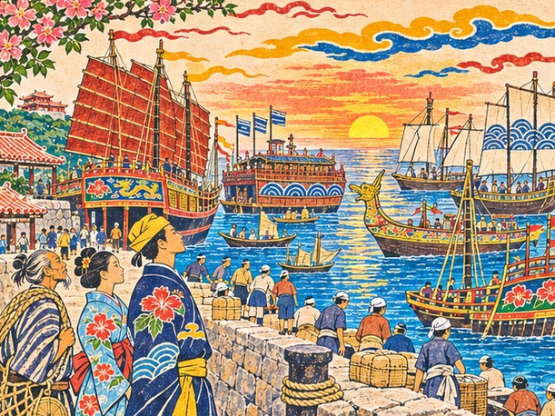
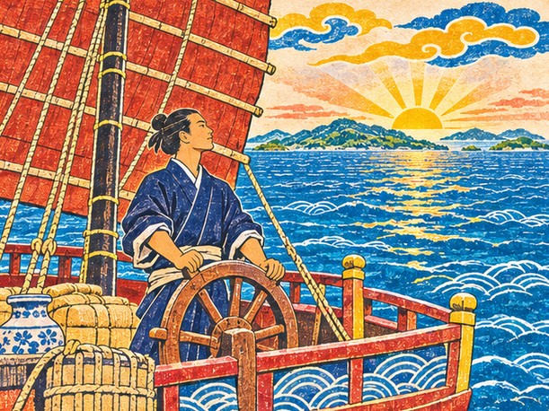
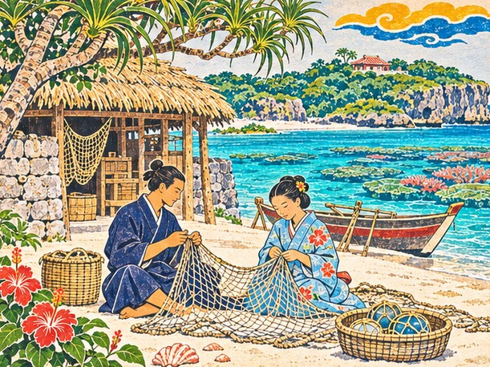

## 결말 하나 ― 만국의 다리

"다리를 지키겠습니다."

다루가 말했다. 회랑의 처마 끝에서 빗물 한 방울이 떨어졌다.

"큰 나라들 사이에서, 칼이 아니라 약속으로."

"그럴 줄 알았소." 마쓰 할배가 회랑 기둥에 등을 기댔다. "선장은 처음부터 짐을 세는 사람이었지. 짐을 세는 사람은 짐을 버리지 않소."

새 왕은 그날 바로 그를 불렀다. 정사로 둔다는 말과 함께, 류큐의 이름을 만국에 거는 일을 계속 맡으라고 했다. 채문경은 그 자리에서 다음 국서도 제가 옮기겠다고 아뢰었다. 누가 시킨 것도 아니었다.

가마는 오빠의 손목을 보았다. 머리카락이 아직 감겨 있었다.

"풀지 말고 그대로 둬. 다음 항해에도 내가 같이 갈 거니까."

그해 가을부터 나하 부두가 달라졌다. 명의 정크와 조선의 배, 사카이와 하카타의 안택선, 시암의 상선이 나란히 닻을 내렸다. 남쪽에서는 대월과 자바의 배가 올라왔고, 말라카의 포르투갈 상관이 보낸 사람도 내렸다. 만국 장부의 여덟 줄이 부두 위에 돛으로 서 있었다.

부두에는 여러 나라 말이 한데 섞였다. 통사들이 쉴 틈이 없었다. 구메촌의 젊은 통사들이 채문경에게서 시암 말 인사를 배웠다. 발음은 여전히 반쯤 명나라 말 같았다.

가끔 우에하라 친방의 말이 떠올랐다. 나라를 지키려면 강한 쪽에 붙어야 한다. 다루는 그 말이 틀렸다고 생각하지 않았다. 다만 그는 약속 쪽에 서기로 했다. 힘이 없는 나라가 바다를 건너는 길은 그것 하나뿐이라고 믿었다.

출항을 며칠 앞두고 다루는 왕부 문서고에 들렀다. 그가 가져온 답서 넷이 상자에 담겨 선반 한 칸을 차지하고 있었다. 그 앞에 빌린 관복을 입은 젊은 부사 하나가 앉아 부산포 답서를 소리 없이 읽고 있었다. 첫 진공선에 오르기로 정해진 토박이 부사라고 했다.

다루는 그를 부르지 않았다. 네 해 전의 자기가 거기 앉아 있었다. 의전을 틀릴까 봐 두루마리를 몇 번이고 펴 보던 얼굴이었다. 다루는 문서고 문을 조용히 닫고 나왔다.

이듬해 봄, 다루는 다시 진공선에 올랐다. 손목에는 여전히 가마의 머리카락이 감겨 있었다.

"남쪽 소문은 내가 모아 둘게요!" 쁘라이가 부두에서 손을 흔들었다. "돌아오면 다 들려줄게요!"

마쓰 할배는 부두 끝 찻집에 앉아 떠나는 배의 돛을 셌다. 바람이 맞으면 말없이 고개를 끄덕였다. 키는 이제 할배의 해도를 든 젊은 화장이 잡았다. 할배는 그 젊은이가 쿠로시오 물길에 뱃머리를 제대로 올려놓는 것을 보고 나서야 찻잔을 들었다.

다루는 만국 장부의 마지막 장을 펼쳤다. 명, 조선, 시암, 대월, 자바, 포르투갈, 하카타, 사카이. 작은 섬 하나가 그 모두를 잇고 있었다. 그는 그 아래 스승의 말을 옮겨 적었다.

「의전은 약속을 위한 것이다.」

다리가 얼마나 오래 서 있을지 아무도 몰랐다. 다만 그 시절, 만국의 배가 이 섬에서 만났다.

---

## 결말 둘 ― 두 바다의 상인

*부산포 관아에서 오노를 넘기지 않고 그와 거래해 일본 바닷길을 얻었다면, 바다는 더 거칠었을 것이다. 조선의 답서는 반쯤만 따뜻했고, 풀려난 오노는 대마도 앞바다에서 등을 돌렸을 것이다. 그러나 그 값을 치른 끝에 이런 길도 열려 있었다.*

"왕부를 떠나 바다로 가겠습니다."

다루가 말했다. 회랑이 조용해졌다.

"증서 없이 이름 하나로 거래하는 상인이 되겠습니다."

이튿날 그는 정사의 붉은 띠를 왕부에 돌려주었다. 띠를 받쳐 든 시종의 손이 조금 망설였다. 다루는 띠를 접어 내려놓고, 한 번 고개를 숙이고 물러났다.

새 왕은 붙잡지 않았다. 다만 시종을 통해 말 한마디를 보내왔다. 류큐의 배가 닿는 곳마다 류큐의 이름이 함께 닿을 것이니, 띠는 놓아도 그 이름은 놓지 말라고. 다루는 그 말을 가마의 새 장부 첫 장에 적게 했다.

"왕부 녹봉은 끊겨도 장부는 내가 볼게." 가마가 새 장부를 사 왔다. "오빠 혼자 셈하다간 금방 망하니까."

"어디로 가시든 따르겠다고 했습니다." 채문경이 짐을 꾸려 왔다. "상선의 통사도 통사입니다."

"남쪽 바다 일이면 나한테 물어요." 쁘라이가 말했다. "아유타야엔 정사님, 아니 선장님 자리가 늘 있어요."

첫 거래는 사카이에서였다. 해자 안의 상인들은 류큐 왕부의 증서를 보자고 하지 않았다. 류큐의 다루라는 이름을 듣고 문을 열었다. 시마이는 여전히 값을 짜게 불렀고, 다루는 그 값을 깎으려 들지 않았다. 그것이 둘 사이의 약속이었다.

"증서도 없이 오다니, 배짱이 늘었구려." 시마이가 장부에 도장을 찍으며 말했다.

"증서는 종이지만 이름은 사람이 들고 다니니까요. 잃어버릴 일이 없습니다."

"그 말을 오노가 들었으면 배를 잡고 웃었겠군." 시마이가 도장을 거두었다. "아니, 이제는 안 웃으려나."

오노가 탐내던 바닷길이었다. 하카타에서 사카이로, 사카이에서 나하로, 나하에서 아유타야로. 위조한 인장으로 열려던 그 길을, 이번에는 약속을 지키는 상인이 걸었다. 오노의 손에서 돈이 되던 이름이 다루의 손에서는 신용이 되었다.

마쓰 할배는 나하 부두에서 상선을 배웅했다. 키는 이제 젊은 화장이 잡았다. 할배는 배가 떠날 때마다 손을 들었다가, 돛이 바람을 잘 받으면 그제야 내렸다.

부두에는 여러 나라 말이 섞였다. 가마의 장부에는 여덟 나라 상인의 이름이 나란히 적혔다. 왕부의 문서가 아니라 한 상선의 거래 장부였지만, 이름은 똑같이 무거웠다.

다리가 얼마나 오래 서 있을지 아무도 몰랐다. 다만 그 시절, 두 바다의 배가 한 사람의 이름 아래 만났다.

---

## 결말 셋 ― 고향 섬으로

"고향 섬으로 돌아가겠습니다."

다루가 말했다. 가마가 눈을 크게 떴다.

"가마와 함께 작은 배 집을 꾸리겠습니다."

떠나는 날 나하 부두에는 채문경과 쁘라이가 나왔다. 채문경은 다루의 손에 붓 한 자루를 쥐여 주었다. 구메촌에서 국서를 쓸 때 쓰던 붓이었다.

"소식 장부를 쓰신다면 붓이 좋아야 합니다. 끊긴 획이 있으면 제가 편지로 따지겠습니다."

"남쪽 소문은 편지에 꼭 넣을게요." 쁘라이가 말했다. "참말만 골라서요."

그해 여름, 다루와 가마는 나하를 떠나 고향 섬으로 건너갔다. 바닷가 언덕에 작은 배 집을 지었다. 고깃배 한 척과 그물 몇 벌, 그리고 장부 두 권이 살림의 전부였다.

섬 사람들은 처음에 그를 어떻게 불러야 할지 몰랐다. 슈리의 정사였던 사람이 그물을 깁고 있었다. 누군가 정사님 하고 부르면 다루는 웃으며 고개를 저었다. 그리고 그물코 하나를 마저 기웠다. 한 달이 지나자 아이들은 그를 그냥 다루 아저씨라고 불렀다.

집에 들어선 첫날 저녁, 가마가 오빠의 손을 끌어당겼다. 그리고 손목에 감긴 머리카락의 매듭을 손끝으로 천천히 풀었다.

"집에 오면 내가 풀어 준다고 했지." 가마가 풀린 머리카락을 손바닥에 올려놓았다. "이제 오빠 차례야."

"그래. 이번엔 내가 지킬 차례다. 머리카락 대신 이 손으로."

바다에 나가는 오라비를 누이가 지킨다고 했다. 네 해 동안 가마는 짐에, 그리고 손목에 머리카락을 묶어 오빠를 지켰다. 이제 바다를 지키던 누이를 오라비가 지킬 차례였다.

마쓰 할배가 가끔 배 집에 들렀다. 툇마루에 앉아 바람 이야기를 하다가 해가 지면 돌아갔다. 할배의 해도 끝에는 고향 섬의 물길이 새로 적혔다. 쿠로시오가 섬을 비켜 도는 자리, 봄에 날치가 몰려드는 여울, 태풍이 오기 전 물빛이 바뀌는 곳. 큰 나라로 가는 길은 아니었지만 할배는 그 물길도 한 줄도 빼지 않고 적었다.

"바다는 큰 길이나 작은 길이나 똑같이 사람을 삼키오." 할배가 말했다. "그러니 작은 길도 똑바로 적어야지."

배 집 문간에는 장부 두 권이 놓였다. 하나는 고기잡이 셈이었고, 하나는 바다 건너 소식이었다.

"오빠, 나하에서 배가 들어오면 소식 장부도 같이 적자." 가마가 말했다. "다리는 멀리서도 지킬 수 있잖아."

"그래. 네 장부가 있으면 멀리서 지키는 다리도 있겠지."

가끔 채문경의 편지가 왔다. 새 정사를 따라 천주에 다녀왔다는 이야기, 구메촌 아이들에게 국서 쓰는 법을 가르친다는 이야기가 단정한 글씨로 적혀 있었다. 쁘라이가 보낸 시암 소식도 그 안에 섞여 있었다. 아유타야 강가에 류큐 배가 또 닿았다고 했다.

가마는 소식 장부를 펼 때마다 만국 장부의 여덟 이름을 맨 앞 장에 옮겨 두었다. 명, 조선, 시암, 대월, 자바, 포르투갈, 하카타, 사카이. 나하 부두에는 지금도 그 나라들의 배가 드나들고 있을 것이었다.

다리가 얼마나 오래 서 있을지 아무도 몰랐다. 다만 그 시절, 만국의 배가 이 섬에서 만났다. 그리고 그 다리를 놓은 사람은 작은 섬의 배 집에서, 누이와 함께 바다 건너 소식을 적었다.

---

*류큐 외전: 만국의 다리 ― 끝*
