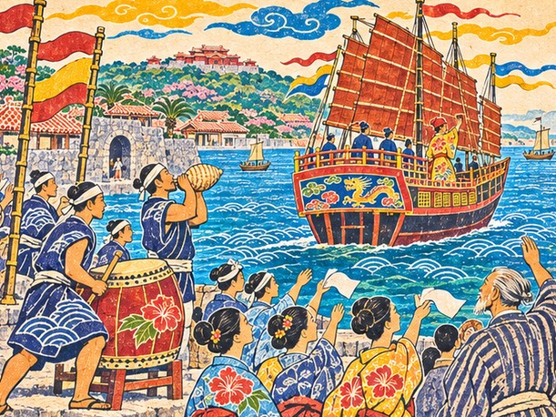

1523년 봄, 영파에서 일본의 두 사절단이 서로 진짜라며 칼을 뽑은 뒤로 명의 문이 닫혀 가던 해. 류큐 왕국 나하의 하급 부사 다루는 늙은 왕의 진공선에 올라 천주로 향합니다. 칼도 큰 배도 없는 작은 섬나라가 가진 것은 한 번 지킨 약속과 왕의 국서뿐입니다. 쓰러진 정사의 자리를 이어받은 다루는 여동생 가마의 장부, 구메촌 통사 채문경의 말, 늙은 항해장 마쓰의 바람, 아유타야 상인의 딸 쁘라이의 귀를 빌려 시암과 말라카, 조선과 사카이의 문을 차례로 엽니다. 류큐의 이름을 빌려 쓰는 가짜 증서의 주인 오노를 쫓고, 큰 나라들 사이에 다리를 놓는 이야기입니다.

:::caution[줄거리 공개]
이 소설에는 다루 이야기의 처음부터 마지막 결말까지 모든 줄거리가 들어 있습니다. 게임을 먼저 즐기고 싶다면 다 끝낸 뒤에 읽으세요.
:::

이 소설은 게임의 이야기를 바탕으로 장면과 대화를 덧붙인 각색입니다. 만국 장부 여덟 곳을 모두 채우고, 3부에서 오노를 조선 관아에 넘기고, 4부에서 친방을 설득한 여정을 따라가며 결말에서는 세 갈래를 모두 소개합니다. 실제 게임의 선택에 따라 만나는 장면은 달라질 수 있습니다.

## 차례

| 차례 | 내용 |
| --- | --- |
| [서장 ― 바늘땀과 머리카락](/novel/ryukyu/prologue/) | 1523년 봄 나하, 진공선과 닫혀 가는 명의 문 |
| [1부 ― 닫힌 문](/novel/ryukyu/part1/) | 슈리 왕부, 천주의 검문, 영파의 소문, 쓰러진 정사, 가짜 증서 |
| [2부 ― 남쪽 바닷길](/novel/ryukyu/part2/) | 북동풍의 항해, 아유타야의 알현, 포르투갈의 말라카, 남쪽 바다의 약속 |
| [3부 ― 가짜 사신](/novel/ryukyu/part3/) | 나가사키와 부산포, 경상좌수영의 대조, 묶인 오노 |
| [4부 ― 늙은 왕의 바다](/novel/ryukyu/part4/) | 구메촌 장로들, 조공 기한, 늙은 왕의 임종, 새 왕의 어전 |
| [5부 ― 만국의 다리](/novel/ryukyu/part5/) | 만국호의 출항, 대만 해협, 천주 시박사의 마지막 알현 |
| [결말 ― 세 갈래 바다](/novel/ryukyu/ending/) | 다리를 지키는 길, 두 바다의 상인이 되는 길, 고향 섬으로 돌아가는 길 |
