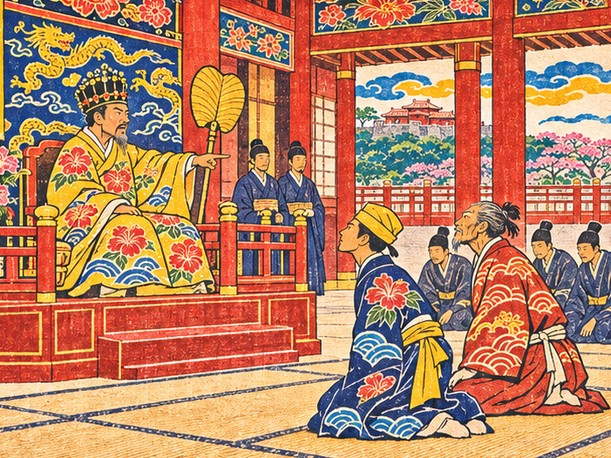
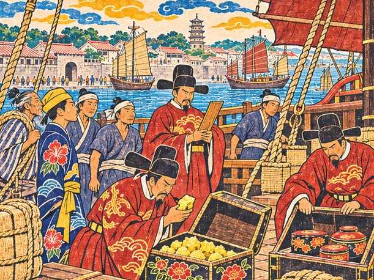
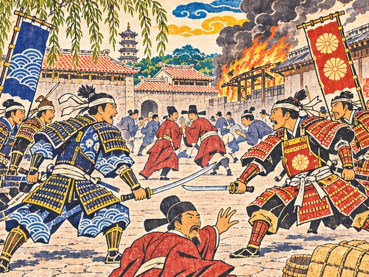
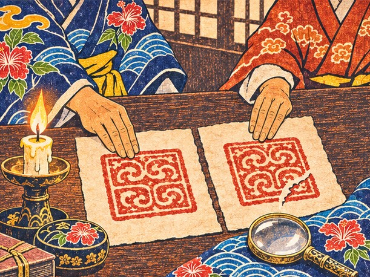

## 1. 슈리의 앞뜰

슈리 왕부는 나하를 내려다보는 언덕 위에 있었다.

굽이진 돌담이 몇 겹으로 언덕을 감았다. 돌을 깎아 쌓은 담은 햇빛을 받아 희었고, 문을 하나 지날 때마다 바람 소리가 달라졌다. 정전 앞뜰에 이르자 사절단은 돌바닥에 엎드렸다. 정사 긴조가 맨 앞에, 다루는 그 한 걸음 뒤에.

다루는 고개를 들지 못했다. 그래서 왕의 얼굴은 보지 못하고 목소리만 들었다. 낮았지만 앞뜰 끝까지 또렷하게 닿는 목소리였다. 오래 다스린 왕이었다. 다루가 태어나기 전부터 이 섬의 왕이었다.

"명나라 황제께 국서와 조공을 바쳐라. 바다가 거칠수록 약속은 단단해야 한다."

잠시 침묵이 흘렀다. 뜰 가장자리의 나무에서 새가 울었다.

"류큐는 칼로 큰 나라를 이길 수 없다. 대신 한 번 지킨 약속은 오래 남는다. 그것이 이 섬의 힘이다." 왕의 목소리가 조금 누그러졌다. "긴조, 이번 길에 젊은 부사를 데려간다지. 네가 본 바다를 그에게 남겨라."

"받들겠습니다, 전하. 다만 바다는 말로 남기기 어려워, 제 눈으로 보게 하겠습니다."

그때 왕의 곁에서 다른 목소리가 났다. 매끄럽고, 그 밑이 단단한 목소리였다.

"전하, 명의 문은 날로 좁아지고 있습니다. 언제까지 머리를 숙여 길을 빌릴 것입니까?"

"우에하라." 왕이 그 이름을 불렀다. "머리를 숙이는 것과 등을 내주는 것은 다르다."

"전하의 뜻은 알겠습니다. 다만 바다 건너 누가 강한 쪽인지는 늘 살피셔야 합니다."

우에하라 친방. 왕부의 고관이었다. 다루는 엎드린 채 그 목소리를 귀에 담았다. 왕부 안에도 바다처럼 여러 물길이 흐르고 있었다. 어느 물길이 배를 어디로 데려갈지는 아직 알 수 없었다.

"국서와 조공품, 하나도 빠짐없이 전하겠습니다."

다루의 목소리는 돌바닥에 부딪혀 작게 울렸다.

물러 나오는 길에 긴조가 왕부에서 내린 돈 주머니를 다루에게 건넸다. 금화 천이백.

"유황은 나하 교역소에서 왕부 값으로 실어라. 예순 짐이다." 긴조는 돌담 아래를 천천히 걸었다. "명은 유황으로 화약을 만든다. 우리 섬에서 나는 것 중에 큰 나라가 아쉬워하는 몇 안 되는 물건이지. 칼을 만드는 유황을 바치고, 비단과 책을 받아 온다. 그것이 조공의 셈이다, 부사."

"예순 짐에서 한 짐이라도 모자라면, 류큐의 약속이 그만큼 모자라는 셈이겠지요."

돌담 모퉁이를 돌 때 누군가 곁을 스쳐 지나갔다. 비단 겉옷 자락에서 향 냄새가 났다. 친방이었다. 그는 걸음을 늦추지 않고 낮게 말했다.

"토박이 부사라. 명의 관리 앞에서 무릎이 떨리지 않기를 바라오."

"무릎은 떨리더라도 국서는 떨어뜨리지 않겠습니다, 친방님."

친방은 돌아보지 않았다. 다만 그 걸음이 아주 잠깐, 반 박자쯤 멈칫했다.

이튿날 다루와 가마는 나하 교역소에서 유황 예순 짐을 샀다. 북쪽 섬에서 캐 온 덩어리가 누렇게 빛났다. 가마는 짐마다 무게를 달게 하고 장부에 한 줄씩 적었다. 코를 찌르는 냄새에 눈물이 났지만 붓은 멈추지 않았다.

## 2. 반쪽 문서

외교 문서를 맡는 구메촌 통사들이 사절단에 끼었다.

구메촌은 오래전 명에서 건너온 사람들의 마을이었다. 그 자손들은 대대로 한문 문서를 짓고 읽으며 왕부의 외교를 맡아 왔다. 나하 사람들은 그 마을을 존중했고, 조금 멀리했다. 구메촌 사람들도 그랬다.

길드 마루에는 국서를 베껴 쓰는 붓 소리만 사각사각 났다. 통사들은 다루가 들어서자 힐끔 보고는 다시 고개를 숙였다. 그중 하나만 붓을 내려놓고 일어섰다. 서른 남짓, 갸름한 얼굴에 옷깃이 반듯했다.

"토박이 부사님이시군요. 채문경입니다." 그가 고개를 숙였다. 숙이는 각도까지 격식에 맞았다. "외교는 문서이고, 문서는 구메촌의 일입니다. 부사님은 짐만 세시면 됩니다."

"짐을 세는 것도 외교라고 배웠습니다. 짐이 틀리면 문서도 거짓이 되니까요."

채문경의 눈썹이 올라갔다. "……그 말은 기억해 두지요."

그는 제 조부가 열두 번 명에 갔고 국서 한 장 틀린 적이 없었다고 했다. 구메촌 아이들은 일곱 살에 천자문을 떼고, 열다섯에 국서의 격식을 외운다고 했다.

"부사님은 무엇을 떼셨습니까?"

"열 살에 항구 장부를 뗐습니다. 배 한 척에 무엇이 몇 짐 실리는지는 지금도 눈으로 셉니다."

"명의 관리는 짐 대신 글자를 셉니다. 글자 하나가 틀리면 배 한 척이 돌아오지요."

서기가 옻칠한 통 하나를 받들어 왔다. 명이 류큐 왕에게 내준 감합, 무역을 허락하는 증서였다. 이것이 있어야 천주에서 류큐 배가 류큐 배로 대접받았다. 채문경이 먼저 손을 뻗었다.

"감합 통은 제가 지니겠습니다. 이것은 짐이 아니라 문서니까요."

"그럼 저는 그 통이 실린 배를 지키겠습니다. 문서도 바다를 건너려면 배가 있어야 하니까요."

채문경은 통을 품에 안으며 덧붙였다. "감합은 반쪽입니다. 명의 관청에 남은 장부와 맞춰 보아야 비로소 진짜가 되지요."

"서로 맞아야 진짜가 된다……" 다루가 중얼거렸다. "약속과 닮았네요."

채문경은 잠시 말이 없었다. "……부사님은 무엇이든 약속에 빗대시는군요."

길드를 나서자 기다리던 가마가 오빠의 소매를 당겼다.

"오빠, 저 통사님 콧대가 돛대만 해. 그래도 글씨는 정말 곱더라."

"콧대가 높은 만큼 국서도 바르겠지. 우리한테 꼭 필요한 사람이야."

## 3. 쿠로시오

만년호는 소라 소리와 북소리 속에 나하를 떠났다.

쿠로시오를 건너 서쪽으로. 검푸른 물살이 쉴 새 없이 뱃전을 밀어 올렸다. 바다 한가운데를 흐르는 또 하나의 바다라고 마쓰는 말했다. 다루는 그 말을 새겨들을 겨를이 없었다. 사흘 내내 뱃전을 붙잡고 지냈다.

"오빠, 얼굴이 유황 빛이야. 물 한 모금이라도 마셔."

"……마쓰 어른 말씀이 맞았어. 이제 알겠다."

나흘째 아침, 마쓰가 껄껄 웃으며 다루의 등을 두드렸다. "사흘이면 빠른 편이오. 나흘째부터는 다들 멀미 대신 바다를 보지. 멀미엔 먼 데를 보는 게 약이오. 배 안을 보면 배가 흔들리고, 수평선을 보면 내가 흔들리는 걸 알게 되지."

다루는 수평선을 보았다. 정말로 배가 아니라 제 몸이 흔들리고 있었다. 속이 조금 가라앉았다.

마쓰는 뱃전에 기대어 먼 남쪽을 턱으로 가리켰다.

"말라카가 무너지기 전엔 이 바다가 장터였소. 류큐 배, 시암 배, 자바 배가 한데 모여 값을 불렀지."

"지금은요?"

"포르투갈이 말라카를 쥔 뒤로는 길이 꼬였소. 바다는 그대로인데 문이 줄었지." 노인의 눈이 가늘어졌다. 오래된 것을 들여다보는 눈이었다. "그 시절 말라카 부두에서 류큐 사람이라 하면 상인들이 먼저 자리를 내줬소. 약속한 날에 꼭 오는 배라고."

"약속한 날에 꼭 오는 배……" 다루는 그 말을 되뇌었다. "그 이름을 다시 들을 수 있을까요."

"바다가 대답해 주진 않소. 그건 사람이 해야지."

밤이 되자 마쓰는 갑판에 누워 별을 가리켰다. 저 별은 늘 북쪽에 박혀 있다고, 구름이 끼면 물빛과 새를 보고, 그것도 안 되면 이 늙은이 무릎을 믿으라고 했다. 가마는 그 곁에서 지난 날수를 장부 귀퉁이에 적다가 고개를 들었다.

"할아버지 무릎이 쑤시면 비가 와요?"

"비가 오니까 무릎이 쑤시는 거요, 아가씨. 앞뒤를 헷갈리면 안 되지. 장부도 그렇잖소?"

다루는 멀미가 가라앉은 얼굴로 웃었다. 바다에도 장부가 있었다. 다만 그 장부는 바람과 물빛과 늙은이의 무릎에 적혀 있었다.

## 4. 동쪽 배는 다 같다

명나라 천주의 강어귀는 배로 메워져 있었다.

만년호보다 두세 배는 큰 명의 배들이 돛을 접고 늘어서 있었다. 부두 너머로 성벽과 탑이 보였다. 나하를 통째로 옮겨 놓아도 이 항구의 한 귀퉁이를 채울 것 같았다. 만년호는 그 사이를 조심스럽게 비집고 들어갔다.

닻을 내리자마자 붉은 관복을 입은 관리들이 뱃전에 올라왔다. 손마다 붓과 장부를 들고 있었다. 우두머리가 배 안을 한 번 둘러보고 말했다.

"동쪽에서 온 배요? 동쪽 배는 다 같소. 짐부터 풀고, 칼은 모두 내놓으시오."

"류큐 왕의 진공선입니다. 국서와 감합이 여기 있습니다."

"국서는 영파에서 칼부림한 왜인들도 들고 왔소. 기다리시오."

영파. 다루는 그 이름이 무슨 뜻인지 몰랐다. 되물으려 입을 열자 채문경이 등 뒤에서 낮게 말했다.

"부사님, 여기서는 따지지 마십시오. 명의 관청에서 「기다리라」는 가장 흔한 대답입니다."

"정사님께도 들었습니다. 하루를 기다리고 반 시진을 말한다고요."

마쓰가 허리에 찬 작은 칼을 먼저 풀어 내놓았다. "칼을 내놓으라면 내놓읍시다. 진공선이 칼로 다니는 배는 아니잖소."

관리들은 짐을 한 짐씩 풀어 저울에 달았다. 유황 덩어리를 손에 들고 냄새를 맡아 보는 자도 있었고, 칠기 상자 뚜껑을 하나하나 열어 보는 자도 있었다. 다시 묶는 일은 선원들 몫이었다. 해가 기울도록 부두에서 기다렸다. 긴조는 짐 상자에 걸터앉아 눈을 감고 있었다. 기다리는 법이 몸에 밴 얼굴이었다. 다만 그 이마에 땀이 맺혀 있었다. 바람이 서늘해진 뒤에도 마르지 않았다.

해 질 녘, 가마가 짐표를 들고 다가왔다.

"오빠, 저 사람들 셈이 틀렸어. 우리 짐을 한 짐 더 적었어."

다루는 짐표를 받아 보았다. 가마의 말이 맞았다. 그는 망설이지 않았다.

"많이 적힌 것도 틀린 거야. 고쳐 달라고 하자. 나중에 모자란다고 하면 우리가 거짓말을 한 셈이 되니까."

다루가 짐표를 내밀자 관리는 의아한 얼굴로 장부를 다시 셈했다. 붓으로 한 줄을 긋고 고쳐 적으며 그가 중얼거렸다.

"……많이 적어 준 것도 마다하는 배라니. 별일이군."

채문경이 다루 곁에 서서 작게 말했다. "부사님, 방금 그 일은 관리들 사이에 금방 퍼질 겁니다. 이번에는 좋은 쪽으로요."

## 5. 영파의 소문

그날 밤, 부두 뒷골목 술집에서 영파의 일을 들었다.

일본에서 사절단 둘이 한꺼번에 영파에 왔다고 했다. 서로 제가 진짜 사절이라며 다투다 칼을 뽑았다고 했다. 관아에 불이 났고, 사람이 죽었다고 했다. 술집 주인은 그 이야기를 하며 다루 일행의 술값을 먼저 받았다.

"그 뒤로 동쪽에서 온 손님한테는 우리 집도 술값을 먼저 받소. 섭섭해도 어쩌겠소. 그 난리에 명의 관원까지 화를 입었다더군. 조정에선 동쪽 바다 문을 아예 닫자는 말까지 나온다오."

옆자리의 뱃사람들이 류큐라는 말을 듣고 슬그머니 자리를 옮겼다. 의자 끄는 소리가 유난히 컸다.

마쓰가 술잔을 내려놓았다. "그래서 동쪽 배가 다 같다는 거요. 왜인이 진짜 사절을 다툴 때 우리 배도 같이 의심받는 거지."

"누가 진짜 사절인가……" 다루는 잔을 쥔 채 말했다. "그걸 칼로 정하려 했다니."

"인장이 똑같으면 누가 진짜인지 어떻게 알아?" 가마가 고개를 갸웃했다. "장부라면 숫자를 맞춰 보면 되는데."

"숫자를 맞춰 보듯이…… 진짜는 처음부터 끝까지 어긋나지 않아야겠지. 말도, 짐도, 날짜도."

"여기 사람들 귀엔 류큐 말이나 왜인 말이나 다 동쪽 바다 말이오." 마쓰가 말했다. "우리가 다르다는 건 우리가 보여 줘야지."

다루는 그날 밤 술잔을 비우지 못했다. 칼이 아닌 무엇으로 진짜를 보일 수 있을지, 답은 떠오르지 않았다.

## 6. 남겨야 할 말

여관으로 돌아오니 긴조가 쓰러져 있었다.

열이 내리지 않았다. 채문경이 밤길을 달려 의원을 불러왔고, 의원은 맥을 짚더니 약을 달이라고만 일렀다. 가마는 대야를 곁에 두고 밤새 젖은 수건을 갈았다. 등잔 불빛 아래 노인의 얼굴이 낯설게 작아 보였다. 다루는 그 손을 잡고 있었다. 뜨거웠다.

"정사님, 이마가 불덩이예요. 말씀은 그만하시고 주무세요."

가마가 수건을 짜며 말렸지만 긴조는 눈을 떴다.

"말을 아껴야 할 때가 있고, 남겨야 할 때가 있다. 지금은 남겨야 할 때다." 그의 눈이 다루를 찾았다. "부사…… 내일 알현은 네가 해야겠다."

"저는 아직 의전도 다 외우지 못했습니다."

채문경이 한 걸음 나섰다. "정사님, 알현을 미루자고 청해 보겠습니다. 토박이 부사가 시박사 앞에 서는 것은……"

"미루면 의심이 자란다, 문경. 영파의 일 뒤로는 더욱 그렇다."

"정사님, 제가 말을 잘못하면 류큐가 다칩니다. 저 하나 다치는 것과는 다릅니다."

"그걸 아는 사람이라 맡기는 것이다."

긴조는 숨을 골랐다. 한 마디 한 마디가 무거운 짐을 옮기는 것 같았다.

"의전은 상대를 위한 것이 아니다. 약속을 위한 것이다. 그것만 잊지 마라. 상대가 무엇을 묻든, 류큐가 지킬 수 있는 것만 말해라. 지키지 못할 말은 아무리 고와도 거짓이다."

"……지킬 수 있는 것만. 명심하겠습니다."

"그리고 두려우면 두렵다고 여겨라. 두려움을 모르는 사절은 약속도 가볍게 한다." 긴조의 입가가 조금 풀렸다. "모두 내가 처음 명에 갔을 때, 그때의 정사님께 들은 말이다. 이제 네게 넘긴다."

그 말을 하고 긴조는 다시 열에 들떠 잠들었다. 다루는 날이 밝을 때까지 의전 두루마리를 펼쳐 놓고 앉아 있었다. 글자는 눈에 들어오지 않았다. 대신 긴조의 말이 한 줄씩 머릿속 장부에 적혔다.

새벽녘, 방문 앞에 인기척이 있었다. 채문경이었다. 그는 아무 말 없이 들어와, 거의 다 탄 등잔에 기름을 채워 놓고 나갔다.

## 7. 끊긴 획

시박사 관청은 천주 성안에 있었다. 높은 문지방 너머로 서기들이 책상을 줄지어 놓고 앉아 있었다. 류큐라는 말이 나오자 붓들이 일제히 멈췄다. 방 안이 조용해졌다.

명의 관리 왕 제거는 마른 얼굴에 눈이 깊었다. 그는 채문경이 올린 감합을 관청의 장부와 한 자씩 맞춰 보았다. 오래 걸렸다. 이윽고 그가 고개를 들었다.

"같은 인장이 찍힌 증서가 지난달 다른 배로 들어왔소. 그 배엔 왜인들이 타고 있었지."

"그 배는 류큐 왕의 배가 아닙니다."

"그걸 어떻게 증명하겠소? 인장은 똑같은데."

다루는 대답할 말을 찾았다. 찾지 못했다. 그럴듯하게 꾸밀 말은 몇 개 떠올랐지만, 긴조의 말이 그것들을 막았다.

"……지금 이 자리에서 증명할 길은 없습니다. 다만 류큐 왕의 배는 늘 같은 길로, 같은 예를 갖추어 옵니다."

"말은 누구나 하오. 나는 지난달 그 배의 선장에게서도 같은 말을 들었소."

채문경이 뒤에서 작게 속삭였다. "부사님, 저 관리는 문서를 볼 줄 압니다. 서두르면 지고, 꾸미면 더 크게 집니다."

"그럼 꾸미지 않고, 있는 그대로 말하겠습니다."

왕 제거는 책상 위에 쌓인 문서 더미를 손바닥으로 눌렀다. "영파의 일 뒤로 내 책상엔 동쪽 배의 문서가 산처럼 쌓였소. 그 절반은 누가 썼는지도 모를 것들이지. 류큐를 미워해서 하는 말이 아니오. 나는 속지 않으려는 것뿐이오. 속은 관리는 목이 날아가니까."

"속지 않으려는 마음은 저희도 같습니다. 류큐의 이름을 빌린 그 배에 저희도 속은 셈이니까요."

왕 제거는 대답하지 않았다. 다만 감합을 덮지 않고 책상 한쪽에 밀어 두었다. 다시 보겠다는 뜻인지, 그냥 치워 두겠다는 뜻인지 다루는 알 수 없었다.

관청을 나와 시장 골목을 지날 때였다. 천주 시장에는 남쪽의 향료와 북쪽의 인삼, 동쪽의 칼이 한데 뒤섞여 있었다. 생선 굽는 연기와 향 냄새가 엉기고, 골목마다 여러 나라 말로 값을 부르는 소리가 울렸다. 늙은 상인 하나가 다루의 소매를 끌었다.

"류큐 나리, 이걸 보시오. 그 일본 배가 흘리고 간 증서 사본이오. 내 눈엔 영 수상하더이다."

종이 한 장이었다. 문구는 류큐 왕부의 증서를 그대로 흉내 냈고, 끝에 붉은 인장이 찍혀 있었다. 다루는 그것을 해에 비춰 들여다보았다. 날마다 짐표의 도장을 보던 눈이 먼저 알아챘다.

"……인장의 획 하나가 다릅니다. 우리 왕부 인장은 이 획이 끊겨 있지 않아요."

"역시!" 상인이 무릎을 쳤다. "그 배 사람들은 셈은 빨랐어도 말끝이 류큐 사람 같지 않았소. 내 사십 년 장사 눈은 못 속이지. 사흘 머물다 훌쩍 떠났소. 우리 집 외상값도 안 갚고."

채문경이 사본을 받아 들었다. 한참 들여다보던 그의 얼굴이 조금 굳었다.

"……획까지 보셨습니까. 저는 글자만 읽었는데, 글자도 어딘가 어색하군요."

"항구에서는 짐표의 도장을 날마다 봅니다. 틀린 도장 하나가 짐을 통째로 잃게 하니까요."

"부사님. 이 사본, 귀국하면 구메촌의 옛 문서들과 맞춰 보고 싶습니다."

"부탁드립니다. 제 눈은 도장까지만 닿으니까요."

가마가 오빠의 팔을 잡았다. "오빠, 그거 버리지 마. 언젠가 쓸모가 있을 거야."

그날 밤 여관에서 다루와 채문경은 등잔 아래 두 장의 종이를 나란히 펼쳤다. 왕부에서 가져온 문서의 인장, 그리고 시장에서 얻은 사본의 인장. 꼭 같아 보였다. 획 하나만 빼고. 진짜는 이어져 있었고, 가짜는 끊겨 있었다.

다루는 사본을 접어 국서 통 옆에 나란히 넣었다. 진짜와 가짜가 한 통 안에서 같은 무게로 흔들렸다.

## 8. 짧은 말

이튿날 다시 시박사 관청에 섰다.

"좋소, 부사. 류큐가 진짜라면 그 예를 보여 보시오."

다루는 긴조의 말을 속으로 되뇌었다. 류큐가 지킬 수 있는 것만 말해라. 뒤에서 채문경이 낮게 말했다. "시박사는 짧은 말을 좋아합니다. 부사님, 평소대로 하십시오."

평소대로. 다루는 의전 두루마리에 적힌 긴 인사말을 머릿속에서 접었다. 대신 들고 온 작은 칠기 상자를 앞으로 내밀었다. 조공품과 따로, 북쪽 섬에서 난 유황 가운데 가장 맑은 덩어리를 골라 담은 것이었다. 류큐에서 나는 것 중에 큰 나라가 아쉬워하는 몇 안 되는 물건. 긴조에게서 들은 말이었다.

"류큐 왕의 사절이 아룁니다. 조공품은 유황 예순 짐, 국서 한 통, 감합 반쪽입니다. 짐표는 관원께서 고쳐 적으신 그대로입니다. 지난달 온 배는 저희 배가 아니며, 그 증서의 인장은 획 하나가 끊겨 있습니다. 류큐는 다음 해에도 같은 길로, 같은 예를 갖추어 오겠습니다."

그뿐이었다. 다루는 입을 다물었다. 방 안에 붓 소리조차 없었다.

왕 제거가 칠기 상자 뚜껑을 열어 유황 덩어리를 들어 보았다. 그다음 감합을 다시 끌어당겨 한 번 더 맞춰 보았다. 짐표를 보고, 다루를 보았다.

"말이 짧고 문서가 정확하군." 그가 말했다. "영파의 왜인들과는 다르오. 조공도, 사무역도 넉넉히 허락하겠소."

다루는 깊이 고개를 숙였다. "감사합니다. 오늘 드린 말씀은 다음 진공선도 똑같이 지키겠습니다."

왕 제거는 붓을 들어 자기 장부를 펼쳤다. 그리고 거기에 류큐 배의 이름을 따로 적었다. 동쪽 배들이 한데 뭉뚱그려 적히던 줄과는 다른 줄이었다.

채문경이 다루 곁에서 작게 말했다. "……시박사가 동쪽 배더러 「다르다」고 하는 말은 처음 들었습니다."

관청을 나서자 다리가 떨렸다. 다루는 그제야 자기가 내내 숨을 참고 있었다는 것을 알았다. 계단 아래에서 기다리던 가마가 달려왔다.

"오빠! 어떻게 됐어? 얼굴이 하얘."

"……끝났어, 가마. 정사님께 먼저 알려 드리자."

조공품을 바친 것은 그날 오후였다. 왕 제거는 관원들을 시켜 유황 짐을 하나하나 달게 했다. 마지막 짐이 저울에서 내려오자 그가 말했다.

"유황 예순 짐, 정확하오. 황제께 올리겠소."

"저희 왕께서 보내신 정성입니다. 한 짐도 빠짐없이 전해져 다행입니다."

가마가 장부를 덮었다. "예순 짐, 셈 끝. 오빠, 이제 숨 쉬어도 돼."

관리들이 유황 짐을 관청 창고로 옮겼다. 짐칸이 비자 만년호가 한결 가볍게 흔들렸다. 가마는 관청의 장부와 자기 장부를 한 줄씩 맞춰 본 뒤에야 붓을 내려놓았다. 왕부가 사절단에게 맡긴 첫 일이 그렇게 끝났다.

## 9. 다리의 셈

하사품 비단 꾸러미를 교역소에서 풀자 상인들이 몰려들었다. 누구는 손가락으로, 누구는 주판으로 값을 불렀다. 감합을 지닌 배라는 말이 벌써 돌았는지 부르는 값이 처음부터 후했다.

"황제의 하사품으로 받은 비단과 도자기, 여기서 팔면 이만큼, 나하에서 팔면 저만큼." 가마가 장부를 펼쳐 손가락으로 두 줄을 짚었다. "오빠, 이게 사무역이야."

"싸게 사서 비싸게 판다…… 장부로 보니 바다가 보이는구나."

"그냥 비싸게 파는 게 아니야. 누가 무엇을 아쉬워하는지 아는 거지. 명은 유황, 일본은 비단, 남쪽은 도자기."

다루는 시장의 소란을 둘러보았다. 남쪽의 향료, 북쪽의 인삼, 동쪽의 칼. 저마다 제 땅에서 넘치는 것을 들고 와 남의 땅에서 모자라는 것과 바꾸었다.

"아쉬운 것을 서로 이어 주는 일…… 그러면 류큐는 장사꾼이 아니라 다리가 되는 셈이구나."

"다리라도 공짜는 아니야. 뱃삯이랑 선원 품삯은 빼고 셈해야지. 오빠는 그걸 늘 잊더라."

"……그래서 네가 있는 거지."

가마는 장부에 무언가를 적으며 콧등을 찡그렸다. "남는 돈은 만년호 손보는 데 먼저 쓰자. 돛 아랫단이 다 해졌더라."

여관에 돌아오니 긴조가 자리에서 겨우 몸을 일으켜 앉아 있었다. 열은 조금 내렸지만 얼굴에 핏기가 없었다. 채문경이 알현의 일을 아뢰러 들어갔고, 다루와 가마도 뒤따랐다.

긴조는 보고를 끝까지 듣고 나서 말했다. "문경. 너는 부사를 도와라."

"제가요? 토박이 부사를……"

"오늘 알현을 본 사람은 너뿐이다. 무엇을 보았느냐."

채문경은 한참 동안 대답하지 않았다. 등잔 심지가 작게 튀었다.

"……짐을 세는 것도 외교라 하던 사람이, 문서를 문서대로 지켰습니다."

"그럼 됐다."

채문경이 다루를 돌아보았다. "외교는 여전히 문서의 일입니다. 다만 그 문서를 지킬 사람은 다시 보겠습니다."

"제게는 통사님의 글이 필요합니다. 짐은 제가 세겠습니다. 글은 통사님께서 봐 주십시오."

긴조가 다루를 불렀다. "부사. 문경은 자존심이 세다. 그 자존심 덕에 구메촌의 국서가 틀리지 않았다. 꺾지 말고 아껴 써라."

가마가 오빠 귀에 대고 속삭였다. "오빠, 저 사람 방금 웃었어. 아주 조금."

채문경이 헛기침을 했다. "……웃지 않았습니다. 등잔 불빛 탓입니다."

"통사님, 알현 때 뒤에서 해 주신 말씀 덕분에 숨을 고를 수 있었습니다."

"사절의 숨을 고르는 것도 통사의 일입니다." 채문경은 옷깃을 바로 했다. "고맙다는 말은 장부에 적지 마십시오."

## 10. 등불을 낮추고

귀국길, 사흘째.

수평선 끝에 돛 몇 개가 떠올랐다. 관선 모양이었다. 처음에는 같은 쪽으로 가는 명의 배인 줄 알았다. 그러나 그 돛들은 반나절을 멀찍이 따라오다가, 해가 기울 무렵 수평선 너머로 사라졌다.

마쓰가 키를 잡은 채 말했다. "왜구 배요. 오늘은 우리를 재기만 했소."

"재기만 했다는 건, 다음엔 덤빈다는 뜻이군요."

"돛 모양을 보셨소? 명의 관선을 흉내 냈지만 뱃머리가 낮소. 저런 배는 바람보다 사람을 노리지."

채문경이 돛들이 사라진 자리를 보았다. "왜구 가운데에는 류큐 사람 행세를 하는 자도 있다고 들었습니다. 바다에서는 이름도 빼앗깁니다."

"이름을 빼앗긴다……" 다루는 국서 통을 떠올렸다. 그 안에서 진짜와 나란히 흔들리는 가짜 한 장. "천주에서 본 가짜 인장도 그런 것이겠군요."

"그럼 우리 이름은 우리가 지켜야지." 가마가 장부를 끌어안았다. "오빠, 장부는 두 벌 써서 한 벌은 따로 숨겨 둘게."

"구메촌에서도 오가는 국서는 모두 베껴 묶어 둡니다. 남겨 둔 글이 결국 이름을 지키지요."

마쓰가 돛줄을 고쳐 잡았다. "오늘 밤은 등불을 낮추고 가겠소. 바다에선 등불이 사람보다 먼저 이름을 알리는 법이니."

그날 밤 만년호는 불빛을 줄이고 어둠 속을 달렸다. 다루는 뱃머리에 서서 칼 없이 지킬 수 있는 것들을 헤아렸다. 바르게 적은 짐표. 고쳐 받은 장부 한 줄. 끊기지 않은 획 하나. 그리고 약속한 날에 꼭 오는 배라는 이름. 짐 끈에 묶인 머리카락이 밤바람에 가늘게 떨렸다.

## 11. 남쪽으로 열린 문

슈리 왕부의 앞뜰은 떠날 때와 같았다. 다만 이번에는 고개를 들라는 말이 내려왔다.

"정사가 쓰러진 자리를 부사가 메웠다고? 명의 관리가 류큐를 다르게 보았다니."

"신은 정사님 말씀대로, 류큐가 지킬 수 있는 것만 아뢰었을 뿐입니다."

다루는 천주에서 있었던 일을 보태지도 빼지도 않고 아뢰었다. 짐표 한 줄을 고친 일, 영파의 소문, 시박사 앞의 짧은 말. 가짜 인장 이야기에 이르자 왕부가 잠시 술렁였다.

긴조가 지팡이를 짚고 한 걸음 나섰다. "전하, 신은 이제 바다에 나갈 몸이 아닙니다. 다루에게 진공선을 맡기소서."

"토박이 부사에게 진공선을요?" 친방의 목소리였다. "외교는 구메촌의……"

"외교는 류큐의 것이다, 우에하라."

왕의 말은 짧았다. 친방은 물러나며 고개를 숙였다. "……전하의 뜻이 그러하시다면. 다만 바다는 한 번의 알현으로 판가름 나지 않습니다."

긴조가 다루에게 작게 말했다. "저 사람의 말을 미워하지는 마라. 나라를 걱정하는 마음은 같다. 길이 다를 뿐이다."

"정사님께서 다시 바다에 나오지 못하신다니…… 아직 배울 것이 많습니다."

"이제부터는 바다가 가르칠 게다. 나는 나하에서 네 배가 돌아오는 날을 세마."

"부사." 왕이 불렀다. "가짜 인장의 사본은 버리지 말고 지녀라. 남의 이름을 훔친 자는 언젠가 다시 나타난다."

그리고 왕명이 내려왔다.

"말라카가 무너진 뒤 남쪽 바닷길이 끊어져 간다. 시암에 가서 그 길을 다시 이어라. 명에 바치는 소목과 후추는 남쪽에서 온다. 남쪽 길이 끊기면 북쪽 문도 닫힌다."

"시암까지…… 받들겠습니다."

뒤에 엎드린 마쓰가 저도 모르게 중얼거렸다. "시암이라…… 늙은 뼈가 다시 남쪽 바람을 맡게 되겠구려."

"다루." 왕이 이번에는 부사가 아니라 이름을 불렀다. "시암 사람들은 서두르는 손님을 믿지 않는다고 들었다. 바람은 서둘러도 말은 서두르지 마라."

왕부의 서고에서 남쪽 바다의 해도가 나왔다. 하노이, 아유타야, 말라카, 자카르타, 마카오. 채문경이 지명을 하나씩 읽어 주었고, 가마는 그것을 장부 새 장에 옮겨 적었다.

"하노이, 아유타야, 말라카…… 이름만 들어도 장부가 두꺼워지는 것 같아."

"두꺼워지는 건 장부만이 아니야. 이번엔 정사님 없이 가야 한다."

"마쓰 할아버지, 통사님, 그리고 내가 있잖아. 셋이 모이면 정사님 한 분쯤은 되지."

마쓰가 껄껄 웃었다. "정사 양반이 들으면 섭섭하겠구려. 그래도 틀린 셈은 아니오."

며칠 뒤, 나하 항구관리소 앞 부두.

다루는 진공선 선장이 되었다. 관복 띠를 고쳐 매던 버릇은 어느새 없어져 있었다. 가마가 오빠의 짐 끈을 풀었다가 다시 묶었다.

"끈이 느슨해졌길래 다시 묶었어. 머리카락은 그대로야."

"가마, 너도 같이 가는데 너는 누가 지키지?"

"오빠가 지키면 되지. 그러니까 오빠는 꼭 무사해야 해."

마쓰가 뱃전에서 소리쳤다. "자, 이제 부사 나리가 아니라 선장이오. 선장이 배멀미를 하면 체면이 안 서지."

"시암 왕부에 보낼 국서의 서식은 제가 맞춰 두겠습니다, 선장님." 채문경이 말했다. 선장님이라는 말이 아직 그의 입에 서툴렀다.

다루는 부두 쪽을 돌아보았다. "정사님이 여기 계셨다면 무어라 하셨을까요."

"아마 「말은 반듯한데 바다는 반듯하지 않다」 하셨겠지. 그 양반 입버릇이오."

그때 부두 끝에서 누군가 손을 들어 보였다. 지팡이를 짚은 긴조였다. 다루는 그쪽을 향해 깊이 고개를 숙였다. 긴조는 손을 내리지 않았다. 배가 돌아오는 날을 세겠다던 사람의 손이었다.

나하 부두 너머로 남쪽 바다가 열려 있었다. 작은 나라의 배 한 척이, 끊어진 길을 다시 잇기 위해 돛을 손보았다.
