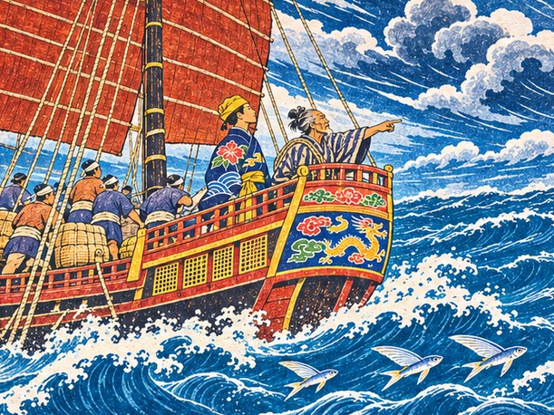
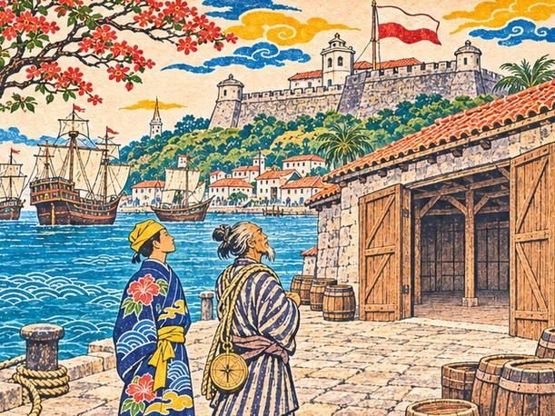

## 12. 왕부의 방

나하 길드의 벽에 새 방이 붙은 것은 다루가 진공선 선장이 된 지 사흘째 되던 아침이었다.

「왕부 의뢰: 운송·국서·왜구 쫓기·새 항구 찾기. 맡을 이는 길드로.」

다루는 먹 자국이 채 마르지 않은 글을 한 자씩 읽었다. 짐을 나르고, 문서를 전하고, 해적을 쫓고, 아무도 가 보지 않은 포구를 찾는 일. 하나하나는 작았다. 그러나 모두 왕부의 이름으로 하는 일이었다.

"선장 나리, 왕부 일을 맡아 보시겠소?" 길드 주인이 장부를 펼쳤다. "끝낸 일이 쌓일수록 왕부가 믿고 맡기는 일도 커지고, 보수도 오르지."

"남쪽 관리들도 그런 걸 본대." 가마가 오빠의 소매를 당겼다. "왕부 일을 몇 번 끝낸 배인지. 시암에 가기 전에 몇 건 해 두자."

"이름을 쌓으라는 거구나." 다루가 중얼거렸다. "시암에서 류큐 배를 기억하는 사람은 이제 드물 테니까."

"이름은 문서로 쌓이고, 문서는 일로 쌓입니다." 채문경이 방을 다시 올려다보았다. "한 건이라도 가볍게 보지 마십시오."

가마는 벌써 제 장부를 펴고 있었다. "보수는 내가 따로 적을게. 왕부 돈이랑 섞이면 나중에 셈이 꼬여."

보름 동안 만년호는 이웃 섬에 왕부의 문서를 전하고, 천주에서 실어 올 짐을 날랐다. 두 번 다 날짜를 하루도 어기지 않았다. 채문경은 일이 끝날 때마다 왕부의 확인을 받아 문서 통에 넣었다.

그다음 날, 다루는 슈리 왕부에 불려 갔다. 늙은 왕은 국서 한 통을 내렸다. 시암 왕에게 보내는 글이었다.

"예물도 실어라. 일본 은과 명의 비단이면 시암 사람들이 반길 것이다."

다루는 엎드린 채 물었다. "시암은 아직 류큐 배를 기억하고 있겠습니까?"

"백 년을 오간 길이다. 문서는 남아도 사람은 잊는다. 그러니 네가 가서 다시 알려라."

왕부는 예물 살 돈으로 금화 삼천을 내주었다. 마쓰가 뒤에서 낮게 아뢰었다. 겨울 북동풍이 부는 동안 떠나야 한다고, 그 바람을 놓치면 남쪽 바다에서 반년을 기다려야 한다고.

물러나려는 다루를 왕이 불러 세웠다.

"선장. 시암 왕 앞에서 류큐가 작다고 목소리를 낮추지 마라. 작은 나라의 말일수록 또렷해야 한다."

"명심하겠습니다. 또렷하되, 서두르지 않겠습니다."

회랑은 길고 조용했다. 다루는 그 회랑을 처음으로 혼자 걸었다. 정사 긴조가 걷던 자리였다.

나하 교역소에서 가마는 은괴를 하나씩 들어 도장을 살폈다. 시암 관리들은 은괴의 도장부터 본다고, 교역소 주인이 귀띔해 준 터였다.

"은은 일본 것, 비단은 명 것. 우리 것은 다리뿐이네."

"다리가 없으면 은도 비단도 바다를 못 건너지."

"그럼 다리 값으로 사는 셈이네." 가마는 은괴를 내려놓았다. "오빠, 은값은 깎지 마. 왕께 드릴 거니까 좋은 걸로."

"남의 나라 물건으로 예를 차리는 게 류큐의 오랜 방식이지. 부끄러울 건 없어. 다만 언젠가는 우리 것도 하나쯤 자랑스럽게 실어 가고 싶다."

예물 몫은 따로 봉했다. 가마는 천주에서 남긴 돈과 의뢰 보수를 털어 은과 비단을 조금 더 샀다. 이건 장삿짐이야, 하고 그녀는 봉하지 않은 자루에 따로 표를 달았다. 마쓰는 물을 넉넉히 실으라고 했다. 남쪽 바다에 섬은 많아도 마실 물이 나오는 섬은 드물다고. 그날 하루, 만년호에는 물통 굴리는 소리가 그치지 않았다.

## 13. 북동풍

북동풍을 타고 남쪽으로 엿새째, 물빛이 짙푸르게 바뀌었다.

나하 앞바다의 물은 맑아서 바닥의 산호가 비쳤다. 이 바다는 달랐다. 깊고 무거운 남빛이 끝없이 이어졌다. 돛은 하루 종일 배가 불렀다.

"이 바람을 놓치지 마시오." 마쓰가 키 옆에 서서 말했다. "바람은 장부처럼 기다려 주지 않소."

늙은 항해장은 밤에는 별을, 낮에는 물빛을 보았다. 이 늙은이 머릿속에 남쪽 바다가 통째로 들어 있다고 그는 큰소리를 쳤다. 그러다 가끔 품에서 닳은 해도를 꺼내 폈다. 그리고 제대로 들여다보지도 않고 다시 말아 넣었다.

"할배, 그 해도 나도 보여 줘." 가마가 졸랐다. "셈이라면 내가 잘하잖아."

"이건 셈으로 읽는 게 아니오. 바람을 맞아 본 사람만 읽지." 마쓰는 해도를 품 깊이 넣었다. "언젠가 선장한테나 보여 줄까."

밤이 되자 남쪽 하늘에 낯선 별들이 떠올랐다. 나하에서는 보이지 않던 별이었다. 채문경이 뱃전에 기대어 오래 올려다보았다.

"책에서만 읽던 남쪽 바다입니다. 통사는 글로 건너고, 뱃사람은 몸으로 건너는군요."

다루는 대답하지 않았다. 긴조 정사님도 이 별을 보셨을까. 물어볼 것이 많았다. 그러나 이번에는 물어볼 사람이 없었다. 바람의 길도, 말의 길도 그가 정해야 했다.

## 14. 붉은 강의 장부

대월의 하노이는 붉은 강을 거슬러 오른 곳에 있었다. 흙빛 강물 위로 크고 작은 배가 빽빽했고, 상인들은 류큐 돛을 보자 반겼다. 강가 시장에는 도자기와 비단, 계피 자루가 쌓여 있었다. 대월 말과 명 말이 한데 섞여 들렸다.

"류큐 배가 오다니 오랜만이오." 교역소 주인이 말했다. "말라카가 막힌 뒤로 남쪽 물건이 귀해졌소."

"남쪽 물건은 이제 어디로 들어옵니까?"

"포르투갈 배가 값을 정하면 우리는 따라갈 뿐이오. 그러니 류큐 같은 배가 반갑지."

그날 저녁, 채문경은 왕부에서 받아 온 장부 한 권을 다루 앞에 놓았다. 표지에 「만국」 두 글자만 적혀 있었다.

"왕부는 류큐가 다리를 놓을 상대 여덟을 이 장부에 적으라 했습니다. 만국 장부라고 하지요."

다루는 손가락을 꼽았다. "명, 시암, 조선, 대월, 자바, 포르투갈, 하카타, 사카이…… 여덟 나라의 상인과 약속을 맺는다."

"장부라면 내 일이네." 가마가 표지를 쓸었다. "근데 숫자 말고 약속을 적는 장부라니, 셈이 안 맞으면 어떡해?"

"약속은 숫자처럼 더하고 빼지 않습니다. 한 번 어기면 앞에 적은 것까지 지워지지요."

"포르투갈까지 적는단 말이오?" 마쓰가 눈살을 찌푸렸다. "말라카를 차지한 사람들인데."

"문을 쥔 사람과도 약속은 해야지요." 다루가 말했다. "문이 닫히면 바다가 아무리 넓어도 소용없으니까요."

첫 장에는 천주에서 맺은 약속이 한 줄 적혀 있었다. 명의 시박사가 류큐의 문서를 믿어 준 일이었다. 그 아래는 비어 있었다. 다루에게는 그 빈 장이 바다보다 넓어 보였다.

이튿날, 교역소 안쪽 칠기 상자 위에 대월 상인 조합의 장부가 펼쳐져 있었다. 붉은 강을 따라 올라온 배들의 이름이 빼곡했다.

"류큐 선장, 대월 상인들은 일본 은을 찾고 있소." 조합의 우두머리가 말했다. "은 스물이면 조합이 류큐와 약속하겠다더군."

가마가 다루를 보았다. 봉해 둔 예물 자루가 아니라, 표를 단 장삿짐 자루 쪽이었다. 다루는 고개를 끄덕였다. 일본 은 스물이 칠기 상자 위에 놓였다.

"은은 일본에서, 배는 류큐에서, 값은 대월에서." 다루가 말했다. "셋이 만나야 한 번의 거래가 됩니다."

우두머리는 조합 장부에 류큐 배의 이름을 적었다. "붉은 강의 상인들은 약속한 이름을 잊지 않소."

그날 밤 가마는 만국 장부 둘째 줄에 대월을 적었다. 글씨를 쓰는 손이 조금 떨렸다. 숫자를 적을 때는 한 번도 떨지 않던 손이었다.

떠나는 날 아침, 교역소 주인이 뱃전까지 따라 나왔다.

"남쪽 참파 앞바다에 해적이 들끓소. 조심하시오."

"참파 앞바다라." 마쓰가 수염을 쓸었다. "물살이 섬 사이로 꺾여서 숨을 데가 많은 곳이지. 예전에도 그랬소."

## 15. 참파 앞바다

수평선에서 작은 배 세 척이 물살을 가르며 다가왔다. 맨 앞 배의 뱃머리에 머리를 풀어헤친 사내가 서 있었다.

"류큐 배다! 은과 비단을 싣고 있다지? 바다매가 다 가져가 주마!"

"이 짐은 시암 왕께 드릴 예물이오!" 다루가 소리쳤다. "길을 비키시오!"

웃음소리만 돌아왔다. 채문경이 다루 곁으로 왔다.

"선장님, 저들에겐 국서도 예도 통하지 않습니다. 배를 지키는 것이 곧 약속을 지키는 겁니다."

"선장, 돛을 반만 내리시오!" 마쓰의 목소리가 갑판을 갈랐다. "바람을 등지고 붙어야 저 작은 배들이 못 따라붙소!"

싸움은 길지 않았다. 바람을 등진 만년호가 큰 몸집으로 해적선의 뱃머리를 밀어냈고, 화살과 장대가 오갔다. 한 척이 돛을 잃자 나머지 둘도 돛을 접고 달아났다.

"부사 나리, 아니 선장." 마쓰가 땀을 닦으며 웃었다. "오늘 배멀미는 안 했구려."

"멀미할 틈이 없었을 뿐입니다. 손은 아직도 떨리는데요."

가마가 짐칸에서 올라왔다. 얼굴이 하얬지만 장부는 놓지 않았다. "은 스물, 비단 서른. 하나도 안 잃었어. 오빠, 손은 떨려도 셈은 맞아."

다루는 부서진 뱃전을 오래 바라보았다. 칼 대신 말로 건너겠다던 바다에도 칼은 있었다.

## 16. 금빛 탑 아래

시암의 아유타야는 강을 따라 금빛 탑들이 늘어선 도성이었다.

"오빠, 저 탑 꼭대기 좀 봐." 가마가 뱃전에 매달렸다. "저게 다 금이면 셈이 안 될 거야."

"아유타야는 강 세 줄기에 둘러싸인 섬 도성입니다." 채문경이 말했다. "강이 곧 성벽이고 길이지요."

강가에는 명, 대월, 파타니에서 온 배들이 줄지어 있었다. 류큐의 돛은 만년호 하나뿐이었다.

"이 강을 거슬러 오른 것도 열한 번째요." 마쓰가 키를 붙든 채 말했다. "예전엔 류큐 돛이 늘 서너 개는 보였는데."

"그 서너 척이 다시 이 강을 오르게 하는 것, 그게 이번 항해의 일이겠지요."

다루는 짐을 풀기 전에 항구 관리소부터 찾았다. 관리소 사람은 반기면서도 말끝을 흐렸다.

"류큐 배요? 반갑소. 다만 요즘은 류큐라는 이름을 다들 조심하오. 까닭은 술집에 가서 물어보시오. 남의 집 빚 이야기를 내 입으로 하기는 뭣하오."

술집은 강가 기둥 위에 지은 집이었다. 마루 틈으로 강물이 보였다. 다루가 자리에 앉기도 전에, 젊은 여자 하나가 탁자 앞을 막아섰다. 눈썹이 짙고 목소리가 또렷했다.

"류큐 사람이에요? 그럼 우리 집에 빚진 그 배도 당신네 배예요?"

"빚이라니요?"

"작년에 류큐 증서를 든 배가 와서 소목을 헐값에 가져가고 값은 반만 치렀어요. 선장 이름이 오노라던가."

다루는 품에서 문서 통을 꺼냈다. 천주에서 얻은 가짜 증서의 사본이 국서 옆에 들어 있었다. 그는 사본을 펴서 인장 자리를 보였다.

"……이 인장이었나요?"

"맞아요! 이 끊긴 획!"

"이건 류큐 왕부의 인장이 아닙니다. 천주에서 얻은 가짜 증서의 사본이에요. 우리 왕부 인장은 이 획이 끊겨 있지 않습니다."

여자의 얼굴에서 핏기가 가셨다.

"가짜라고요? 그럼 우리 아버지는…… 가짜한테 창고를 걸었던 거예요?"

그녀의 이름은 쁘라이였다. 아유타야 상인 집안의 딸이었다. 아버지는 그 배를 믿고 다른 상인들에게 받을 소목까지 미리 넘겼다. 나머지 값이 들어오지 않자 빚은 두 겹이 되었다. 아버지는 지금도 날마다 부두에 나간다고 했다. 류큐 배가 오면 나머지 값을 받을 수 있을 거라고.

"그 뒤로 시장 사람들은 류큐 말만 들려도 고개를 돌려요. 나도 그랬고요."

"그런데 왜 저희에게 먼저 말을 거셨습니까?"

"당신네 배는 강을 오르자마자 관리소에 먼저 들렀잖아요. 그 사람들은 밤에 몰래 짐부터 풀었거든요."

"가짜가 류큐의 이름으로 진 빚이라면," 채문경이 사본을 내려다보았다. "그 빚은 결국 류큐의 이름에 남습니다."

가마가 오빠의 소매를 아주 작게 당겼다. "오빠, 오노라는 이름. 천주에서 본 그 끊긴 획이랑 이어졌어."

오노. 다루는 그 이름을 마음속 장부 맨 윗줄에 적었다.

## 17. 이름의 빚

시암 왕부의 관청은 강가에 있었다. 외국 배의 문서는 모두 이곳을 거쳤다. 문지기는 처음에 이름 없는 배는 만나지 않는다며 고개를 저었다. 채문경이 문서 통에서 왕부의 확인서를 꺼냈다. 나하를 떠나기 전 끝낸 왕부의 일 두 건이 거기 적혀 있었다. 문지기는 그것을 한참 보더니 안으로 들어갔다.

관리는 다루를 보자마자 말했다.

"류큐의 사절이라고? 작년에도 류큐 사절이 와서 빚만 남기고 갔소. 그 빚부터 갚는다면 알현을 생각해 보지."

"그 배는 류큐 왕부가 보낸 배가 아닙니다." 다루가 말했다. "그래도 류큐의 이름으로 진 빚이라면 모른 척하지 않겠습니다."

"말은 쉽소. 시암 왕부는 말보다 장부를 믿소."

채문경이 다루에게 몸을 기울였다. "선장님, 빚을 갚겠다는 말은 국서보다 무겁습니다. 한번 하시면 물릴 수 없습니다."

관리의 눈이 통사에게로 갔다가 다시 다루에게 왔다.

"통사가 말리는 것을 보니 빈말은 아닌 모양이오. 갚고 나서 다시 오시오."

관청을 나서며 다루는 생각했다. 물릴 수 없는 말이라면, 처음부터 지킬 말만 해야 한다.

이튿날 교역소에서 쁘라이가 접힌 종이 한 장을 내밀었다.

"이게 그 빚 증서예요. 금화 삼천." 그녀는 서둘러 덧붙였다. "갚으라는 게 아니에요. 아버지가 이것 때문에 창고를 내놓았다는 걸 보여 주고 싶었을 뿐이에요."

가마가 장부를 덮었다. "삼천이면 왕부가 예물값으로 내준 돈과 같아. 셈은 내가 했어. 정하는 건 오빠야."

다루는 증서를 오래 들여다보았다. 날짜도 값도 또렷했다. 가짜일수록 증서만큼은 반듯하게 꾸미는 모양이었다. 그 반듯한 글씨 끝에 끊긴 획의 인장이 찍혀 있었다.

그는 가마에게 고개를 끄덕였다. 가마는 말없이 금고를 열었다.

"가짜가 진 빚이라도, 이름은 우리 것입니다." 다루는 금화 삼천을 쁘라이 앞에 놓았다. "류큐의 이름으로 갚겠습니다."

쁘라이는 한동안 금화를 내려다보았다.

"……정말로 갚는 사람은 처음 봐요."

그녀는 빚 증서를 두 손으로 받아 들고, 한참 동안 접지 못했다.

"왕부에 올릴 보고는 제가 쓰겠습니다." 채문경이 말했다. "이 빚을 왜 갚았는지, 누가 읽어도 알 수 있는 글로."

"고맙습니다. 왕부의 돈을 제 고집으로 쓴 셈이니, 꾸중은 제가 듣겠습니다."

그날 오후, 머리가 희끗한 사내가 교역소로 찾아왔다. 사내는 다루 앞에 서서 아무 말 없이 고개를 숙였다. 오래 숙이고 있었다.

"아버지가 그러는 건 처음 봐요." 쁘라이가 말했다. "고맙다는 말이 서툰 사람이라서요."

마쓰는 멀찍이 문가에 서 있었다. "시암 사람들은 이 일을 오래 기억할 거요. 좋은 일도 나쁜 일도 강물처럼 오래 흐르지."

## 18. 귀 밝은 사람

그날 밤, 쁘라이가 여관으로 찾아왔다. 손에 작은 보따리 하나가 들려 있었다.

"나도 데려가요. 남쪽 바다 소문이라면 내가 제일 잘 알아요. 참말과 거짓말을 가려 드리죠."

"소문은 문서가 아닙니다." 채문경이 팔짱을 꼈다. "참과 거짓을 무엇으로 가린다는 겁니까?"

"말을 퍼뜨린 사람이 무엇을 얻는지 보면 돼요. 얻는 게 큰 소문일수록 의심하는 거죠."

"아버지가 등을 떠밀었어요. 빚을 갚아 준 배라면 믿어도 된다고요." 쁘라이는 보따리를 고쳐 쥐었다. "그리고 류큐 배가 계속 와야 우리 집도 살아요. 진짜 류큐 배가요. 그걸 내 눈으로 보고 싶어요."

"잘 왔어." 가마가 먼저 그녀의 손을 잡았다. "셈하는 사람, 글 쓰는 사람, 바람 읽는 사람에다 이제 귀 밝은 사람까지 생겼네."

"환영합니다." 다루가 말했다. "다만 하나만 약속해 주세요. 모르는 것은 모른다고 말해 주시기를."

"그게 소문 장사의 첫째 규칙이에요. 모르는 걸 아는 척하면 다음부터 아무도 내 말을 안 사거든요."

며칠 뒤, 다루는 다시 관청에 들었다.

관청 안은 서늘했다. 낮은 단 너머에서 관리가 부채를 천천히 부치고 있었다. 채문경이 국서를 한문으로 옮겨 올렸다. 류큐와 시암은 늘 그 글로 국서를 주고받았다. 쁘라이는 미리 일러두었다. 시암 관리는 일본 은을 귀히 여기고, 서두르는 말을 싫어한다고.

짧게 아뢰라던 천주와는 다르다고 다루는 생각했다. 여기서는 기다리는 것이 예였다.

그는 서두르지 않았다. 부채가 몇 번 오가는 동안 엎드려 있었고, 관리가 먼저 입을 열기를 기다렸다. 그리고 류큐 왕의 안부를 시암 왕께 전하는 말부터 천천히 올렸다. 용건은 맨 뒤에 두었다. 예물로는 도장이 또렷한 일본 은을 올렸다.

부채가 멈췄다.

"느긋한 예와 좋은 은이로군." 관리의 입가가 풀렸다. "류큐 배라면 언제든 시암의 문을 열겠소."

시암 통행 문서가 다루의 손에 놓였다. 시암 왕부가 내리는 답례금도 함께였다. 가마의 손끝에서 셈이 소리 없이 돌았다. 빚으로 나간 삼천이 그대로 돌아온 셈이었다.

"저 관리가 웃는 건 처음 봐요." 쁘라이가 속삭였다. "아버지가 들으면 놀라겠어요."

그날 밤 가마는 만국 장부 셋째 줄에 시암을 적었다.

가마는 계피와 후추를 사 가자고 했다. 조선과 명에 가면 몇 배가 되고, 조선 왕께 드릴 예물로도 좋다고. 그러나 교역소 주인은 고개를 저었다. 향료는 요즘 말라카로 다 모인다고, 예전엔 시암이 모아 팔았지만 이제는 그 값에 들어오지 않는다고.

## 19. 바뀐 문

"말라카를 직접 봐야 해요. 포르투갈이 쥔 바다를."

쁘라이가 뱃머리에서 남쪽을 가리켰다. 마쓰는 한참 말이 없다가 입을 열었다.

"말라카라…… 열세 해 만이구려. 그 뒤로는 한 번도 그쪽으로 뱃머리를 돌리지 않았소."

"할배가 내키지 않으시면 돌아가도 됩니다. 시암 길은 이미 이었으니까요."

"아니오. 늙은이가 피한다고 바다가 바뀌지는 않지. 내 눈으로 보고 오겠소."

"할배, 말라카가 어땠는데?" 가마가 물었다. "그렇게 좋았어?"

"좋았다기보다 넓었지. 한 부두에서 말이 스무 가지는 들렸소. 귀가 젊어지는 곳이었구려."

남쪽으로 닷새째 되던 밤, 다루는 가마가 짐 끈에 묶어 둔 머리카락 한 올을 손끝으로 오래 만져 보았다.

말라카 부두에는 포르투갈 깃발이 펄럭이고 있었다. 입항세는 터무니없이 비쌌다.

"동쪽 배는 입항세가 따로요." 항구 관리소의 서기가 말했다. "왕의 배든 장사꾼 배든 값은 같소."

"천주보다 두 배는 비싸." 가마가 속삭였다. "할배, 예전에도 이랬어?"

마쓰는 대답하지 않았다. 그는 부두 끝의 창고 하나를 보고 있었다. 문이 닫힌 낡은 창고였다.

"……여기 부두에 류큐 배 자리가 따로 있었소. 저 창고가 우리 상관이었지."

"할배……"

"바다는 그대로인데 문이 바뀌었소. 늙은이는 그게 제일 서럽구려." 마쓰는 오래 창고를 보았다. "그땐 항무장이 넷이었소. 그중 하나가 명과 류큐, 동쪽 배를 맡았지.류큐 사람은 값은 깎아도 약속한 날짜는 어기지 않는다고, 이 부두에선 다들 그렇게 알았소."

부두 위 언덕에는 돌로 쌓은 새 성채가 서 있었다. 옛 술탄의 궁이 있던 언덕이었다.

"성채는 새로 쌓았어도 부두의 말은 그대로군요." 채문경이 말했다. "짐꾼들이 아직 옛말로 값을 부릅니다."

할배의 바다는 어느 해도에도 없는 바다구나, 하고 다루는 생각했다. 기억 속에만 남은 바다.

술집에서 포르투갈 사내 하나가 다루의 탁자에 술잔을 내려놓았다.

"류큐 선장인가? 마누엘 드 소자다. 동쪽 바다에 좋은 장사가 있다는데, 철포 같은 것 말이지. 우리는 너희를 레키오스라 부르지. 레키오스 배가 끊긴 뒤로 이 항구 사람들이 꽤 아쉬워하더군."

"철포를 누구에게 팝니까?"

소자는 웃었다. "돈을 내는 사람에게. 왜인이든 명인이든."

"선장님," 채문경이 낮게 말했다. "철포가 왜구 손에 들어가면 그 총구는 결국 우리 바다를 향합니다."

"철포는 바다를 건너면 주인을 묻지 않겠지요." 다루가 소자를 똑바로 보았다. "그래도 그 물건이 어디로 가는지는 기억해 두겠습니다."

"기억해서 뭘 하게? 장사꾼은 잊는 게 빨라야 돈을 벌지." 소자는 잔을 비웠다. "그래도…… 말은 재미있군. 포르투갈 왕은 멀고 바다는 가깝지. 여기선 다들 제 배와 제 장부로 사는 거요."

소자가 떠난 뒤 쁘라이가 작게 일렀다. 저 선장 배는 다음 달 북쪽으로, 천주 앞바다나 그 너머까지 간다고.

"기억해 두겠습니다." 다루가 말했다. "오늘은 기억할 것이 많군요."

그 밤, 여관 아래층에서 늙은 뱃사람 하나가 혼잣말처럼 중얼거렸다.

"두 해 전 이 부두에서 조선 사람들이 노예선에 실려 서쪽으로 갔지. 장부를 끌어안은 젊은이도 있었어."

가마의 손이 멈췄다. "조선 사람이…… 노예로?"

"사람을 사고파는 바다라니." 다루가 말했다. "우리 다리는 그런 바다에 놓이면 안 된다."

"옛 말라카도 깨끗한 바다는 아니었소." 마쓰가 말했다. "문은 바뀌었는데 그 장사는 그대로 남았구려."

"장부를 끌어안은 젊은이…… 어디로 갔을까. 살아서 어디선가 셈을 하고 있으면 좋겠다."

"가마, 이 이야기는 적어 두자. 숫자 장부 말고, 들은 것을 잊지 않으려고 쓰는 장부에."

채문경이 옛 왕부는 표류한 조선 사람들을 몇 번이고 고향으로 돌려보냈다고 했다. 구메촌 문서에 그 기록이 남아 있다고.

다루는 장부 맨 끝장에 한 줄을 적었다.

「말라카에서 들음. 두 해 전, 조선 사람들, 서쪽으로.」

창밖 부두에서는 밤늦도록 짐 내리는 소리가 그치지 않았다.

## 20. 문지기와의 약속

포르투갈 상관장은 말라카 길드 안쪽 방에서 다루를 맞았다. 탁자 위에 낯선 글자로 쓴 해도가 펼쳐져 있었다. 창밖으로 요새의 대포가 바다를 향해 늘어서 있었다.

"류큐 배를 막을 생각은 없소. 이 상관이 모은 남쪽 바다 소식을 금화 삼천에 사 가겠다면, 류큐 배의 입항세는 받지 않지." 상관장은 해도 위에 손을 얹었다. "말라카를 지나는 배가 무엇을 싣고 어디로 가는지, 그걸 아는 게 이 상관의 일이오. 소식이 곧 바다의 지도지."

"생각해 보겠습니다."

길드를 나오자 일행의 말이 갈렸다.

"입항세를 몇 번 낼지 따져 보고 정하자." 가마가 말했다. "자주 올수록 삼천이 싸게 먹혀."

"소식을 사겠다는 사람은 소식을 팔기도 해요." 쁘라이가 말했다. "무엇을 말할지 잘 골라야 해요."

"말라카를 차지한 나라라고 문을 닫으면 남쪽 바다의 절반을 잃습니다." 다루가 말했다. "서두르지 않겠습니다."

칼 대신 소식을 사고파는 바다였다. 무엇을 말하고 무엇을 아낄지, 그것도 사절의 일이었다.

북으로 돌아갈 남서풍이 불기까지는 아직 날이 남아 있었다. 다루는 그 사이 뱃머리를 남쪽 자바로 돌렸다.

자카르타 부두에는 정향과 육두구 냄새가 짙게 배어 있었다. 머리에 천을 두른 상인들이 낯선 정크를 오래 바라보았다.

"자바 상인들은 명의 비단을 기다리오." 교역소 주인이 말했다. "견직물 서른이면 장부에 이름을 올려 주겠소."

가마가 장삿짐 자루의 표를 떼어 냈다. 나하에서 따로 사 둔 비단 서른이었다.

"말라카가 막힌 뒤로 명의 비단은 귀했소." 주인이 비단 결을 쓸어 보았다. "류큐가 다리가 되어 준다면 자바도 배를 띄우겠소."

가마는 상인들과 한참 이야기를 나누고 돌아와 웃었다. "자바 상인들이 그러는데, 비단 값보다 다시 온다는 약속이 더 귀하대. 그것도 장부에 적어 둘게."

말라카로 돌아온 날, 가마는 입항세 셈을 다 끝내 놓고 있었다. 류큐 배가 해마다 이 부두를 지난다면, 삼천은 몇 해 안에 제값을 했다. 다루는 다시 상관장 앞에 앉았다.

"철포를 누구에게 파는지는 묻지 않겠습니다. 다만 류큐의 이름으로는 팔지 마십시오."

상관장은 웃었다. "장사꾼에게 이름은 짐이 될 때도 있지. 좋소, 약속하지."

금화 삼천이 탁자 위로 건너갔다. 상관장은 낯선 글자의 장부에 레키오스라는 이름을 적었다.

상관을 나온 마쓰는 오래 부두를 보았다. 닫힌 창고 쪽이었다.

"문지기가 바뀌었으면 문지기와도 말을 터야지. 늙은이도 그건 알겠소." 그는 천천히 말했다. "문은 바뀌었어도, 류큐 배가 이 부두에 다시 이름을 남겼구려."

"할배가 기억하는 바다를 다 돌려드릴 수는 없지만, 한 줄은 다시 적었습니다."

그날 다루 일행은 말라카 시장에서 계피 마흔과 후추 마흔을 샀다. 조선 예물로 쓸 몫은 채문경이 따로 봉했다. 장삿짐과 예물이 섞이면 예가 흐려진다고.

## 21. 바람이 만든 나라

여름 남서풍이 불었다. 북으로 이레째였다. 남서풍은 뜨겁고 무거웠다. 돛이 하루 종일 배불러 있었다.

"류큐는 이 바람을 타고 오고 가죠." 쁘라이가 날리는 머리카락을 누르며 말했다. "바람이 만든 나라예요."

"바람이 만든 나라라. 맞는 말이오." 마쓰가 말했다. "바람을 잘 읽는 나라가 오래 가지."

가마가 두툼해진 장부를 무릎에 올려놓았다. "오빠, 이번 항차를 다 적었더니 장부 한 권이 꽉 찼어. 빚 갚은 줄이 제일 굵어."

"그 줄은 손해 칸에 두지 마. 언젠가 다른 칸으로 옮겨 적을 날이 올 테니까."

"쁘라이 언니, 소문 값은 어느 칸에 적어? 남는 것도 아니고 잃는 것도 아니고."

"앞날 칸이요. 소문은 오늘 사서 내일 쓰는 거니까요."

만국 장부에는 이름이 다섯 줄 올라 있었다. 명, 대월, 시암, 자바, 포르투갈. 가마는 그 장을 펴 놓고 한참 들여다보다가 덮었다. 셈할 수 없는 것을 셈하는 얼굴이었다.

"선장, 오늘은 키를 잡아 보시오." 마쓰가 키에서 손을 뗐다. "바람이 순할 때 배워 둬야 거친 날 손이 기억하오."

다루는 키를 잡았다. 생각보다 무거웠다. 배 한 척이, 그 안의 사람과 짐과 약속이 다 이 손에 걸려 있었다. 말라카의 빈 창고가 자꾸 눈에 밟혔다. 다리는 한번 끊기면 다시 놓기 어렵다는 것을, 다루는 이번 항해에서 처음 보았다.

천주 교역소에서 가마는 남쪽 후추를 풀어 놓았다.

"남쪽 후추를 여기서 팔면…… 오빠, 이게 중계무역이야. 우리가 다리라서 남는 몫."

"다리 값을 받는 거구나."

시박사 관청 앞을 지나왔지만 오늘은 아무도 만년호를 뒤지지 않았다.

"한 번 지킨 문서가 다음 문을 엽니다." 채문경이 말했다. "천주가 류큐를 다시 기억하기 시작한 거지요."

슈리 왕부에서 늙은 왕은 다루의 보고를 끝까지 들었다.

"시암의 문이 다시 열렸다니. 장하다."

"시암 왕부가 국서를 받았습니다. 다만 가짜 류큐 배가 남긴 빚이 있어, 그것을 먼저 갚았습니다."

"왕부의 돈으로 남의 빚을 갚았다고?"

채문경이 한 걸음 나섰다. "전하, 그 빚은 류큐의 이름으로 진 것이었습니다. 이름을 되찾는 값이었다고 신이 보증합니다."

왕은 오래 웃었다. "구메촌 통사가 토박이 선장을 보증하는구나. 그거면 됐다."

우에하라 친방이 끼어들었다. "남쪽 길로 일본의 칼을 막을 수 있겠소? 북쪽에서는 하카타 상인들이 류큐의 이름을 쓰고 다니는데."

"칼은 막지 못합니다. 다만 남쪽 바다에서는 류큐라는 이름을 다시 믿게 했습니다."

"이름이라. 이름으로 배를 지킬 수 있다면 좋겠구려."

"조선이 류큐 사절을 받지 않는다고 들었다." 왕이 말했다. "가짜가 너무 많았던 탓이지."

"전하, 말라카 부두에서 조선 사람들이 노예선에 실려 갔다는 말도 들었습니다. 장부에 적어 두었습니다."

"그 말을 조선에 전할 날이 올지도 모르겠구나. 잊지 말고 지니고 있거라."

친방이 낮게 중얼거렸다. 남의 나라 사람 걱정까지 하다니, 류큐가 그리 넉넉한 나라였던가. 다루는 그 말을 들었지만 돌아보지 않았다.

나하 부두에는 남쪽에서 실어 온 향료 냄새가 아직 배어 있었다. 같은 부두에서, 배는 이제 북쪽을 향해야 했다.

다루는 병석의 긴조를 찾아 남쪽 바다 이야기를 전했다. 긴조는 눈을 감은 채 끝까지 들었다. 빚 이야기에 이르러서야 눈꺼풀이 조금 움직였다.

"남의 빚을 갚았다고? ……그것도 약속이다."

긴조는 그 한마디만 남겼다.

저녁에 왕부에서 사람이 왔다. 왕의 말이었다. 끊긴 조선 길을 열어라. 이번엔 진짜 류큐가 간다고.

"남쪽 길은 빚을 갚아서 열었습니다." 다루가 부두에서 말했다. "북쪽 길은 무엇으로 열어야 할까요."

"조선에 보낼 서계도 한문으로 씁니다." 채문경이 말했다. "다만 이번엔 글보다 증거가 먼저 말해야 할 겁니다."

"오빠, 그 가짜 증서 사본. 버리지 말라고 했지? 이제 쓸 데가 생겼네."

"북쪽 물은 차고 빠르오." 마쓰가 무릎을 주물렀다. "이 늙은 뼈가 버텨 줄지 모르겠구려."

며칠 뒤 왕부는 다루에게 제 관복과 인장 주머니를 내렸다. 빌린 옷도, 선장의 바랜 옷도 아니었다. 다루는 이제 류큐의 사절이었다.
