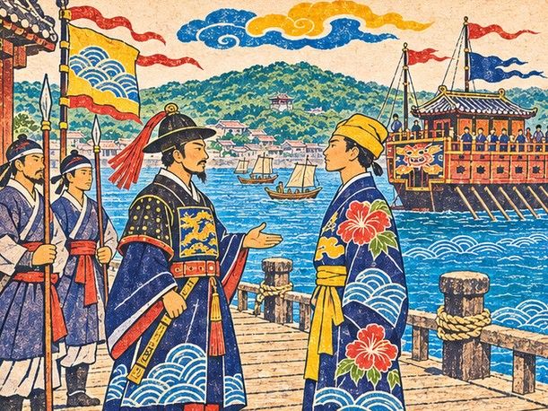
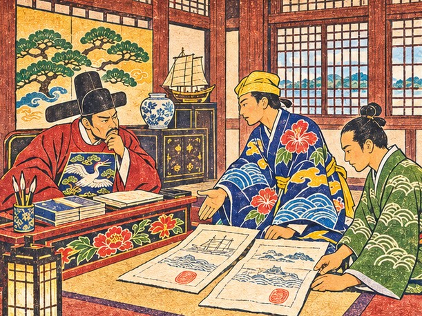
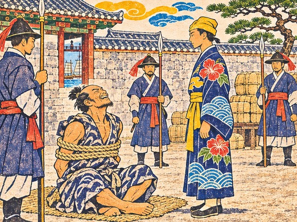

## 22. 북쪽으로 가는 국서

슈리 왕부의 대청은 늘 바닷바람보다 한 박자 늦게 서늘해졌다.

늙은 왕은 옥좌에 등을 기대지 않고 앉아 있었다. 그 앞 탁자에 검게 옻칠한 국서 통이 놓여 있었다. 다루는 그 통을 보는 순간 손바닥에 땀이 뱄다. 천주에 가져갔던 국서보다 작은 통이었다. 그런데 더 무거워 보였다.

"조선 왕께 보내는 국서다." 왕이 말했다. "이번에는 진짜 류큐의 말이 닿아야 한다."

이번에는. 다루는 그 말을 마음속으로 한 번 더 굴렸다.

옆방에서 시종 둘이 긴조를 부축해 나왔다. 천주에서 쓰러진 뒤로 정사는 한 번도 제 발로 대청에 서지 못했다. 볼이 패고 손등에 핏줄이 드러났지만 눈만은 예전 그대로였다. 긴조는 방석에 앉자마자 숨을 고르고 입을 열었다.

"오십 년 전부터 류큐 이름으로 조선에 간 사절이 여럿이었지. 그런데 그중 진짜는 거의 없었다. 하카타와 대마도 상인들이 류큐를 사칭했으니까."

"그래서 조선이 우리를 믿지 않는군요."

"믿음은 한 번 잃으면 이름만으로는 돌아오지 않는다. 증거와 약속이 함께 가야 한다."

긴조는 천천히 이야기했다. 하카타와 대마도 사람들이 류큐 왕의 이름으로 국서를 꾸며 조선에 들고 갔다. 조선은 먼 바다의 왕이 예를 갖춰 왔다고 여겨 면포와 경전을 넉넉히 내렸다. 그 답례가 고스란히 엉뚱한 손으로 들어갔다. 뒤늦게 속은 것을 안 조선은 류큐라는 이름부터 의심하게 되었다. 그 뒤로는 진짜 사절이 가도 바다 건너에서 막혔다.

"그 오십 년 동안 류큐는 왜 아무 말도 하지 않았습니까?"

왕은 꾸짖지 않았다. 긴조가 대신 대답했다.

"명에 조공하고 남쪽 바다를 오가느라 북쪽의 이름은 남의 손에 맡겨 둔 셈이지. 그 값을 이제 네가 치르는 거다."

"국서에는 지난 일을 덮지 않고 적었다." 왕이 덧붙였다. "류큐의 이름으로 간 거짓은 류큐가 알지 못한 일이었다고."

다루는 품에서 기름종이 꾸러미를 꺼냈다. 천주 시장에서 얻은 가짜 증서의 사본이었다. 인장의 획 하나가 끊긴 그 종이를 다루는 두 해 동안 국서 통 옆에 넣고 다녔다.

"이 사본이 있습니다. 진짜와 무엇이 다른지 조선 관아 앞에서 보여 드리겠습니다."

긴조가 기침을 삼켰다. 마른 어깨가 한 번 크게 들썩였다.

"사절은 제 말을 하러 가는 사람이 아니다. 나라가 한 약속을 들고 가는 사람이다. 잊지 마라."

국서 통을 건네는 긴조의 손이 가늘게 떨렸다. 다루는 그 통을 두 손으로 받아 품에 넣었다. 대청 창 너머로 나하 항구가 내려다보였다. 남쪽 배들의 돛대가 숲처럼 서 있었다. 그 사이에 북쪽에서 온 배는 한 척도 없었다.

"다루." 왕이 불렀다. "조선은 큰 나라다. 그러나 큰 나라도 속으면 아프다. 그 아픔을 먼저 헤아려라."

"명심하겠습니다. 저들의 의심을 탓하지 않고, 의심이 풀릴 때까지 기다리겠습니다."

교역소 창고에서는 가마가 벌써 예물 목록을 펼쳐 놓고 있었다. 계피 마흔 다발, 후추 마흔 자루. 둘 다 지난 항차에 말라카 부두에서 미리 사 둔 것이었다.

"계피는 약이 되고 후추는 음식 맛을 내지. 둘 다 조선 땅에서는 나지 않아서 귀하대."

"남쪽에서 실어 온 것을 북쪽에 바치는구나." 다루가 자루를 쓸어 보았다. "예물부터가 우리가 다리라는 증거겠네."

"예물만으로는 모자랍니다." 채문경이 붓통을 허리에 차며 말했다. "가짜 사절들도 남쪽 물건을 들고 갔으니까요. 이번에는 문서가 말을 해야 합니다."

"조선은 처음이에요." 쁘라이가 계피 다발 하나를 코에 대 보았다. "거기 사람들도 이걸 달여 마셔요?"

"조선 궁궐의 약방에도 남쪽 계피가 든다고 들었습니다. 그러니 예물로 귀하지요."

마쓰 할배는 창고 문간에 기대 북쪽 하늘만 보았다.

"북쪽 바다는 처음이구려. 쿠로시오가 등을 밀어 주지만, 대마도 앞은 물살이 사납소."

가마는 예물 목록을 세 번 맞춰 보고 나서야 붓을 내려놓았다.

## 23. 찬 바다

북으로 닷새째, 바다가 차가워졌다.

아침마다 뱃전에 찬 이슬이 맺혔다. 남쪽 바다만 다니던 선원들이 궤짝 밑에서 솜옷을 꺼내 입었다.
"북쪽 바다는 이렇게 추워요?" 쁘라이가 어깨를 움츠렸다. "아유타야에선 겨울에도 땀이 나는데."

"이 정도로 떨면 안 되오. 북쪽 바다의 겨울은 뼈까지 파고들지."

가마가 다루 곁으로 와서 낮게 말했다.

"오빠, 국서 통은 기름종이로 두 번 쌌어. 이번 항차에서 제일 비싼 짐이니까."

밤이 되자 별자리가 낯설게 기울었다. 마쓰는 키를 잡은 채 북쪽 하늘의 별 하나를 오래 올려다보았다.

"남쪽 바다는 바람이 길을 알려 주지만, 북쪽 바다는 물이 길을 정하오. 물길을 놓치면 엉뚱한 섬에 닿지."

"할배는 북쪽에도 와 보셨습니까?"

"젊을 적에 한 번. 그때도 조선 포구에서 류큐 배라고 하니 고개부터 갸웃하더구려."

쁘라이가 솜옷 앞섶을 여몄다.

"남쪽 소문은 내가 다 아는데, 북쪽 바다는 하나도 몰라요. 이번엔 내가 배울 차례네요."

## 24. 셈이 깔끔한 사람

나가사키의 술집은 기름 등잔 냄새와 주판 소리로 꽉 차 있었다.

하카타 상인들이 명의 비단값과 조선의 무명값을 놓고 목청을 높였다. 류큐 사람들이 들어서자 몇몇이 고개를 돌렸다.

다루가 오노라는 이름을 꺼내자 술집 주인은 잔을 닦던 손을 멈추지도 않았다.

"오노 소에몬? 그 양반 요즘 류큐 사절 행세로 조선을 드나든다더군. 영파 난리 뒤로 일본 배는 명에 못 들어가니, 류큐 이름이 금값이지."

채문경이 다루 귀에 대고 낮게 말했다.

"영파에서 일본 두 사절단이 서로 진짜라며 칼을 뽑은 뒤로 명은 동쪽 배를 믿지 않습니다. 그 빈자리를 류큐 이름으로 메우려는 것이지요."

그때 옆자리에서 누군가 잔을 내려놓았다. 소매를 단정히 걷은 마흔 남짓한 사내였다.

"오노와 한패로 보지는 마시오. 나는 하카타의 시마이 요헤에. 값은 짜게 부르지만 위조는 안 하오."

"류큐의 다루입니다. 진짜 류큐요."

시마이가 웃었다. 입꼬리만 조금 올라가는 웃음이었다.

"진짜라는 말은 오노도 하지. 증거를 보이시오."

"증거는 조선 관아에서 보이겠습니다. 대신 하나만 여쭙지요. 시마이 님은 왜 오노를 꺼리십니까?"

"가짜가 판을 치면 진짜 물건값도 떨어지오. 조선 관아가 하카타 배를 다 의심하게 됐으니 나도 손해를 보는 셈이지."

쁘라이가 다루 소매를 당겼다.

"이 사람 말은 참말 같아요. 손해 이야기를 먼저 꺼내는 상인은 거짓말을 덜 하거든요."

시마이는 잔을 비우고 일어섰다. 내일 교역소로 오라는 말만 남겼다. 그가 나간 뒤 가마가 장부를 덮으며 속삭였다.

"오빠, 저 사람 술값을 자기 몫만 딱 맞춰 내고 갔어. 셈이 깔끔한 사람이야."

"셈이 깔끔한 사람은 약속도 깔끔하겠지. 내일 가 보자."

이튿날 시마이의 창고는 술집보다 조용했다. 짐마다 하카타의 상호가 먹으로 또렷이 찍혀 있었다. 모서리 하나 어긋난 궤짝이 없었다.

"부산포에 넘길 짐이 있소. 실어다 주면 오노가 어떻게 장사하는지 알려 드리지."

"실어 드리겠습니다. 부산포 교역소에 넘기면 되지요?"

"그렇소." 시마이가 궤짝 하나를 손바닥으로 두드렸다. "오노는 류큐 인장을 새긴 도장장이를 부리오. 획 하나를 끊어 놓고 다들 모르는 줄 알지."

다루의 손이 저도 모르게 품속 기름종이 꾸러미로 갔다.

"획 하나…… 천주에서 본 증서도 획이 끊겨 있었습니다. 같은 손에서 나온 것이군요."

"그 도장장이는 하카타 뒷골목에 사오. 오노는 국서도 서너 벌 써 두고, 받는 쪽에 따라 골라 든다더군."

"국서를 골라 든다니요." 채문경의 목소리가 굳었다. "상대에 따라 말이 바뀌는 문서는 이미 문서가 아닙니다."

가마는 시마이의 짐을 장부 맨 끝에 따로 적었다. 남의 짐을 싣는 것도 약속이니까, 하고 중얼거리면서.

"하나 더." 시마이가 돌아서는 다루를 불러 세웠다. "조선 관리는 말이 번지르르한 자부터 의심하오. 증거를 먼저 내고 말은 나중에 하시오. 그리고 내 짐에는 내 이름을 쓰오. 남의 이름을 빌려 판 물건은 값이 올라도 내 것이 아니지."

"시마이 님의 이름이 곧 증서로군요."

"증서라니 과하오. 하카타 장사꾼 삼대가 겨우 지켜 온 간판일 뿐이지."

쁘라이가 다루 등 뒤에서 작게 말했다.

"자랑도 저렇게 무뚝뚝하게 하네요. 아유타야 상인이면 한나절은 늘어놨을 텐데."

## 25. 묶인 닻줄

대마도 앞바다는 마쓰의 말 그대로였다.

물살이 배 밑바닥을 옆으로 끌었다. 키를 바로 잡아도 뱃머리가 자꾸 동쪽으로 돌아갔다.

"이 물목에서 노를 놓으면 배가 대마도 쪽으로 끌려가오. 다들 손에 힘 주시오!"

멀리 대마도의 산줄기가 회색으로 누워 있었다. 오십 년 동안 수많은 가짜 사절이 저 섬을 거쳐 류큐의 이름을 달고 조선으로 건너갔다. 지금 만년호가 지나는 바로 이 물길이었다.

거짓이 건넌 길을 진짜가 똑같이 건너고 있다. 이번엔 다르다는 것을 무엇으로 보여야 하나.

파도가 뱃머리를 넘어 갑판을 쓸었다. 가마는 국서 통을 품에 안고 돛대에 몸을 묶었다. 채문경은 뱃전을 붙든 채 얼굴이 종잇장처럼 하얬다.

"구메촌 통사가 문서보다 먼저 물고기 밥이 되면 체면이 서지 않겠군요."

"통사 나리, 토할 거면 바람 아래쪽으로 하시오. 그것도 뱃사람의 예법이오."

부산포에 닿자 배다리를 내리기도 전에 항구관리소의 관리가 걸어 나왔다.

"류큐 사절? 류큐 사절이라는 자들은 늘 왜인이었소. 배를 묶어 두시오. 관아의 명이 있을 때까지."

"저희는 진짜……"

"진짜라는 말도 늘 들었소."

부두에 조선 군졸들이 늘어섰다. 만년호의 닻줄에 관아의 표지가 걸렸다. 가마가 다루 곁에서 입술을 깨물었다.

"오빠, 배가 묶여 있으면 짐 값이 하루하루 줄어. 오래 끌면 안 돼."

"여기서 화를 내면 저들이 옳았다는 증거가 됩니다." 채문경은 아직 핏기가 덜 돌아온 얼굴이었지만 목소리는 차분했다. "지금은 기다리는 것도 외교입니다."

"알겠습니다. 의심받는 것까지 사절의 몫이겠지요."

부두에는 소금 냄새와 생선 비린내가 섞여 있었다. 흰옷 입은 사람들이 멀찍이 서서 낯선 배를 바라보았다. 가까이 오는 사람은 없었다.

"다들 우리를 신기하게 봐요." 쁘라이가 두리번거렸다. "아니, 신기한 게 아니라…… 무서워하는 건가요."

류큐 사절이라는 이름이 이 포구에서 무엇을 뜻했는지 알 것 같았다. 국서보다 먼저 저 눈빛부터 풀어야 했다.

## 26. 갑옷 끈

부산포 술집은 낮은 천장 아래 연기가 고여 있었다.

구석 자리에 무관 하나가 앉아 있었다. 갑옷 끈을 느슨하게 풀어 놓은 채였다. 막 바다에서 돌아와 잠깐 숨을 돌리는 사람 같았다. 그는 류큐 사람들이 들어서는 순간부터 그들의 옷차림을 한참 살폈다. 다루의 관복 깃, 채문경의 붓통, 마쓰의 거친 손.

"류큐에서 왔다고? 나는 이 앞바다를 지키는 수군 무관이오."

"십오 년 전 삼포에서 난리가 난 뒤로 이 포구는 바다 건너 오는 이름을 하나하나 다시 따지오. 류큐라는 이름은 그중에서도 가장 의심받지."

"어째서 류큐가 가장입니까?"

"류큐 왕의 국서를 들고 온 자들이 정작 류큐 말은 한마디도 못 했다 하더이다. 그런 일이 한두 번이 아니었다오."

제 나라 말을 못 하는 사절. 그런 자들이 오십 년 동안 류큐의 얼굴로 이 포구를 드나들었다.

"오십 년 동안 가짜가 왔으니 믿지 못하는 것도 당연합니다. 그래도 진짜는 진짜라 말해야지요."

무관은 잠시 다루를 보았다. 탁자 위의 잔을 보는 것과 같은 눈이었다. 무게를 재는 눈.

"……가짜는 그런 말을 길게 하지 않더군. 관아에 말해 두겠소. 증거를 들고 가시오. 다만 관아는 내 말 한마디로 움직이지 않소. 진짜는 가짜보다 증명할 것이 많은 법이오. 그대가 직접 보이시오."

"말씀 고맙습니다." 채문경이 고개를 숙였다. "문서는 저희가 갖추어 두었습니다."

무관은 술값을 치르고 먼저 일어섰다. 문간에서 갑옷 끈을 다시 조여 매는 손이 빨랐다. 그의 이름이 윤해강이라는 것은 나중에 관아에서야 들었다.

마쓰가 그가 나간 문을 오래 보았다.

"바다 사람 눈이구려. 말보다 배를 먼저 보고 사람을 재는 눈이오."

## 27. 좀 슨 서계

경상좌수영 관아의 대청 마루에 서계 뭉치가 쌓였다.

종이는 누렇게 바랬고, 어떤 장은 좀이 슬어 가장자리가 그물처럼 뚫려 있었다.

"성화 연간부터 류큐 왕의 이름으로 온 서계가 이만큼이오." 관리가 말했다. 마흔을 넘긴 얼굴에 웃음기가 없었다. "모두 대마도를 거쳐 왔고, 모두 답례를 넉넉히 받아 갔지. 그대의 국서가 진짜라면 이것들과 무엇이 다르오?"

시마이의 말이 떠올랐다. 증거를 먼저 내고 말은 나중에.

다루는 아무 말 없이 기름종이 꾸러미를 풀었다. 천주에서 얻은 가짜 증서 사본을 서계 뭉치 옆에 펼치고, 그 곁에 왕부에서 받아 온 문서를 나란히 놓았다. 그리고 손가락 하나로 인장의 한 곳을 짚었다.

"이 획을 보십시오. 우리 왕부의 인장은 여기가 끊기지 않습니다."

관리가 몸을 숙였다. 아전 하나가 서계 뭉치에서 몇 장을 골라 옆에 펼쳤다. 같은 자리에서, 같은 획이 끊겨 있었다.

채문경이 앞으로 나섰다.

"그리고 이 문서는 명의 연호를 틀리게 썼습니다. 류큐 왕부라면 이런 실수는 하지 않습니다. 또 있습니다. 이 서계들은 류큐 왕을 부르는 칭호가 장마다 다릅니다. 한 왕부에서 나온 문서라면 그럴 리가 없습니다."

"……흠."

관리는 서계를 오래 넘겨 보았다. 그러나 고개를 들었을 때 그 얼굴은 아까와 같았다.

"증거는 그럴듯하오. 그러나 앞서 온 자들도 저마다 증거를 들고 왔었소. 그대가 누구인지는 다른 것으로도 보여야 하오."

진짜를 진짜라 말하는 일이 거짓을 꾸미는 일보다 어렵구나. 다루는 그 생각을 삼켰다. 채문경이 옆에서 아주 작게 말했다.

"저 관리는 의심하는 것이 일입니다. 끝까지 의심해 주는 사람이 오히려 공정합니다."

관리가 다음으로 물은 것은 이름이었다. 류큐 왕부 안에서 이 사절이 무엇을 해 온 사람인가. 가마가 장부를 펼쳤다. 남쪽 바다를 오가며 왕부가 맡긴 짐을 제때 실어 나른 기록이 날짜와 함께 줄줄이 적혀 있었다. 시암에서 남의 빚을 대신 갚은 줄도 거기 있었다. 관리는 그 장부를 서계보다 더 오래 들여다보았다.

사흘 뒤 관아가 알현을 허락했다.

대청에 조선 관리들이 줄지어 앉았다. 국서 통을 여는 다루의 손끝이 차가웠다. 채문경이 등 뒤에서 속삭였다. 여기서는 증거가 먼저입니다. 말은 낮게, 짧게 하십시오.

다루는 예물 가운데 후추 자루부터 올렸다. 그리고 국서를 앞세우지 않았다. 가짜 사본과 진짜 문서를 다시 나란히 펴 놓고, 류큐가 오십 년 동안 침묵한 것까지 국서에 적었다고 낮게 아뢰었다. 왕의 이름을 내세우지도, 가짜를 꾸짖지도 않았다. 큰 나라도 속으면 아프다. 늙은 왕의 말이 혀끝에 있었다.

관리들 사이에 한동안 말이 없었다. 이윽고 가운데 앉은 관리가 입을 열었다.

"겸손하되 증거가 분명하오. 국서를 한양에 올리고, 류큐 배가 부산포에서 거래하도록 서계를 내주겠소."

그리고 조금 뒤에, 혼잣말처럼 덧붙였다.

"오십 년 만에 류큐의 말을 류큐 사람에게서 듣는구려."

관리가 붓을 들어 한양에 올릴 장계를 쓰기 시작했다. 류큐라는 글자가 이번에는 의심 없이 적혔다. 채문경은 관아가 내준 서계를 두 손으로 받쳐 들었다. 그의 손도 조금 떨렸다.

"조선이 류큐 배에 포구를 열어 준 문서입니다. 선장님, 이건 문서 이상의 것입니다."

다루는 서계를 오래 들여다보았다.

"오십 년의 거짓이 이 종이 한 장으로 지워지지는 않겠지요. 그래도 첫 줄은 썼습니다."

그날 오후 만년호의 닻줄에서 관아의 표지가 풀렸다. 부산포 교역소에서 계피 마흔 다발과 후추의 나머지를 내렸다. 조선 상인들이 계피 다발을 풀어 향을 맡았다. 달큰하고 매운 냄새가 퍼지자 누군가 짧게 감탄했다.

"저 계피는 남쪽 섬에서 왔어요." 쁘라이가 들떠서 말했다. "예전엔 우리 아버지 창고도 거쳐 갔을 거예요!"

교역소 주인은 시마이의 궤짝도 하나하나 확인했다.

"하카타 시마이의 짐도 잘 받았다고 전해 주시오. 시마이는 짐 맡길 사람을 까다롭게 고르는 양반이오. 그 짐을 실어 왔다니 그대도 믿을 만하겠구려."

가마가 장부에서 두 줄을 지웠다. 예물 한 줄, 시마이의 짐 한 줄.

"남의 약속을 대신 지키면 우리 이름도 같이 실리는 거야."

그날 밤 만국 장부에 하카타 상인의 이름이 올랐다. 류큐의 이름을 훔친 자와 같은 항구에서 온, 제 이름을 지키는 상인이었다.

## 28. 대마도 물목

이틀 뒤 술집 구석에서 해강이 다시 다루를 불렀다. 이번에는 갑옷 끈이 단단히 매여 있었다.

"대마도 쪽 바다에 류큐 깃발을 단 배 두 척이 보였다오. 그대 배는 여기 있는데."

"오노입니다." 다루는 이름을 입에 올리는 것만으로 목이 말랐다. "가짜 사절이 진짜를 만나러 오는군요."

"수군이 나서려면 관아의 명이 있어야 하오. 그사이 놈들은 부산포 앞까지 닿겠지."

"대마도 쪽이면 지금 물때가 우리 편이오." 마쓰가 잔을 밀어 놓았다. "바람이 바뀌기 전에 나가야 하지."

가마가 다루의 짐 끈에 묶어 둔 머리카락을 손끝으로 매만졌다. 한 올이 여전히 그 자리에 있었다.

"싸움은 피하고 싶었는데. ……그래도 같이 가."

"칼로 사절을 가리고 싶지는 않았습니다." 다루가 말했다. "하지만 류큐 깃발을 단 거짓을 그냥 보낼 수는 없습니다."

"가짜 사절의 배를 진짜 사절이 붙잡는다면, 관아도 더는 우리를 의심하기 어렵겠지요."

해강이 먼저 일어섰다.

"대마도 물목은 바람이 갑자기 꺾이오. 바위섬 그늘을 조심하시오."

오노의 배는 바위섬 그늘에서 나타났다. 높은 누각을 얹은 일본 배 두 척이었다. 돛대 끝에 류큐 깃발이 걸려 있었다. 만년호의 깃발과 똑같은 것이었다.

뱃전에 선 사내가 손나팔을 만들어 외쳤다. 볕에 그을린 얼굴에 웃음이 걸려 있었다.

"류큐의 진짜 사절이라? 진짜든 가짜든, 바다에선 이긴 쪽이 사절이지!"

"그 깃발을 내리시오. 류큐는 칼로 사절을 정하지 않소!"

"말 한번 곱군. 그 고운 말로 내 대포도 막아 보시지!"

같은 깃발을 단 배끼리 마주 섰다. 바다 위에서 진짜와 가짜를 가를 것은 깃발이 아니었다.

포성이 두어 번 물 위를 굴렀다. 마쓰는 물때를 놓치지 않았다. 바위섬을 끼고 돌아 바람을 등지자 오노의 배가 물살에 밀렸다. 돛대 하나가 꺾였고, 그 배는 더 움직이지 못했다. 오노는 붙잡혔다.

바닷물에 젖은 류큐 깃발이 오노의 갑판에 늘어져 있었다. 다루는 그 깃발을 손수 걷어 접었다. 젖은 천은 생각보다 무거웠다.

채문경이 선실에서 나온 상자를 열었다.

"선장님, 국서와 인장입니다. 왕부의 것과 똑같이…… 아니, 여기도 획 하나가 끊겨 있습니다."

붙잡힌 선원들은 대부분 품삯을 받고 탄 뱃사람이었다. 류큐가 어디 있는지도 잘 몰랐다.

"저 사람들 탓은 아니오." 마쓰가 말했다. "배를 띄운 자가 따로 있지. 뱃사람은 늘 남의 깃발 아래서 노를 젓는다오."

"다친 사람부터 돌봐 주십시오. 류큐의 배에서 류큐의 이름으로 사람을 버릴 수는 없습니다."

## 29. 무릎 꿇지 않는 사람

부산포 항구관리소 마당에서 오노 소에몬은 무릎을 꿇지 않았다.

밧줄이 팔과 몸통을 겹겹이 감고 있었다. 군졸이 어깨를 눌러도 그는 엉덩이를 땅에 붙인 채 허리를 펴고 버텼다. 다루가 마당에 들어서자 오노는 묶인 채 웃었다.

"류큐라는 이름은 누구 것이냐. 쓰는 사람의 것이지. 나는 그 이름으로 너희보다 더 많은 거래를 했다."

"조선은 류큐가 어디 붙은 섬인지도 몰랐지. 국서 한 장, 인장 하나면 왕의 사절이 됐어. 이름이란 그렇게 가벼운 거다."

"이름을 쓰는 사람의 것이라면, 약속도 쓰는 사람이 갚아야지요. 당신은 아유타야에서 빚만 남겼습니다."

오노의 웃음이 멈췄다.

"류큐는 작은 나라입니다." 다루가 말을 이었다. 목소리를 높이지 않았다. "칼도 배도 많지 않지요. 그래서 이름 하나가 나라의 전부입니다. 당신은 그걸 빌려 쓰고 버렸습니다."

오노는 눈을 돌렸다. 마당 담장 너머로 바다가 보였다.

"전부라. 그 전부를 누가 팔고 있는지는 알고나 하는 소리냐."

그 뒤로 오노는 입을 다물었다. 그러나 그 한마디는 다루의 귀에 오래 남았다.

그날 저녁 관아 대청에서 관리가 다루에게 물었다.

"이 자는 조선을 속인 죄인이오. 넘겨주시겠소?"

조선 관리들의 눈이 오노가 아니라 다루를 향했다. 류큐가 무엇을 고르는지 보려는 눈이었다.

오노가 낮게 말했다.

"나를 살려 두면 하카타 바닷길과 사카이 상인들을 열어 주지. 류큐에겐 일본 길도 필요할 텐데."

"선장님, 무엇을 고르든 류큐의 이름이 걸립니다." 채문경이 말했다.

가마가 장부를 반쯤 펼쳤다가 덮었다.

"하카타 길이 열리면 사카이 장사가 쉬워져. 장부로만 보면 거래가 남는 장사야, 오빠."

"늙은이 생각엔, 한 번 거짓을 판 자는 두 번도 판다오." 마쓰가 수염을 쓸었다. "다만 바다는 넓고, 길은 많을수록 좋지."

"류큐 사절." 관리가 다시 불렀다. "조선은 그대의 대답을 그대로 장부에 적을 것이오."

긴조 어른이라면 무엇을 고르셨을까. 다루는 그렇게 생각하다가 고개를 저었다. 이것은 긴조의 대답이 아니었다. 왕의 대답도, 가마의 장부가 내는 대답도 아니었다. 국서 통을 품고 이 대청에 선 사람이 해야 할 대답이었다.

"넘기겠습니다. 류큐의 이름을 판 죄는 류큐가 덮어 줄 수 없습니다."

관리의 굳은 얼굴이 처음으로 조금 풀렸다.

"그대를 진짜 류큐 사절로 장부에 적겠소."

군졸들이 오노를 일으켜 세웠다. 오노는 끌려 나가면서도 웃었다.

"진짜 사절이라. 하카타 사람들이 그 이름을 오래오래 기억해 줄 거다."

"가짜 사절의 일은 조정에 낱낱이 아뢰겠소. 앞으로 류큐의 국서는 그대의 얼굴로 가리겠구려."

이튿날 아침, 오노를 실은 관아의 수레가 부두를 떠났다. 다루는 그 뒷모습이 사라질 때까지 눈을 떼지 않았다.

"하카타 쪽 장사는 한동안 어렵겠다." 가마가 말했다. "그래도 조선과의 길은 우리 손으로 연 거야."

옳은 일을 했는데도 가슴이 가볍지 않았다. 오노 뒤에 선 하카타 사람들은 오늘 일을 어떻게 갚으려 할까. 그날 밤 만국 장부에 조선이 올랐다. 다루는 그 줄을 쓰는 동안 붓을 두 번 멈췄다.

## 30. 사카이의 소문

귀국길에 사카이로 뱃머리를 돌렸다.

"사카이는 일본 상인들의 큰 항구요." 마쓰가 말했다. "거기선 상인들 힘이 영주 못지않다지."

좁은 바다로 들어서자 섬들이 겹겹이 다가왔다. 물가 마을마다 고깃배가 촘촘히 매여 있었다. 쁘라이는 뱃전에 턱을 괴고 그 섬들을 보았다.

"오노가 한 말이 자꾸 걸려요. 누가 류큐 이름을 팔고 있다는 거요."

"저도 그렇습니다. 오노 혼자서 인장을 새기고 국서 꼴까지 갖출 수 있었을까요."

사카이 교역소 주인은 류큐 배라는 말을 듣자마자 눈썹을 올렸다.

"하카타 사람들이 류큐 이야기를 하더이다. 오노를 넘겼다지? 하카타와는 사이가 틀어지겠구려."

"하카타 사람이 모두 오노 편은 아니지요. 시마이 님 같은 분도 계십니다."

"그건 그렇소." 주인이 어깨를 으쓱했다. "사카이는 누구 편이든 값만 맞으면 거래하오. 사카이 상인들은 도자기를 찾고 있소. 서른만 가져오면 한자리 내주겠소."

"도자기는 명 쪽 항구에서 싸게 살 수 있어." 가마가 재빨리 적었다. "장부에 적어 둘게."

사카이 부두에는 명의 비단, 남쪽의 향료, 조선의 무명이 한데 쌓여 있었다. 주판 소리가 파도 소리보다 컸다.

"여긴 아유타야 시장보다 더 시끄러워요. 그런데 다들 셈은 아주 빨라요."

"사카이 상인들은 문서보다 장부를 믿는다고 합니다." 채문경이 말했다. "이곳에서는 가마 아가씨가 저보다 쓸모 있겠군요."

"들었지, 오빠? 통사님이 나를 인정했어."

그날 밤 술집은 하카타 사람, 교토 사람, 남쪽 배의 선원들로 북적였다. 류큐 말이 들리자 옆자리가 잠깐 조용해졌다. 그리고 누군가 일부러 들으라는 듯이 말했다.

"슈리 왕부의 누군가가 오노에게 돈을 댄다더군. 류큐 사람이 류큐를 판다니, 우습지."

"왕부의 인장은 깊은 곳에 둡니다. 획 하나만 빼고 똑같이 새기려면 진짜를 가까이서 본 사람이 있어야 합니다."

"이건 참말 같아요." 쁘라이가 속삭였다. "오노가 류큐 인장을 어디서 얻었겠어요?"

다루의 입에서 대답이 저절로 나왔다.

"……왕부 안에서."

마쓰가 잔을 탁 내려놓았다.

"선장, 그 말은 배 안에서만 하시오. 왕부 이야기는 바람보다 빨리 돈다오."

"……알겠습니다. 증거가 없으면 의심도 말일 뿐이지요. 나하에 가서 조용히 살피겠습니다."

류큐를 파는 손이 류큐 안에 있다면, 이름은 어디서부터 새고 있었을까.

## 31. 정사

나하의 집에서 오랜만에 바닥에 등을 붙였는데도 몸은 아직 파도를 타는 것 같았다.

가마가 등잔 심지를 낮추며 물었다.

"오빠, 진짜 사절이란 게 뭐야? 증서가 진짜인 사람이야, 약속이 진짜인 사람이야?"

"둘 다였으면 좋겠지만…… 하나만 고르라면 약속이겠지. 증서는 오노도 만들었으니까."

"약속이라…… 그럼 오빠가 시암에서 남의 빚을 갚은 것도, 시마이 짐을 실어 준 것도 다 사절 일이었네."

"그런가 봐. 증서는 남이 꾸밀 수 있어도, 지킨 약속은 남이 훔쳐 갈 수 없으니까."

가마가 웃었다.

"오빠 말이 점점 긴조 어른을 닮아 가. ……그래도 혼자 다 지려고 하지는 마."

다루가 잠든 뒤 가마는 오빠 짐에 묶인 머리카락이 아직 단단한지 몰래 확인했다. 창밖에서 이웃집 아이들이 뱃노래를 불렀다. 다루는 잠결에 그 노래가 어느 나라 배에서 처음 불렸을까 생각했다.

이튿날 슈리에서 소식이 내려왔다. 늙은 왕이 쓰러졌다.

왕부 복도에는 약 달이는 냄새가 배어 있었다. 대신들은 목소리를 낮추고 서로의 눈치를 살폈다. 왕의 침소로 가는 미닫이 앞에는 우에하라 친방이 서 있었다. 그는 왕의 말을 대신 전하기 시작한 지 벌써 여러 날이라고 했다.

"전하께서는 쉬셔야 하오. 사절은 기다리시오."

"조선에서 서계를 받아 왔습니다. 전하께 직접 아뢰어야 할 일입니다."

"서계는 내가 받아 두겠소." 친방이 손을 내밀었다. "조선 길이 열렸다니 다행이오만, 류큐를 지켜 줄 칼은 조선에 없소."

긴조가 다루 곁을 지나며 낮게 말했다.

"저 사람이 왕의 말을 막고 있다. 조심해라."

다루는 긴조에게만 들리게 대답했다.

"사카이에서 들은 소문이 있습니다. 왕부의 누군가가 오노에게 돈을 댄다고요."

긴조가 눈을 감았다.

"……소문은 증거가 아니다. 그러나 증거는 흔히 소문 뒤에 숨어 있지. 서두르지 마라."

닫힌 미닫이 너머에서 늙은 왕의 기침 소리가 났다. 친방의 시종이 그 문 앞을 떠나지 않았다. 친방이 다루를 돌아보았다.

"사절, 그대의 충심은 아오. 그러나 이 나라를 지키는 일은 국서 한 장으로 되지 않소."

"국서 한 장이 류큐의 전부일 때도 있습니다. 조선에서 그것을 배웠습니다."

친방은 잠시 말이 없었다.

"……배운 것이 많은 사절이구려. 그 말을 오래 지킬 수 있기를 바라오."

며칠 뒤 나하 항구관리소로 전갈 하나가 내려왔다. 친방의 손을 거치지 않고, 병석의 왕이 사람을 따로 보내 전한 말이었다.

「다루를 정사로 세운다. 류큐의 말을 바다 건너까지 전하라.」

"전하께서 친방을 거치지 않고 전갈을 보내셨군요." 채문경이 전갈을 다시 읽었다. "왕부의 말이 아직 다 막힌 것은 아닙니다."

"진공선 갑판에서 배멀미하던 부사 나리가 여기까지 왔구려." 마쓰가 껄껄 웃었다. "늙은이가 오래 살고 볼 일이오."

다루는 국서 통을 쥐었다. 조선에서 돌아온 빈 통이었다. 그런데 여전히 무거웠다.

"이름이 무거워질수록 지켜야 할 약속도 늘겠지요."

가마가 오빠 소매를 잡았다.

"오빠, 전하께서 저리 편찮으신데 우리가 또 바다에 나가도 되는 걸까."

다루는 대답하지 못했다. 부두 너머로 슈리의 언덕이 보였다. 그 위에서 늙은 왕은 병석에 누워서도 바다 쪽을 향하고 있었다.

다루는 류큐의 정사가 되었다.
