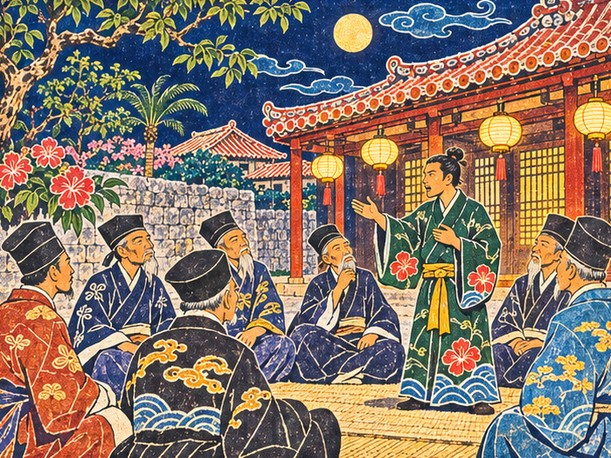
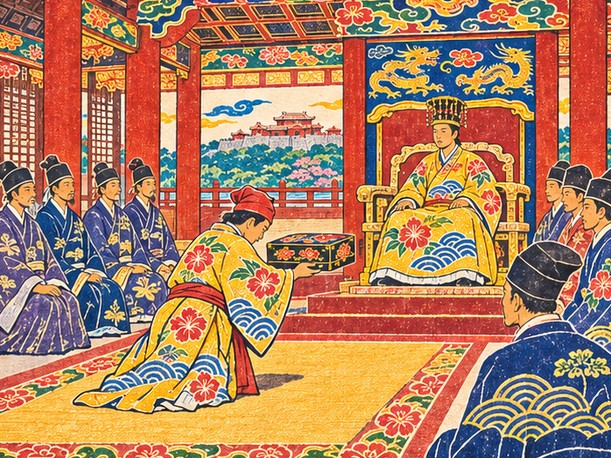

## 32. 붉은 띠

병석의 왕이 보낸 전갈은 나하 항구관리소 앞에서 읽혔지만, 띠는 슈리에서 매어야 했다. 그리고 슈리로 오르는 회랑에는 우에하라 친방이 서 있었다.

"정사라니." 친방은 다루의 인사를 받지도 않고 말했다. "왕부가 맡긴 일도 제대로 쌓지 못한 자에게? 신용부터 보이시오."

회랑의 신하들이 다루를 흘끗 보고 지나갔다. 아직 정사의 띠를 맬 사람으로 보는 눈은 아니었다. 돌아 나오는 길에 가마가 오빠의 소매를 당겼다.

"오빠, 저 사람 말이 얄밉긴 해도 틀린 말은 아니야. 왕부 의뢰판부터 채우자."

그래서 다루는 한동안 정사가 아니라 심부름꾼으로 살았다. 왕부 앞마당 판자에 나붙는 일들을 하나씩 떼어 냈다. 천주로 가는 짐, 나가사키에서 받아 올 값, 구메촌에 전할 문서. 가마는 끝낸 일마다 장부에 줄을 그었다. 줄이 열을 넘긴 날, 슈리에서 다시 사람이 내려왔다.

슈리 왕부 깊은 방. 향 연기 속에 늙은 왕이 누워 있었다. 병풍 곁에는 우에하라 친방이 말없이 서 있었다. 이번에는 그도 막지 않았다.

"다루." 왕은 누운 채 그를 불렀다. "정사의 띠를 매어라. 명에 조공을 바쳐야 한다. 유황 여든, 여섯 달 안에."

시종이 붉은 띠를 받쳐 들고 왔다. 다루는 무릎을 꿇고 두 손으로 띠를 받았다. 손끝이 조금 떨렸다.

"전하, 빌린 관복으로 첫 배에 오른 지 세 해입니다. 이 띠가 제게 너무 무겁지 않을지……"

"무거우라고 주는 것이다. 띠가 가벼운 사절은 바다 건너에서 말도 가볍게 하느니라."

다루는 띠를 허리에 둘렀다. 붉은 천 위로 홍형 무늬 겉옷 자락이 내려앉았다. 시종이 녹봉으로 내리는 금화 상자를 문턱에 내려놓았다.

"동쪽에서 오는 배를 보는 명의 눈이 날로 매서워진다. 날짜를 어기면 겨우 남은 문마저 닫힐 것이다."

"명심하겠습니다. 짐은 한 짐도, 날은 하루도 어기지 않겠습니다."

그때 친방이 한 걸음 나섰다.

"전하, 신은 다시 아룁니다. 명에 머리를 숙이는 대신 일본 상인에게 무역을 맡기고 보호를 받는 편이 낫습니다. 명은 바다 건너 멀고, 하카타와 사카이의 배는 가깝습니다. 먼 데서 오는 은혜보다 가까이 있는 칼이 더 두렵습니다."

"……우에하라. 너는 등을 내주자는 것이냐."

"등을 내주자는 것이 아니라 등을 맡기자는 것입니다. 신은 이 섬이 불타는 꼴을 보고 싶지 않을 뿐입니다."

왕이 기침을 했다. 기침은 길었고, 시종이 등을 받쳤다.

"……정사가 조공을 마치고 돌아오면 다시 듣겠다. 오늘은 물러가라."

친방은 고개를 숙이고 물러났다. 문턱에서 그가 다루를 한 번 돌아보았다. 노여움보다는 안타까움에 가까운 눈이었다.

회랑에서 기다리던 가마가 오빠를 위아래로 훑었다.

"오빠, 붉은 띠 매니까 진짜 정사 같다. ……근데 얼굴은 왜 그렇게 굳었어?"

"전하의 손이 너무 가벼웠어. 띠를 건네시는데 종이 한 장 드시는 것 같았어."

가마는 잠깐 말이 없었다.

"……그럼 더 서둘러 다녀와야겠네. 여섯 달 안에, 전하가 기다리실 수 있게."

"응. 조공을 마치고 돌아와서, 전하께 직접 아뢰고 싶어."

## 33. 닫힌 문서함

나하 길드 안쪽에는 구메촌 통사들이 쓰는 방이 있었다. 늘 명의 글과 시암의 글이 펼쳐져 있던 탁자였다. 그날은 탁자 위 문서함이 모두 닫혀 있었다.

"구메촌 장로들이 친방 쪽에 붙었습니다." 채문경이 말했다. "친방이 외교는 계속 구메촌이 맡게 해 주겠다고 약속했답니다."

"문경은요?"

채문경은 대답하지 못했다. 한참 만에 낮게 말했다.

"……저는 구메촌 사람입니다. 장로들은 정사님이 토박이라서 등을 돌린 게 아닙니다. 구메촌의 자리가 사라질까 두려운 겁니다. 저도 그 두려움을 압니다."

그는 고개를 숙이고 방을 나갔다. 문이 닫히자 가마가 오빠를 보았다.

"오빠, 문경 씨 안 붙잡아도 돼?"

"내가 붙잡으면 문경은 구메촌을 버린 사람이 돼. 스스로 고를 때까지 기다릴래."

창밖으로 구메촌의 지붕들이 보였다. 명에서 건너온 이들의 후손이 몇 대째 문서와 말을 지켜 온 마을이었다.

"오빠도 처음엔 문경 씨가 얄미웠잖아. 우릴 토박이라고 내려다본다고."

"지금은 알아. 문경이 지키려던 건 자기 자리가 아니라, 문서가 틀리지 않는 일이었어."

## 34. 여든 자루

유황은 나하 교역소에서 왕부 값으로 살 수 있었다. 가마는 왕부가 내린 금화를 세어 교역소 주인 앞에 쌓았다.

"여든이야. 한 자루라도 모자라면 천주에서 문서도 안 받아 줘."

"명 시박사는 짐이 모자라면 문서도 받지 않습니다." 아침에 다시 배에 나타난 채문경이 덧붙였다. 어제 일은 입에 올리지 않았다. "여든에서 한 짐도 빠지면 안 됩니다."

짐꾼들이 유황 자루를 어깨에 지고 줄지어 배에 올랐다. 짐칸에서 매캐한 냄새가 올라왔다. 섬의 산에서 캐낸 노란 돌이, 명으로 가는 류큐의 약속이었다. 가마는 자루마다 숯으로 번호를 적었다.

"여든 짐, 다 실었어. 이번엔 기한도 장부에 적어 둘게."

마쓰 할배가 고물 쪽 화덕을 손바닥으로 툭 쳤다.

"유황 짐은 불씨를 멀리해야 하오. 이번 항해 동안 화덕은 고물 쪽에서만 피우겠소."

"여든 자루, 번호 하나 안 빠졌어. 천주 저울에 달아도 이 번호대로 맞을 거야."

만년호는 북동풍을 받아 나하를 떠났다.

천주로 가는 나흘째 밤이었다. 가마는 등잔 아래서 장부를 펼치고 붓으로 무언가를 지웠다.

"기한까지 남은 날을 밤마다 하나씩 지우는 중이야. 오빠는 국서나 한 번 더 읽어."

밤바다에 별이 낮게 떴다. 마쓰 할배는 키 옆에 앉아 별과 물빛을 번갈아 보았다.

"바람이 북동으로 고르구려. 이맘때 바람은 조공 가는 배를 늦게 한 적이 없소."

할배는 가끔 눈을 비볐다. 그러고는 한참 만에야 별을 다시 찾았다. 다루는 그것을 보았지만 묻지 않았다.

## 35. 천주의 저울

천주 시박사의 마당에는 커다란 저울이 걸려 있었다. 세 해 전 다루가 하급 부사로 처음 섰던 그 마당이었다.

"조공 유황 여든은 어디 있소?"

왕 제거는 인사보다 짐을 먼저 물었다. 다루는 대답 대신 손짓을 했다. 선원들이 자루를 하나씩 저울에 올렸다. 눈금이 멈출 때마다 아무도 숨소리를 내지 않았다. 가마는 장부의 번호를 손가락으로 짚어 가며 따라 셌다. 여든째 자루가 내려졌다.

"기한 안에 정확히 여든. 지난번 사절보다 낫군. 감합을 새로 내주겠소."

왕 제거가 다루의 허리께로 눈을 내렸다.

"짐을 세는 것도 외교라던 그 부사로군. 띠 색이 바뀌었구려."

"띠는 바뀌었어도 짐 세는 법은 그대로입니다. 그때 배운 대로 했습니다."

"동쪽 문서는 모두 두 번씩 읽소. 류큐 것은 한 번만 읽어도 되겠구려."

채문경이 낮게 속삭였다.

"저 말은 왕 제거가 할 수 있는 가장 큰 칭찬입니다."

새 감합이 증서 통에 들어갔다. 가마가 통 뚜껑을 닫으며 숨을 내쉬었다.

"조공은 끝냈어. 이제 남은 건…… 바다 건너가 아니라 왕부 안의 일이네."

천주 부두에서는 동쪽에서 온 배마다 관리가 붙어 짐을 뒤졌다. 류큐 배 앞에서만 관리가 일찍 물러갔다. 가마는 빈 짐칸을 그냥 두지 않았다. 사카이 상인들이 찾는다던 도자기 서른을 명 시장 값으로 사들였고, 언젠가 왕부에 올릴 일이 있을 것이라며 견직물도 몇 필 따로 챙겼다.

그날 저녁 부두 술집에서 소문을 들었다.

"류큐 친방의 집사가 천주에서 하카타 오노의 사람을 만났다더군."

쁘라이가 잔을 내려놓았다.

"이건 참말이에요. 집사가 은행에 드나들었다는 말도 같이 돌아요. 그 얘기를 꺼낸 건 은행 심부름꾼이래요. 술값을 대신 내 줬더니 술술 말하더라고요."

"친방 댁 집사라면 저도 얼굴을 압니다." 채문경이 말했다. "구메촌에 문서를 맡기러 자주 드나들던 사람입니다."

"은행이라면 장부가 남겠지요." 다루가 말했다. "소문은 바람에 흩어져도 장부는 남습니다."

술집 구석에서는 명 상인 몇이 류큐 유황이 올해도 제때 왔다고 이야기하고 있었다. 가마가 쁘라이에게 몸을 기울였다.

"쁘라이, 그 술값은 장부 어디에 적어? 정보 값?"

"참말 값이요. 거짓말 값보다 훨씬 싸요."

## 36. 진짜 인장

천주 은행 안쪽 방에는 주판알 소리와 먹 냄새 사이로 장부 더미가 천장까지 쌓여 있었다. 은행 주인은 붉은 띠를 보고서야 장부를 넘겼다.

"류큐 친방 댁 송금이오? 하카타 오노 소에몬 앞으로 석 달마다 나갔구려."

주인이 내민 어음 한 장을 다루가 들여다보았다. 종이 아래쪽에 낯익은 인장이 찍혀 있었다.

"친방의 인장……"

"집사가 지난달부터 발을 끊었소. 찾아가지 않은 어음이 한 장 남았는데, 류큐 일이니 류큐 정사께 넘기리다."

"석 달마다 같은 날, 같은 사람에게. 왕부의 녹봉만으로는 나올 수 없는 돈입니다."

채문경이 어음을 등잔 가까이 대고 인장의 획을 하나하나 짚었다. 세 해 전 천주 시장에서 가짜 증서의 끊긴 획을 찾아내던 그 손가락이었다.

"인장의 획이 왕부 문서와 똑같습니다. 이번 것은 가짜가 아닙니다. 그래서 더 무겁습니다."

"가짜였으면 차라리 마음이 편했을 겁니다. 왕부의 진짜 인장이 하카타로 돈을 보내고 있었군요."

가마가 어음을 기름종이에 쌌다.

"이건 증서 통 맨 아래에 넣을게. 바닷물 한 방울도 안 닿게."

"어음 한 장에 사람 하나가 무너지네요." 쁘라이가 말했다. "그 사람이 나쁜 사람인지는 아직 모르겠지만요."

은행을 나서자 마쓰 할배가 바다 쪽을 보며 눈살을 찌푸렸다.

"선장, 돌아가는 길을 누가 흘렸을지 모르겠소. 대만 쪽 바다가 수상하오."

"우리가 언제 천주를 떠나는지 아는 사람은 왕부 안에도 몇 없습니다."

할배의 말은 틀리지 않았다. 천주를 나선 지 반나절, 섬 그늘에서 날렵한 관선 세 척이 미끄러져 나왔다. 뱃머리에 선 두목이 껄껄 웃었다.

"류큐 정사의 배라지? 누군가 이 길로 온다고 친절히 알려 주더군!"

"알려 준 사람이 누군지, 이 바다를 건너면 알게 되겠지!"

"선장, 유황을 내려 배가 가볍소." 할배가 키를 틀었다. "바람 위로 붙어서 놈들 옆구리를 치지."

"유황 대신 목숨을 바치고 가라! 값은 이미 받았으니까!"

만년호는 바람을 타고 관선들의 옆구리로 파고들었다. 화살이 뱃전에 박히고, 짧은 칼들이 번쩍였다. 오래 걸리지 않았다. 앞선 배가 부서지자 남은 두 척이 흩어져 달아났다.

"흩어지는 꼴을 보니 제 목숨 걸고 싸울 놈들은 아니었구려. 누가 돈을 주고 부른 게지."

"돈을 댄 사람과 길을 흘린 사람이 같은 사람이 아니기를 바랐는데……"

갑판에 박힌 화살을 뽑으며 선원들이 숨을 골랐다. 다친 사람은 있어도 잃은 사람은 없었다. 가마가 오빠의 손을 잡았다.

"오빠, 손 떨려. ……괜찮아, 다 끝났어."

"칼 앞에 서 보니 알겠어. 친방이 왜 그렇게 칼을 두려워하는지."

"두려움을 아는 사람이 칼을 덜 뽑는 법이오." 할배가 말했다. "선장은 그 두려움을 잊지 마시오."

## 37. 구메촌의 밤

나하로 돌아온 날 밤, 길드 안쪽 방에 구메촌 장로들이 모였다. 다루는 문간 자리를 얻었다. 장로들이 부른 것이 아니라 채문경이 청한 자리였다.

늙은 장로 하나가 지팡이로 바닥을 두드렸다.

"문경아, 친방은 외교를 구메촌에 남겨 주마 했다. 무엇이 모자라냐."

채문경이 일어섰다. 등잔 불빛이 그의 얼굴 한쪽만 비추었다.

"친방이 남겨 주겠다는 외교는 일본 상인의 뜻을 명의 글로 옮겨 적는 일입니다. 그것은 통사가 아니라 대서일 뿐입니다."

장로들 뒤편에 앉은 젊은 통사들이 서로 눈짓을 주고받았다.

"외교는 구메촌의 것이 아닙니다. 류큐의 것입니다. 저는 정사의 통사로 남겠습니다."

방 안이 술렁였다. 누군가 토박이 편에 붙었다고 중얼거렸다. 다루가 저도 모르게 입을 열었다.

"문경……"

"짐을 세는 것도 외교라 하셨지요. 저는 그 말을 기억해 두겠다고 했습니다."

채문경은 장로들에게 돌아서서 깊이 절했다.

"구메촌이 저를 길렀습니다. 그 은혜는 구메촌의 자리가 아니라 류큐를 지켜서 갚겠습니다."

장로들은 대답하지 않았다. 다만 가장 나이 든 장로가 천천히 고개를 끄덕였다.

길드를 나서는 길에 다루가 말했다.

"문경, 오늘 일로 구메촌에서 등을 돌리는 사람도 있을 겁니다."

"압니다. 그래서 더 정확하게 일하겠습니다. 정사의 통사가 틀리면 구메촌이 틀린 것이 되니까요."

뒤따라오던 가마가 두 사람 사이로 고개를 내밀었다.

"문경 씨, 오늘 저녁은 우리랑 먹어. 구메촌 밥상 대신 토박이 밥상이야."

채문경이 처음으로 웃었다.

"……사양하지 않겠습니다. 다만 국은 싱겁게 부탁드립니다."

## 38. 빈 장

이튿날 아침, 여관 마당에 그물이 널려 있었다. 마쓰 할배는 그물코를 손끝으로 더듬어 세고 있었다. 눈으로 세지 않았다.

"선장, 이번이 내 마지막 항해가 될 것 같소. 눈이 예전 같지 않구려."

"할배 없이 남쪽 바다를 어떻게 건너요."

할배는 품에서 낡은 해도를 꺼내 내밀었다.

"이걸로 건너시오. 말라카가 무너지기 전의 바람 길이 다 적혀 있소. 끝까지는 같이 가 주지."

바닷물에 몇 번이나 젖었다 마른 종이였다. 섬과 섬 사이에 작은 글씨로 날짜와 바람이 빼곡했다.

"젊을 적엔 말라카 항구에 류큐 배가 서너 척씩 나란히 섰지. 그 바다를 다시 보진 못하겠지만, 선장은 길을 잃지 마시오."

가마가 눈가를 훔쳤다.

"할배, 뭍에 내리면 우리 집 앞에 살아. 내가 날마다 생선 갖다줄게."

"허허, 아가씨 장부에 생선값까지 적히겠구려. 이 늙은이가 빚지고 사는 수밖에."

"그럼 마지막 항해는, 할배가 키를 놓는 날까지 제가 바로 옆에 있을게요."

다루는 해도를 한 장씩 넘겼다. 맨 끝 장에는 아무것도 없었다.

"선장, 해도 맨 끝 장은 비워 두었소. 말라카 다음의 바다는 선장이 채우시오."

"빈 장이 제일 무겁네요. 할배가 다 채워 주시지 않고."

"늙은이가 다 채우면 젊은 사람은 따라가기만 하지. 길은 제 손으로 그려야 제 길이오."

## 39. 사카이의 장부

사카이 술집은 하카타에서 건너온 뱃사람들로 붐볐다. 류큐 말을 알아듣는 이도 몇 있었다. 그날 술집에는 소문이 둘 돌았다.

"오노의 함대는 남쪽 바다로 내려갔다더군."

"아니, 오노 사람들은 대마도에서 배를 모으고 있대."

쁘라이는 앞의 말이 나오자마자 고개를 저었다.

"앞의 건 거짓말이에요. 남쪽에서 왔는데 그쪽 배는 못 봤어요. 누가 일부러 퍼뜨린 거예요."

"우리를 남쪽으로 보내 놓고 북쪽을 비우려는 거군."

"소문은 바람이랑 같아요. 어디서 불기 시작했는지 보면 돼요. 이건 하카타 배가 들어온 날부터 돌았대요."

"함대를 남쪽으로 몰려면 몇 달은 바람을 기다려야 하오." 할배가 말했다. "그런 말이 이렇게 빨리 돌 리가 없지."

"아유타야 시장에선 소문 하나에 값이 오르내려요. 거짓 소문을 못 가리면 하루 만에 집안이 기울어요."

오노는 부산포 관아에 묶여 있었다. 그런데도 그의 이름을 단 소문은 아직 바다를 떠돌고 있었다. 누군가 그 이름을 대신 쓰고 있다는 뜻이었다.

사카이 상인 회합소 마루에는 사카이와 하카타 상인들이 갈라 앉아 있었다. 붉은 띠에 눈길이 모였다. 하카타 쪽 자리에서 시마이 요헤에가 일어나 장부 한 권을 내밀었다.

"오노를 넘겨 줘서 하카타가 조용해졌소. 보답이오. 오노가 류큐 친방과 주고받은 거래 장부요."

다루가 장부를 받았다. 시마이는 덧붙였다.

"나는 값은 짜게 불러도 남의 인장은 찍지 않소. 이 장부도 내가 쓴 게 아니니 그대로 믿어도 좋소."

"하카타 사람이 류큐의 일을 돕는군요. 바다의 셈은 나라로만 갈리지 않는가 봅니다."

"오노의 가짜 증서 탓에 하카타의 정직한 상인들까지 조선에서 의심을 받았소. 이건 하카타를 위한 일이기도 하오."

가마가 장부를 넘기다 손을 멈췄다.

"날짜가 천주 어음이랑 딱 맞아. 돈이 갈 때마다 왕부 서식 종이도 하카타로 같이 갔어."

"어음만으로는 돈을 보냈다는 것밖에 모릅니다." 채문경이 말했다. "장부가 붙으니 그 돈으로 무엇을 샀는지가 보입니다."

"류큐의 이름을 산 거군요. 류큐를 지키겠다던 사람이……"

회합소 창밖으로 사카이 항구의 돛이 빽빽했다. 그중 몇 척이 류큐의 이름을 달고 떠났을지 아무도 몰랐다.

회합소를 나와 교역소에 들렀다. 지난번 주인이 말한 대로, 천주에서 실어 온 도자기 서른을 내려놓았다.

"도자기 서른, 잘 받았소. 사카이는 이제 류큐의 장부에 이름을 올리겠소."

사카이 상인들이 차례로 붓을 들었다. 가마가 펼친 만국 장부에서, 류큐의 이름 옆에 사카이의 이름이 나란히 적혔다.

## 40. 슈리의 불빛

나하로 돌아가는 바다에서는 증거 두 개가 짐보다 무거웠다.

"오빠, 친방은 어떻게 할 거야? 증거 둘을 올리면 다 끝나잖아."

"끝나는 건 친방 한 사람이야. 왕부 안에 친방 말을 믿는 사람들은 그대로 남아."

"구메촌 장로들도 그중에 있습니다." 채문경이 말했다. "증거는 사람을 내쫓을 수 있어도 생각까지 내쫓지는 못합니다."

쁘라이가 난간에 기대어 물었다.

"아유타야에선 왕이 아프면 온 도시가 절마다 등불을 밝혀요. 류큐는 어때요?"

"……그런 얘기 하지 마." 가마가 말했다. "전하는 우리가 돌아갈 때까지 기다리실 거야."

할배가 돛줄을 당겼다.

"바람이 좋소. 곧 나하요. 그때까지는 다들 입을 무겁게 하시오."

멀리 슈리 언덕에 불빛이 유난히 많았다. 밤새 꺼지지 않을 불빛이었다.

신하들이 병상을 둘러싸고 있었다. 친방도 그 안에 있었다. 왕이 손짓으로 다루를 가까이 불렀다. 다루는 무릎으로 기어 병상 곁에 닿았다. 띠를 건네던 그날보다 손이 더 가벼웠다.

"다루…… 다리를 지켜라. 큰 나라들 사이에서, 칼이 아니라 약속으로."

"지키겠습니다, 전하."

"우에하라도…… 류큐를 아끼는 자다. 미워하지는 마라. 다만 그 길을 따르지는 마라."

"……명심하겠습니다."

늙은 왕이 세상을 떠났다. 곡소리가 회랑을 따라 번졌다. 친방은 오래 엎드린 채 일어나지 못했다.

왕부 밖 돌계단에서 가마가 오빠 곁에 앉았다.

"오빠, 울어도 돼. 여기선 아무도 정사라고 안 불러."

"지금 울면 전하의 마지막 말씀을 놓칠 것 같아. 다 외우고 나서 울게."

그날부터 나하의 장터가 문을 닫았다. 배들은 돛을 내렸고, 부두의 아이들까지 목소리를 낮췄다. 새 왕이 왕위에 올랐고, 장례 행렬이 슈리 언덕을 내려가던 날 섬사람들은 길가에 엎드려 늙은 왕을 보냈다.

"이 늙은이는 저 왕의 배를 서른 해 넘게 몰았소." 할배가 말했다. "왕이 바뀌어도 바다는 그대로겠지만…… 오늘은 바다도 조용하구려."

"구메촌에서도 선왕을 기리는 글을 짓고 있습니다." 채문경이 말했다. "장로들이 오늘은 저에게도 붓을 맡겼습니다."

가마가 소매로 눈을 눌렀다.

"오빠, 이제 울어도 돼. 다 외웠잖아."

"……응. 다 외웠어."

## 41. 식은 찻잔

장례가 끝나고 이레 뒤, 친방이 다루를 왕부의 빈 방으로 불렀다.

방에는 등잔 하나뿐이었다. 친방은 상복 차림으로 앉아 다루에게 손수 차를 따랐다.

"정사. 증거를 가졌다고 들었소. 나를 몰아내겠소?"

다루는 찻잔을 받기만 하고 마시지 않았다.

"나는 류큐를 팔려던 게 아니오. 나라를 지키려면 강한 쪽에 붙어야 한다고 믿었을 뿐이오. 명은 멀고, 일본은 가깝소. 영파에서 일본 사절들이 칼을 뽑은 뒤로 명은 동쪽 배를 모두 의심하오. 그 의심이 언제 류큐에 닿을지 누가 장담하오?"

"강한 쪽에 붙으면 언젠가 그 강한 쪽이 류큐를 삼킵니다."

"그럼 약한 나라는 무엇으로 버티오?"

"약속으로 버팁니다. 명에도, 조선에도, 시암에도, 일본에도 같은 말을 하는 나라는 누구도 함부로 삼키지 못합니다."

친방이 쓴웃음을 지었다.

"선왕과 똑같은 말을 하는구려. 말라카도 약속을 지키던 항구였소. 포르투갈의 대포 앞에서는 오래 버티지 못했지."

"그래서 류큐는 남쪽 길을 시암과 파타니로 돌려 살아남았습니다. 강한 쪽에 붙어서가 아니라, 길을 여럿 놓아서요."

"……정사는 젊소. 젊은 사람의 말은 늘 옳게 들리지. 나는 늙은 사람의 두려움을 말하는 것이오. 나는 선왕을 마흔 해 모셨소. 그분이 늙어 가는 동안 바다 건너 나라들은 날로 커졌지. 나는 그 차이를 셈했을 뿐이오."

"셈은 저도 압니다. 다만 친방의 셈에는 류큐 사람들이 스스로 고를 자리가 없었습니다."

친방은 오래 다루를 보았다.

"……고를 자리라. 선왕께서도 마지막까지 그 말씀을 하셨소."

친방의 손이 떨리고 있었다. 노여움 때문인지 슬픔 때문인지, 다루는 알 수 없었다.

"가 보시오. 무엇을 하든 그대가 고른 길이니, 그 값도 그대가 치르게 될 것이오."

방을 나서는 다루의 등 뒤로, 친방이 식은 찻잔을 오래 내려다보는 기척이 있었다.

동료들은 회랑 끝 작은 방에서 기다리고 있었다. 가마가 증서 통을 열어 기름종이 꾸러미 둘을 꺼내 놓았다.

"어음이랑 장부, 둘 다 여기 있어. 오빠가 정해. 난 어느 쪽이든 장부에 적을게."

"증거를 새 왕께 바로 올리면 친방은 쫓겨나지만 왕부가 갈라집니다." 채문경이 말했다. "설득해 스스로 물러나게 하면 덜 다치지만, 친방의 말을 믿어야 합니다."

"친방 말이 참말인지는 바다에 나가 봐야 알아요." 쁘라이가 말했다. "그래도 거짓말하는 사람 얼굴은 아니었어요."

"이 늙은이는 바다밖에 모르오. 다만 배가 둘로 갈라지면 아무리 좋은 바람도 소용없지."

다루는 두 증거를 번갈아 보았다. 하나에는 친방의 인장이, 하나에는 친방의 셈이 적혀 있었다. 선왕은 미워하지 말라고 했다. 따르지도 말라고 했다.

"어느 쪽을 고르셔도 저는 국서를 쓰겠습니다." 채문경이 말했다. "다만 고르신 뒤에는 돌아보지 마십시오."

다루는 꾸러미 둘을 다시 증서 통에 넣었다. 그리고 빈 방으로 돌아갔다. 친방은 아직 그 자리에 앉아 있었다.

"친방, 스스로 물러나 주십시오. 그리고 오노의 함대가 어디서 기다리는지 알려 주십시오."

친방은 오래 말이 없었다. 등잔 심지가 한 번 튀었다.

"대만 해협 북쪽, 펑후 섬 그늘이오. 오노의 남은 무리는 거기서 대사절선을 노릴 거요."

문간에 서 있던 쁘라이가 작게 말했다.

"펑후라면 소문과도 맞아요. 이번 말은 참말 같아요."

"그대의 다리가 오래 서 있기를 바라오. 진심이오." 친방이 식은 찻잔을 내려놓았다. "나는 그 다리를 믿지 못했을 뿐이니."

친방은 병을 들어 관직을 내놓았다. 왕부는 갈라지지 않았지만, 그가 비운 자리는 오래 서늘했다.

"오빠, 친방 말 정말 믿어? 펑후 얘기가 함정이면 어떡해."

"그래서 쁘라이의 귀와 할배의 눈을 같이 믿는 거야. 한 사람 말에만 배를 걸지는 않아."

## 42. 새 왕의 어전

어전에 들기 전, 회랑에서 대신들의 수군거림이 들렸다.

"토박이 정사가 선왕의 총애만 믿고……"

새 왕이 처음 여는 어전이었다. 아직 상복을 벗지 못한 대신들이 좌우에 늘어서 있었다. 흰 옷들 사이에서 다루의 붉은 띠만 홀로 짙었다.

"선왕께서 그대를 아끼셨다. 이제 내 앞에서도 그 약속을 말해 보라."

채문경이 뒤에서 낮게 말했다.

"대신들은 정사님의 말보다 얼굴을 볼 겁니다. 흔들리지 마십시오."

다루는 선왕이 남긴 말을 속으로 한 번 되뇌고, 새 왕 앞에 엎드렸다. 먼저 천주에서 가마가 챙겨 온 견직물을 올렸다. 명의 비단이 아니라 명과 맺은 약속을 바친다는 뜻이었다. 새 왕의 눈길이 비단 위에 잠시 머물렀다.

그리고 다루는 꾸미는 말 대신 증서 통을 열었다. 하나씩, 차례대로.

"명 시박사가 새로 내준 감합입니다. 유황 여든을 기한 안에 바치고 받았습니다. 시암 왕부의 통행 문서입니다. 말라카를 잃은 남쪽 길을 아유타야로 이었습니다. 조선 경상좌수영의 서계입니다. 오십 년 동안 가짜만 오던 길에 처음으로 진짜 류큐가 닿았습니다."

마지막으로 그는 가마의 만국 장부를 펼쳤다. 명, 시암, 대월, 조선, 자바, 포르투갈, 하카타, 사카이. 여덟 나라의 이름이 류큐의 이름 옆에 적혀 있었다.

"류큐는 칼로 이 이름들을 얻지 않았습니다. 지킨 약속 하나마다 이름 하나가 올랐습니다. 이것이 선왕께서 놓으신 다리입니다."

어전이 조용해졌다. 새 왕이 장부의 마지막 줄을 오래 내려다보았다.

"선왕의 뜻이 그대 말 안에 있구나. 대사절의 전권을 맡긴다."

새 왕은 잠시 말을 고르는 듯했다.

"나는 아직 선왕만큼 바다를 알지 못한다. 그러니 그대가 바다 건너에서 내 눈과 입이 되어 다오."

"전하의 말씀을 한 글자도 바꾸지 않고 만국에 전하겠습니다."

새 왕이 국서함을 손수 다루에게 내렸다. 대신들 사이의 수군거림이 멎었다. 대사절을 꾸릴 금화도 함께 내려왔다.

어전을 물러나며 다루는 붉은 띠를 고쳐 맸다. 이제 그 띠는 새 왕의 약속을 묶고 있었다. 회랑에서 채문경이 곁에 붙었다.

"오늘 정사님은 의전을 두 번 틀리셨습니다. 그래도 아무도 웃지 않았습니다."

"문경이 세고 있었군요. 다음엔 한 번만 틀리겠습니다."

## 43. 새 왕의 바다

어전에서 돌아온 밤, 가마는 장부를 덮고 한참 오빠를 바라보았다.

"오빠, 이제 나라의 말을 하네. 처음 배에 오를 땐 의전도 못 외웠으면서."

"의전은 지금도 다 못 외웠어. 대신 약속은 다 외웠지."

"그리고 전엔 누가 뭐라 하면 고개부터 숙였잖아. 오늘은 새 왕 앞에서도 눈을 안 피하더라."

"선왕께서 칼이 아니라 약속으로 다리를 지키라 하셨잖아. 고개만 숙이는 사람은 약속을 못 하더라."

가마는 무릎을 끌어안았다.

"……오빠가 변하니까 좀 낯설어. 그래도 머리카락 한 올은 계속 묶어 둘 거야. 오빠가 아무리 높아져도."

"가마, 너도 변했어. 처음엔 장부만 보더니 이젠 사람 얼굴부터 보잖아."

"오빠 얼굴을 너무 오래 봐서 그래. 걱정할 때 눈썹이 어떻게 되는지 다 알아."

"……그럼 지금 내 눈썹은 어때?"

"반쯤 올라갔어. 걱정 반, 설렘 반."

며칠 뒤 슈리에서 사람이 내려와 나하 항구관리소 앞에서 새 왕의 말을 전했다.

"조선, 일본, 시암, 명. 한 항차에 국서를 모두 전하라. 류큐가 다리라는 것을 만국에 보여라."

다루는 만국의 사절이 되었다.

항구관리소 앞에 사람들이 모여들었다. 상복을 벗은 나하 사람들이 처음으로 부두에서 웃었다.

"국서가 넷이면 연호도, 칭호도, 예법도 넷입니다." 채문경이 벌써 소매를 걷었다. "오늘 밤부터 문서를 맞추겠습니다."

"네 나라를 한 번에 돈다니, 장부 한 권으론 모자라겠다. 새 장부부터 사야겠어."

할배는 말없이 해도의 빈 장을 쓰다듬었고, 쁘라이는 벌써 어느 항구 술집부터 들를지 손가락을 꼽았다.

"선왕께서 놓으신 다리를 이제 제가 건너 보겠습니다." 다루가 말했다. "끝까지 건너 보이겠습니다."

나하 항구에 다시 바람이 불었다. 늙은 왕의 바다가 저물고, 새 왕의 바다가 열리고 있었다.
