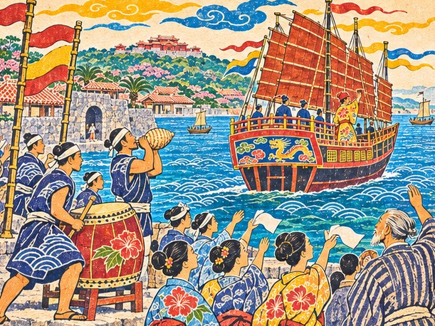
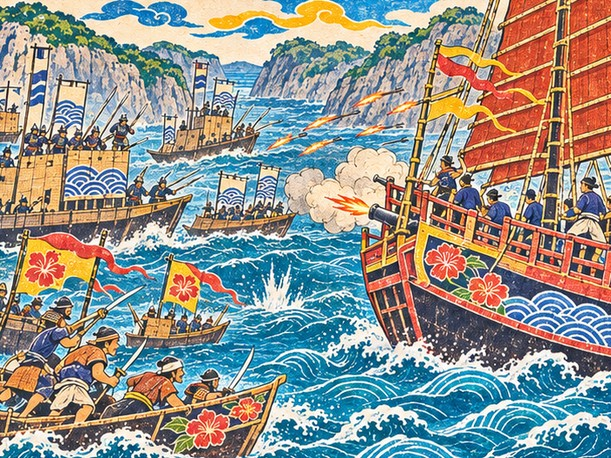
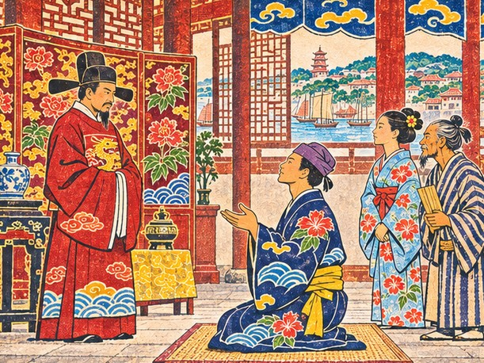

## 44. 만국호

1527년 봄, 슈리 왕부.

상복을 벗은 지 얼마 되지 않은 대신들이 어전 좌우에 늘어서 있었다. 그 가운데로 붉은 띠를 맨 다루가 걸어 나가 엎드렸다. 지난겨울 내내 그는 왕부가 맡긴 일을 하나씩 끝내며 보냈다. 나하와 천주를 오가는 짐을 나르고, 밀린 문서를 맞추고, 섬과 섬 사이 바닷길의 사정을 적어 올렸다. 일 하나하나는 작았다. 그러나 작은 일이 쌓이자 왕부의 문서고에는 다루의 이름이 적힌 끝난 일들이 두툼하게 모였다. 대사절은 그만큼 쌓은 사람에게만 맡길 수 있는 일이었다.

"조선, 일본, 시암, 명." 새 왕이 말했다. "한 항차로 국서를 모두 전하라."

부산포 관아, 사카이 회합소, 아유타야 왕부 관청, 천주 시박사. 네 나라, 네 관청, 네 통의 국서였다. 예물은 견직물 마흔, 은 스물, 유황 마흔. 시종이 그 목록을 읽는 동안 다루는 머릿속으로 바닷길을 그었다. 북으로 올라갔다가 남으로 내려가고, 다시 북으로. 동중국해를 한 번 휘감는 길이었다.

"선왕께서는 다리를 지키라 하셨다." 새 왕이 옥좌 팔걸이를 가만히 쥐었다. "나는 그 다리를 만국에 보이고 싶다."

"국서 넷에 류큐의 이름을 걸겠습니다. 그 이름에 부끄럽지 않게 다녀오겠습니다."

"대사절선은 왕부가 반을 대마. 나머지 반은 정사가 채워야 한다." 새 왕은 잠시 말을 멈추었다가 덧붙였다. "선왕께서는 마지막에 그대 이름을 부르셨다. 나도 그 이름을 믿어 보려 한다."

물러나는 길, 슈리의 돌담 너머로 나하 항구가 내려다보였다. 바다 위에 작은 돛들이 하얗게 떠 있었다. 빌린 관복을 입고 저 항구에서 처음 진공선에 오르던 봄이 벌써 네 해 전이었다. 그때 그의 허리에 매인 것은 띠 하나뿐이었다.

나하 조선소의 주인은 도면을 펴 놓고 손가락으로 값을 짚었다.

"왕부 몫 말고도 금화 만 냥이 더 드오."

"만 냥이야, 오빠." 가마가 장부를 넘기며 말했다. 그 목소리에는 놀람보다 이미 셈이 끝났다는 기색이 먼저 묻어 있었다. 겨우내 왕부의 일을 돌며 모은 돈이 거기 다 적혀 있었다. 다루는 금화를 마지막 한 닢까지 내놓았다.

봄이 끝나 갈 무렵, 나하 조선소 비탈에 새 정크가 섰다. 뱃머리에는 류큐 왕부의 깃발이 걸렸다.

"선체는 명의 정크를 따랐고, 키와 닻은 나하 목수들이 깎았소." 조선소 주인이 뱃전을 쓰다듬었다. "어느 한 나라의 배라 하기 어렵지. 그래서 이름을 만국호라 했소. 이름값을 하는 배가 될 거요."

마쓰 할배가 뱃전을 손바닥으로 두드렸다. 단단한 소리가 났다.

"소리가 좋구려. 이 늙은이 마지막 배로 모자람이 없소."

"배 값 만 냥, 장부에 적었어." 가마가 붓을 내려놓았다. "오빠 녹봉이 한동안 바닷물에 잠기겠네."

"이름값을 해야 하는 건 배가 아니라 저희겠지요."

목수들이 뱃머리에 새 이름을 새겼다. 끌 자국이 마르기도 전에 가마가 다가가 그 획을 손가락으로 하나하나 짚어 보았다. 위로, 옆으로, 아래로. 끝까지 짚고 나서야 손을 뗐다.

"끊긴 획은 없네. 우리 배 이름까지 누가 훔쳐 가면 안 되잖아."

다루는 웃지 않았다. 천주 시장에서 처음 본 가짜 증서, 그 인장의 획 하나가 끊겨 있던 것을 그도 기억했다. 류큐라는 이름을 훔쳐 간 사람들이 있었다. 그 이름을 되찾으러 다닌 네 해였다.

예물은 나하 교역소에서 마저 채웠다. 견직물은 지난 항차들에서 모아 둔 것으로 모자라지 않았고, 은은 나가사키에서 사 온 것이 스무 상자 있었다. 유황은 나하에서만 나는 물건이었다. 섬의 북쪽 화산에서 캐 온 노란 덩어리가 마흔 자루, 교역소 마당에 쌓였다. 명의 황제가 류큐에서 받는 조공품이 바로 이것이었다.

"예물 다 실었어. 장부에 하나하나 적어 뒀어."

"짐이 틀리면 문서도 거짓이 된다." 채문경이 말했다. "정사님께 처음 들은 말입니다. 이번엔 제가 두 번 셌습니다."

"문경이 두 번, 가마가 세 번 셌으니 틀릴 리가 없겠군요."

"네 번이야." 가마가 장부를 덮었다. "오빠가 잠든 사이에 한 번 더 셌거든."

## 45. 손목의 머리카락

출항 전야, 나하 여관의 등불 아래 사절단이 둘러앉았다. 내일이면 만국호가 북으로 돛을 올린다.

채문경이 국서 넷을 상 위에 나란히 펼쳤다. 조선에 보낼 것, 일본 회합에 보낼 것, 시암 왕부에 보낼 것, 명에 보낼 것. 연호도, 칭호도, 머리 숙이는 글귀도 저마다 달랐다.

"연호와 칭호를 다시 맞춰 봤습니다. 이번엔 누구도 가짜라 하지 못할 겁니다."

"문경이 처음 배에 올랐을 때는 제가 짐 세는 것도 못마땅해했지요."

채문경이 웃었다. 네 해 전이었다면 보기 어려웠을 웃음이었다.

"그때는 외교가 문서인 줄만 알았습니다. 이제는 문서 뒤에 선 사람이 외교라는 걸 압니다."

"남쪽 바람은 내가 볼게요." 쁘라이가 말했다. "아유타야에 가면 우리 집 사람들이 마중 나올 거예요. 술집 소문도 다 들어 둘게요. 오노가 어느 바다에 숨었든 누군가는 꼭 떠들거든요."

"쁘라이가 없었다면 거짓 소문을 따라 남쪽 바다를 헤맸을 겁니다."

가마가 상 한쪽에 다른 장부 하나를 올려놓았다. 겉장이 닳은 장부였다. 만국 장부. 류큐와 약속을 맺은 나라와 상인의 이름을 적는 장부였다. 명, 시암, 조선, 하카타, 사카이. 그리고 남쪽 바다에서 맺은 대월과 자바와 포르투갈. 여덟 칸이 모두 이름으로 차 있었다.

"처음엔 빈칸뿐이었는데." 가마가 겉장을 쓸었다. "이번 항차는 이 장부를 들고 다니는 거야. 우리가 약속을 지키러 다시 왔다는 걸 보이러."

마쓰 할배가 잔을 비웠다.

"이 늙은이도 끝까지 키를 잡겠소. 마지막 항해니 멋지게 가 봅시다."

"할배. 이번 항해가 끝나면 정말 뭍에 내리십니까?"

"바람이 그만하라는구려." 할배는 등불을 보며 말했다. "말라카 앞바다를 처음 건널 때 나도 선장 나이였지. 끝을 이렇게 좋은 배에서 맞으니 복이오. 아는 바람 길은 하나도 안 버리고 다 넘겨주지."

모두 방으로 돌아간 뒤, 가마가 오빠 곁에 남았다.

"오빠, 처음 배에 오를 때 짐에 묶었던 머리카락 기억나?"

"기억하지. 그런 풍습은……" 다루는 그때도 그렇게 말을 꺼냈다가 끝내지 못했었다. 이번에도 끝을 맺지 못했다.

"짐은 바다에 던지면 그만이잖아. 이번엔 놓치기 싫어."

가마가 오빠의 손을 끌어당겼다. 그리고 소매를 걷어 손목에 머리카락 한 올을 감았다. 두 번 감고 작게 매듭을 지었다. 손끝이 조금 떨렸다.

"이번엔 짐 말고 오빠한테 묶었어."

"……고맙다, 가마."

"풀면 안 돼. 집에 돌아오면 내가 풀어 줄 거야."

"그래. 돌아와서 네 손으로 풀어 다오. 약속하마."

다루는 손목의 머리카락을 소매 속에 감추었다. 국서 넷이 나라의 약속이라면, 이것은 집안의 약속이었다. 어느 쪽도 어길 수 없었다.

## 46. 다시 찾아온 사절

나하의 산이 수평선 아래로 가라앉았다. 만국호는 쿠로시오를 타고 북으로 나아갔다.

검푸른 물길은 배를 밀어 주는 손 같았다. 닷새째가 되도록 돛을 크게 고쳐 달 일이 없었다.

"물길이 북으로 흐르니 거스를 일이 없구려." 마쓰 할배가 키를 느슨하게 쥐고 말했다. "오늘은 바람이 키를 잡아 주는 날이오."

가마가 갑판에 장부를 폈다. "부산포 비단 스물, 사카이 은 스물, 아유타야 비단 스물, 천주 유황 마흔. 한 짐도 안 틀렸어."

채문경은 국서 통을 무릎에 올려놓은 채 뱃전에 기대 있었다. 바다에서도 그것을 손에서 놓지 못했다. "이게 젖으면 류큐가 젖는 것 같아서요."

"부산포는 류큐 사절을 믿지 않던 곳이야." 다루가 북쪽 수평선을 보며 말했다. "오십 년 동안 류큐의 이름으로 온 사절이 모두 가짜였으니까. 이번엔 다시 찾아온 사절로 서야 해."

"그때 관리는 국서를 뒤집어 보기만 했잖아." 가마가 말했다. "이번엔 앞면부터 읽게 해 줘, 오빠."

밤이 되자 북쪽 하늘에 낯선 별자리가 떠올랐다. 남쪽 바다만 알던 선원들이 뱃전에 기대 오래 올려다보았다.

부산포 관아에는 두 해 전 류큐의 국서를 몇 번이고 뒤집어 보던 그 관리가 오늘도 앉아 있었다. 그는 다루를 알아보았다. 알아보고도 표정을 바꾸지 않았다.

비단 스무 필이 관아 마루에 올려졌다.

"류큐 국왕의 국서입니다. 새 왕께서 즉위하신 뒤 처음 보내시는 글입니다."

채문경이 곁에서 낮게 말했다. "연호와 인장은 세 번 맞췄습니다. 끊긴 획 하나 없습니다."

관리는 국서를 펴기 전에 인장부터 등불에 비춰 보았다. 등잔의 불빛이 붉은 인주를 뚫고 종이 뒤로 번졌다. 한참을 그렇게 보던 눈이 천천히 글자로 옮겨 갔다. 관아 안이 조용했다. 붓 끝이 종이를 스치는 소리만 났다.

이윽고 관리가 고개를 들었다.

"진짜 류큐 사절이 다시 왔구려." 그의 입가가 처음으로 조금 풀렸다. "전하께서 답서와 답례를 내리셨소. 오래 끊겼던 길이오."

"끊겼던 길을 다시 잇는 데 오십 년이 걸렸습니다. 이번에는 끊기지 않게 하겠습니다."

"그 말을 장부에 적어 두겠소. 다만 요즘 대마도 쪽 바다가 어수선하오. 돌아가는 길을 살피시오."

관아를 나서며 채문경이 답서를 두 손으로 받쳐 들었다.

"가짜 사절 앞이 아니라 류큐 왕부 앞으로 쓴 답서입니다. 받는 이름이 똑바로 적혀 있습니다."

"긴조 정사님이 보셨다면 뭐라 하셨을까요."

"증거와 약속이 함께 갔다고 하셨겠지요. 그분이 늘 하시던 말씀대로."

부두에는 윤해강이 나와 있었다. 조선 수군의 무관은 두 해 전과 다름없이 곧게 서 있었다.

"진짜 사절은 다시 오는 사람이더군. 가는 길 무사하시오."

"해강 공 덕분에 처음 관아 문을 두드릴 수 있었습니다. 늘 고마웠습니다."

"나는 문 앞까지 데려다주었을 뿐이오. 문을 연 건 그대가 들고 온 증거와 약속이지." 해강이 남쪽 바다를 턱짓했다. "대마도 앞은 물살도 사람도 거칠소. 섬 그늘에 너무 붙지 말고 지나가시오."

만국호가 부두를 떠났다. 돌아보니 해강은 배가 작아질 때까지 그 자리에 서 있었다.

대마도 앞바다에서 소식이 먼저 닿았다. 지나가는 고깃배의 사공이 소리쳐 알려 주었다. 조선 관아에 넘겨졌던 오노가 옥을 깨고 달아나 왜구와 손을 잡았다는 것이었다.

소식이 끝나기도 전에 수평선에 돛이 셋 솟았다. 왜구의 관선이었다.

"오노는 없어도 그 졸개들이구려." 마쓰 할배가 눈을 가늘게 떴다. "길을 막을 셈이오."

"오빠, 국서 상자는 선실 깊이 넣어 뒀어. 배가 기울어도 안 젖게."

"사카이 술집에서 들은 소문 그대로예요." 쁘라이가 말했다. "대마도에서 배를 모은다던 그 말이요."

다가오는 배의 뱃머리에서 왜구 두목이 외쳤다. "오노 나리가 류큐 배를 놓치지 말라 하셨지!"

"오노가 없는 자리에서도 오노의 말이 바다를 막는군요." 다루가 돌아섰다. "포문을 여십시오. 다만 멀리 쫓지는 맙시다. 우리 일은 사카이에 닿는 것입니다."

포성이 물 위를 굴렀다. 반 시진 남짓 뒤, 연기 사이로 관선들이 흩어지기 시작했다.

"흩어진 배들이 남쪽으로 가요." 쁘라이가 뱃전에 매달려 보았다. "오노한테 우리 소식을 전하러 가는 거예요."

"그럼 오노도 우리가 어디로 가는지 알겠군요. 숨지 않고 가겠습니다."

갑판에 박힌 화살을 뽑으며 선원들이 그제야 웃었다. 북쪽 바다의 첫 고비를 넘긴 것이다.

"젊은 녀석들, 손은 떨려도 키는 안 놓았구려." 할배가 말했다. "그거면 뱃사람이오."

## 47. 두 개의 도장

사카이는 해자로 둘러싸인 도시였다. 칼보다 장부가 먼저 오가는 곳이었다.

상인 회합소 마루에 하카타와 사카이의 상인들이 한데 모였다. 은 스무 상자가 그들 앞에 놓였다. 시마이 요헤에가 류큐의 국서를 회합에 전했다.

"하카타든 사카이든, 이제 류큐 이름을 함부로 쓰지는 못할 거요." 시마이가 말했다. "오노 같은 자 때문에 일본 상인이 다 위조꾼으로 보였지. 정직하게 장사하는 우리도 손해였소."

"이름을 쓰는 사람이 약속도 지키게 된다면, 그걸로 됐습니다."

시마이가 웃었다. "값은 여전히 짜게 부를 거요. 그래도 증서는 진짜로만 쓰겠소."

채문경이 회합의 답서를 받아 왔다. 류큐의 인장과 회합의 도장이 나란히 찍혀 있었다. 다루는 그 두 도장을 오래 바라보았다. 오노는 류큐의 인장을 훔쳐 제 증서에 찍었다. 지금 이 종이에는 두 이름이 제 손으로 나란히 찍혀 있었다. 위조가 아니라 약속으로.

회합소를 나서는 다루를 시마이가 불러 세웠다.

"하나 알려 두지. 오노의 사람이 남쪽으로 철포를 실어 갔다는 말이 있소. 대만 쪽 바다를 조심하시오."

"알려 주셔서 고맙습니다. 그것이 시마이 님이 약속을 지키는 방식이군요."

시마이는 어깨를 으쓱했다. "이건 공짜요. 대신 다음 거래 때 값을 깎으려 들지만 마시오."

남쪽으로, 엿새째. 쁘라이가 고물에 서서 바람을 읽었다.

"이 바람이면 곧 시암만이에요. 집 냄새가 벌써 나는 것 같아요."

"말라카가 무너진 뒤에도 시암 길은 살아 있구려." 마쓰 할배가 말했다. "이 늙은이가 키를 잡는 마지막 남쪽 바다요."

"할배가 넘겨주신 해도가 있으니 길을 잃지 않겠습니다. 이 바다는 오래 류큐 배를 기억할 겁니다."

밤이면 쁘라이가 고물에 앉아 시암 노래를 흥얼거렸다. 가사를 몰라도 선원들이 손바닥으로 박자를 맞췄다.

"쁘라이, 그 노래 무슨 뜻이야?" 가마가 물었다.

"배가 돌아오면 강가에 등불을 띄운다는 노래예요. 이번엔 내가 돌아가는 쪽이네요."

채문경이 국서 하나를 펴 보였다. "시암 국서는 시암 말 인사로 시작하도록 고쳐 두었습니다. 쁘라이에게 발음을 배웠지요."

"문경 님 발음은 아직 반쯤 명나라 말 같아요." 쁘라이가 웃었다. "그래도 다들 알아는 들을 거예요."

아유타야의 강가에는 여러 나라 배가 줄지어 서 있었다. 시암 말과 명의 말, 남쪽 섬들의 말이 부두에서 뒤섞였다. 왕부 관청에서 시암 관리가 류큐의 국서를 두 손으로 받았다. 비단 스무 필이 그 앞에 쌓였다.

"류큐가 약속대로 다시 왔구려. 시암의 문은 류큐에 늘 열려 있소."

"말라카 길이 끊긴 뒤로 시암과의 약속이 류큐의 남쪽 바다를 지켜 주었습니다."

"약속을 지킨 건 류큐 쪽이오." 관리가 고개를 저었다. "빚을 갚으러 다시 온 사절을 시암은 잊지 않소."

관청을 나서자 부두에서 누군가 손을 흔들었다. 쁘라이의 가족들이었다.

"봐요, 우리 집 사람들이에요. 빚을 갚아 준 류큐 정사님이라고 다들 알아요."

"쁘라이, 이대로 집에 남아도 괜찮습니다."

"아니요, 끝까지 갈 거예요. 천주까지 가야 내 소문 장부도 끝이 나죠."

쁘라이의 어머니가 다가와 다루의 손을 잡았다. 그리고 시암 말로 무언가를 오래 말했다. 다루는 알아듣지 못했다. 쁘라이는 웃기만 하고 옮겨 주지 않았다.

마쓰 할배는 강 위쪽의 탑을 바라보고 있었다. "이 강을 처음 거슬러 올랐을 때도 저 탑이 있었소. 늙은이만 늙었구려."

"다음에 이 강에 오는 류큐 배는 할배의 해도를 들고 올 겁니다."

배에 오르며 쁘라이가 말했다. "엄마가 정사님한테 날 잘 부탁한대요. 내가 정사님을 부탁해야 하는데."

## 48. 펑후의 그늘

북으로, 천주를 향해. 만국호가 대만 해협에 들어섰다.

바람이 잦아들고 바다 빛이 짙어졌다. 멀리 섬 그림자들이 낮게 엎드려 있었다. 선원들의 말수가 줄었다. 사카이에서 들은 철포 이야기를 모두가 알고 있었다.

가마가 오빠의 손목을 보았다. "아직 그대로네. 오늘은 꼭 쥐고 있어."

"풀릴 일 없어. 네가 묶었잖아."

채문경이 국서 통을 끌어안은 채 물었다. "천주에 닿으면 마지막 국서입니다. 정사님, 무슨 말씀을 하실지 정하셨습니까?"

"아직입니다. 의전대로 할지, 약속을 말할지." 다루는 북쪽 바다를 보았다. "이 바다를 건너면서 정하겠습니다."

슈리의 깊은 방에서 우에하라 친방이 한 말이 있었다. 대만 해협 북쪽, 펑후 섬 그늘. 오노는 거기서 대사절선을 노릴 것이라고. 관직을 내려놓으며 친방이 남긴 마지막 말이었다. 그 말을 믿을지 말지를 두고 다루는 쁘라이의 귀와 할배의 눈을 함께 믿기로 했었다. 쁘라이는 남쪽 항구마다 펑후 쪽 소문을 들었다고 했다. 마쓰 할배는 물길을 보고, 섬 그늘에 배를 숨기기 좋은 자리를 짚었다.

만국호는 펑후의 그늘에 바로 다가가지 않았다. 할배가 키를 크게 꺾어 섬 바깥쪽 물길로 돌았다. 한나절을 더 쓰는 길이었다.

해 질 녘, 섬 그늘에서 돛이 솟았다. 하나, 둘, 셋…… 안택선과 관선과 정크가 뒤섞인 함대였다. 그러나 그들은 엉뚱한 쪽을 막고 있었다. 만국호가 지나리라 여긴 섬 안쪽 물길이었다. 부랴부랴 돛을 고쳐 다는 배들 가운데 한 척이 얕은 물에 걸려 따라 나오지 못했다.

"친방 말대로 펑후 그늘에 매복이 있었소." 할배가 말했다. "미리 돌아서 피했으니 한 척은 따돌렸구려."

"친방은 마지막에 류큐 편에 섰군요." 다루가 낮게 말했다. "그 말을 믿은 값이 오늘의 한 척입니다."

"그래도 남은 배가 많습니다." 채문경이 말했다. "정사님, 지휘를."

적의 기함 뱃머리에 한 사내가 섰다. 오노 소에몬이었다. 조선의 옥을 깨고 나온 지 몇 달, 그는 하카타와 대마도와 남쪽 바다에서 배와 사람을 그러모아 이곳에 왔다. 그의 뱃전에 철포가 줄지어 걸려 있었다.

"말라카의 포르투갈 놈에게 산 철포다!" 오노가 외쳤다. "다리든 사절이든 오늘 바다에 가라앉혀 주마!"

다루는 말라카 부두의 마누엘 드 소자를 떠올렸다. 철포를 누구에게 파느냐고 묻자 그는 웃으며 말했었다. 돈을 내는 사람에게. 그 대답이 지금 총구가 되어 이쪽을 보고 있었다.

"류큐의 이름은 쓰는 사람의 것이라 했지요." 다루가 소리쳐 답했다. "오늘 그 이름을 지키는 사람이 누군지 보여 드리겠습니다!"

"철포 소리가 요란해도 바람은 우리 편이오!" 할배가 키를 움켜쥐었다. "키는 이 늙은이가 잡겠소!"

가마가 오빠의 손목을 꼭 쥐었다. "국서 셋은 전했어. 마지막 하나는 오빠가 직접 들고 가야 해."

철포 소리가 해협을 찢었다. 만국호는 바람 위를 잡고 섞인 함대 사이로 파고들었다. 발이 맞지 않는 배들이 하나씩 떨어져 나갔다. 해가 다 지기 전, 오노의 기함이 불길에 휩싸였다. 연합 함대가 흩어졌다.

포연이 걷히자 부서진 돛과 나무 조각만 떠다녔다. 만국호의 뱃전에도 철포 자국이 박혀 있었다.

가마가 오빠의 손목을 다시 잡았다. "다친 데 없지? ……머리카락도 그대로네."

"네가 지켜 준 덕이다. 이제 천주로 가자."

선원들이 물에 빠진 적선 사람들을 건져 올렸다. 다루는 그들을 묶되 손대지는 말라고 일렀다.

"건진 사람들 말이 제각각이에요." 쁘라이가 말했다. "하카타 말, 명 말, 남쪽 말. 오노가 바다에서 사람을 끌어모았나 봐요."

"나라를 가리지 않고 모인 무리군요. 그러니 어느 한 나라를 탓할 일도 아닙니다."

마쓰 할배가 키에서 손을 뗐다. 그리고 제 손을 내려다보았다.

"……이걸로 이 늙은이 마지막 싸움이오. 손이 아직도 떨리는구려."

## 49. 약속을 말한 사절

천주 시박사 관청 마당에 여러 나라 상인들이 줄지어 서 있었다. 명의 상인, 남쪽 섬들의 상인, 머리를 동여맨 시암 사람들. 류큐 사절단의 차례가 오자 관리들이 일제히 고개를 들었다.

"그 왜구 함대를 깨뜨린 배가 류큐 배라고?" 문간의 관리가 옆 사람에게 수군거렸다. "동쪽 배가 다 같은 건 아니었구려."

채문경이 낮게 말했다. "처음 이 관청에 섰을 때는 동쪽 배라고 칼부터 내놓으라 했지요."

"그날은 긴조 정사님을 대신해 섰습니다. 오늘은 류큐를 대신해 섭니다."

네 해 전 바로 이 도시에서, 긴조는 열에 들뜬 손으로 다루의 소매를 붙잡았었다. 그때 들은 말이 지금 다시 귀에 울렸다. 의전은 상대를 위한 것이 아니다. 약속을 위한 것이다.

유황 마흔 자루가 관청 마루에 놓였다. 나하에서 캐 온 노란 덩어리였다. 왕 제거가 그것을 내려다보고, 다루를 보았다. 영파의 난 뒤로 모든 동쪽 사절을 의심하던 눈이었다. 그러나 그 눈은 공정했다. 다루는 그것을 네 해 동안 배웠다.

"왜구를 깨뜨린 류큐의 정사. 황제께 무엇을 청하겠소?"

채문경이 곁에서 낮게 말했다. "무엇을 고르시든, 저는 한 글자도 바꾸지 않고 옮기겠습니다."

의전대로라면 여기서 엎드려 정해진 글귀를 읽어야 했다. 다루는 그 글귀를 다 외우고 있었다. 지난밤에도 몇 번이나 되뇌었다. 그러나 그는 엎드리지 않았다.

"의전대로라면 여기서 엎드려야 합니다. 하지만 오늘은 약속을 말씀드리겠습니다." 다루가 말했다. "류큐는 어느 나라의 등도 되지 않고, 모든 나라의 다리가 되겠습니다."

관청 안이 조용해졌다. 엎드리지 않은 사절을 누구도 꾸짖지 않았다. 채문경의 목소리가 그 말을 명의 말로 옮겼다. 떨리는 목소리였지만, 한 글자도 빠지지 않았다.

왕 제거가 오래 다루를 바라보았다.

"……황제께 그 말을 그대로 전하겠소. 류큐의 배는 언제든 천주에 들어오시오."

관청을 나서는 다루에게 왕 제거가 한마디를 더 건넸다.

"영파 이후로 진짜라고 말하는 사절은 많았소. 약속을 말한 사절은 그대가 처음이오."

마당으로 나오자 가마가 장부를 덮으며 달려왔다.

"유황 마흔까지 다 넘겼어. 국서 넷이 다 닿았어, 오빠."

"그래. 이제 집으로 갈 일만 남았구나."

그날 저녁, 조선 관아에서 넘어온 전갈이 천주에 닿았다. 해협 싸움 뒤 달아나던 오노가 붙잡혀 조선으로 다시 압송된다는 것이었다. 압송선은 이튿날 아침 천주 부두를 떠날 참이었다.

다루는 그 부두로 나갔다. 쇠사슬 소리가 물소리에 섞였다.

오노는 쇠사슬을 찬 채 배다리 앞에 서 있었다. 하카타의 비단옷은 간데없고, 소금기에 전 홑옷 차림이었다. 그는 다루를 보자 웃었다. 부산포 관아에서 끌려 나가던 날과 같은 웃음이었다.

"류큐라는 이름은 누구 것이냐." 오노가 말했다. "오십 년 동안 하카타도 대마도도 그 이름을 썼다. 나만 탓하지 마라."

"탓하러 온 게 아닙니다. 그 질문에 답하러 왔습니다." 다루가 말했다. "약속을 지키는 사람의 것입니다. 당신이 아니라."

오노가 코웃음을 쳤다. "약속이라. 큰 나라가 마음먹으면 그 약속도 종잇장이다. 너도 알 텐데."

"압니다. 그래서 붙드는 사람이 있어야 합니다. 붙든 손이 있는 동안 약속은 종이가 아닙니다."

오노는 오래 말이 없었다. 바닷바람이 그의 헝클어진 머리를 흔들었다.

"……그 이름, 내 손에선 돈이 되더니 네 손에선 무거워 보이는군."

오노는 더 묻지 않았다. 다루도 더 답하지 않았다. 관아의 병사가 쇠사슬을 당겼고, 오노는 배다리를 올라갔다. 한 번도 돌아보지 않았다.

"오빠, 저 사람한테 화 안 났어?" 가마가 물었다.

"났지. 하지만 화로는 다리를 못 놓아. 저 사람은 그걸 끝까지 몰랐던 거야."

그날 밤 다루는 항해 일지의 마지막 장에 오노의 물음과 자기 대답을 그대로 적었다.

만국호가 나하로 돌아왔다.

나하 부두에서 슈리까지, 사절단을 보려는 사람들이 길가에 늘어서 있었다. 아이들이 만국호의 뱃전에 박힌 철포 자국을 손가락으로 가리켰다. 누군가 다루의 붉은 띠를 보고 고개를 숙였고, 누군가는 가마의 이름을 불렀다.

어전에는 새 왕의 자리 아래 대신들이 늘어서 있었다. 우에하라 친방이 섰던 자리는 비어 있었다. 다루는 그 빈자리에 잠시 눈을 두었다가 새 왕 앞에 엎드렸다.

"만국의 국서가 모두 닿았다." 새 왕이 말했다. "정사, 이제 무엇을 하겠느냐."

"국서 넷이 모두 닿았고, 답을 가지고 돌아왔습니다. 쉬운 답도 무거운 답도 있었습니다."

"선왕께서 보셨다면 기뻐하셨을 것이다. 그대는 칼이 아니라 약속으로 바다를 건넜다." 새 왕이 답서 넷을 손수 받아 들었다. "그대가 가져온 답서들은 왕부 문서고에 넣어 두겠다. 뒤에 오는 사절들이 읽을 수 있도록."

어전을 물러난 뒤, 사절단은 회랑 끝 처마 아래 모였다. 저마다 갈 길을 말할 차례였다.

"이 늙은이는 이제 뭍에 내리겠소." 마쓰 할배가 먼저 말했다. "바람 길은 해도에 다 남겼소."

"할배가 아니었으면 첫 항해에서 배멀미로 쓰러졌을 겁니다."

할배가 웃었다. "쓰러지긴 했지. 일어나는 법을 금방 배웠을 뿐이오. 잘 있으시오, 선장."

"저는 정사님의 통사로 남겠습니다. 어디로 가시든." 채문경이 말했다. "구메촌 장로들도 이제는 정사님을 토박이 부사라 부르지 않습니다."

"문경이 장로들 앞에서 일어서 준 날을 잊지 않겠습니다."

"나는 아유타야와 나하를 오가는 배를 탈래요." 쁘라이가 말했다. "소문 장부는 계속 쓸게요. 시암 사람들한테 류큐 이야기를 할 거예요. 빚을 갚으러 다시 온 사람들 이야기요."

모두의 눈이 다루에게 향했다. 손목에는 아직 가마가 묶은 머리카락이 감겨 있었다.

"선장, 대답은 천천히 하시오." 할배가 말했다. "바람 길은 한번 정하면 돌리기 어렵소."

가마가 오빠를 올려다보았다.

"오빠는?"
