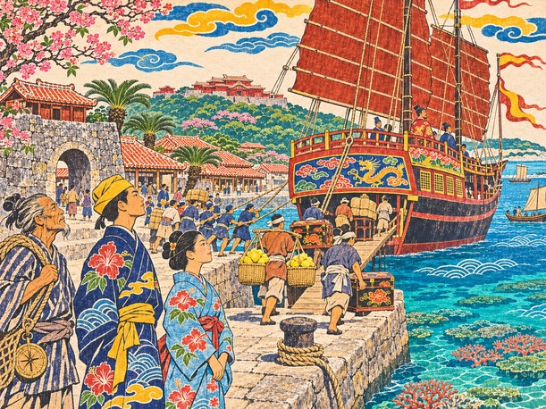

1523년 봄, 류큐 왕국 나하.

명과 조선, 일본과 시암. 큰 나라들 사이의 바다에 작은 섬나라 하나가 다리처럼 걸려 있었다. 다리는 제 힘으로 서지 않는다. 양쪽 기슭이 저를 믿어 주어야 선다. 섬사람들은 그것을 글로 배우지 않고 부두에서 배웠다.

그해 봄, 나하 항구에는 명나라로 떠날 진공선이 돛을 올리고 있었다. 부두에는 북쪽 섬에서 실어 온 누런 유황 짐과 남쪽 바다에서 건너온 소목 다발이 쌓였다. 짐꾼들이 멜대를 어깨에 걸고 노래를 불렀다. 노랫소리가 바닷바람에 섞여 돌담 너머까지 갔다.

구메촌 통사들은 붉은 칠을 한 국서 상자를 받들어 날랐다. 토박이 짐꾼들은 그 곁에서 유황 짐을 졌다. 같은 배에 오를 사람들이었지만 두 무리는 서로 말을 섞지 않았다. 한쪽은 한문으로 나라의 글을 짓는 사람들이었고, 다른 쪽은 그 글이 실려 갈 짐을 세는 사람들이었다.

다루는 그 가운데 서서 빌린 관복의 띠를 몇 번이나 고쳐 맸다. 스물셋. 갓 부사에 올라 이번 사절단에 이름을 얹었다. 아버지는 평생 이 부두에서 배와 짐을 세어 온 관리였다. 아버지가 세던 배를 이제 아들이 타고 나간다. 새벽에 어머니가 말없이 관복 소매를 꿰매 주었다. 바늘땀이 유난히 촘촘했다. 다루는 그 소매 끝을 자꾸 손끝으로 쓸었다.

배다리 아래로 짐꾼들이 줄지어 오르내렸다. 다루는 저도 모르게 짐을 세고 있었다. 유황 한 짐, 두 짐. 소목 한 다발. 어릴 때 아버지 곁에서 하던 그대로였다. 아버지는 짐을 세다가 틀리면 처음부터 다시 셌다. 한 짐이 모자라면 누군가 거짓말을 한 것이고, 한 짐이 남아도 누군가 거짓말을 한 것이라고 했다. 부두는 그런 곳이었다. 숫자가 맞아야 사람끼리 믿을 수 있었다.

"네가 다루로구나."

흰 수염의 노인이 그를 보고 있었다. 이번 사절단의 정사 긴조였다. 명에 여러 번 다녀왔다는 사람답게 걸음이 느긋했다.

"토박이 관리 집 아들이 부사라니, 구메촌 통사들이 수군대겠군."

"수군대는 말은 장부에 적지 않겠습니다. 적을 것은 조공품과 날짜뿐입니다."

긴조가 웃었다. "말은 반듯하구나. 바다는 반듯하지 않다만." 그는 부두 너머 먼바다를 한 번 보았다. "이번이 내 마지막 길이 될지도 모르겠구나."

"정사님께 배우라고 아버지께서 이르셨습니다. 무엇부터 익히면 되겠습니까?"

"기다리는 법부터. 명의 관청에서는 하루를 기다리고 반 시진을 말한다."

"반 시진을 말하려고 하루를 기다린다면, 말 한마디가 아주 무겁겠군요."

"그렇지. 그래서 사절은 말을 아낀다. 네가 말을 아끼는 아이라 들어서 내가 너를 골랐다."

진공선의 이름은 만년호였다. 뱃전의 칠은 바랬어도 용골은 곧은 정크였다. 배다리 끝에 등이 조금 굽은 노인이 팔짱을 끼고 서 있었다. 햇볕과 소금에 그을린 얼굴이 가죽 같았다.

"이 배의 화장 마쓰요. 시암까지 열 번을 넘게 다녀왔지. 부사 나리, 배멀미는 하시오?"

"……해 본 적이 없어서 모르겠습니다."

"그럼 곧 알게 되겠구먼." 마쓰가 뱃전을 손바닥으로 두드렸다. "만년호는 늙었어도 바닥이 단단한 배요. 나처럼 말이지."

노인은 껄껄 웃고 나서 손가락 셋을 차례로 접었다. 바다에서는 바람이 첫째, 물길이 둘째, 사람 고집은 맨 끝이라고 했다. 다루가 장부 첫 장에 적어 두겠다고 하자 노인은 고개를 저었다.

"적는 건 좋소만, 바다는 글을 안 읽소. 몸으로 외우시오."

돛대 끝에서 왕부의 깃발이 펄럭였다. 부두의 아이들이 손을 흔들며 뱃전을 따라 달렸다.

## 등잔 아래

출항 전날 밤. 다루의 집 선반에는 아버지의 장부가 해마다 한 권씩 꽂혀 있었다. 어느 해에 몇 척이 들고 났는지, 어느 배가 무엇을 몇 짐 실었는지. 다루는 열 살에 그 장부로 셈을 뗐다.

등잔 아래서 누이 가마가 오빠의 짐 보따리를 풀었다 묶었다 했다. 마당에서는 풀벌레가 울었다.

"오빠, 짐에 이걸 묶어 뒀어. 머리카락 한 올. 누이가 바다에 나가는 오라비를 지킨다잖아."

"가마, 그런 풍습은……"

"알아. 오빠는 장부에 적히는 것만 믿지. 그래도 이건 고모가 아버지께 해 드린 거야. 우리 집 일이라고." 가마는 매듭을 손끝으로 눌렀다. "고모는 아버지 배가 돌아올 때까지 날마다 그 머리카락을 생각했대. 기다리는 사람이 있으면 배는 돌아온다고."

"아버지는 그 이야기를 한 번도 안 하셨는데."

"말 안 하는 건 오빠랑 똑같지. 그러니까 내가 대신 말하는 거야."

다루는 풀지 않겠다고 했다. 가마는 고개를 끄덕이더니, 그 끄덕임 끝에 한마디를 붙였다. 저도 가겠다고. 오빠 혼자 장부 보다가 셈 틀리면 나라 망신이라고.

"안 된다. 진공선은 왕부의 배야. 구경 가는 길이 아니라고."

"작년에 오빠가 쌀 장부 맞추느라 사흘 밤 샌 거 잊었어? 그거 내가 반나절에 끝냈잖아."

"셈을 한다고?"

문가에 긴조가 서 있었다. 진상 목록을 전하러 들른 길이었다. 노인은 목록을 가마 앞에 내밀었다. "그럼 이 합을 대 보거라."

가마는 목록을 한 번 훑고 곧장 답했다. "유황 예순 짐, 사흘 치 물에 열흘 치 식량. 그리고 세 번째 줄은 두 번 더해져 있어요."

긴조가 목록을 들여다보았다. 한참 뒤에 그가 말했다. "……데려가라, 부사. 네 누이가 너보다 낫다."

"정사님, 누이는 아직 열아홉입니다. 바다에는……"

"나는 열여섯에 처음 명에 갔다. 나이는 셈을 대신하지 못한다." 긴조가 가마를 보았다. "다만 하나는 약속해라. 배 위에서는 오라비의 말이 아니라 부사의 말을 따른다고."

"약속할게요. 대신 장부가 틀리면 부사님이라도 따질 거예요."

긴조는 웃음을 참으며, 그건 자기도 바라는 바라고 했다.

노인이 돌아간 뒤 방 안이 한동안 조용했다. 가마가 먼저 입을 열었다.

"오빠, 화났어?"

"아니." 다루는 선반의 장부들을 보았다. 아버지가 서른 해 동안 센 배들. 그 배들 가운데 몇 척에는 누군가의 머리카락이 묶여 있었을 것이다. "그냥, 아버지 장부에 빠진 줄이 있었구나 싶어서."

"그 줄은 내가 적을게." 가마가 말했다. "오빠는 짐이나 세."

그날 밤 가마는 늦도록 등잔을 켜 두고 진상 목록을 처음부터 다시 셈했다. 다루는 짐 끈에 묶인 머리카락 한 올을 오래 보았다. 장부에는 적을 수 없는 것이었다. 그래도 거기 있었다.

같은 봄, 바다 건너 대륙의 항구 영파에서는 일본에서 온 두 사절단이 서로 제가 진짜라며 칼을 뽑을 참이었다. 그 일로 명의 문이 동쪽 바다를 향해 얼마나 좁아질지, 나하의 누구도 아직 알지 못했다.
