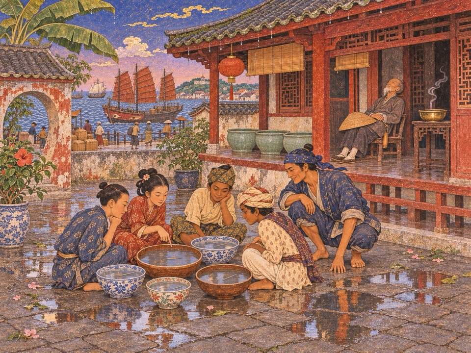
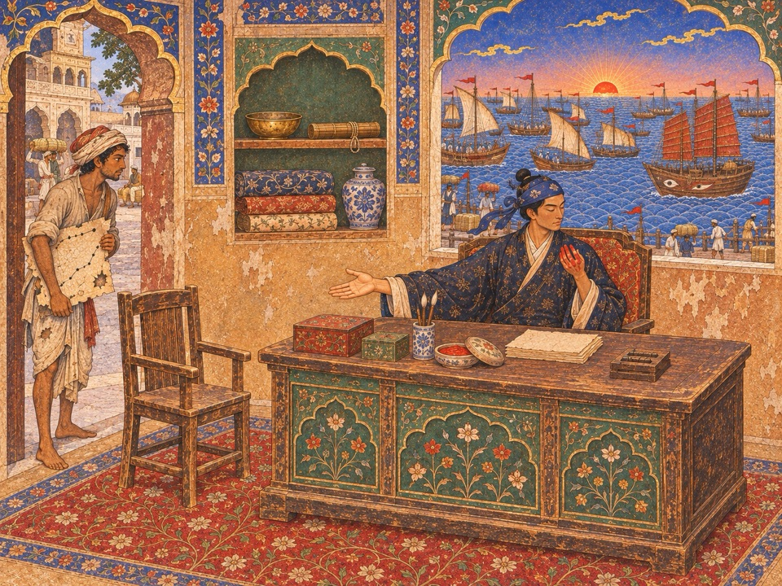
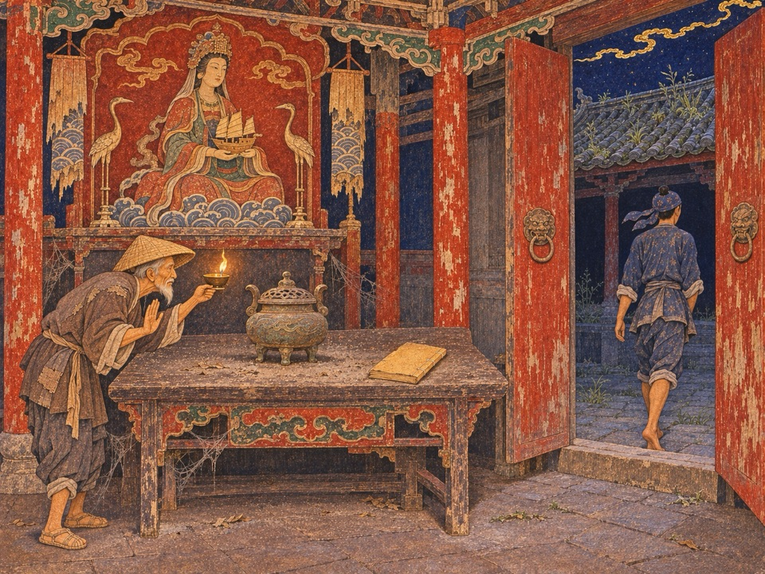

이 이야기에는 결말이 셋 있다.

## 결말 하나 ― 길을 여는 사람

차오는 말린디 부두의 햇살 아래서 붓을 다시 적셨다.

소보호 선창에서 꺼낸 새 종이 위였다. 차오는 다섯 빈칸이 모두 채워진 침로도를 갑판 상자 위에 펼쳐 놓고, 맑은 먹으로 선과 글자를 하나씩 옮겨 그렸다. 한문 글씨 옆에는 살마가 아랍 글자로 별 높이를 적었고, 데브지가 구자라트 숫자로 물때와 거리 수를 보탰다. 사흘 밤낮으로 베낀 사본이 여러 부 쌓였다.

"이건 다우에 실으시오." 차오가 첫 번째 묶음을 바카리에게 건넸다.

바카리는 수놓은 모자를 고쳐 쓰며 종이를 가슴에 대었다. 바카리의 다우 세 척은 그날 오후 킬와와 몸바사를 향해 남쪽으로 닻을 올렸다.

바람이 돌아서자 살마가 먼저 떠났다. 말린디에 매어 둔 아덴 상선에 오른 살마는 갑판 난간에서 카말의 매듭을 한 번 흔들어 보였다. 그녀의 품속에도 베낀 침로도 한 부가 들어 있었다. 아덴의 눈먼 아버지 유수프에게 읽어 주고, 나히다 호에 실을 종이였다.

이브라힘도 바람이 남서로 돌아선 뒤 큰 돛배 셋을 이끌고 캘리컷으로 돌아갔다. 뱃머리에 선 이브라힘은 사본을 붉은 천에 둘둘 말아 허리띠에 꽂은 채, 다시는 누구도 통행증 따위 사지 않게 하겠다고 소리치며 노를 저어 나갔다.

소보호는 바람이 남서로 돌아서는 늦봄을 기다려 닻을 올렸다. 짝이 다른 두 눈이 동쪽 바다를 향했다.

캘리컷에 닿자 데브지가 장부 궤짝과 사본 한 부를 안고 배에서 내렸다. 데브지는 캄베이로 올라가는 상선에 오르기 전, 차오에게 두 번 허리를 굽히고는 곧장 부두 시장으로 걸어 들어갔다.

실론 갈레의 풀숲에서는 타밀 노인이 여전히 낫을 들고 있었다. 차오가 세 글 비석 앞 받침돌 위에 사본 한 부를 내려놓자, 노인은 기름종이를 만져 보고는 묵묵히 고개를 끄덕였다.

몇 해가 지났다.

말라카 화인 마을 안쪽, 비가 그친 오후의 길잡이 집이었다. 처마 밑에는 뤄 영감 가게에서 가져온 큼직한 청자 대접이 줄지어 놓여 있었다. 뤄 영감의 외상 빚은 첫해 겨울에 두 배로 갚은 지 오래였다.

마루 한쪽 기둥에는 탄 노인이 낡은 삿갓을 무릎에 얹은 채 입을 반쯤 벌리고 졸고 있었다. 노인의 허리춤에는 이제 향 통 대신 붉은 빈랑 주머니가 차여 있었다.

마당 평상 위에는 열 살 안팎의 아이 넷이 둘러앉아 있었다. 화인 아이 둘과 말레이 아이 하나, 캄베이 상인 집에서 온 구자라트 아이 하나였다. 아이들 앞에는 물이 담긴 그릇 네 개가 놓여 있었다.

"가운데를 보지 말고, 물이 잔잔해질 때까지 기다려야지."

차오가 아이들 곁에 쪼그려 앉아 말했다. 소보호의 놋그릇은 마루 기둥 옆 탁자 위에 놓여 있었고, 아이들 앞에는 나무그릇과 사기그릇이 놓여 있었다. 아이 하나가 자석에 문지른 쇠바늘을 물 위에 조심스럽게 띄웠다. 바늘이 빙글 돌더니 남쪽을 향해 멈췄다.

아이 옆에 놓인 낡은 종이 책에는 세 가지 글씨로 적은 항해 기록과 다섯 곳의 침로가 적혀 있었다. 맨 앞장을 넘기던 구자라트 아이가 손가락으로 서투르게 한자를 짚으며 물었다.

"아저씨네 할아버지는 일곱 번 갔고 여덟 번째는 가지 못했다고 하셨다면서요."

차오가 대답하려는데, 바늘을 띄우던 작은 아이가 먼저 고개를 갸웃하며 종이 끝을 짚었다.

"여기 소보호가 말린디에 닿았다고 적혀 있잖아요. 그럼 여덟 번째도 간 거네요."

차오가 옅게 웃으며 아이의 머리를 한 번 쓸었다.

"그래. 갔지."

마루에서 졸던 탄 노인이 잠결에 헛기침을 한 번 했다. 놋그릇 속 바늘 끝이 오후 햇살을 받아 가늘게 반짝였다.

## 결말 둘 ― 길을 쥔 사람

차오는 말린디 부두의 햇살 아래서 침로도를 접어 침경에 끼웠다.

밀랍칠한 끈으로 단단히 동여매고, 두꺼운 기름종이에 다시 싸서 저고리 안쪽 주머니에 깊이 밀어 넣었다. 옆에 있던 데브지가 붓을 씻을 물통을 내밀었으나 차오는 고개를 저었다. 종이는 한 장도 더 베끼지 않았다.

"베끼지 않습니까." 데브지가 물었다.

"아직은." 차오가 품속을 여미며 답했다.

살마는 그 말을 듣고 아무 말 없이 카말의 끈을 목에 감았다. 바람이 남서로 돌아선 뒤, 살마는 아덴으로 돌아가는 상선에 올랐다. 아버지 유수프의 눈을 대신해 나히다 호를 몰고 홍해와 아라비아해를 오갈 길이었다.

바카리는 말린디 부두에서 상아와 천을 다우에 실으며 손을 흔들었고, 이브라힘 역시 바람이 돌아서자 큰 돛배 셋의 노를 정비해 캘리컷으로 떠났다. 그들은 저마다의 바다로 돌아갔고, 차오의 품속에 든 종이 이야기를 다시 꺼내지 않았다.

여름 바람이 서자 소보호는 데브지와 그의 장부 궤짝을 싣고 동쪽으로 뱃머리를 돌렸다. 말라카로 가는 대신, 배는 구자라트의 캄베이 항구에 닻을 내렸다.

몇 해가 지났다.

캄베이 항구 어귀에 이층짜리 흰 돌집이 서 있었다. 데브지와 차오가 함께 세운 상단이었다. 항구 안쪽 부두에는 같은 붉은 깃발을 단 배 스무 척이 줄지어 매여 있었다. 캘리컷의 후추, 호르무즈의 말, 아덴의 유향, 말린디의 상아가 모두 이 집의 장부를 거쳐 오갔다. 뤄 영감에게 졌던 빚은 상단을 세운 첫해에 어음으로 두 배로 갚았다.

부두 한쪽 끝에는 낡은 정크 한 척이 여전히 물 위에 떠 있었다. 짝이 다른 두 눈이 빛바랜 소보호였다. 이제는 짐을 싣지 않고 상단 사무소 앞바다를 지키는 배였다.

사무소 안쪽 벽 선반에는 캘리컷에서 구한 놋그릇과 탄 노인의 대나무 향 통이 나란히 놓여 있었다. 그릇 안은 바싹 말라 있었고, 향 통의 마개도 닫힌 지 오래였다. 차오는 창가 큰 나무 탁자 뒤에 앉아 구자라트 상인들이 보내온 항해 기록을 넘겼다. 붉은 밀랍 인장이 탁자 모서리에 놓여 있었다.

문밖에서 서기가 낮은 목소리로 알렸다.

"선주 어른, 호르무즈로 곧장 건너는 길을 묻겠다고 온 젊은 길잡이가 기다립니다."

"들어오라고 하시오."

문을 열고 들어온 사내는 스물 안팎의 구자라트 젊은이였다. 햇볕에 그을린 얼굴에 낡은 무명 저고리를 걸치고, 손에는 해진 바다 그림 한 장을 쥐고 있었다. 젊은이가 문턱에서 머뭇거리며 허리를 굽혔다.

차오는 서류에서 눈을 들었다.

"서 있지 말고 저 의자에 앉으시오."

차오가 손바닥을 펴 탁자 맞은편 빈 나무 의자를 가리켰다. 젊은이는 잠깐 망설이다 의자 끝에 조심스럽게 걸터앉았다.

"이번 겨울 바람에 처음 큰 바다로 나갑니다. 캘리컷에서 호르무즈로 곧장 건너는 물길과 날짜를 여쭈러 왔습니다. 소보호 선주께서 그 길을 아신다고 들었습니다."

차오는 대답 대신 탁자 서랍을 반쯤 열었다. 그 안에는 기름종이에 싼 침로도와 침경이 고이 들어 있었다. 차오는 서랍을 다시 천천히 닫았다.

차오는 젊은이의 마른 손가락을 보다가, 시선을 내려 자기 손을 바라보았다. 붉은 인주와 검은 먹물이 옅게 배어 있는 손바닥이었다.

## 결말 셋 ― 돌려보내는 사람

차오는 말린디 부두의 햇살 아래서 침경의 매듭을 다시 조였다.

새로 꿰매 붙인 열 장의 종이와 낡은 첫 장을 손끝으로 쓸었다. 세 가지 글이 적힌 「제8차」 장이 맨 안쪽에 접혀 들어갔다.

"어디로 가려는 거요?" 살마가 뱃머리에 선 차오에게 물었다.

"본래 있던 곳으로 돌려보내려 하오."

바카리는 말린디 부두에서 말린 고기와 식수 통을 소보호에 실어 주며 웃었다. 살마는 아덴으로, 이브라힘은 캘리컷으로 저마다의 돛을 올렸다. 데브지는 소보호를 타고 캄베이 앞바다까지 동행했다가, 장부 궤짝과 구자라트 사공 라자, 무사를 데리고 제 집으로 내렸다. 내리기 전 데브지는 말라카 뤄 영감에게 전할 은화 꾸러미를 차오의 손에 쥐여 주고, 캄베이 부두에서 새 사공 둘을 더 구해 태워 주었다.

말라카 사공 리우와 아밍, 새 사공 둘, 그리고 차오가 탄 소보호는 짝이 다른 두 눈을 앞세우고 동쪽으로 뱃머리를 돌려 말라카에 들러 뤄 영감에게 빚의 두 배가 되는 은화를 전한 뒤, 다시 북쪽으로 올라갔다.

몇 달 뒤, 밤바다가 칠흑처럼 어두운 천주 앞바다였다.

바다를 닫은 지 오래라 큰 정크가 항구 안으로 들어갈 수 없었다. 포구 어귀마다 순찰하는 관청 배들이 불을 밝히고 있었다. 차오는 소보호를 바깥 섬의 어두운 바위 그늘 뒤에 닻을 내리게 한 뒤, 혼자 작은 거룻배에 올랐다. 품속에는 기름종이에 싼 침경 한 권뿐이었다.

노를 젓는 소리조차 죽여 가며 포구 안쪽 개펄에 닿았을 때, 자정이 가까웠다. 차오는 젖은 짚신을 끌고 인적 없는 돌길을 걸어 천비궁 앞마당에 이르렀다.

백 년 전 큰 선단이 닻을 올리기 전마다 향을 피우던 사당이었다. 지붕 기와에는 잡초가 돋아 있었고, 문짝은 반쯤 열려 있었다.

차오가 문턱을 넘자 구석 평상에서 기침 소리가 났다. 허리가 굽은 늙은 사당지기가 작은 기름 등잔을 들고 나왔다. 노인은 등불을 들어 낯선 사내의 남색 두건과 손에 든 기름종이 꾸러미를 번갈아 비추었다.

차오가 기름종이를 풀고 침경을 내밀었다. 등불 아래로 낡은 실 매듭과 「침경」 두 글자가 드러났다.

사당지기의 손이 가늘게 떨리며 등잔이 흔들렸다. 노인이 한 걸음 뒤로 물러섰다.

"이걸…… 어디서 가져왔소."

"남쪽 바다에서 왔습니다. 옛 선단의 길잡이 집안에 남아 있던 책입니다. 이제 제자리에 두러 왔습니다."

사당지기가 고개를 세차게 저으며 두 손을 내저었다.

"가지고 가시오. 나는 받을 수 없소. 바다를 닫은 뒤로 이런 것을 가진 집은 불탔소. 관청에서 알면 나도 이 사당도 무사하지 못하오."

노인의 목소리가 어둠 속에서 갈라졌다. 차오는 더 말하지 않았다. 노인을 지나쳐 사당 안쪽으로 걸어 들어갔다.

먼지가 앉은 나무 제단 위에 놋향로 하나가 식어 있었다. 차오는 침경을 제단 한가운데 조심스럽게 올려놓았다. 등불 빛이 닿지 않는 어두운 천장 아래, 누런 표지가 희미하게 보였다.

차오는 고개를 한 번 숙인 뒤 몸을 돌려 사당 문밖으로 걸어 나왔다. 늙은 사당지기는 등잔을 든 채 붙잡지 않았다.

거룻배를 저어 바깥 섬 그늘로 돌아오자, 동쪽 하늘 끝이 아주 희미하게 풀리고 있었다. 차오는 소보호 갑판에 올라 허리춤의 향 통을 열어 새 향을 붙였다. 그리고 놋그릇에 남은 물 위에 바늘을 띄워 테두리의 남쪽 글자를 짚었다.

"리우 영감, 돛을 올리십시오."

대나무 살을 댄 붉은 갈색 돛 셋이 기지개를 켜듯 올라갔다. 소보호의 짝이 다른 두 눈이 남쪽 먼 바다를 향해 천천히 몸을 돌렸다.
