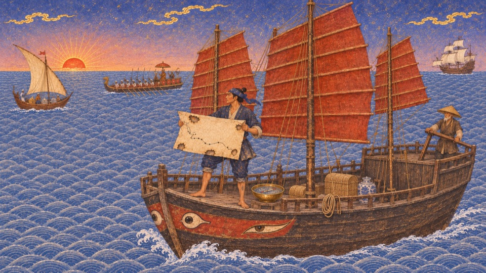

1522년 봄, 말라카의 젊은 길잡이 **린차오**는 할아버지에게서 옛 선단의 침로도를 물려받습니다. 침로도에는 불에 그을린 빈칸이 다섯 있고, 빈칸마다 두 글자가 적혀 있습니다. 우물에, 돌에, 바람에, 별에, 짐승에 물어라. 차오는 낡은 정크 **소보호**를 몰아 실론과 캘리컷, 호르무즈와 아덴을 거쳐 아프리카의 말린디까지 서쪽으로 갑니다.

통행증을 파는 감독관 **바스쿠 살레마**, 장부를 끌어안고 다니는 캄베이 상인 **데브지**, 캘리컷 수군의 **이브라힘**, 별을 재는 아덴의 길잡이 **살마**가 그 길에 있습니다. 인물과 사건은 지어낸 것이며 시대는 큰 틀만 따릅니다.

:::caution[줄거리 공개]
이 소설에는 처음부터 세 가지 결말까지 모든 줄거리가 들어 있습니다. 게임을 먼저 즐기고 싶다면 다 끝낸 뒤에 읽으세요.
:::

게임의 [인도양 외전](/side-story/voyage/)은 이 소설을 따라 만들었습니다. 다만 해전에 나서는 배의 수나 장면이 벌어지는 건물처럼 게임에 맞춰 바꾼 곳이 있고, 세 결말은 게임의 마지막 장면에서 직접 고릅니다.

## 차례

| 차례 | 내용 |
| --- | --- |
| [서장 ― 일곱 번의 돛](/novel/voyage/prologue/) | 함락의 밤에 묻은 책, 그을린 빈칸 다섯 |
| [1부 ― 우물에 물어라](/novel/voyage/part1/) | 통행증 값, 외상 도자기, 밤의 여울, 수부침 |
| [2부 ― 돌에 물어라](/novel/voyage/part2/) | 첫 큰 바다, 세 가지 글의 비석, 캘리컷의 이브라힘 |
| [3부 ― 바람에 물어라](/novel/voyage/part3/) | 의자와 값, 모래톱의 해전, 짝이 다른 눈, 스무닷새의 바다 |
| [4부 ― 별에 물어라](/novel/voyage/part4/) | 말 값, 반쪽 종이, 카말과 별, 향 통 |
| [5부 ― 짐승에 물어라](/novel/voyage/part5/) | 기린, 그릇 굽의 한 줄, 몸바사 앞바다, 제8차 |
| [결말 ― 여덟 번째 항해](/novel/voyage/endings/) | 길을 여는 사람, 길을 쥔 사람, 돌려보내는 사람 |
