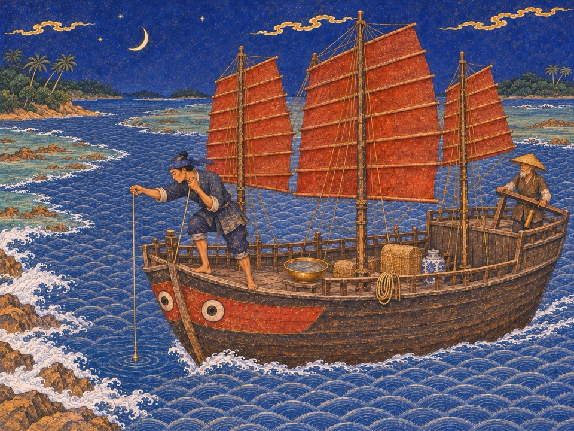
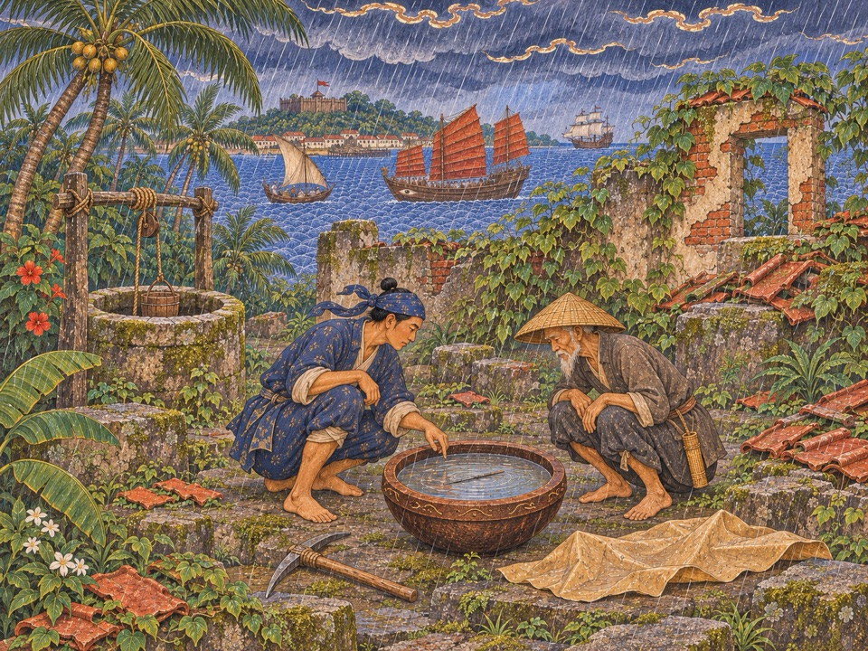

## 1. 소보호와 탄 노인

1522년 봄, 말라카 부두.

썩은 갯벌 내음과 말린 생선 비린내가 아침 안개에 섞여 코끝을 찔렀다. 할아버지의 무덤에 흙을 덮고 내려온 다음 날이었다.

린차오는 남색 두건을 고쳐 매고 낡은 나무 부두 위로 걸음을 옮겼다. 색 바랜 남색 저고리 품에는 기름종이에 싼 침경과 침로도가 들어 있었다. 걸을 때마다 종이 뭉치가 가슴뼈에 묵직하게 닿았다.

부두 끝에 정크 한 척이 매여 있었다. 소보호. 할아버지가 "작은 보선"이라 부르던 배였다. 대나무 살을 가로로 댄 붉은 갈색 돛이 셋 달려 있었는데, 가운데 돛에는 손바닥만 한 기운 자국이 두 군데 나 있었다. 뱃머리 양쪽에는 굵은 먹과 흰 회로 둥근 눈이 그려져 있었다. 바닷물에 씻겨 눈꼬리가 조금 번졌지만 두 눈은 여전히 서쪽 바다를 보고 있었다.

"늦었다, 꼬마야. 물때가 벌써 반이나 빠졌어."

갑판 위에서 쉰 목소리가 날아왔다. 예순여덟의 탄 노인이었다. 흰 수염이 성긴 마른 얼굴에 낡은 삿갓을 눌러쓰고, 회색 저고리 허리춤에는 대나무 향 통을 차고 있었다. 할아버지가 평생 믿고 키를 맡기던 조타수였다.

차오가 밧줄을 풀고 갑판에 오르자 뱃전이 삐걱거리며 기울었다. 갑판 위에는 밧줄을 감던 젊은 사공 하나와 돛줄을 만지는 늙은 사공 하나가 전부였다. 차오와 탄 노인까지 합쳐도 배를 몰 사람은 넷뿐이었다.

"선원이 이것뿐입니까."

"품삯 줄 돈이 어디 있냐. 밥만 먹여 달라는 놈들 둘 모은 것만도 다행이지." 탄 노인이 수염을 쓸며 투덜거렸다. "향도 다 떨어져 간다. 시장에 들러 두 묶음만 더 사 와야겠어. 물 위에서 경도 못 재고 다닐 셈이냐."

탄 노인이 허리춤에서 길쭉한 향 통을 뽑아 올렸다. 그 안에 든 향을 하나 피워 재가 한 마디씩 떨어질 때마다 뱃사람들은 한 경이 지났다고 헤아렸다. 밤바다에서는 해와 별이 숨어도 향 타는 냄새와 재의 길이로 시간을 쟀다.

"일단 배를 띄워야 합니다. 부두 사용료도 사흘 치가 밀렸어요."

"어디로 가려고."

차오는 부두 남쪽 끝, 돌로 쌓은 높은 성채 쪽을 바라보았다. 포르투갈 깃발이 바람에 펄럭이고, 그 아래 물가에는 대포를 실은 큰 배 두 척이 닻을 내리고 있었다.

"해협 밖으로 나가야 합니다."

탄 노인이 삿갓 아래로 눈을 가늘게 떴다.

"미쳤구나. 저 성채 아래서 내주는 종이 한 장 없이는 해협 입구도 못 지나간다. 통행증이 없으면 배째로 잡혀 들어가."

"그러니 통행증을 사러 가는 겁니다."

차오가 돈주머니를 만졌다. 안에 든 은전 몇 닢이 손끝에서 딸그락거렸다. 가벼웠다. 수리비를 대고 장례를 치르고 나니 남은 것이 거의 없었다.

탄 노인이 고개를 저으며 중얼거렸다.

"해협 밖 큰 바다는 구경도 못 한 놈이, 돈도 없으면서."

차오는 대답하지 않았다. 뱃머리 양쪽에 그려진 눈을 한 번 쓸어내렸다. 뭍에서 썩어 가는 배를 보기보다 종이 값부터 알아보는 편이 나았다.

## 2. 의자

포르투갈 요새 아래 통행증 사무소는 회반죽 벽이 차가웠다. 바깥의 후텁지근한 갯바람과 달리 안쪽은 눅눅한 돌 냄새와 잉크 냄새가 났다.

창가 큰 탁자 뒤에 마흔 줄에 접어든 사내가 앉아 있었다. 바스쿠 살레마였다. 잘 다듬은 검은 수염, 목까지 단추를 채운 검은 더블릿, 허리에 두른 붉은 띠. 말라카 해협을 오가는 배들의 통행증을 내주고 순찰 함대를 거느리는 감독관이었다.

차오가 문턱을 넘자 살레마가 서류에서 눈을 들었다.

"린 노인의 손자군요. 어서 오시오. 서 있지 말고 저 의자에 앉으시오."

살레마는 목소리가 낮고 부드러웠다. 방 안의 서기들이 고개를 숙이고 깃펜을 굴리는 소리만 들릴 만큼 조용한 말투였다. 그는 손바닥을 펴 맞은편 나무 의자를 가리켰다.

차오는 잠깐 망설이다 의자 끝에 걸터앉았다. 짚신이 차가운 돌바닥에 닿았다.

"배를 띄우려고 왔습니다. 수마트라 쪽과, 언젠가는 서쪽 바다로 나갈 통행증을 구하고 싶습니다."

살레마가 턱을 살짝 끄덕였다.

"성실하군. 정크 소보호라 했지요." 살레마가 서류 한 장을 끌어당겨 깃펜으로 숫자를 적었다. "대형 정크는 아니지만, 해협 밖 서쪽 바다까지 닿는 통행증이라면 이만큼이 듭니다."

살레마가 종이를 돌려 차오 쪽으로 밀었다.

차오는 종이 위의 숫자를 보고 숨을 멈췄다. 은화로 따져도 지금 허리춤에 찬 돈의 열 배였다. 할아버지 장례를 치르고 남은 은 조각을 다 털어도 반의 반도 안 되었다.

"너무 비쌉니다. 우리 배는 낡은 중형 정크입니다."

"규정이 그렇습니다." 살레마는 여전히 잔잔하게 웃었다. "먼 바다로 나가는 배는 순찰 함대의 보호를 받는 셈이니 값을 더 내야지요. 억지로 사라고는 하지 않겠습니다. 다만 종이 없이 나갔다가 바다에서 내 배를 만나면, 법대로 짐과 배를 압류할 수밖에 없소."

살레마는 깃펜을 내려놓고 차오의 얼굴을 천천히 훑었다.

"그나저나, 그대 집안이 옛 선단의 길잡이였다지."

차오의 손가락이 무릎 위에서 멈췄다. 품속의 기름종이 꾸러미가 갑자기 두꺼워진 것처럼 느껴졌다. 할아버지가 우물가에 묻고, 열한 해 동안 베개 밑에 숨겼던 책과 지도.

"옛날 일입니다. 지금은 그저 말라카 부두에서 작은 짐이나 나릅니다."

"그렇군요."

살레마가 더 캐묻지 않고 고개를 끄덕였다. 그의 시선이 차오의 가슴께에 잠깐 머물다 떨어졌다. 차오가 자리에서 일어나 문손잡이를 잡았을 때, 살레마가 등 뒤에서 나직이 말했다.

"의자는 언제든 비워 두겠소."

차오는 고개만 숙이고 사무소를 나왔다. 등줄기에 식은땀이 배어 있었다.

## 3. 첫 거래

화인 마을 시장은 한낮의 열기로 들끓었다. 향신료 자루와 비단 꾸러미, 붉은 면포가 좁은 골목 양옆에 쌓여 있었다.

차오는 골목 안쪽 도자기 가게 앞에 섰다. 그릇 굽는 냄새와 먼지 냄새가 섞여 났다. 가게 주인 뤄 영감은 할아버지와 사십 년 넘게 거래하던 노인이었다. 영감은 마당 구석에 쌓인 나무 상자를 손바닥으로 툭툭 쳤다.

"네 할아범이 앓아눕기 전부터 맡아 달라고 해 둔 물건이다. 용천 청자 대접 서른 죽, 경덕진 청화 그릇 열 죽. 빛깔이 고와."

"지금 당장 치를 은전이 없습니다."

"당장 달라는 게 아니다. 외상으로 실어 가라. 아체로 넘어가면 후추나 주석과 바꿀 수 있을 게다. 돌아와서 장부 맞추면 되지."

외상이라는 말에 차오의 목덜미가 뻣뻣하게 굳었다. 빚을 진다는 것은 목에 밧줄을 걸고 남에게 끄트머리를 쥐여 주는 것과 같았다. 할아버지가 살아 계실 때도 차오는 남에게 쌀 한 되 꾼 적이 없었다.

"빚은 지기 싫습니다. 통행증 값도 모자라는데 그릇 값까지 얹으면……."

"이놈아, 빈 배로 바다에 나가서 바닷물 퍼다 팔 테냐." 뤄 영감이 혀를 찼다. "네 할아범도 젊을 땐 외상 장부에 도장 찍고 시작했어."

뒤에서 탄 노인이 차오의 옆구리를 팔꿈치로 찔렀다.

"어서 받아라, 영감 변심하기 전에. 굶어 죽기 싫으면 빚이라도 져야지."

차오는 입술을 깨물었다. 며칠을 고민해도 은전은 땅에서 솟지 않았다. 차오는 뤄 영감이 내민 장부 끝에 손도장을 찍었다. 붉은 인주가 손끝에 오래 남았다.

소보호에 실을 소금과 건어물을 맞추려고 부두 앞 중개인에게 들렀을 때였다. 차오는 값을 부르는 데 영 서툴렀다. 중개인이 청자 두 상자를 먼저 떼어 주면 말린 생선 열 가마니와 뱃줄 두 동을 주겠다며 웃자, 차오는 따져 묻지도 못하고 고개를 끄덕였다.

배로 돌아와 짐을 풀었을 때, 탄 노인이 생선 가마니를 발로 툭 찼다.

"이 망할 놈아. 위에는 큰 놈을 덮고 아래는 죄다 썩은 멸치만 깔아 놓았잖느냐. 청자 두 상자면 생선 스무 가마니는 받고도 남아."

차오는 썩은 멸치 냄새가 나는 가마니를 내려다보았다. 손해가 컸다.

"이미 도장을 찍었습니다."

"도장은 무슨. 쫓아가서 멱살이라도 잡아야지."

"제가 잘못 본 탓입니다." 차오가 소매를 걷었다. "남은 도자기는 아체까지 직접 싣고 갑니다."

탄 노인은 뱃전 너머 물에 침을 뱉었다.

"바보 같은 놈. 넌 뭍에서는 밥 빌어먹기도 틀렸다."

## 4. 밤의 여울

말라카 해협은 낮보다 밤이 더 솔직했다.

소보호가 아체를 향해 북서쪽으로 뱃머리를 돌린 지 나흘째 되는 밤이었다. 달빛이 검은 물결 위에 은가루처럼 부서져 내렸다. 바람은 미지근했고, 돛 세 개가 팽팽하게 부풀어 오르며 배를 밀었다.

갑판에 선 차오는 난간을 쥔 채 어두운 바다를 노려보았다. 해협은 좁고 물밑에 뱀처럼 구부러진 모래톱과 산호초가 숨어 있어, 큰 배들은 밤이 되면 닻을 내리고 날이 밝기를 기다렸다. 하지만 낮에는 포르투갈 순찰선과 해적들이 눈을 부라렸다.

"파세이 앞바다는 크게 돌아가야 한다." 키를 잡은 탄 노인이 어둠 속에서 외쳤다. "지난해에 포르투갈 놈들이 파세이에 돌요새를 세웠다는 소문이 파다해. 그 앞을 지나다간 통행증 내놓으라고 대포를 쏠 게다."

차오는 고개를 끄덕였다. 파세이는 예전부터 후추로 이름난 항구였지만, 이제는 남의 손에 넘어갔다. 소보호가 갈 곳은 아직 포르투갈이 손대지 못한 수마트라 북쪽 끝, 아체였다.

"탄 노인, 키를 동쪽으로 조금만 트십시오. 저 앞 물빛이 엷습니다."

"여긴 밤이라 아무것도 안 뵈는데 네 눈엔 뭐가 뵈냐."

"파도 소리가 다릅니다. 저쪽은 물밑에 돌이 있어서 부서지는 소리가 짧아요."

차오는 뱃머리로 걸어가 굵은 납추를 매단 줄을 물속으로 던졌다. 줄이 팽팽해지자 손끝으로 전해지는 진동을 읽었다. 바닥이 단단한 모래가 아니라 진흙이었다. 납추를 끌어올려 끝부분에 발라 둔 기름을 만져 보니 고운 갯벌 흙만 묻어 나왔다.

"오른쪽으로 두 뼘만 더 돌리십시오. 물길은 좁지만 바닥이 푹신해서 배가 닿아도 깨지지 않습니다."

탄 노인이 투덜거리면서도 힘껏 키를 돌렸다. 소보호가 미끄러지듯 방향을 틀었다. 물살이 배 옆구리를 때리는 소리가 한결 부드러워졌다. 왼편 어둠 속에서는 하얀 포말이 거칠게 일며 암초의 이빨을 드러내고 있었다. 큰 배라면 배 밑바닥이 찢겼을 물길이지만, 차오의 머릿속에는 해협의 얕은 여울과 조류의 흐름이 손바닥 금처럼 그려져 있었다.

꼬박 밤을 새워 물길을 빠져나온 소보호는 사흘 뒤 아체의 흙탕물 어귀에 닻을 내렸다.

아체 부두는 활기가 넘쳤다. 구자라트 상인과 자바 상인이 뒤섞여 후추 포대를 나르는 동안, 차오는 외상으로 얻은 그릇을 부두 창고로 직접 옮겼다.

아체의 후추 상인은 도자기 굽에 낀 먼지를 트집 잡으며 값을 깎으려 들었다. 차오는 목소리를 높이지 못하고 그릇을 들어 햇빛에 비추어 보일 뿐이었다. 결국 제값보다 조금 덜 받고 검은 후추 스무 포대와 바꿨지만 이번에는 밑지지 않았다.

후추 자루를 싣는 동안, 땀에 젖은 차오의 등을 보고 탄 노인이 넌지시 말했다.

"물길 보는 눈만큼만 입이 열렸어도 벌써 부자가 됐겠다."

차오는 땀을 닦으며 후추 냄새가 맵게 배어 나오는 자루를 묶었다.

## 5. 여울의 미끼

돌아오는 해협은 짙은 해무가 깔려 있었다.

후추 스무 포대를 실은 소보호는 뱃전이 물에 반 뼘쯤 더 잠겨 묵직하게 나아갔다. 바람이 잦아들어 돛이 축 늘어질 때마다 사공들이 번갈아 노를 저어야 했다.

그때, 뒤쪽 안개 속에서 날카로운 노 젓는 소리가 들려왔다. 하나가 아니었다.

"배다!"

망대에 올라 있던 젊은 사공이 소리쳤다. 안개를 뚫고 좁고 길쭉한 배 두 척이 불쑥 모습을 드러냈다. 돛이 낮고 노가 여덟 개씩 달린 해적선이었다. 해협의 얕은 갯벌 사이에 숨어 있다가 짐 실은 정크를 덮치는 무리였다.

"칼 꺼내. 뱃전에 작살 세워."

탄 노인이 고함을 지르며 삿갓을 벗어 던졌다. 사공들이 허겁지겁 선창에서 낡은 창과 몽둥이를 꺼내 들었다.

차오의 손도 허리춤으로 갔지만 거기에는 아무것도 없었다. 차오는 칼을 다룰 줄 몰랐다. 쇠붙이를 휘두르는 일에는 영 서툴렀다. 갑판 한쪽에 세워 둔 쇠 작살을 잡아 보았으나 손바닥에 땀만 배어 나와 자루가 미끄러졌다.

"차오야, 물러서. 놈들이 갈고리를 던진다."

앞선 해적선 뱃머리에 선 사내 둘이 쇠갈고리에 묶인 밧줄을 빙빙 돌렸다. 소보호와의 거리는 스무 걸음 남짓이었다. 맞서 싸우면 네 명뿐인 소보호 선원들이 당해 낼 수가 없었다.

차오는 손에 쥐었던 작살을 갑판에 내려놓았다. 대신 뱃머리 난간을 붙잡고 앞쪽 물빛을 노려보았다.

"탄 노인, 돛을 전부 올리십시오. 오른쪽 안개 끝으로 꺾으십시오."

"바람도 없는데 무슨 돛이냐. 놈들이 코앞이야."

"지금 썰물입니다. 오른쪽으로 트십시오!"

차오의 목소리는 크지 않았으나 단단했다. 탄 노인이 이를 악물고 키를 오른쪽으로 힘껏 밀었다. 소보호가 비스듬히 기울며 짙은 안개 속 엷은 물빛으로 빨려 들었다.

해적선 두 척이 곧장 뒤를 따랐다. 앞선 배가 갈고리를 던졌지만, 쇠붙이가 소보호의 고물 판자를 스치고 물속으로 처박혔다. 거리는 순식간에 열 걸음 안쪽으로 좁혀졌다.

바로 그 순간, 소보호의 배 밑바닥이 모래톱을 긁는 묵직한 소리가 났다. 사공 하나가 비명을 질렀다.

"가만히 있어. 안 뚫린다."

차오가 외쳤다. 오늘이 그믐날 썰물 끝자락이라는 것을 차오는 계산해 두었다. 소보호의 둥근 바닥이 진흙과 모래 섞인 턱을 겨우 스치고 지나갈 만큼만 물이 남아 있는 좁은 여울이었다.

해적선 선두가 거세게 노를 저어 들이닥쳤다. 그러나 소보호가 지나간 자리는 썰물이 빠지며 한 뼘 더 낮아져 있었다.

나무가 쪼개지는 거친 소리와 함께 선두 해적선의 용골이 모래턱에 처박혔다. 배가 기우뚱하며 해적들이 갑판 위로 나뒹굴었다. 뒤따르던 배가 급히 키를 틀다 앞 배의 옆구리를 들이받았다. 두 배가 좁은 여울 위에서 서로 엉켜 아우성을 쳤다.

소보호는 썰물의 물살을 타고 미끄러지듯 깊은 물길로 빠져나왔다. 뒤에서는 해적들이 장대로 바닥을 밀며 욕설을 퍼붓는 소리가 안개 속으로 멀어졌다.

차오는 떨리는 두 손을 주먹 쥐었다. 칼은 한 번도 휘두르지 않았지만, 심장이 가라앉기까지는 한참이 걸렸다.

## 6. 아체 주점의 장부

여름이 깊어 가며 소보호는 말라카와 아체를 두 번 더 오갔다. 후추와 주석을 실어 나르고 뤄 영감에게 진 외상 빚의 절반을 갚았다. 하지만 통행증 값에는 여전히 한참 모자랐다.

아체 항구의 주점은 해 질 무렵이면 향신료 냄새와 야자술의 시큼한 냄새로 가득 찼다.

구석 탁자에 둥근 체격의 사내 하나가 앉아 있었다. 흰 무명 옷에 붉은 터번을 두르고, 한쪽 귀에 작은 금 귀걸이를 단 사내였다. 품에는 기름먹인 가죽으로 싼 두꺼운 장부 묶음을 끌어안고 있었다.

차오가 술사발을 들고 자리에 앉으려는데, 사내가 문이 열릴 때마다 어깨를 움츠리며 문 쪽을 살폈다.

"말라카에서 온 린차오 선주라고 들었습니다. 나는 구자라트 캄베이 상인 집안의 대리인, 데브지 샤라고 합니다."

데브지의 목소리는 낮고 빨랐다. 그는 탁자 위에 놓인 차오의 마른 손을 보며 재빨리 눈을 굴렸다.

"그런데요."

"바스쿠 살레마 감독관에게 통행증을 사려고 돈을 모은다고 들었습니다." 데브지가 장부 묶음을 살짝 들춰 보였다. "그만두십시오. 돈을 다 모아서 사도 소용없습니다."

차오가 술사발을 내려놓았다.

"무슨 뜻입니까."

"저는 배가 두 척 있었습니다. 캄베이에서 물건을 싣고 말라카로 가는 길에 살레마의 순찰선을 만났지요." 데브지가 마른침을 삼켰다. 옆 탁자에서 사공 하나가 큰 소리로 웃자 데브지는 흠칫 놀라며 고개를 더 숙였다. "통행증이 있었습니다. 제값에 은화 열 냥을 더 얹어 산 종이였지요. 그런데 살레마의 부하가 종이를 보더니 도장 가장자리가 살짝 번졌다며 위조된 통행증이라 우겼습니다. 배 두 척과 짐을 통째로 뺏겼습니다."

차오는 요새 아래 사무소에서 살레마가 권하던 의자를 떠올렸다. 부드러운 목소리. 예의 바른 미소.

"지금 그 짐이 어디로 갔는지 찾고 있습니까."

"찾고 있습니다." 데브지가 장부를 펼쳤다. 안에는 구자라트 숫자와 글씨가 빽빽했다. "압류된 짐은 왕실 창고로 들어가야 법이지만, 제 후추와 면포는 고아 장부에 올라가 있지 않았습니다. 살레마가 다른 배 편으로 빼돌려 팔아치우고 있습니다. 날짜와 근수, 은화 냥수까지 제가 다 맞추어 적고 있습니다."

데브지가 눈을 반짝이며 차오를 살폈다. 겁이 많아 어깨는 굽었으나 눈빛만은 또렷했다.

"듣자 하니 린 선주는 밤에도 해협 여울을 탄다지요. 통행증 값이 모자라면 내가 보태 드리겠습니다. 대신 캘리컷과 고아까지 가는 뱃길에 내 짐과 나를 태워 주십시오."

"통행증 값의 나머지가 은화로 얼마인지나 압니까."

"알지요." 데브지가 품속에서 손바닥만 한 누런 종이 한 장을 꺼내 밀었다. 붉은 인장과 구자라트 문자가 적혀 있었다.

"훈디입니다."

차오가 고개를 갸웃하자 데브지가 낮은 소리로 일러 주었다.

"은화를 싣고 바다를 건너면 털리기 십상이지요. 이건 상인들끼리 쓰는 약속 종이입니다. 캄베이와 아체, 말라카의 거래처에 이 종이를 내밀면 적힌 만큼 은화를 내줍니다. 말라카 부두 뒤편 구자라트 상점에 가져가면 통행증 모자란 값을 채우고도 남을 겁니다."

차오는 탁자 위의 종이를 내려다보았다. 얇은 종이 한 장이 배 한 척의 짐보다 무겁게 느껴졌다.

"왜 하필 저입니까."

"당신 배는 작고, 당신은 흥정을 못해 남의 물건을 빼돌릴 위인이 아니기 때문입니다." 데브지가 얇게 웃었다. "다만 하나만 약조해 주십시오. 고아나 캘리컷에 닿으면, 내 장부 정리가 끝날 때까지 나를 버리지 않는다고."

차오는 다시 한번 빚을 지게 될 처지가 되었다. 그러나 도망칠 곳이 없었다. 차오는 훈디를 집어 들어 품속 침경 옆에 넣었다.

## 7. 우물에 물어라

말라카로 돌아온 다음 날, 하늘에는 검은 비구름이 낮게 깔려 있었다.

차오는 침로도를 꺼내 펼쳐 보았다. 첫 번째 그을린 빈칸 위에는 두 글자가 선명했다.

「問井」

"우물에 물어라." 차오가 나직이 읽고는 고개를 저었다. "그날 밤의 우물이 아닙니다." 함락의 밤에 할아버지가 책을 묻었던 화인 마을 뒤편 돌우물에는 이미 아무것도 남아 있지 않았다.

옆에서 빈랑을 씹던 탄 노인이 붉은 침을 뱉고는 눈을 찡그렸다.

"우물이 거기 하나뿐이냐. 옛날에 명나라 배들이 드나들 때 쓰던 창고 터 옆에도 우물이 하나 있지."

"관창 터 말씀입니까."

"그래. 화인 마을 노인네들이 예전 큰 선단 사람들이 팠다고 부르는 오래된 우물 말이야. 지금은 풀만 무성하고 벽돌도 반쯤 내려앉아 아무도 물을 안 길어 먹지만."

두 사람은 괭이와 쇠꼬챙이를 챙겨 언덕 아래로 걸어갔다.

화인 마을 동쪽 끝, 야자나무들이 우거진 언덕 아래에 이끼 낀 우물이 하나 서 있었다. 돌 난간이 군데군데 부서져 내렸고, 우물 안에는 검푸른 물이 고여 있었다. 이름 붙인 사당도, 향을 피운 흔적도 없는 그저 버려진 옛 우물이었다.

차오가 우물 속을 들여다보았으나 썩은 나뭇잎만 떠 있을 뿐이었다.

"우물이 아니라 창고 터다."

탄 노인이 우물 곁으로 몇 걸음 옮겨 가며 발로 잡초를 헤쳤다. 우물 옆으로 무너진 기와 조각과 불에 탄 주춧돌이 흙 속에 반쯤 묻혀 있었다. 백 해 전 정화 선단이 식량과 비단을 쌓아 두었다던 관창 터였다. 지금은 담장 자국만 겨우 남아 덩굴에 덮여 있었다.

두 사람은 주춧돌 사이를 쇠꼬챙이로 찔러 가며 뒤졌다. 한참 만에 우물 쪽을 바라보는 모서리 주춧돌 아래에서 쇠꼬챙이 끝이 묵직한 것에 부딪혔다.

흙을 파내자 기름먹인 천에 겹겹이 싸인 꾸러미가 나왔다.

천을 풀자 손바닥을 편 크기의 둥근 물그릇이 드러났다. 쇠나무를 깎아 만든 그릇이었다. 가장자리 테두리에는 동서남북과 열두 지지를 뜻하는 한자가 새겨져 있었고, 작은 가죽 주머니 안에는 가느다란 쇠바늘 하나가 들어 있었다.

"수부침이다!"

탄 노인의 눈이 커졌다.

"선조 어른이 쓰시던 겁니까."

"그래. 물그릇에 맑은 물을 채우고 저 쇠바늘에 자석을 문질러 물 위에 띄우면, 쇠바늘 끝이 돌다가 남쪽과 북쪽을 가리키지. 해가 가려도 배가 길을 잃지 않게 해 주는 물건이야."

탄 노인이 우물에서 표주박으로 물을 길어 왔다. 차오가 그릇에 물을 붓자 맑은 물 밑바닥이 환히 드러났다.

차오의 손이 멈췄다.

나무 그릇 안쪽 바닥면에 가는 칼끝으로 긁어 새긴 글씨들이 촘촘하게 박혀 있었다.

『말라카 어귀를 떠나 서북으로 세 경, 얕은 여울을 피해 큰 섬 끝을 끼고 돈다. 여섯 날 만에 해협 끝을 본다.』

그 뒤로 말라카 해협을 빠져나가는 물때와 여울의 위치가 글자로 빽빽하게 이어져 있었다. 윗대의 선조가 후손을 위해 관창 터 돌 밑에 묻어 둔 해협 침로였다.

차오는 마른 바늘을 꺼내 가죽에 살짝 닦은 뒤 물 위에 조심스럽게 올려놓았다. 바늘이 물 위에 가만히 떠 있더니, 천천히 돌아 한쪽 끝을 남쪽 하늘로 고정했다.

그날 밤, 소보호의 선실 등불 아래에서 차오는 벼루에 먹을 갈았다. 물그릇 바닥에 새겨진 해협의 침로를 옆에 두고, 가는 붓을 들어 침로도의 첫 번째 그을린 빈칸에 먹선과 지명을 한 획씩 옮겨 적었다. 얕은 여울과 섬 끝을 도는 자리가 종이 위에서 비로소 이어졌다. 차오는 먹물이 마르기를 기다려 침로도를 다시 접었다.

## 8. 작은 흠

데브지가 건네준 훈디는 말라카 뒤편 구자라트 상점에서 군말 없이 은화로 바뀌었다. 아체에서 가져온 후추 판 돈까지 보태자, 살레마가 부른 통행증 값을 맞추고도 남았다.

요새 아래 통행증 사무소 안은 여전히 돌 냄새가 찼다.

살레마는 탁자 위에 쌓인 은화 자루를 천천히 세어 보더니, 깃펜을 들어 양피지 두루마리에 글씨를 채웠다. 바깥에는 12월을 앞둔 북동풍이 성채 깃발을 세차게 흔들고 있었다.

"정확하군요, 린 선주."

살레마가 두루마리 아래쪽에 붉은 밀랍을 떨어뜨리고 인장을 꾹 눌렀다. 종이가 손에 들렸다는 사실만으로 차오는 마음이 놓였다.

"감사합니다."

"아닙니다. 정당한 값을 치렀으니 정당한 권리를 얻은 것이지요." 살레마가 자리에서 일어나 차오에게 두루마리를 건넸다. 그의 눈은 여전히 예의 바르고 깊었다. "부디 서쪽 바다에서도 순풍을 만나시길 바랍니다. 서쪽에서 다시 뵙지요."

사무소를 나와 돌계단을 내려오자, 골목 그늘에서 기다리던 데브지가 허겁지겁 다가왔다.

"받았습니까? 보여 주십시오."

차오가 두루마리를 펼치자 데브지는 허리춤에서 작은 볼록유리를 꺼내 종이 끝을 훑었다. 작은 먹물 점과 뭉개진 밀랍 테두리 앞에서 데브지의 손끝이 떨렸다.

"이것 보십시오."

"마르면서 조금 번진 것 아닙니까."

"아닙니다. 제 배 두 척을 뺏길 때 통행증에도 똑같은 자국이 있었습니다." 데브지가 주위를 두리번거렸다. "인장 끝이 뭉개지고, 이름 옆에 작은 점 하나. 순찰선 선장들만 알아보는 표식을 남긴 겁니다. 먼 바다에서 만나면 위조된 통행증이라며 배를 잡을 빌미로 삼으려는 수작입니다."

차오는 손에 들린 통행증을 다시 보았다. 그 작은 흠 하나가 덫의 이빨처럼 도사리고 있었다.

"지금 따지러 갈 수는 없습니다." 데브지가 종이를 말아 쥐었다. "서기가 실수했다고 발뺌할 테니까요. 순찰선 눈에 띄지 않게 바다를 건너는 수밖에요."

차오는 요새 창문을 올려다보았다. 창틀 너머 검은 더블릿을 입은 살레마의 그림자가 어렴풋이 비쳤다. 서쪽에서 다시 보자던 목소리가 귓가에 낮게 맴돌았다.

## 9. 뭍이 없는 바다

1522년 12월 새벽.

겨울을 알리는 북동풍이 마침내 말라카 해협에 자리를 잡았다. 눅눅하게 가라앉아 있던 공기가 선선하고 마른 바람으로 바뀌며 붉은 갈색 돛을 세차게 두드렸다. 서쪽 큰 바다로 나가는 배들이 일 년에 딱 한 번 기다리는 바람이었다.

말라카 부두는 새벽안개 속에서도 분주했다. 데브지는 후추와 주석 상자, 그리고 장부 궤짝을 소보호 선창 깊숙이 실었다. 데브지가 데려온 구자라트 사공 둘까지 갑판에 오르자 배의 사람은 일곱이 되었다. 차오는 뤄 영감에게 남은 외상 빚을 캘리컷에 다녀와 두 배로 갚기로 약조했다.

"닻 올려라."

탄 노인이 삿갓 끈을 턱에 조여 매고 외쳤다. 허리춤의 향 통에서는 이미 짙은 향 내음이 피어오르고 있었다.

사공들이 소리를 맞추어 닻줄을 감아올렸다. 삐걱거리는 나무 소리와 함께 소보호가 짙은 해협 물길을 따라 천천히 물길을 가르며 나아갔다. 뱃머리에 그려진 두 눈이 새벽 어스름을 가르며 서쪽을 향했다.

수부침 물그릇 안쪽에 새겨진 침로대로 엿새 밤낮 여울을 빠져나오자, 양옆을 감싸던 수마트라와 말라카 반도의 검은 능선이 서서히 뒤로 물러났다.

이레째 해가 뜰 무렵, 사방 어디에도 뭍의 그림자가 보이지 않는 바다가 펼쳐졌다.

수평선이 끝없이 이어져 있었다. 물빛은 뱃바닥이 가라앉을 듯 짙고 검은 푸른빛이었다. 길고 묵직한 너울이 소보호의 용골을 들어 올렸다 내릴 때마다 선창의 나무들이 신음 소리를 냈다.

갑판 난간을 잡은 차오의 손등에 하얀 핏줄이 섰다. 스물두 해를 바다 곁에서 자랐지만, 양쪽에 섬 하나 보이지 않는 곳으로 나온 것은 이번이 처음이었다. 발밑의 판자 아래로 얼마나 깊은 물이 고여 있는지 가늠조차 되지 않았다. 가슴이 차갑게 식고 손끝이 떨렸다.

"겁나느냐."

뒤에서 탄 노인이 향 통을 매만지며 물었다. 차오는 대답하지 못하고 고개만 살짝 끄덕였다.

"당연한 거다. 뭍이 안 보이면 다리가 후들거리는 법이지. 나도 스무 살 때 처음 큰 바다에 나갔을 땐 사흘 내내 토했어."

탄 노인이 차오의 손 옆에 작은 나무 물그릇을 놓았다. 선조가 남긴 수부침이었다.

그릇의 맑은 물이 배의 흔들림에 따라 찰랑거렸다. 그 위를 떠도는 가는 쇠바늘은 어두운 푸른 물결 속에서도 흔들리지 않고 똑바로 남쪽을 가리켰다. 차오는 그릇 테두리에 새겨진 글자에서 침경이 일러 준 방위, 서쪽에서 조금 북쪽을 찾아 뱃머리를 맞췄다.

차오는 떨리는 손을 거두고, 뱃머리가 향하는 수평선 너머 빈 바다를 바라보았다.
