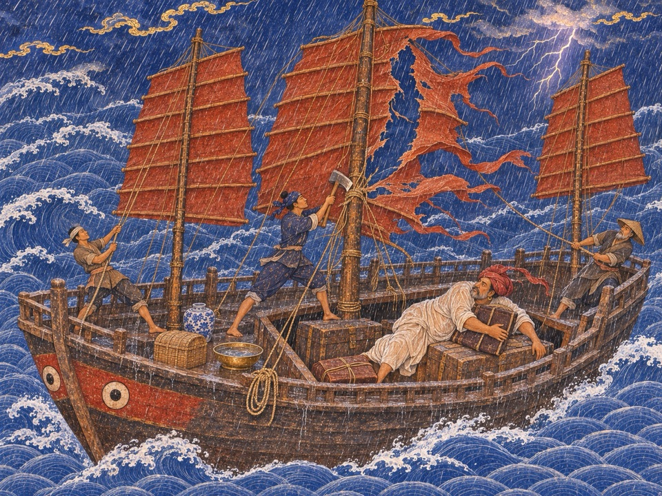
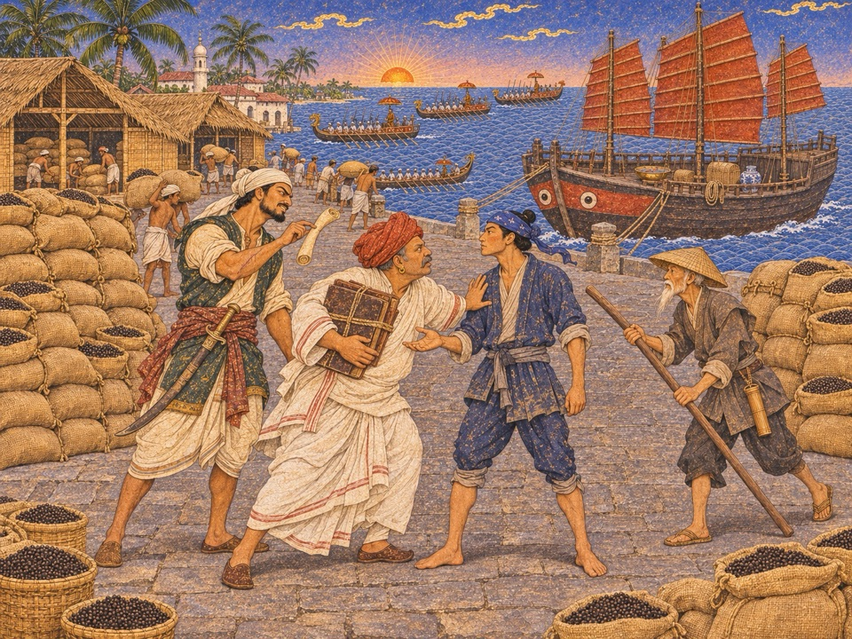

## 1. 몇 경에 몇 침

1522년 12월, 벵골만.

열흘째 뭍이 보이지 않았다.

소보호의 갑판은 소금기에 절어 하얗게 말라 있었다. 북동풍이 붉은 갈색 돛 셋을 팽팽히 밀어 올렸지만, 배 밑바닥을 들어 올리는 너울은 말라카 해협과 달랐다. 해협에서는 물결이 짧고 빠르게 부딪쳤으나, 큰 바다의 물결은 언덕처럼 다가와 배를 들어 올렸다가 골짜기로 떨어뜨렸다.

차오는 뱃머리 난간에 기대어 납추 줄을 감아올렸다. 여울을 잴 때처럼 줄을 던져 보았으나, 서른 발이나 풀려 나간 줄 끝에는 차가운 바닷물만 묻어 올라왔다. 해협에서 익혀 둔 감각은 이 물 위에서 아무 쓸모가 없었다.

"그 줄은 당분간 선창에 넣어 둬라."

뒤에서 쉰 목소리가 들렸다. 탄 노인이 삿갓 끈을 턱에 매고 허리춤의 대나무 향 통을 열었다. 안에서 마른 향 하나를 꺼내 부싯돌로 불을 붙이자 매운 연기가 바람에 찢겨 날아갔다.

"여기선 물밑이 아니라 해와 바람, 그리고 이 향으로 길을 재는 거다."

탄 노인이 불붙은 향을 둥근 놋접시 위에 눕혔다. 향불이 천천히 타들어가며 첫 번째 마디를 향해 기어갔다. 재가 한 마디 떨어질 때마다 한 경이 지난다.

차오는 품속에서 침경을 꺼내 바람에 날리지 않게 무릎으로 눌렀다. 누런 종이 위에는 먼저 간 사람들이 남긴 붓글씨가 줄지어 있었다.

『서북쪽으로 아홉 경, 다시 정서로 열두 경.』

"몇 경에 몇 침입니까." 차오가 고개를 들었다.

"그래. 닻을 내릴 뭍이 없으니 시간과 방향만 믿고 가는 거지." 탄 노인이 키를 잡은 말라카 사공 리우에게 고개를 끄덕였다. 리우 옆에서는 젊은 사공 아밍이 돛줄 매듭을 고쳤고, 앞쪽에서는 구자라트 사공 라자와 무사가 갑판을 씻었다. 말은 반쯤밖에 통하지 않았지만, 밧줄을 당기는 손길은 맞았다.

차오는 뱃머리 상자 안의 수부침을 내려다보았다. 쇠나무 물그릇의 물이 배의 흔들림에 맞춰 찰랑거렸고, 가느다란 쇠바늘 끝은 언제나 남쪽을 가리켰다.

차오는 그릇 테두리의 글자를 손가락으로 짚었다. 그릇을 돌려 글자의 남쪽 끝을 바늘 끝에 맞추고, 서쪽에서 북쪽으로 한 칸 비켜선 자리에 적힌 글자를 보았다.

"리우 영감, 뱃머리를 두 뼘만 오른쪽으로 트십시오."

리우가 말없이 키를 밀었다. 뱃머리에 그려진 흰 눈 두 개가 짙푸른 물살을 가르며 방향을 고쳤다. 갑판 한구석에서 장부 궤짝을 끈으로 동여매던 데브지가 누런 얼굴로 고개를 내밀었다. 뱃멀미 때문인지 붉은 터번 아래 이마에 식은땀이 배어 있었다.

"아직도 멀었습니까, 린 선주."

"이제 열흘 지났습니다. 향이 서른 번은 더 타야 뭍 냄새가 날 겁니다."

데브지는 입술을 굳게 다물고 다시 궤짝 위 밧줄을 조였다. 바람이 차가워지며 돛이 한 번 크게 울었다.

## 2. 찢긴 돛

열이틀째 밤, 바람의 소리가 달라졌다.

해가 진 뒤부터 북동풍이 사납게 몰아치더니 자정을 넘기자 비를 몰고 왔다. 빗줄기가 바늘처럼 얼굴을 때렸다. 검은 하늘과 검은 바다가 경계 없이 맞붙고, 번개가 칠 때마다 하얗게 부서지는 파도 봉우리가 소보호의 키보다 높이 솟았다.

가운데 돛대에서 천이 갈라지고 대나무 살이 꺾이는 날카로운 소리가 터졌다. 손바닥만 한 기운 자국이 두 군데 나 있던 붉은 갈색 돛이 세로로 길게 찢어졌다. 찢어진 돛자락이 빗속에서 채찍처럼 날뛰며 대나무 살을 부러뜨렸다.

"돛대가 부러진다! 줄을 끊어라!"

탄 노인이 고함을 질렀다. 파도가 갑판을 덮칠 때마다 아밍이 도끼를 들고 돛대 밑으로 기어갔다. 라자와 무사는 기울어진 선창 덮개를 붙잡으려 안간힘을 썼다.

"짐이 쏠린다! 선창이 무거워서 배가 못 일어나!"

리우가 키를 두 팔로 끌어안은 채 소리쳤다. 배가 왼쪽으로 크게 기울며 뱃전이 바닷물을 들이마셨다. 선창 아래 실린 후추 포대와 주석 상자들이 삐걱거리며 한쪽으로 밀렸다.

"물건을 버려! 주석 덩이부터 던져!"

아밍이 돛줄을 찍으려던 손을 멈추고 선창 쪽으로 돌아섰다. 라자도 밧줄을 풀며 선창 입구로 내려섰다. 배가 가라앉기 전에 무거운 짐을 비워야 한다는 생각뿐이었다.

그때였다. 선창 어귀에서 둥근 몸 하나가 튕겨 나와 상자들 위를 덮쳤다.

데브지였다.

평소라면 큰 소리만 나도 어깨를 움츠리던 사내가, 젖은 흰 무명 옷이 살에 달라붙은 채 선창의 나무 상자와 가죽 궤짝을 두 팔로 끌어안고 엎드렸다. 붉은 터번이 풀어져 긴 머리카락이 빗물에 젖어 얼굴을 가렸지만 눈빛만은 흔들리지 않았다.

"안 됩니다! 이 짐은 안 됩니다!"

"미쳤나, 배가 가라앉는데 짐이 중해?"

아밍이 젖은 팔로 데브지의 어깨를 잡아끌었다. 그러나 데브지는 상자 모서리를 쥔 손가락을 한 치도 떼지 않았다. 손등에 핏줄이 불거졌다.

"내 짐이 아니오! 캄베이 상인들의 짐이고, 내 장부가 여기 들었소! 이걸 버리면 살아 돌아가도 산 목숨이 아니오!"

데브지의 목소리가 비바람 소리를 뚫고 날카롭게 꽂혔다. 차오가 미끄러운 갑판을 기어 선창 어귀로 다가갔다. 파도가 다시 한번 배를 덮쳤다. 차오는 입안에 들어찬 소금물을 뱉어 내고 아밍의 손에서 도끼를 낚아챘다.

"짐은 건드리지 마! 찢긴 돛줄만 끊는다!"

차오는 돛대 밑으로 몸을 날렸다. 찢어져 날뛰는 가운데 돛의 아랫줄을 도끼날로 내리찍었다. 두 번, 세 번. 질긴 삼베 줄이 끊어지자 찢긴 돛자락이 바람을 따라 밤바다로 날아갔다. 돛대의 무게가 한결 가벼워지며 기우뚱하던 소보호가 서서히 중심을 되찾았다.

"라자! 무사! 밧줄 가져와 짐을 들보에 묶어라!"

차오의 외침에 사공들이 굵은 밧줄을 던졌다. 차오와 데브지는 선창 바닥에 무릎을 꿇은 채 빗물을 뒤집어쓰며 상자와 자루들을 기둥에 단단히 엮었다. 데브지는 기름먹인 가죽으로 싼 장부 묶음을 품속에 깊이 밀어 넣고 나서야 가쁜 숨을 내쉬었다.

새벽이 밝아 올 무렵에야 비바람이 잦아들었다. 가운데 돛대는 앙상하게 비어 있었고, 갑판은 부러진 대나무 조각과 젖은 밧줄로 어지러웠다. 데브지는 떨리는 손으로 풀어졌던 붉은 터번을 다시 머리에 감고 있었다. 그 품속에서는 여전히 장부 묶음의 모서리가 불룩하게 튀어나와 있었다.

## 3. 돌을 찾아 사흘

1523년 1월, 실론 갈레.

소보호가 찢긴 가운데 돛을 떼어 낸 채 앞뒤 돛 두 개만으로 갈레 항구에 닿은 것은 폭풍 뒤 나흘 만이었다.

항구는 짙은 나무 냄새와 알싸한 계피 냄새로 가득했다. 돌로 쌓은 포르투갈 상관 담장 위로 붉은 십자 깃발이 흔들렸고, 부두 바닥에는 싱할라 짐꾼들과 아랍 상인들, 타밀 여인들이 뒤섞여 오갔다.

데브지는 배가 닿자마자 사공 둘을 데리고 부두 시장으로 내려갔다. 새 삼베 천과 식수, 말라바르로 싣고 갈 계피를 구하기 위해서였다. 탄 노인이 부러진 대나무 살을 다듬는 동안, 차오는 침로도를 꺼내 둘째 빈칸을 보았다.

「問石」

"돌에 물어라."

차오는 종이를 다시 접어 품에 넣고 부두로 나섰다.

첫날은 항구 창고 뒤편을 뒤졌으나 명나라 배가 남긴 돌을 아는 이가 없었다. 포르투갈 상관 앞 짐꾼도 고개만 저었다. 이튿날은 시장을 돌며 무슬림 상인과 사원의 승려에게도 서툰 바닷말로 물었지만 모두 처음 듣는다는 얼굴이었다. 사흘째에는 동쪽 곶 아래 바위 해변까지 헤맸으나 파도에 깎인 검은 돌덩이뿐이었다.

해가 떨어지며 항구가 붉게 물들었다. 차오는 먼지 묻은 짚신을 끌고 부두 돌계단에 주저앉았다. 땀이 식으며 바닷바람이 목덜미를 파고들었다. 저편에서는 데브지가 계피 꾸러미를 나르고, 탄 노인은 꿰맨 돛을 올리고 있었다. 차오의 손에는 아무것도 없었다.

어둠이 깔린 부두 끝에서, 낡은 그물 바구니를 든 노인 하나가 절뚝거리며 계단을 올라오고 있었다.

## 4. 세 가지 말

노인은 갈레 항구 변두리의 작은 어촌에서 온 타밀 사람이었다.

차오가 계단 끝에 앉아 무릎을 감싸 안고 있는 것을 보더니, 노인은 바구니를 내려놓고 차오의 남색 두건과 얼굴을 유심히 살폈다.

"동쪽 바다에서 온 배인가. 배 앞머리에 눈이 그려진 정크를 항구에서 보았지."

노인은 말라카 항구에서도 자주 들리던 타밀 말과 섞인 바닷사람들의 말로 물었다. 차오가 고개를 끄덕이며 물었다.

"옛날, 아주 큰 배들이 이 항구에 닿았을 때 남긴 돌을 찾고 있습니다. 글씨가 새겨진 돌입니다."

노인의 주름진 눈가가 잠시 움직였다. 노인은 항구 뒤편, 포르투갈 창고와는 정반대 방향의 어두운 숲 쪽을 턱으로 가리켰다.

"옛날에 사람들이 기도하러 가던 돌이 하나 있긴 했지. 내 집안이 대대로 그 돌 둘레 풀을 베어 오긴 했으나, 포르투갈 사람들이 성채를 짓기 시작한 뒤론 아무도 거기 안 가. 내일 해 뜨거든 저 그물 말리는 터 끝으로 오게."

다음 날 아침, 이슬이 마르기 전에 차오는 데브지, 그리고 그물 바구니를 진 타밀 노인과 함께 갈레 변두리로 걸었다.

항구에서 걸어서 반 시진 남짓 떨어진 곳이었다. 붉은 흙길 양옆으로 야자나무와 가시덤불이 사람의 키만큼 자라 길을 막고 있었다. 노인이 낫으로 덤불을 쳐내며 앞장섰다. 젖은 풀잎 냄새와 흙냄새가 진하게 올라왔다.

"저기다."

노인이 낫 끝으로 풀숲 한가운데를 가리켰다.

두꺼운 덩굴과 마른 나뭇잎에 반쯤 덮인 검은 돌비석 하나가 땅 위에 비스듬히 누워 있었다. 높이가 어른 키만 하고, 비석 머리에는 마주 보는 용 두 마리가 새겨져 있었다. 오래전에 받침돌에서 빠져 넘어졌는지 한쪽 모서리가 흙에 파묻혀 있었다.

차오가 무릎을 꿇고 손바닥으로 비석 위의 마른 흙과 이끼를 쓸어냈다. 그러자 돌 표면에 가늘고 깊게 새겨진 글자들이 드러났다.

하나의 줄기가 아니었다. 비석 위쪽은 세 칸으로 나뉘어, 각기 다른 모양의 글자가 빼곡히 새겨져 있었다.

차오는 숨을 멈추고 비석 오른쪽에 세로로 새겨진 한문 줄을 손끝으로 짚었다. 익숙한 글자들이 손끝에 닿았다. 차오는 젖은 흙을 닦아 내며 낮게 소리 내어 읽었다.

"대명 영락 칠년, 황제가 사신을 보내…… 금과 은, 비단과 향로를 가져와 부처의 앞에 바친다."

차오의 목소리가 끊어지자, 곁에 쪼그려 앉아 있던 타밀 노인이 비석 왼쪽 위의 줄에 손가락을 얹었다. 노인은 깎인 글자 홈을 손끝으로 더듬더니 느린 목소리로 읽었다.

"같은 해 같은 달, 바다를 건너온 배들이 같은 금과 은, 비단과 향을 올려 테나바라이 나야나르 신께 바친다."

노인이 읽기를 멈추고 가슴에 두 손을 모았다가 내렸다.

"저기 지나는 이에게 물어봅시다."

데브지가 덤불 너머 좁은 길을 가리켰다. 계피 바구니를 나르던 무슬림 상인 하나가 길을 지나다 세 사람이 풀숲에 모여 있는 것을 보고 발걸음을 멈춘 참이었다. 희고 긴 옷에 수염을 단정히 기른 사내였다. 노인이 비켜서자 사내가 다가와 비석 왼쪽 아래, 둥글게 이어진 글자 줄을 내려다보았다.

"페르시아 글씨군."

사내가 쪼그려 앉아 손가락으로 돌의 먼지를 털어 내며 몇 줄을 읽었다.

"영락 칠년, 먼 나라의 사신이 금과 은과 비단, 향로를 싣고 와 알라의 이름 아래 올린다."

풀숲에 잠시 바람이 스치는 소리만 남았다.

세 사람이 각기 다른 글씨를 손끝으로 짚고 서 있었다.

"같은 돌이 세 가지 말로 말한다."

차오가 저도 모르게 중얼거렸다. 무슬림 상인은 가슴에 손을 얹고 작게 기도를 읊조렸고, 타밀 노인은 합장한 손을 이마에 댔다. 그 어느 쪽도 서로의 기도를 방해하지 않았다.

차오는 무릎 위에서 주먹을 쥐었다. 할아버지의 침로도를 품고 말라카를 떠날 때까지만 해도, 이 길은 린씨 집안이 몰래 지켜 온 비밀인 줄로만 알았다. 그런데 이 먼 섬의 풀숲에 누운 돌에는 전혀 다른 말들이 나란히 새겨져 있었다.

데브지가 장부를 꺼내려다 말고 그저 비석의 세 가지 글 줄을 물끄러미 바라보았다. 바람이 불자 야자나무 잎사귀들이 비석 위로 그림자를 흔들었다.

## 5. 곶의 나무

차오는 누운 비석의 모서리를 들추어 보려 했으나 꿈쩍도 하지 않았다.

"뒤쪽에 무슨 글이나 그림이 더 있습니까."

비석지기 노인이 고개를 저었다. "아무것도 없네. 거친 돌면뿐이야."

차오는 다시 한문 줄을 훑었으나 공물과 날짜뿐, 침로는 한 줄도 없었다. 실망감이 어깨를 눌렀다.

"자네는 글씨를 보러 왔나, 길을 보러 왔나." 노인이 물었다.

"길을 보러 왔습니다. 우리 할아버지 지도에서 여기서부터 서쪽으로 가는 선이 지워졌습니다."

노인이 비석 옆, 땅속에 박힌 네모난 받침돌을 지팡이로 툭툭 쳤다.

"이 돌이 서 있던 자리 보게. 내 할아버지가 젊었을 때, 큰 배들이 갈레에서 닻을 올릴 때마다 선원들이 꼭 이 돌 앞에 섰다고 했어."

노인이 남서쪽 바다 건너 바위 곶을 가리켰다. 곶 끝 벼랑 위에 홀로 선 커다란 반얀나무 한 그루가 보였다.

"저기 곶 끝에 선 큰 나무 보이나. 그 배들이 떠날 때 저 곶의 나무와 이 돌을 겹쳐 보고 나갔다네. 이 돌자리에서 저 나무 끝이 일직선으로 놓이는 물길을 따라 나가야 입구의 산호초를 피하거든."

차오가 받침돌 위에 올라서서 남서쪽 바다를 바라보았다. 하얀 포말이 이는 검은 암초들 사이로, 받침돌과 큰 나무를 잇는 시퍼런 물길이 선명하게 갈라져 보였다.

"돌에 글이 있는 게 아니라, 돌이 놓인 자리가 표식이었군." 데브지가 중얼거렸다.

차오는 허리춤에서 작은 나무 물그릇을 꺼내, 들고 온 가죽 물통의 물을 부었다. 바늘을 띄우자 바늘이 남쪽을 가리켰다. 차오는 그릇 테두리의 글자를 돌려 곶의 나무가 가리키는 방위를 읽었다. 남쪽에서 서쪽으로 두 칸 비켜선 글자. 그 물길로 암초를 벗어난 뒤 말라바르 해안으로 올라간다.

차오는 받침돌에서 내려와 노인에게 깊이 허리를 숙였다. 노인은 손을 저으며 "내 할 일을 했을 뿐"이라고 말하고는 그물 바구니를 챙겼다. 차오는 배로 돌아오는 길에 데브지에게 말린 계피 한 꾸러미를 청해 노인의 바구니에 얹어 주었다. 노인은 그제야 이 없는 잇몸을 드러내며 웃었다.

## 6. 붉은 띠의 그림자

1523년 2월, 말라바르 해안.

실론을 벗어난 소보호는 남서쪽 곶의 물길을 따라 북서쪽으로 뱃머리를 틀었다. 2월의 북동풍은 순하고 맑았다. 왼쪽으로는 끝없는 아라비아해가 푸르게 열려 있었고, 오른쪽으로는 야자나무가 빽빽한 인도의 해안선이 손에 잡힐 듯 이어졌다.

배가 코친 앞바다를 지나 캘리컷을 향해 올라가던 나흘째 오후였다.

망대에 올라 있던 사공 아밍이 다급하게 종을 울렸다.

"오른쪽 해안에서 배가 나옵니다! 삼각 돛입니다!"

차오가 난간으로 달려갔다. 해안의 작은 만에서 흰 삼각 돛을 단 날렵한 포르투갈 순찰선 한 척이 미끄러져 나와 소보호의 앞길을 가로막고 있었다. 뱃전에 청동 대포 두 문이 햇빛을 받아 번쩍였다.

"걸음을 늦춰라. 돛을 반만 내려라."

차오가 침착하게 외쳤다. 도망치면 곧장 대포가 날아올 거리였다. 말라카 해협처럼 얕은 여울도 없는 탁 트인 연안이었다.

잠시 뒤 포르투갈 순찰선이 소보호의 옆구리에 바짝 붙어 갈고리를 걸었다. 쇠 투구를 쓰고 가죽 조끼를 입은 포르투갈 장교 하나와 창을 든 병사 넷이 소보호 갑판 위로 건너왔다.

"배 주인이 누구냐."

장교는 거친 말레이 말과 포르투갈 말을 섞어 물었다. 차오가 한 걸음 앞으로 나서며 품에서 말라카에서 받은 양피지 두루마리를 꺼내 두 손으로 내밀었다.

장교가 두루마리를 펼쳐 붉은 밀랍 인장과 서명을 살폈다. 데브지는 선창 난간 뒤에 반쯤 몸을 숨긴 채 숨을 죽이고 있었다.

장교의 시선이 두루마리 아래쪽에서 멈췄다. 그는 엄지손가락으로 뭉개진 밀랍 테두리를 문지르고, 선주 이름 옆의 작은 먹물 점을 손톱 끝으로 짚었다.

"인장이 찌그러지고 이름 옆에 얼룩까지 있군. 위조한 종이가 아닌가."

차오의 손바닥에 식은땀이 배어났다. 말라카를 떠나던 날, 데브지가 볼록유리로 찾아내던 바로 그 흠이었다.

"말라카 사무소에서 정당한 은화를 치르고 받은 것입니다."

"법대로라면 고아로 끌고 가 진위를 가려야 한다." 장교가 양피지를 말아 쥐며 짐 자루들을 훑어보았다. "선창에 뭘 실었지?"

그 순간, 데브지가 조용히 앞으로 걸어 나왔다. 라자에게 눈짓해 갈레에서 산 계피 묶음 두 개를 끌어오게 하고, 허리춤에서 작은 가죽 주머니를 풀어 장교의 손에 쥐여 주었다.

"대장님. 말라카 서기가 실수했나 봅니다. 고아까지 가자면 길이 늦어지실 테니, 이 햇계피와 작은 성의로 덮어 주시지요."

장교가 주머니의 무게를 손바닥으로 가늠해 보더니, 계피 묶음의 냄새를 한 번 맡았다. 굳어 있던 얼굴이 순식간에 누그러졌다.

"서기 놈들이란 늘 칠칠맞지. 다음부터는 똑바로 된 걸 받아 오라."

장교는 통행증을 차오의 가슴에 던지듯 돌려주고, 계피 묶음 두 개를 병사들에게 들려 자기 배로 건너갔다. 갈고리가 풀리고 순찰선이 남쪽을 향해 멀어졌다.

갑판에 다시 정적이 찾아왔다. 사공들이 안도의 한숨을 내쉬며 주저앉았다.

데브지는 떨리는 손을 옷자락에 닦더니, 곧바로 선창으로 내려가 기름먹인 장부 묶음을 꺼내 펼쳤다. 장교가 타고 왔던 순찰선 고물에 적혀 있던 글자를 기억해 내며, 데브지는 대나무 펜에 먹물을 찍어 구자라트 글씨로 또박또박 적었다.

『2월 열나흘, 순찰선 산타 크루스, 계피 두 묶음과 은화 열 냥.』

"말라카에서 찍어 준 작은 흠 하나가 여기 인도 바다까지 따라옵니다."

데브지가 펜을 내려놓으며 낮게 말했다. 차오는 손에 들린 양피지를 내려다보았다.

## 7. 무너진 비정

며칠 뒤, 소보호는 캘리컷 항구에 닻을 내렸다.

자모린의 도시 캘리컷은 후추 냄새로 숨이 막힐 지경이었다. 부두 앞 창고마다 붉고 검은 후추 포대가 성벽처럼 쌓여 있었고, 바다 쪽에는 수백 척의 상선과 작은 거룻배들이 빽빽하게 닻을 내리고 있었다.

데브지는 배가 닿자마자 캄베이 상인들의 거처로 달려가 후추 시세를 알아보고, 뤄 영감에게 갚을 몫과 갈레에서 급히 기운 돛을 제대로 맞출 비용을 셈하기 시작했다.

"아체 후추는 호르무즈까지 가져갈 몫입니다." 데브지가 주석 값을 맞추고 돌아와 말했다.

차오는 부두 북쪽, 야자나무 숲이 끝나는 언덕 위를 물었다. 캘리컷의 늙은 하역꾼 하나가 풀숲에 덮인 옛 돌집 터가 있다고 일러 주었다.

한낮의 볕을 뚫고 언덕에 오르자, 붉은 흙 위에 무너진 기와 조각과 부러진 돌기둥 넷이 흩어져 있었다. 비바람을 가려 주던 지붕은 오래전에 내려앉아 흔적만 남았으나, 그 한가운데 세워진 검은 돌비석은 부러지지 않고 똑바로 서 있었다.

옛 선단이 캘리컷에 세웠다는 비정이었다.

차오가 비석 앞의 잡초를 헤치고 다가가 한문으로 새겨진 글자들을 짚었다. 풍화에 닳아 획이 옅어진 곳이 많았으나, 큰 줄기는 또렷하게 읽혔다.

「이 나라는 중국에서 십만 리가 넘게 떨어져 있으나 사람과 물산이 넉넉하고 풍속이 다르지 않다. 여기 돌에 새겨 길이 보인다.」

차오는 비석의 문장 앞에서 한참을 서 있었다.

그날 밤, 소보호의 선실 안.

갑판 위에서 사공들이 뱃줄을 손질하는 동안, 차오는 작은 기름 등불 아래에 침로도를 펼쳤다. 벼루에 물을 한 방울 떨어뜨려 먹을 갈았다. 서늘한 먹 냄새가 선실의 비린내를 덮었다.

차오는 가는 붓에 먹물을 찍어, 침로도의 두 번째 그을린 빈칸 「問石」 아래 빈 종이를 채웠다. 갈레의 받침돌과 곶 끝의 큰 나무, 거기서 캘리컷의 무너진 비정까지 이어지는 해안선과 경수를 한 획씩 그려 넣었다. 먹물이 마르기를 기다렸다가 침로도를 접어 기름종이에 넣었다. 이제 빈칸은 셋 남았다.

## 8. 빠른 배와 종이 한 장

다음 날 아침, 캘리컷 부두는 여느 때보다 소란스러웠다.

부두 안쪽 물살을 가르고 가늘고 긴 배 세 척이 들어왔다. 돛대는 하나씩뿐이었지만 양옆으로 긴 노가 열두 개씩 뻗어 있어 물새처럼 빨랐다. 캘리컷의 마라카르 수군이 타는 전선, 파라오였다.

맨 앞선 배에서 젊은 사내 하나가 밧줄도 던지기 전에 부두 돌바닥으로 뛰어내렸다.

스물여섯쯤 되어 보이는 사내였다. 어깨가 넓고 다부졌으며, 짧은 검은 수염 위로 흰 두건을 질끈 동여매고 있었다. 허리에는 날이 굽은 칼을 찼고, 걷어 올린 소매 아래 맨 팔에는 굵은 칼자국이 길게 남아 있었다. 부두의 짐꾼들이 "이브라힘 마라카르다" 하고 수군거렸다.

이브라힘은 부두에서 계피와 주석 상자를 내려놓던 소보호 쪽으로 걸어왔다. 말라카에서 온 낡은 정크를 위아래로 훑어보더니, 부두 감독에게 내밀고 있던 차오의 손에서 양피지 두루마리를 낚아채듯 들여다보았다.

"이건 포르투갈 놈들의 통행증이잖아."

이브라힘의 목소리가 부두가 울릴 만큼 컸다. 그는 두루마리 끝을 손가락으로 튕기며 차오를 노려보았다.

"제 바다를 지나는 데 남의 종이를 사는 자로군. 그 종이 한 장에 은화를 몇 냥이나 바쳤나?"

부두의 짐꾼들이 슬금슬금 물러서며 구경할 채비를 했다. 차오의 입술이 굳게 다물어졌다. 제 통행증을 낚아채 손가락으로 튕기는 태도가 거슬렸다.

"돌려주시오. 내 배와 내 짐을 지킬 종이요."

"종이가 배를 지켜 주나?" 이브라힘이 코웃음을 치며 두루마리를 차오의 가슴에 툭 던졌다. "지난달에도 구자라트 상선 두 척이 통행증을 들고도 잿더미가 됐지. 종이 나부랭이나 사 모으는 놈들 때문에 저놈들이 이 바다의 주인 행세를 하는 거다."

"그럼 대포 앞에서 맨몸으로 짐을 나르란 말이오?" 차오도 물러서지 않고 한 걸음 다가섰다. "당신은 빠른 배와 칼이 있으니 싸우면 되겠지. 나는 장사꾼 짐을 싣고 가는 길잡이요. 내 짐을 지키는 방식은 내가 정하오."

이브라힘의 눈꼬리가 날카롭게 치켜올라갔다.

"길잡이? 종이에 머리 조아리는 놈이 무슨 길잡이야."

이브라힘의 손이 차오의 남색 저고리 깃을 쥐려 뻗었다. 차오는 칼은 쓸 줄 몰랐지만, 밧줄을 당기던 팔 힘은 가늘지 않았다. 차오가 이브라힘의 팔목을 쳐내며 어깨를 들이밀었다. 이브라힘이 비틀거리다 허리춤의 굽은 칼자루를 잡았다.

"그만두시오! 둘 다 미쳤소?"

데브지가 둥근 몸을 날려 두 사람 사이를 파고들었다. 탄 노인이 긴 삿대를 들고 부두로 뛰어내리며 고함을 질렀다.

"어린놈들이 남의 부두에서 칼을 뽑으려 들어!"

이브라힘은 칼자루에서 손을 떼고 차오를 똑바로 쳐다보았다.

"이름이 뭐지."

"린차오."

"린차오. 이 바다에서는 종이보다 뱃바닥이 먼저 부서지는 걸 곧 보게 될 거다."

이브라힘은 더 말하지 않고 돌아서서 자기 배들로 걸어갔다. 차오도 흙이 묻은 통행증을 털어 품에 넣고 소보호 갑판으로 올라섰다. 손등에 이브라힘의 팔목이 부딪친 자국이 붉게 부어오르고 있었다.

## 9. 북쪽에서 오는 소문

1523년 3월, 캘리컷.

항구의 공기가 무겁게 가라앉기 시작했다. 북동풍이 점차 힘을 잃어 가고, 몇 달 뒤면 배들을 뭍으로 끌어올려야 하는 남서풍 폭풍철이 다가오고 있었다.

그즈음 북쪽 고아에서 내려온 작은 고깃배 하나가 캘리컷 항구에 불길한 소문을 실어 왔다.

"바스쿠 살레마의 순찰 함대가 내려온답니다. 큰 배 다섯 척을 거느리고 코친으로 내려가는 길목의 배들을 닥치는 대로 훑고 있답니다."

항구 안쪽이 금세 술렁였다.

저녁 무렵, 캘리컷 부두 끝에서는 횃불이 수십 개씩 타올랐다. 마라카르 집안의 어른들과 이브라힘이 항구의 배들을 안쪽 만으로 불러 모으고 있었다. 파라오 전선 열여섯 척이 횃불 아래 검은 물고기 떼처럼 나란히 닻을 내렸다. 사공들이 뱃전에 창과 화약 통을 실어 날랐다.

"포르투갈 큰 배들은 뱃바닥이 깊어. 정면에서 대포를 맞으면 우리 배들은 나무 조각이 된다."

이브라힘이 횃불 아래서 부두의 늙은 선장들을 둘러보며 소리쳤다.

"고아에서 내려오는 길목, 모래톱과 얕은 여울을 손바닥처럼 아는 길잡이가 필요하다! 물때를 맞춰 그 큰 배들을 여울 쪽으로 끌어들이면 우리 파라오가 에워쌀 수 있다!"

그러나 모인 캘리컷의 늙은 길잡이들은 서로 눈치만 볼 뿐 선뜻 앞으로 나서지 않았다.

"이브라힘 도련님, 두 달이면 남서풍이 터집니다. 지금 살레마의 함대와 맞붙었다간 폭풍철 전에 배들을 다 잃습니다."

"그래도 맞서야지, 안 그러면 저놈들이 캘리컷 앞바다까지 들어와 닻을 내릴 거요!"

이브라힘이 답답한 듯 마른 얼굴을 쓸어내렸다.

부두 저편, 소보호의 갑판 난간에 기대어 차오는 그 모습을 멀찍이 지켜보았다.

차오는 싸움에 끼고 싶지 않았다. 말라카에서 뤄 영감에게 진 외상 빚도 갚아야 했고, 데브지의 짐을 고아까지 데려다주기로 한 약조도 남아 있었다. 침로도에는 아직 채워야 할 빈칸이 셋이나 더 있었다.

"린 선주, 곧 고아로 갈 채비를 해야 합니까."

뒤에서 데브지가 다가와 조심스럽게 물었다. 고아에는 살레마의 손이 닿아 있지만, 장부 정리를 끝내려면 결국 고아를 거치거나 통행증 문제를 풀어야 했다.

"조금 더 기다려 봅시다. 북쪽 소문을 더 들어보고."

차오는 부두 끝에 선 이브라힘의 등을 한 번 더 바라보았다. 이브라힘도 고개를 돌려 소보호를 힐끗 보았으나, 차오는 시선을 거두고 풀린 밧줄을 말뚝에 감았다.

밤바람이 매캐한 횃불 연기와 함께 불어왔다. 차오는 차가운 밧줄을 손바닥에 감아 쥔 채 삐걱거리는 소보호의 선창을 내려다보았다.

이틀 뒤 새벽, 소보호가 고아로 떠날 채비를 마쳤을 때 이브라힘이 부두 돌바닥을 걸어왔다. 그의 뒤로 파라오 한 척이 노를 세운 채 떠 있었다.

"고아로 간다지."

"통행증의 흠은 고아에서 풀어야 하오."

이브라힘이 소보호의 둥근 뱃전을 한 번 훑어보았다.

"고아 앞바다까지는 내 파라오가 따라간다. 살레마의 배를 제 눈으로 보겠다. 길잡이 일은 그다음에 묻겠다."

차오는 대답하지 않았다. 따라오라고도, 오지 말라고도 하지 않았다. 이브라힘도 대답을 기다리지 않고 제 배로 건너갔다.

해가 뜰 무렵 소보호가 닻을 올렸다. 파라오가 소보호의 왼쪽 뱃전에서 활 두어 바탕쯤 떨어져 나란히 북쪽으로 물을 갈랐다. 차오는 키 옆에 서서 파라오의 노 스물네 개가 한꺼번에 물을 긁는 소리를 들었다.
