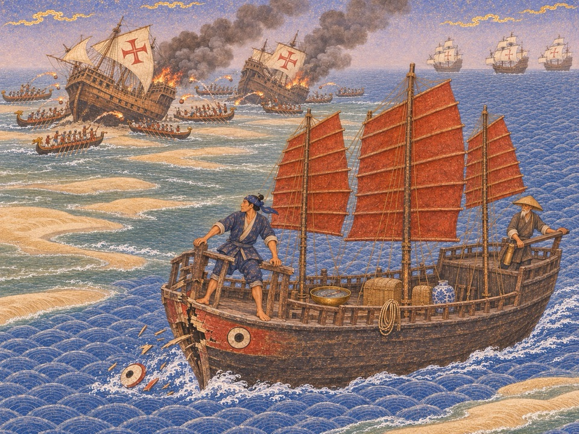
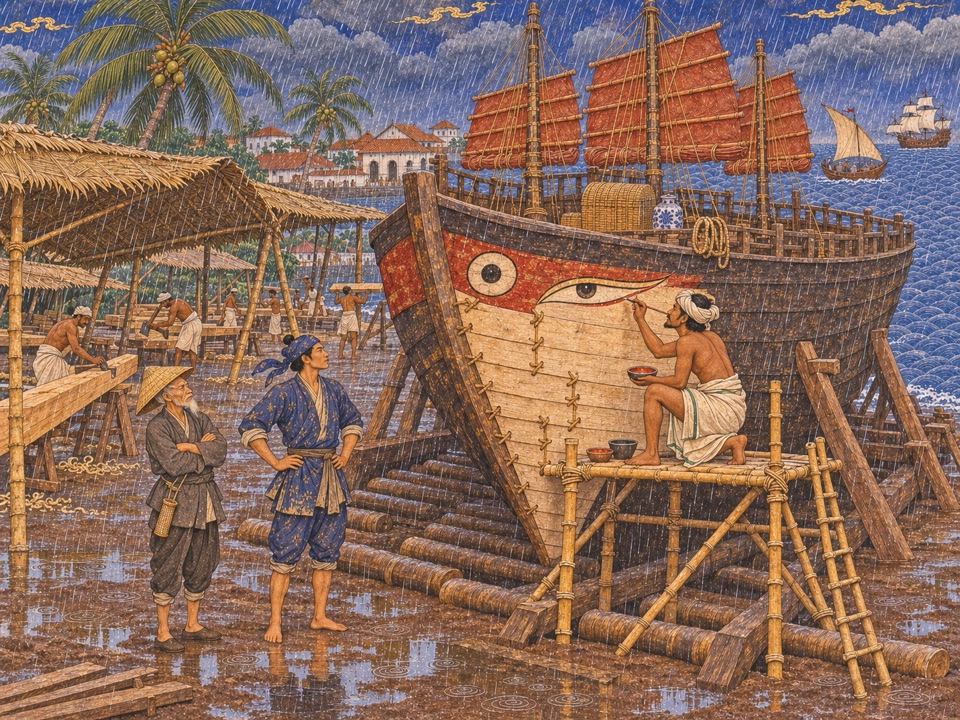
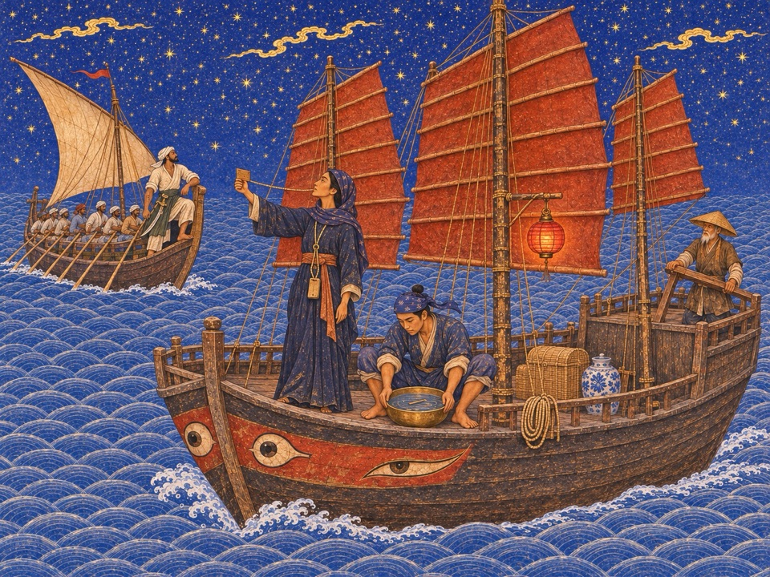

## 1. 나무판의 매듭

1523년 3월, 고아.

만도비 강 어귀의 붉은 흙물이 바다와 섞이는 곳마다 썩은 망고 냄새와 쇠붙이 녹 냄새가 났다. 돌로 쌓은 요새 성벽 아래로 포르투갈 큰 배들이 줄지어 닻을 내리고 있었다.

린차오는 소보호를 부두 가장자리 얕은 곳에 댔다. 캘리컷에서 살레마의 함대가 내려온다는 소문을 들었으나, 차오는 싸움에 끼기 전에 고아로 올라왔다. 통행증의 흠을 정식으로 고쳐 받으면 살레마의 덫을 피할 수 있으리라 여겼다. 따라온 이브라힘의 파라오는 요새의 대포가 닿지 않는 강 어귀 바깥 모래턱 뒤에 돛을 내리고 남았다. 선창에는 캘리컷에서 팔고 남은 계피 자루와 후추 포대, 데브지의 장부 궤짝이 실려 있었다.

통행증 사무소 앞 돌마당에는 선주들이 줄을 서 있었다. 아랍 상인과 구자라트 선장들 틈에 호리호리한 젊은 여인 하나가 서 있었다. 짙은 남색 겉옷에 같은 빛깔의 머릿수건을 두르고, 양 손목에는 가죽 끈을 감은 모습이었다.

여인의 목에 걸린 것이 차오의 눈에 들어왔다. 손바닥 반만 한 네모난 나무판에 가느다란 끈이 달려 있고, 일정한 간격으로 매듭이 지어져 있었다.

차오가 시선을 거두지 못하자 여인이 고개를 돌렸다. 그녀는 차오의 남색 두건과 가슴께를 한 번 훑고는 시선을 거두었다.

"아버지 이름의 통행증은 기한이 지났소."

창구 앞 서기가 퉁명스럽게 말하자 여인이 탁자 위에 은화를 올려놓았다.

"아덴의 나히다 호는 키가 부러져 캘리컷에서 겨울을 났소. 아버지 눈이 어두워져서 내가 대신 배를 몰고 왔소. 도장만 찍어 주시오."

목소리가 군더더기 없이 곧았다. 여인은 줄에서 빠져나와 돌기둥 그늘에 기대어 섰다. 바람이 불 때마다 목에 걸린 나무판이 가볍게 흔들렸다.

"린차오 선주."

사무소 문이 열리고 병사가 불렀다. 차오는 여인을 한 번 더 보고는 차가운 돌복도로 들어섰다.

## 2. 의자와 값

사무소 안의 공기는 말라카보다 무거웠다. 창문 너머로 요새의 종소리가 낮게 울렸다.

큰 탁자 뒤에 바스쿠 살레마가 앉아 있었다. 검은 더블릿에 붉은 띠를 두르고, 손질한 검은 수염을 쓰다듬는 모습은 말라카 때와 다름없었다.

"말라카 이후로 처음이군요, 린 선주."

살레마가 자리에서 일어나 맞은편 나무 의자를 가리켰다.

"서 있지 말고 앉으시오. 먼 길을 왔지 않소."

"서서 말씀드리겠습니다. 통행증을 고치러 왔습니다."

살레마의 눈썹이 잠깐 올라갔다가 내려왔다. 그는 권하던 손을 거두고 자리에 앉았다.

"어디 봅시다."

차오가 양피지 두루마리를 내밀자 살레마가 아래쪽을 짚었다. 뭉개진 밀랍 인장 가장자리와 선주 이름 옆의 작은 먹물 점이었다.

"인장이 반쯤 뭉개졌고, 이름 옆에 얼룩까지 있구려. 위조된 통행증의 흔적이오. 이 종이로는 고아 어귀도 못 벗어나오."

"말라카에서 직접 내주신 종이입니다. 제값에 은화를 치렀습니다."

"내가 내준 서류에 이런 흠이 있을 리 없소." 살레마는 목소리를 높이지 않았다. "법대로라면 소보호와 선창의 짐은 모두 압류해야 하오. 부두에 병사를 보내면 한 식경 안에 선창을 비울 수 있소."

살레마가 두루마리를 말아 내려놓고 양손을 깍지 끼었다.

"다만, 값을 치를 방도가 하나 있소."

"은화는 없습니다."

"은화를 달라는 게 아니오." 살레마의 시선이 차오의 가슴께에 머물렀다. "그대 할아버지 린 노인이 평생 품고 있던 옛 선단의 바다 그림. 그 종이를 내게 넘기시오."

방 안의 깃펜 긁는 소리가 멈췄다.

"그러면 새 통행증을 내주고, 압류도 없던 일로 하겠소."

"그런 물건은 없습니다. 제게 있는 건 낡은 배 한 척과 후추 몇 포대뿐입니다."

살레마가 천천히 고개를 저었다.

"아직도 나를 못 믿는군. 내일 첫 물때까지 생각할 시간을 주겠소. 그 뒤에는 부두의 병사들이 법대로 움직일 것이오."

살레마가 다시 빈 의자를 가리켰다.

"앉아서 천천히 생각해도 좋소."

"아닙니다."

차오는 통행증을 집어 들어 품에 넣었다. 허리를 숙이지 않은 채 돌아서서 문을 열고 나왔다. 등 뒤에서 살레마가 깃펜을 다시 집어 드는 소리가 들렸다.

## 3. 늙은 길잡이의 밤

고아 부두의 밤안개는 비릿하고 끈적거렸다. 요새 성벽 위 횃불이 물 위에 붉게 번져 있었다.

차오와 데브지는 소보호 갑판에 웅크리고 앉아 있었다. 부두 입구 쪽에는 이미 포르투갈 순찰선 두 척이 불을 켜고 어귀를 지키고 있었다.

"지금 닻을 올리면 대포를 맞을 겁니다." 데브지가 장부 궤짝을 끌어안고 떨리는 목소리로 말했다. "짐을 내려놓고 몸만 피합시다."

"배를 버리면 어디로 갑니까."

그때 부두 돌계단 쪽에서 지팡이 짚는 소리가 들려왔다.

예순은 넘어 보이는 사내가 다가오고 있었다. 헐렁한 아마포 셔츠 앞자락에는 검은 먹물과 기름때가 묻어 있었고, 한 손에는 말아 쥔 양피지 뭉치를 들고 있었다.

"소보호 선주가 누구요."

차오가 고개를 끄덕이자 사내가 끙 소리를 내며 갑판 위로 올라왔다. 손톱 밑까지 붉은 흙과 잉크가 배어 있는 영락없는 뱃사람의 손이었다.

"살레마 놈이 내일 첫물때가 들자마자 그대 배를 압류하라고 서기를 내려보냈소."

"당신은 왜 그걸 알려 줍니까."

"나는 이 항구 길잡이 가스파르 누네스요. 관리 나부랭이가 뱃사람 목줄을 쥐고 흔드는 꼴이 보기 싫어서 왔소." 가스파르가 나무통 위에 걸터앉더니 물기 묻은 양피지 한 장을 펼쳤다. "만도비 강 어귀 남쪽 샛길이오. 큰 순찰선 둘이 지키는 수로는 깊지만, 왼쪽 모래턱 뒤로 좁은 물골이 하나 나 있소."

양피지에는 얕은 여울과 바위 자리가 거칠게 그려져 있었다. 물골 끝은 이브라힘의 파라오가 기다리는 모래턱 바깥이었다.

"자정 넘어 두 번째 썰물이 빠지기 직전, 안개가 가장 짙을 때 나가시오. 정크 배 밑바닥이 둥글다면 물골을 타고 나갈 수 있을 거요."

"우리가 무엇을 가졌는지 아십니까."

가스파르가 양피지를 둘둘 말아 차오의 손에 쥐여 주며 코웃음을 쳤다.

"그대가 뭘 가졌든 내 알 바 아니오. 다만 살레마가 노리는 게 바다 그림이라는 건 항구 바닥에 소문이 다 났소. 바다 그림을 관리 서랍에 넣는 건 그림을 죽이는 일이오. 지도는 물 위에서 쓰라고 있는 거요."

데브지가 조심스럽게 한 발 다가섰다.

"어른, 살레마가 빼돌린 짐이 왕실 창고에 오르지 않았다는 장부가 제게 있습니다. 언젠가 고아 관청에 올릴 수 있겠습니까."

가스파르는 데브지의 품속 장부 묶음을 한 번 훑어보았다.

"살아남아서 캘리컷이나 호르무즈에서 소식을 보내시오. 썩은 물건을 솎아 내길 바라는 사람은 고아 안에도 여럿 있소."

가스파르가 자리에서 일어나 지팡이를 짚고 안개 속으로 걸어갔다.

## 4. 동쪽을 찾는 손님

배를 빼낼 물때까지는 두 시진이 남았다.

차오는 선원들에게 돛줄을 풀어 놓으라 이른 뒤, 식수 두 통을 더 챙기려 부두 뒤편 선술집으로 갔다.

술집 안은 땀 냄새와 포도주 냄새로 자욱했다. 구석 탁자에, 다른 선원들과 어울리지 못한 젊은 사내 하나가 혼자 앉아 있었다.

사내는 질 좋은 붉은 모직 외투를 걸쳤으나 가죽 장화는 진흙과 바닷물에 닳아 뒤축이 헐어 있었다. 탁자 위에는 낡은 나침반과 구겨진 종이 몇 장이 놓여 있었다. 주인에게 물을 청하는 말투가 맑고 또렷한 리스본 말씨였다.

차오가 식수 통을 들고 문가를 지나려는데, 사내가 차오의 남색 두건을 보았다.

"동쪽에서 온 배의 길잡이입니까."

살레마의 부하들처럼 남의 짐을 훑는 눈이 아니었다. 차오는 발걸음을 멈추고 고개를 끄덕였다.

"나는 동쪽으로 가는 배를 기다리는 중이오. 캘리컷을 지나 말라카 너머까지." 사내가 짧게 웃었다. "어딘가 동쪽에, 오래전부터 전해 내려오는 큰 나라가 있다고 들었소. 그곳을 찾아가는 길이오."

차오는 탁자 위의 종이를 보았다. 선은 고아에서 동쪽으로 조금 가다 끊겨 있었다.

"당신은 무엇을 찾아 여기까지 왔소?" 사내가 물었다.

차오는 입을 다물었다. 사내도 캐묻지 않았다.

"찾는 게 있는 사람은 눈빛이 비슷하군." 사내가 잔을 내려놓으며 말했다. "조심하시오. 요새 감독관이 오늘 밤 부두를 뒤진다는 소리가 들립디다. 나는 그쪽 사람들과 상관없는 손님이니, 이 말만 전하오."

"고맙소."

차오는 식수 통을 들어 술집을 나왔다. 낡은 장화를 신은 젊은 사내는 다시 탁자 위 종이에 고개를 숙이고 있었다.

## 5. 빌린 손

자정이 지나자 만도비 강 어귀에 우윳빛 안개가 깔렸다.

"닻줄을 올리지 말고 도끼로 끊어."

탄 노인이 삿갓 끈을 조여 매고 키를 잡았다. 리우와 아밍, 라자와 무사가 닻줄을 베고 삿대로 부두 벽을 밀었다.

소보호는 가스파르가 일러 준 왼쪽 모래턱 뒤 좁은 물골로 들어갔다. 오른편 안개 너머에서는 순찰선 등불 두 개가 희미하게 흔들렸다. 차오가 뱃머리에서 납추를 던져 깊이를 잴 때마다 탄 노인이 키를 반 뼘씩 틀어 빠져나갔다.

물골 끝 모래턱 바깥 어둠 속에서 등불 하나가 낮게 흔들렸다. 차오는 그 불을 찾아 뱃머리를 맞추었다. 이브라힘의 파라오가 노를 내려 소보호 곁으로 붙었다.

난바다로 나와 남쪽으로 가는 바람을 받은 것도 잠깐이었다. 뒤쪽 안개 너머 요새에서 신호 대포 두 발이 울렸다.

"순찰선이 쫓아온다!"

망대의 아밍이 소리쳤다.

"고아에서 무슨 짓을 했길래 놈들을 끌고 나오나!"

파라오의 뱃머리에서 이브라힘이 소리쳤다. 차오는 대답 대신 남쪽을 가리켰다.

두 배는 사흘 밤낮을 남쪽으로 달렸다. 파라오는 노를 늦추어 소보호의 걸음에 맞추었다. 셋째 날 낮이 되자 뒤쪽 수평선 위로 흰 돛 다섯 개가 따라붙었다. 살레마가 캘리컷을 치려고 모아 두었던 큰 배 세 척까지 합류한 함대였다. 함대는 길목의 배들을 훑느라 걸음이 느렸다. 해 질 녘에는 돛이 수평선 아래로 처졌다.

"소보호 걸음으로는 저 다섯 척을 못 따돌립니다." 데브지가 창백한 얼굴로 말했다.

차오는 뱃머리를 잡은 채 곁의 물 위를 보았다. 캘리컷 부두에서 멱살잡이 직전까지 갔던 사내가 파라오 뱃머리에 서서 뒤쪽 수평선을 노려보고 있었다. 차오가 난간 위로 몸을 내밀었다.

"살레마의 배 다섯 척이 내려오고 있소. 당신이 찾던 길잡이, 내가 하겠소."

이브라힘의 눈이 커졌다.

"지난번엔 싸움에 안 낀다고 하지 않았나."

"대신 내 배와 짐을 지켜 주시오."

남에게 먼저 손을 내민 것은 태어나 처음이었다. 목덜미가 뜨거웠다. 이브라힘이 굽은 칼자루를 두드리더니 짧게 웃었다.

이튿날 아침, 두 배가 캘리컷 만 어귀로 들어섰을 때 노를 저어 마중 나온 빠른 배들이 있었다. 마라카르의 파라오였다. 이브라힘이 소보호 쪽으로 돌아섰다.

"좋다. 마라카르의 배 열여섯 척이 대기하고 있다. 물길만 대라, 싸움은 우리가 한다."

## 6. 모래톱의 자리

1523년 4월, 말라바르 앞바다.

남서풍이 터지기 직전의 바다는 눅눅하고 뜨거웠다. 구름이 낮게 깔리며 물빛이 납처럼 가라앉아 있었다.

차오는 사흘 내내 소보호를 몰아 캘리컷 북쪽 곶 앞 얕은 바다를 훑었다. 아밍과 라자가 번갈아 납추를 던졌다.

"모래톱이 갈고리처럼 휘어져 있어."

차오가 납추 끝의 굵은 모래와 조개껍데기를 비비며 말했다. 캘리컷으로 내려오는 길목 한가운데, 썰물 때가 되면 큰 배의 용골이 닿을 만큼 얕아지는 숨은 모래톱이 두 줄기나 뻗어 있었다. 만조 때는 시퍼런 물빛만 보여 아무도 밑에 턱이 있는 줄 몰랐다.

그날 밤, 불빛 없는 만에 마라카르의 선장들이 모였다. 이브라힘이 기름 먹인 나무판 위에 모래를 펴 두자 차오가 손가락으로 물길의 모양을 그렸다.

"살레마의 큰 배들은 뱃바닥이 깊고 대포가 양옆으로 열 문씩 달렸소. 깊은 물에서 맞붙으면 우리 파라오는 대포 한 방에 부서집니다."

"그래서 어떻게 끌어들이나."

흰 수염의 늙은 선장 아흐마드가 모래판에서 눈을 떼지 않고 물었다. 그 밤 그가 한 말은 그것뿐이었다.

"내일 오시 초, 썰물이 반쯤 빠질 때 소보호가 먼저 깊은 물에 나가 살레마의 눈을 끌고 이 좁은 물골로 들어옵니다. 정크는 바닥이 둥글어 썰물 끝자락에도 여기를 지납니다."

"놈들이 미끼를 물고 여기까지 따라올까?"

이브라힘의 사촌 하산이 웃으며 물었다. 이브라힘이 그 뒤통수를 손바닥으로 쳤으나 하산은 맞고도 웃었다.

"살레마는 내 배를 원합니다. 놓치지 않으려 할 겁니다."

"미끼 노릇은 위험하다." 탄 노인이 끼어들었다.

"우리가 곁에 있습니다." 이브라힘이 차오를 보았다. "큰 배들이 모래톱에 얹히면 양쪽 숲 뒤에 숨어 있던 파라오 열여섯 척이 에워쌀 거요. 대포가 닿지 않는 뱃머리와 고물 쪽으로 붙으면 놈들도 손쓸 도리가 없소."

선장들이 고개를 끄덕였다. 아흐마드와 하산은 큰 배들이 얹히면 제 파라오를 소보호 곁으로 붙이기로 했다. 차오는 모래 위의 선을 손바닥으로 쓸어 지웠다. 내일 한낮 썰물의 높이와 바람 방향을 다시 헤아렸다.

## 7. 여울의 싸움

이튿날 오시, 하늘이 뿌옇게 흐리고 바람은 남쪽에서 약하게 불어왔다.

만 너머 수평선 위로 흰 돛 다섯 개가 나란히 떠올랐다. 맨 앞선 큰 배 돛대에 살레마의 붉은 십자 깃발이 걸려 있었다. 대포가 양옆 뱃전에 줄줄이 입을 벌리고 있었다.

"지금이다. 닻을 올려라."

차오의 말에 소보호가 혼자 만 밖으로 미끄러져 나갔다. 파라오 열여섯 척은 모두 해안 바위 뒤와 야자나무 숲 그늘에 돛을 내린 채 숨어 있었다. 깊은 바다에는 낡은 중형 정크 한 척만 덩그러니 떠 있었다.

살레마의 기함이 뱃머리를 돌려 곧장 소보호를 향해 다가왔다. 큰 배가 물살을 가르는 소리가 먼 천둥처럼 울렸다.

"포탄이 닿기 전에 뱃머리를 돌려라!"

탄 노인이 키를 힘껏 밀었다. 소보호가 천천히 방향을 틀어 해안 쪽 모래톱을 향해 달아나는 척했다.

기함 앞머리에서 흰 연기가 피어오르더니, 쇠공 하나가 소보호의 고물 뒤편 물보라를 세차게 쳤다. 바닷물 기둥이 갑판 위까지 쏟아졌다. 데브지가 비명을 지르며 선창 뚜껑 밑으로 기어들어 갔다.

"놀라지 마! 겁주려고 쏘는 거다. 잡으려는 배는 부수지 않아!"

차오가 뱃전 난간을 붙잡고 소리쳤다. 뒤를 돌아보니 살레마의 기함과 그 뒤를 따르던 큰 배 한 척이 돛을 한껏 펼치고 소보호의 꽁무니를 쫓고 있었다. 나머지 배 셋은 조금 뒤에서 양날개처럼 퍼져 따라왔다.

물빛이 서서히 엷어지기 시작했다. 썰물이 빠르게 빠지고 있었다. 차오는 뱃머리에 서서 물빛과 파도 부서지는 모양만 보았다. 납추를 던질 틈도 없었다. 어제 재어 둔 모래톱의 윤곽이 머릿속에 그대로 박혀 있었다.

"리우 영감, 아밍! 가운데 돛을 반만 내려! 걸음을 늦춰야 놈들이 끝까지 따라온다!"

걸음이 늦어지자 기함과의 거리가 순식간에 좁혀졌다. 백 걸음, 여든 걸음. 기함 뱃머리에 검은 더블릿을 입은 살레마의 모습이 보일 만큼 가까워졌다. 기함 선원들이 갈고리를 던지려 밧줄을 돌리는 것이 보였다.

바로 그 순간이었다. 소보호의 배 밑바닥이 모래톱 턱을 스치며 둔탁한 소리를 냈다. 배가 한 번 크게 흔들렸으나 멈추지 않고 좁은 물골로 빠져나갔다.

"왼쪽으로 꺾어!"

차오가 목이 터져라 외쳤다. 탄 노인이 두 발로 갑판을 버티며 키를 꺾었다. 소보호가 좁은 물골을 따라 급히 몸을 틀었다.

뒤따르던 살레마의 기함은 몸집이 크고 무거워 급히 방향을 틀지 못했다.

기함 배 밑바닥에서 나무가 비명을 지르는 듯한 소리가 났다. 거대한 선체가 앞쪽으로 쏠리며 모래톱 한가운데 깊숙이 박혔다. 돛대가 앞으로 휘청거리며 돛줄이 요란하게 흔들렸다. 뒤따르던 두 번째 큰 배가 급히 키를 돌렸으나, 썰물에 좁아진 물골을 피하지 못하고 옆쪽 모래턱에 옆구리를 얹은 채 멈춰 섰다.

"됐다! 지금이다!"

바위 뒤와 숲 그늘에서 검은 개미 떼처럼 배들이 쏟아져 나왔다. 이브라힘의 파라오 열여섯 척이었다. 배마다 긴 노 열두 개가 물살을 미친 듯이 저어, 모래톱에 얹혀 기울어진 큰 배 둘을 단숨에 에워쌌다.

"불화살을 쏴라! 뱃머리 밧줄에 불을 붙여!"

이브라힘이 뱃머리에서 굽은 칼을 휘두르며 고함을 질렀다. 파라오들이 기함의 대포가 돌아보지 못하는 자리, 뱃머리와 고물 밑으로 바짝 붙어 불붙은 기름 항아리와 짧은 창을 던졌다. 기함 위에서 포르투갈 병사들이 화승총을 쏘았으나, 기울어진 갑판 위에서는 빗나가기만 했다.

소보호는 빠져나온 물골 끝에서 다시 방향을 돌려 나와, 뒤에서 다가오는 나머지 포르투갈 배 셋 앞을 가로지르며 그 눈을 끌었다. 이브라힘의 파라오들이 기함을 에워싸는 동안 세 척이 떼를 지어 들어오지 못하게 발을 묶은 셈이었다.

"큰 배가 다가온다! 피해!"

살레마의 세 번째 큰 배가 모래톱 바깥 깊은 물에서 소보호를 향해 돌진해 왔다. 기함이 갇힌 것을 보고 뱃길을 뚫으려 한 것이었다. 큰 배의 옆구리에서 대포가 불을 뿜었다.

포탄 하나가 소보호의 뱃머리 바로 앞 물결을 치고 튀어 올라, 소보호의 앞쪽 뱃전을 정통으로 들이받았다.

나무 파편이 비처럼 쏟아졌다. 앞 뱃머리 오른쪽 판자가 크게 뜯겨 나가고, 거기 그려져 있던 하얀 눈 하나가 조각나 바닷물 속으로 떨어져 내렸다. 배가 왼쪽으로 크게 기울며 갑판 위의 물건들이 죄다 한쪽으로 굴러떨어졌다.

"선실! 선실 안의 그릇!"

차오가 비틀거리며 선실 문을 열어젖혔다. 쇠나무 물그릇이 바닥을 굴러 무거운 닻줄 통에 부딪힌 채 두 동강이 나 있었다. 깨진 나무 조각 사이로 맑은 물이 바닥에 흥건히 고여 있었다. 차오가 무릎을 꿇고 물웅덩이 속을 더듬었다. 다행히 가느다란 쇠바늘 하나는 나무 틈에 걸린 채 부러지지 않고 손끝에 잡혔다. 차오는 젖은 쇠바늘을 꽉 쥐어 품에 넣었다.

갑판 위로 올라서니 바다는 연기와 고함으로 가득했다. 아흐마드와 하산의 파라오가 소보호 양옆에 붙어 셋째 배의 포문을 화살로 막고 있었다. 깨진 뱃머리로 바닷물이 조금씩 들이쳤으나 물에 잠기는 금 위쪽이라 배가 가라앉지는 않았다.

모래톱 쪽에서는 기함과 두 번째 배가 닻과 짐을 바다로 내던지며 배를 가볍게 하려고 안간힘을 쓰고 있었다. 그때, 마라카르의 파라오 두 척이 기함 뱃전 가까이 너무 깊게 들어갔다가, 큰 배가 뱃전의 작은 포를 돌려 쏜 것에 뱃머리가 부서졌다. 이브라힘의 부하들이 물에 뛰어들어 동료들을 건져 올렸다.

이윽고 뒤쪽 깊은 물에 있던 포르투갈 배 셋이 밧줄을 던져 모래톱에 얹힌 두 배를 끌어내기 시작했다. 기함 돛대에 깃발 하나가 새로 올랐고, 나머지 배들이 쫓기를 멈췄다. 썰물이 바닥을 드러내고 있었고, 더 머물면 나머지 배들도 여울에 갇힐 판이었다.

마라카르의 배들도 더는 다가가지 못했다. 두 척을 잃었고 기름 항아리와 화살도 거의 떨어져 갔다.

살레마의 함대는 부서진 두 배를 밧줄로 끌고 천천히 깊은 바다로 물러났다. 도망치는 모양새가 아니었다. 깃발을 내리지 않고 대열을 갖춘 채 북쪽 고아를 향해 질서 있게 물러갔다. 붉은 띠를 두른 사내 하나가 기함 고물에 서서, 부서진 눈을 한 소보호 쪽을 끝까지 내려다보고 있었다.

차오는 부서진 뱃머리 난간을 잡고 가쁜 숨을 몰아쉬었다. 칼 한 번 잡지 않았으나 팔다리가 납처럼 무거웠다. 뱃머리의 뜯겨 나간 자리에서 부러진 나무 가시가 삐죽이 솟아 있었다.

## 8. 짝이 다른 눈

1523년 6월부터 9월, 캘리컷 조선소.

해전이 끝나고 달포 뒤, 남서풍 폭풍철이 닥쳤다.

바다는 검은 벽처럼 일어서서 부두를 때렸고, 항구의 배들은 통나무를 굴려 뭍 위로 끌어올려졌다. 넉 달 동안 어떤 배도 닻을 올릴 수 없었다. 캘리컷 거리마다 빗물이 차고 사공들의 옷에서는 눅눅한 곰팡내가 가시지 않았다.

소보호는 조선소 진흙 바닥에 둥근 배를 누인 채 긴 여름을 났다. 부서진 뱃머리 판자를 뜯어내고 새 나무를 대는 데 말라바르 목수들이 붙었다.

목수들은 쇠못을 쓰지 않았다. 판자 사이에 구멍을 뚫고 야자 껍질에서 뽑아낸 섬유 끈으로 한 땀씩 꿰매었다.

"쇠못은 녹슬고 암초에 부딪히면 나무를 쪼개지. 야자 끈으로 꿰매야 배가 파도를 타며 휘어져도 부러지지 않소."

탄 노인이 눈을 찡그리며 투덜거렸다.

"나무를 실로 꿰매다니, 세상에 배가 저고리냐."

하지만 비바람이 몰아치는 밤마다 탄 노인은 조선소에 내려와 꿰맨 자리에 물이 새지 않는지 손으로 만져 보았다.

수리가 끝날 무렵, 목수가 흰 회와 검은 먹을 가져와 부서졌던 뱃머리 오른쪽에 새 눈을 그렸다. 원래 있던 왼쪽 눈은 둥글고 눈꼬리가 짧았으나, 새 눈은 길쭉하고 눈꼬리가 위로 치켜올라가 있었다.

탄 노인이 두 눈을 번갈아 보더니 혀를 찼다.

"제 짝이 아니지 않느냐. 왼쪽은 정크의 눈이고 오른쪽은 다우의 눈이야."

차오는 마른 물감을 손끝으로 만졌다.

"두 눈 다 앞을 보고 있으면 됐습니다."

탄 노인은 더 말하지 않고 허리춤의 향 통을 만지작거리며 돌아섰다.

그날 저녁, 데브지가 시장에서 둥근 놋그릇 하나를 사 왔다. 차오는 맑은 빗물을 담고 해전에서 건진 쇠바늘에 자석을 문질러 물 위에 띄웠다. 바늘이 천천히 돌더니 남쪽을 가리켰다. 차오는 작은 칼끝으로 놋그릇 테두리에 동서남북과 열두 지지를 새겨 넣었다.

## 9. 바람에 물어라

1523년 10월, 캘리컷.

넉 달 넘게 쏟아지던 비가 잦아들고 하늘빛이 맑아지기 시작했다. 서쪽에서 불어오던 거친 바람이 죽고 바다가 숨을 고르는 시기였다.

차오는 조선소 처마 아래에 앉아 침로도를 펼쳤다. 세 번째 그을린 빈칸 위에는 두 글자가 남아 있었다.

「問風」

"바람에 물어라."

침경에는 캘리컷에서 호르무즈로 가는 길이 두 갈래로 적혀 있었다. 해안을 따라 북쪽으로 돌아가는 길과, 뭍을 보지 않고 아라비아해를 곧장 건너는 길이었다. 하지만 곧장 건너는 길이 시작되는 날짜 부분은 불에 그을려 알아볼 수 없었다.

해안길을 따라가면 고아를 지나야 한다. 살레마가 눈을 부라리는 바다였다.

그때 조선소 마당에서 낯익은 목소리가 들렸다.

"정크 배 수리가 다 끝났다고 들었소."

고아 사무소 앞 돌마당에서 보았던 그 여인이었다. 폭풍철에 발이 묶여 캘리컷에서 여름을 난 모양이었다. 그녀는 수리된 소보호의 짝짝이 눈을 올려다보았다.

"살마라고 하오. 살레마의 배를 모래톱에 얹어 놓은 정크가 이 배구려." 살마가 차오의 손에 들린 누런 종이를 보았다. "조선소 사람들 말이, 호르무즈로 곧장 건너는 날을 묻고 다닌다더구려."

차오가 종이를 접으려 했으나 살마가 먼저 말했다.

"아랍 길잡이들은 이 바다를 건너는 날짜를 몸으로 아오. 여름 남서풍이 죽고, 북동풍이 처음 일어서는 날. 그 바람이 서는 날 닻을 올리면 스무닷새 안에 호르무즈에 닿소."

"언제 그 바람이 서오."

살마가 웃음기 없는 눈으로 차오를 보았다.

"그 날짜를 알려 주고, 호르무즈까지 가는 길을 함께 잡아 주겠소. 내 배 나히다 호는 삼월 끝 바람에 선원들에게 맡겨 먼저 보냈소. 나는 고아에서 통행증 일로 붙들려 바람을 놓쳤고, 폭풍철 전에 캘리컷으로 내려와 여름을 났소. 어차피 호르무즈에 들러 갈 길이오."

"대신 뭘 원하오."

"은화도 후추도 아니오." 살마가 차오의 가슴께를 가리켰다. "그대가 품고 있는 그 바다 그림. 나도 그걸 같이 보겠소. 이 바다를 먼저 지나간 사람들의 기록이라면 나도 볼 권리가 있소."

차오는 잠시 입을 다물었다가, 반쯤 접던 누런 종이를 도로 펼쳤다.

"좋소."

살마는 웃지 않고 고개만 한 번 끄덕였다.

"보름 뒤, 새벽 바람이 차가워질 때 짐을 실으시오."

## 10. 스무닷새의 바다

1523년 11월, 아라비아해.

보름 뒤 새벽, 눅눅한 남풍이 자취를 감추고 육지 쪽에서 서늘하고 마른 북동풍이 불기 시작했다.

출항 날 아침, 캘리컷 부두에서 배 한 척이 더 닻을 올렸다. 이브라힘의 파라오 전선이었다. 파라오 가운데서도 가장 크고 긴 돛배였다. 이브라힘이 뱃머리에서 손을 흔들었다.

"호르무즈까지 호위해 주마. 모래톱에서 진 빚은 거기 가서 말 흥정할 때 갚아라!"

소보호의 사람 일곱에 살마가 타며 배의 사람은 여덟이 되었고, 곁에는 이브라힘이 탄 큰 파라오가 나란히 물살을 갈랐다.

사흘이 지나자 인도의 야자나무 숲이 수평선 너머로 가라앉았다. 그 뒤로는 사방이 짙푸른 물뿐이었다.

뭍이 사라진 첫 나흘은 견디기 쉬웠다. 북동풍이 붉은 갈색 돛 셋을 고르게 밀었고, 소보호는 짝이 다른 두 눈을 물결에 적시며 서쪽과 북쪽 한가운데 글자가 가리키는 길을 탔다. 하지만 닷새째부터 아라비아해 한가운데의 긴 너울이 시작되었다. 아라비아해의 물결은 벵골만의 너울보다 골이 더 길고 느렸다.

데브지는 그날부터 입을 다물었다. 붉은 터번을 고쳐 쓸 힘도 없어 선창 기둥에 기대어 앉은 채 누런 물만 토해 냈다. 라자가 가져다준 마른 생강 조각을 씹어 보았으나 소용이 없었다. 데브지는 속을 비우고 나서도 가죽 끈으로 동여맨 장부 궤짝만은 두 팔로 끌어안고 놓지 않았다.

옆에서 따라오던 이브라힘의 배도 큰 너울 앞에서는 고생을 했다. 뱃바닥이 좁고 길쭉한 돛배라 큰 파도를 옆구리로 받을 때마다 돛대가 수면 쪽으로 아슬아슬하게 기울었다. 사공들이 긴 노를 걷어 들이고 돛을 반쯤 내린 채 밧줄에 매달려 물만 퍼냈다. 해 질 녘이면 이브라힘이 젖은 흰 두건을 짜며 소보호 쪽을 향해 소리를 질렀다. 정크는 배가 둥글어 너울 위에서 굼뜨게 흔들릴 뿐 엎어지지는 않았다.

밤이 되면 두 길잡이가 뱃머리에 나란히 앉았다. 차오는 놋그릇에 물을 붓고 바늘을 띄워 테두리의 글자로 방향을 맞췄다. 그 옆에서 살마는 목에 걸고 있던 매듭 끈 달린 나무판, 카말을 들어 올렸다. 그녀는 나무판 아랫모서리를 수평선에 대고 끈의 매듭 하나를 입술에 물었다.

"저게 무엇이오."

"카말이오. 별이 수평선에서 얼마나 높은지 재는 판자요."

열흘째 되던 날 저녁부터 하늘이 먹빛으로 덮였다. 비는 내리지 않았으나 두꺼운 구름층이 별자리를 통째로 삼켰다.

첫날 밤, 살마는 뱃머리에 서서 카말을 들었다가 이내 끈을 감아 목에 도로 걸었다. 북극성도, 그 옆의 밝은 별들도 구름 뒤에 숨어 보이지 않았다. 살마는 말없이 갑판 난간을 짚고 어두운 수평선만 바라보았다. 바람은 여전히 뒤에서 불었으나, 이 넓은 바다 한가운데서 위아래를 가늠할 눈이 꺼진 셈이었다.

사흘 동안 하늘은 열리지 않았다. 낮에는 희뿌연 안개 빛이었고 밤에는 먹물이었다. 이브라힘의 배는 소보호가 내건 붉은 등불 하나만 보고 꽁무니를 따랐다.

그 사흘 동안 배를 이끈 것은 놋그릇 속 작은 쇠바늘과 탄 노인의 향뿐이었다. 차오는 흔들리는 갑판 위에서 두 무릎 사이에 놋그릇을 끼우고 바늘 끝을 지켰다. 물이 찰랑거릴 때마다 바늘이 좌우로 기우뚱했지만, 잠깐 숨을 죽이고 기다리면 끝은 언제나 남쪽을 찾았다. 차오가 그릇 테두리의 글자를 짚어 뱃머리를 반 뼘씩 바로잡을 때마다, 탄 노인은 허리춤의 향 통에서 새 향을 꺼내 불을 붙였다. 매운 향 연기가 바람에 날려 갔고, 재가 한 마디 떨어질 때마다 사공들은 몇 경을 더 갔는지 소리 내어 세었다.

"구름 낀 날에는 내 카말이 쓸모가 없고, 배가 크게 흔들릴 땐 그대 바늘이 춤을 추오."

셋째 날 밤, 살마가 차오 곁에 쪼그려 앉아 놋그릇을 들여다보며 말했다. 그녀의 손목에 감긴 가죽 끈이 젖어 검게 변해 있었다.

"그래도 이 며칠은 그대 바늘이 배를 끌고 가는구려."

열셋째 날 자정이 지나서야 구름이 서쪽으로 찢어지며 별이 쏟아졌다.

살마가 자리에서 벌떡 일어나 뱃머리로 갔다. 그녀는 수평선 위로 떠오른 북극성을 향해 카말을 뻗고 입술로 매듭을 물었다. 아랫모서리를 어두운 바다 끝에 대고 윗모서리로 별을 짚은 뒤, 살마가 손가락으로 매듭을 더듬었다.

한참 동안 말이 없던 살마가 카말을 내렸다.

"사흘 동안 한 칸도 벗어나지 않았소."

살마가 차오를 돌아보았다. 어둠 속에서도 그녀의 눈빛이 또렷했다.

"구름 밑에서 바늘과 향만으로 갔는데도, 우리가 잡았던 별 높이 그대로요."

차오는 놋그릇의 물을 손가락으로 한 번 훑었을 뿐 대답하지 않았다. 살마가 한 발 다가와 손을 내밀었다.

"그 책, 지금 볼 수 있소."

차오는 품속의 기름종이를 풀어 침경을 꺼냈다. 살마는 두 손으로 낡은 실매듭 책을 받아 들었다. 기름 등불 아래서 그녀는 한문을 읽지 못했으나, 쪽마다 그어진 나침반 방위와 경수를 가리키는 먹선, 그리고 붉은 인장이 찍힌 자리를 손끝으로 천천히 따라 짚었다. 이브라힘의 배가 따라오는 바다 위에서, 아덴의 별길잡이가 말라카 정크의 낡은 책을 한참이나 들여다보았다.

그 뒤로도 열흘 넘게 뭍은 보이지 않았다. 식수는 바닥을 드러내 아끼며 마셔야 했고, 사공들의 입술은 소금기에 하얗게 텄다. 데브지는 열여드레째부터는 멀미를 이겨 내고 선창에서 올라와 호르무즈에 팔 후추와 사 올 말의 값을 셈하기 시작했다.

스무닷새째 되던 날 아침, 붉은 안개 너머로 나무 한 그루 자라지 않은 민둥산이 솟아올랐다. 소금과 유황 냄새가 실려 왔다. 호르무즈였다.

그날 밤, 호르무즈 앞바다에 닻을 내린 소보호의 선실 안.

차오는 먹을 갈아 침로도의 세 번째 빈칸 「問風」 아래에, 캘리컷에서 호르무즈로 뻗은 굵은 먹선 하나를 일직선으로 그었다. 그리고 작은 글씨로 써넣었다.

『여름 바람이 죽고 겨울 바람이 서는 날 닻을 올려, 뭍을 보지 않고 스무닷새를 간다.』

먹물이 마르기를 기다려 침로도를 접는 차오의 손등에, 밤새 바닷바람에 소금기가 희게 말라붙어 있었다.
