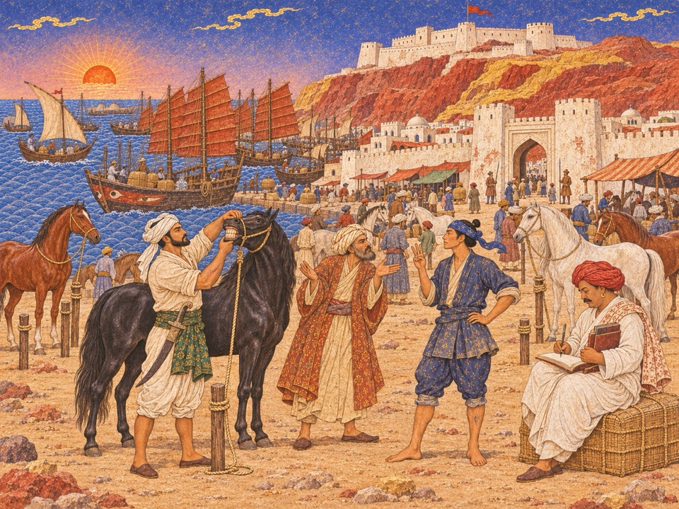
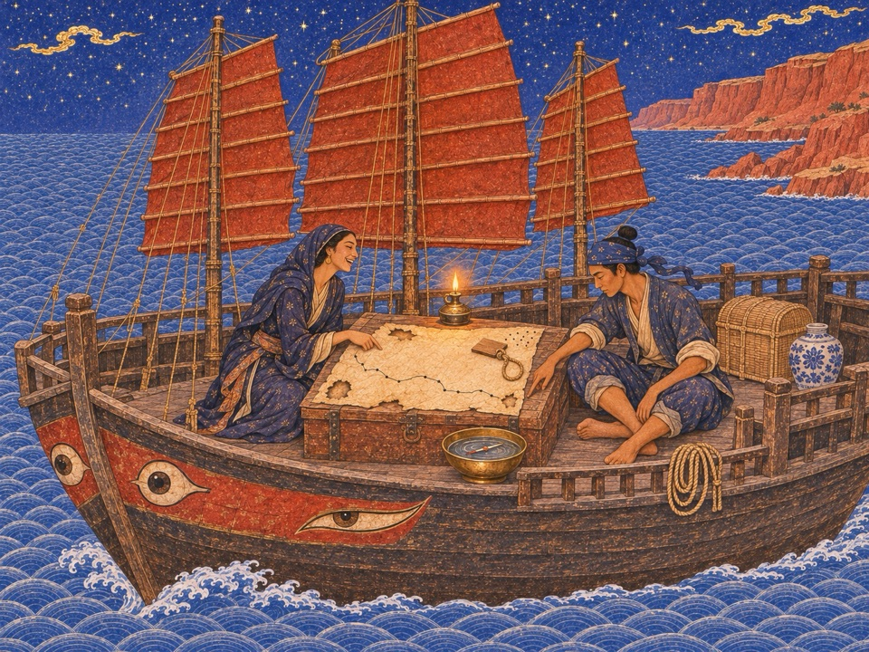
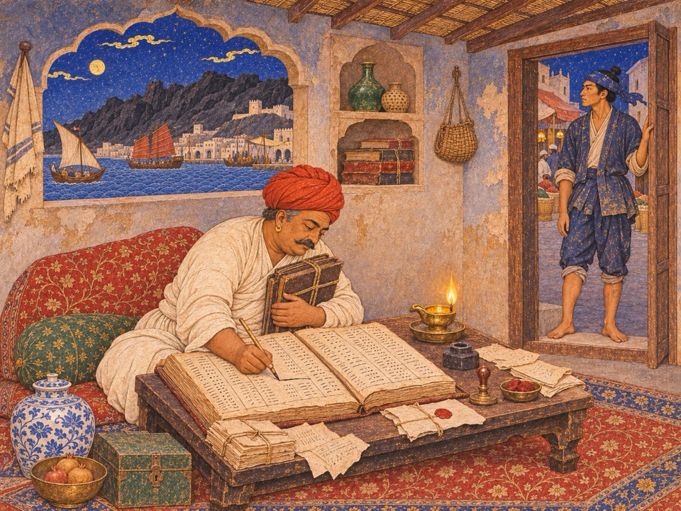

## 1. 물 없는 섬의 시장

1523년 12월, 호르무즈.

돌소금과 유황 냄새가 마른 바람을 타고 갑판 위로 날아왔다.

소보호가 닻을 내린 항구 뒤편으로는 나무 한 그루 자라지 않는 붉고 누런 민둥산이 병풍처럼 서 있었다. 항구 어귀 오른쪽 벼랑 위에는 하얀 회반죽을 바른 돌 요새가 솟아 있었고, 성벽 꼭대기에서 포르투갈의 붉은 십자 깃발이 펄럭였다. 물도 풀도 없는 작은 섬이었으나, 부두 앞 모래톱에서 성문 안쪽 시장까지 다우와 큰 범선들이 빈틈없이 들어차 있었다.

"식수부터 사야겠구나. 여기 우물물은 소금기가 올라와서 못 먹는다."

탄 노인이 마른 입술을 축이며 부두를 가리켰다. 돌계단마다 물부대를 진 물장수들이 줄을 서 있었고, 그 뒤로 아랍과 페르시아 상인, 인도 짐꾼들이 뒤섞여 비단과 진주 상자, 마른 생선을 부리고 있었다.

이브라힘의 파라오 전선도 옆자리에 닻을 내렸다. 이브라힘이 뱃머리에 올라서서 손을 털며 건너왔다.

"호르무즈까지 데려다주마 한 약속은 지켰다. 이제 내 배에는 말을 실어야 해."

갑판 한쪽에서 장부를 챙기던 데브지가 두꺼운 묶음을 품에 낀 채 앞으로 나섰다. 한 달 가까이 뭍을 밟지 못해 핼쑥하던 얼굴에 모처럼 핏기가 돌았다.

"이브라힘 선장님, 마침 잘 오셨습니다. 캘리컷에서 실어 온 후추와 계피를 여기서 풀면 은화가 적지 않게 남습니다. 하지만 빈손으로 나갈 수는 없지요."

"그래서 뭘 실을 셈입니까." 차오가 물었다.

데브지가 성문 밖 모래 마당에 이어진 천막들을 가리켰다. 말 울음소리가 바람을 타고 들려왔다.

"저기 페르시아와 아라비아에서 건너온 군마들입니다. 캘리컷이나 비자야나가르의 성주들은 늘 좋은 말을 찾습니다. 말을 사서 이브라힘 선장님 배로 인도에 보내면 후추를 파는 것보다 몇 갑절은 남습니다."

"우리 배는 좁고 낮아서 말은 못 싣습니다." 차오가 소보호의 선창을 내려다보며 말했다.

"소보호에는 말을 싣지 않습니다." 데브지가 고개를 저었다. "우리는 여기서 후추를 판 은화와 가벼운 진주, 아덴에 가서 팔 비단을 싣습니다. 말 세 필은 모래톱의 빚으로 치고, 우리는 서쪽으로 더 내려갈 밑천을 쥐는 거지요. 다만……."

데브지의 시선이 벼랑 위 포르투갈 요새로 올라갔다.

"세관 관리들이 부두 입구를 지키고 있습니다. 우리 통행증에는 흠이 있습니다. 요새에 발을 들였다가 고아처럼 압류당할 수는 없지 않습니까."

살마가 뱃전 난간에 기대어 서서 요새 아래 부두를 훑어보았다.

"여기 호르무즈의 왕은 나이 어린 소년이오. 실제 살림은 늙은 재상이 도맡아 보지만, 요새의 포르투갈 사령관이 항구 세금을 반씩 떼어 가오. 부두 정문으로 들어가면 통행증을 보자고 할 게 틀림없소."

차오는 품속의 흠 있는 양피지를 만졌다. 요새의 대포가 항구 전체를 내려다보고 있었다. 짐을 내리지 못하면 말도 못 사고, 아덴으로 갈 식수와 양식도 구할 수 없었다.

"그렇다면 정문 밖 모래톱에 짐을 부립시다." 차오가 말했다. "밤 물때에 작은 거룻배로 후추를 내리고, 내일 아침에는 말 시장부터 가 보지요."

## 2. 말 값

이튿날 아침, 호르무즈 성문 밖 모래 마당은 말 먼지로 자욱했다.

말똥 냄새와 마른 풀 냄새, 땀에 젖은 말 가죽 냄새가 뒤엉켜 코를 찔렀다. 말뚝마다 갈기가 긴 아라비아 말과 뼈대가 굵은 페르시아 말이 매여 있었다. 인도에서 온 상인들과 말 주인들이 서로 소매를 잡아끌며 값을 부르는 소리가 마당을 채웠다.

차오는 데브지, 이브라힘과 함께 마당 안쪽으로 걸어 들어갔다. 이브라힘이 굽은 칼자루를 잡은 손으로 밤색 말 두 필을 가리켰다.

"저놈은 다리가 길고 가슴이 넓다. 바람을 타면 하루에 백 리는 달릴 놈이야."

차오가 다가가려는 찰나, 옆 천막에서 터번을 두른 중년 사내 하나가 웃으며 길을 막아섰다. 사내는 윤기가 흐르는 검은 말 두 필의 고삐를 쥐고 있었다.

"동쪽에서 온 정크 배 선주님 아니시오. 인도로 보낼 말을 찾으신다면 이 검은 말들이 제일입니다. 두 필에 후추 스물네 포대면 거저 드리는 겁니다."

말 주인이 고삐를 흔들자 검은 말 두 필이 고개를 치켜들고 앞발을 굴렀다. 겉보기에는 번지르르하고 살집도 좋았다. 차오는 첫 값에 고개를 끄덕이지 않고 이브라힘을 돌아보았다.

이브라힘이 앞으로 나서며 앞선 검은 말의 고삐를 받아 쥐었다. 말의 윗입술을 벌려 앞니와 어금니를 들여다보더니 코웃음을 쳤다.

"이빨이 다 닳았다. 열다섯 살이 넘은 늙은 말이야."

말 주인의 웃음이 잠깐 굳었다.

"나이가 좀 들었어도 힘만 좋으면 그만이지요."

이브라힘은 대답 대신 몸을 숙여 말의 왼쪽 앞다리를 들어 올렸다. 발굽 바닥을 쓸어 보고 다리 아래쪽 힘줄을 엄지로 누르자 말이 다리를 움찔하며 뒤로 물러섰다.

"발굽 뒤쪽 살이 물러 있고 힘줄에 열기가 남았다. 병을 앓고 막 일어난 놈이야. 두 번째 놈은 숨 쉴 때마다 갈비뼈 끝이 가파르게 들썩이고. 배에 타면 사흘도 못 가 다리가 꺾여서 바다에 던져야 할 짐승들이야."

말 주인이 고삐를 잡아챘다.

"값을 깎으려고 트집을 잡는 거요? 호르무즈에 좋은 말이 얼마나 귀한데."

"좋지 않은 말에 은화를 낼 수는 없습니다." 차오가 앞으로 나서며 손가락으로 천막 안쪽을 짚었다. "우리가 가져온 캘리컷 햇후추는 스무 포대뿐입니다. 아까 보신 밤색 말 두 필과 저쪽 흰 말까지 세 필을 주신다면 후추 열여섯 포대를 내드리지요."

"열여섯 포대? 세 필이면 최소한 스물네 포대는 받아야겠소."

"세관 앞까지 들이는 세금은 우리가 물겠습니다. 당신은 부두 밖 모래톱에서 후추만 받아 가시면 됩니다." 차오가 눈을 좁히며 밤색 말의 머리를 가리켰다. "게다가 저 밤색 말 왼쪽 귀 밑에 흉터가 있더군요. 흠 없는 말 값으로 쳐 드릴 수는 없습니다."

이브라힘이 다가와 밤색 말의 목덜미를 두드리고 발목을 만져 보았다.

"이브라힘, 저 말 어떻소."

"발목이 단단하고 눈빛이 맑다. 흉터야 풀숲에 긁힌 거니 상관없고."

말 주인은 두 사람을 번갈아 보더니 마지못해 고개를 끄덕였다.

"열여덟 포대. 더는 못 깎소."

"좋습니다. 해가 지기 전에 거룻배로 후추를 넘길 때 말 세 필을 이브라힘 선장 배 곁으로 데려오십시오."

데브지가 구자라트 숫자로 말 세 필과 후추 열여덟 포대를 장부에 적었다. 차오는 손에 묻은 흙먼지를 털어 내고 밤색 말의 고삐를 이브라힘에게 넘겼다.

## 3. 반쪽 종이

1524년 1월, 호르무즈.

산호석으로 쌓은 왕궁 안뜰은 바깥 시장보다 서늘했다. 분수에서 떨어지는 물소리가 돌바닥에 울렸지만, 회랑 너머로 벼랑 위 포르투갈 요새의 망루가 그림자처럼 내려다보고 있었다.

차오와 데브지는 회랑 끝 넓은 방으로 안내되었다. 살마도 두건을 고쳐 쓰고 뒤를 따랐다.

비단 방석 위에는 열서너 살쯤 되어 보이는 소년 하나가 화려한 금실 수놓은 겉옷을 입고 앉아 있었다. 호르무즈의 왕이었다. 소년은 긴장한 듯 무릎 위의 손가락만 만지작거렸고, 한마디도 입을 열지 않았다.

그 곁의 낮은 탁자 앞에 흰 수염을 길게 기른 노인이 앉아 있었다. 호르무즈의 실무를 도맡아 보는 늙은 재상, 샤라프 알딘이었다.

"멀리 말라카에서 온 정크 배 선주라 들었소."

샤라프 알딘의 목소리는 낮고 건조했다. 그는 탁자 위에 놓인 옛 가죽 장부와 양피지 뭉치를 손가락으로 짚었다.

"옛날 명나라에서 큰 배들이 왔을 때의 기록이 아직 우리 서고에 남아 있소. 도자기와 비단을 가져왔고, 사자와 말을 가져갔다 적혀 있소."

"맞습니다. 제 선조가 그 선단의 길잡이였습니다." 차오가 허리를 숙여 답했다.

"조부의 이름만으로 배에 물과 짐을 내줄 수는 없소. 이 궁에서 믿는 건 말이나 집안 내력이 아니라 글과 도장뿐이오."

샤라프 알딘이 눈을 들어 창밖을 한 번 보았다. 벼랑 위 요새의 붉은 십자 깃발이 창살 사이로 비쳤다.

"저 위의 사령관이 항구 문서를 날마다 들여다보오. 말라카에서 온 배가 통행증에 흠이 있는데도 호르무즈 왕이 보호해 주었다는 소문이 들어가면, 내일 아침 당장 요새 대포가 궁을 향할 것이오. 소년 왕을 세운 것도 저들이니, 내가 그대들에게 이름과 도장이 찍힌 문서를 써 줄 수는 없소."

방 안이 조용해졌다. 소년 왕은 창밖만 바라볼 뿐 고개를 돌리지 않았다.

"그럼 아무것도 없이 떠나란 말씀이십니까." 데브지가 조심스럽게 물었다. "저희 배는 이제 서쪽 아덴으로 갑니다. 아라비아 남쪽 해안에서 물과 양식을 얻어야 하는데, 호르무즈의 허락이 없으면 부두에 배를 대기도 어렵습니다."

샤라프 알딘은 대답 대신 탁자 서랍에서 빳빳한 양피지 한 장을 꺼냈다. 이름도, 왕의 도장도 찍혀 있지 않은 백지였다.

노인은 양피지를 두 손으로 잡더니 가운데를 쭉 찢어 둘로 나누었다. 한쪽은 제 앞에 두고, 나머지 반쪽에는 붓을 들어 아랍 글씨로 두 줄을 적었다. 그리고 마르기를 기다렸다가 찢긴 반쪽과 붓을 차오 앞으로 밀었다.

"그대 글로도 적으시오."

차오는 노인이 내민 반쪽 종이 귀퉁이에 붓을 찍어 한문으로 받아 적었다.

『이 반쪽을 가진 배에는 밤에 물과 말을 판다.』

샤라프 알딘이 두 반쪽을 나란히 대어 찢긴 자국이 맞는지 확인한 뒤, 한쪽을 제 품에 넣고 다른 한쪽을 차오에게 건넸다.

"요새가 말 세금의 반을 떼어 가오. 요새 장부에 오르지 않는 배가 내게도 쓸모가 있소. 이름도 없고 도장도 없소. 그러니 내일 요새 관리가 묻더라도 내 것이 아니오. 다만 아라비아 남쪽 해안과 호르무즈 외항의 물 창고지기들은 이 아랍 글씨와 찢긴 자리만 보면 밤에 문을 열어 줄 거요. 낮에는 나도 그대들을 모르오."

차오는 찢긴 반쪽 종이를 두 손으로 받아 품속 침경 옆에 넣었다.

차오가 허리를 숙여 물러나올 때, 비단 방석 위의 소년 왕은 여전히 무릎 위의 손가락만 매만지고 있었다.

## 4. 손가락 너비

1524년 2월, 아라비아 남쪽 해안.

호르무즈에서 이브라힘은 말을 실은 배를 이끌고 캘리컷으로 뱃머리를 돌렸다. 떠나기 전, 이브라힘이 뱃머리에서 소리쳤다. "부를 일이 생기면 캘리컷으로 기별해라." 소보호는 남은 후추 값 은화와 비단을 실은 채 홀로 서쪽으로 향했다.

북동풍이 호르무즈 해협을 빠져나와 아라비아 남쪽 해안을 따라 불었다. 배 오른쪽으로는 나무 한 그루 없는 붉고 메마른 바위 절벽이 끝없이 이어졌고, 왼쪽으로는 푸른 바다가 열려 있었다.

열흘째 되던 날, 식수가 줄어들자 소보호는 절벽 아래 작은 항구에 닻을 내렸다. 밤이 되자 차오가 품속의 찢긴 반쪽 종이를 들고 물 창고로 갔다. 창고지기는 등불 아래서 찢긴 종이의 아랍 글씨를 한 번 보더니 말없이 가죽 물부대 여섯 개와 말린 대추야자 두 자루를 내주었다.

다시 닻을 올린 지 닷새 뒤, 항구에서 실어 온 유향 상자에서 매캐하고 달큰한 송진 냄새가 갑판 위로 번졌다. 아덴까지 열흘은 더 가야 했다.

그날 밤, 바다는 거울처럼 잔잔했다.

살마는 어김없이 뱃머리 난간에 서서 목에 걸린 카말을 들었다. 그녀는 아랫모서리를 어두운 수평선 끝에 맞추고, 끈의 매듭을 입술에 물었다.

"오늘 밤 북극성은 여섯 손가락 남짓이오." 살마가 매듭을 만지며 중얼거렸다. "호르무즈에서는 열하나였소."

그 옆에 쪼그려 앉아 놋그릇의 바늘을 살피던 차오가 품속에서 침로도를 꺼냈다. 기름 등불 아래 누런 삼베 종이가 펼쳐졌다. 호르무즈에서 아덴으로 이어지는 네 번째 빈칸 「問星」은 아직 비어 있었으나, 그 빈칸 옆 귀퉁이에는 물길 선과 상관없이 작은 그림 하나가 빽빽하게 그려져 있었다.

작은 점들로 별자리 모양을 찍고, 그 아래마다 한문으로 별 이름과 함께 숫자가 적혀 있었다.

『북진성 열한 지. 화개성 여덟 지.』

살마가 등불을 가까이 대고 그 귀퉁이 그림을 들여다보았다.

"이건 무엇이오. 선이 아니라 점만 찍혀 있구려."

"할아버지 침로도 귀퉁이에 있던 별 그림이오. 밤에 별 높이를 손가락 몇 개로 재는 법이라 적혀 있는데, 사람마다 손가락 굵기가 다를 텐데 어떻게 재는지 몰라 쓰지 못했소."

살마가 별 점들과 숫자를 손가락으로 짚어 보더니, 목에서 카말을 벗어 종이 위에 나란히 놓았다.

살마의 입가에서 짧은 웃음소리가 새어 나왔다. 고아에서 처음 본 뒤로 그녀가 소리 내어 웃은 것은 처음이었다.

"뭐가 그리 우습소."

"바다 끝에서 같은 것을 들고 서로 몰라본 게 우습구려." 살마가 나무판을 가리켰다. "그대 집안 어른들이 적은 '지'는 아랍 길잡이들이 부르는 '이스바'와 같은 거요. 팔을 뻗었을 때 손가락 한 마디 너비. 옛날 우리 할아버지들은 맨손가락으로 쟀지만, 사람마다 굵기가 달라서 이 나무판과 매듭을 만든 거요."

"매듭 하나가 한 지라는 뜻이오?"

"그렇소. 여기 적힌 북진성 열한 지는 내 카말의 열한 번째 매듭과 같소. 아덴까지 가려면 이 높이를 다섯 손가락까지 낮추며 서쪽으로 가야 하오."

차오는 침로도 귀퉁이의 별 그림과 살마의 나무판을 번갈아 보았다.

## 5. 군사는 몇이었지

1524년 3월, 아라비아 남쪽 바다.

밤바람이 한결 부드러워졌다. 붉은 갈색 돛 셋이 바람을 안고 조용히 부풀어 있었다. 갑판 위에서는 사공 아밍과 라자가 번갈아 뱃줄을 잡고 있었고, 데브지는 선실 안에서 등불을 끄고 잠들었다.

차오는 뱃머리에 앉아 기름 등불 아래서 침로도를 다시 훑었다. 갈레의 돌과 호르무즈의 기록, 그리고 살마의 카말까지 겹쳐 보며 네 번째 빈칸의 앞부분을 가늠하던 참이었다.

건너편 밧줄 더미에 기대어 있던 살마가 한참 동안 말없이 차오의 손에 들린 누런 종이를 바라보고 있었다.

"차오."

살마가 낮게 불렀다. 차오가 고개를 들었다.

"그대 선조의 선단은 선물만 싣고 왔소? 군사는 몇이었소?"

차오의 손끝이 종이 위에서 멈췄다.

"선단은 도자기와 비단을 가져와 나누어 주고, 각 나라의 진귀한 물건과 사신을 태워 갔다고 들었소."

"큰 배가 수십 척씩 떼를 지어 왔는데, 비단만 싣고 왔을 리가 있소." 살마가 차오의 눈을 똑바로 보았다. "우리 할아버지 적에 홍해와 아덴 앞바다에 그 배들이 들어왔을 때, 항구 사람들이 모두 성벽 위로 올라가 창을 쥐었다 들었소."

차오는 대답하지 못했다. 할아버지에게 들은 이야기는 일곱 번의 항해와 끊긴 바닷길뿐, 어느 항구에서 피를 흘렸는지는 한 번도 들은 적이 없었다.

뒤쪽 키잡이 자리에 앉아 빈랑을 씹던 탄 노인이 낮게 기침을 했다.

"그만두게, 아가씨. 옛날 일 꺼내 봐야 좋은 소리 안 나와."

"알고 싶어서 묻는 거요, 어른." 살마가 탄 노인 쪽으로 고개를 돌렸다.

탄 노인은 빈랑 껍질을 손에서 털고는 뱃전 너머로 붉은 침을 뱉었다.

"선물만 실은 건 아니지. 배마다 군사가 탔고 전체로 치면 이만 명이 넘었어. 내가 젊었을 적, 차오 할아범한테 술김에 들은 이야기가 하나 있지. 갈레에 비석을 세우고 다음 해던가. 실론 섬 성주 하나가 선단 사람들을 속이고 재물을 노리자, 선단 대장이 군사 이천 명을 끌고 밤중에 산길을 넘어 그 성을 덮쳤지. 성주와 일가를 모조리 사로잡아 배에 싣고 돌아갔어."

차오는 손에 든 침로도를 내려다보았다.

"내 선조가……."

차오가 입을 열었으나 뒤가 이어지지 않았다.

살마는 더 묻지 않고 뱃머리 난간으로 걸어가 어두운 수평선만 바라보았다. 탄 노인도 입을 다물고 향 통에서 새 향을 꺼내 불을 붙였다. 차오는 펼쳤던 침로도를 접어 기름종이에 다시 쌌다.

## 6. 눈먼 길잡이

1524년 4월, 아덴.

검고 뾰족한 화산 바위 봉우리가 바다 위로 불쑥 솟아 있었다.

아덴은 거대한 화산 분화구 안쪽을 깎아 만든 항구였다. 검은 절벽 위마다 돌 망루와 성벽이 이어져 있었다. 십여 년 전 포르투갈 함대가 이 성을 치고도 끝내 오르지 못하고 물러난 곳이었다.

부두 안쪽에는 살마가 폭풍철 전에 먼저 보냈던 다우, 나히다 호가 닻을 내리고 있었다.

"아버지가 기다리실 거요."

차오는 침로도와 놋그릇을 품에 챙겨 살마의 뒤를 따랐다.

바위 비탈 아래 하얀 돌집 안으로 들어서자 유향 타는 냄새와 오래된 양피지 냄새가 났다. 마루 끝 평상 위에 마른 노인이 앉아 있었다. 살마의 아버지 유수프였다. 두 눈은 백태가 끼어 흐려져 있었으나, 발자국 소리를 듣자마자 고개를 들었다.

"살마냐."

"다녀왔습니다, 아버지. 배는 무사히 돌아왔습니다."

살마가 노인의 손등을 짚고 뒤따라 들어선 차오를 가리켰다.

"큰 바다를 함께 건너온 말라카의 길잡이, 린차오라 합니다. 바늘로 길을 잡고, 옛 선단의 별 그림을 가진 사람입니다."

유수프가 흐린 눈으로 차오를 바라보며 손을 내밀었다. 차오가 두 손으로 노인의 마른 손을 잡았다. 평생 밧줄과 나무판을 쥐었을 손바닥이 딱딱했다.

"카말 없이 여기까지 건너왔다니 대단하구려." 유수프가 나직이 웃었다. "옛 선단의 별 그림을 가지고 있다지."

"그렇습니다. 하지만 호르무즈에서 아덴까지 오는 길만 알고, 큰 곶 아래 남쪽 해안으로 내려가는 별길은 빈칸으로 남았습니다. 어르신께 여쭈려고 왔습니다."

유수프가 고개를 끄덕였다.

"아덴을 지나 동쪽으로 뻗은 큰 곶을 돌아 남쪽으로 내려가면, 북극성이 바다 아래로 가라앉아 버리오. 그때부터는 내가 눈이 어두워지기 전까지 보던 남쪽 별들을 잡아야 하오."

노인은 두 눈을 감은 채 손가락을 들어 허공을 짚었다.

"큰 곶을 지날 때 북극성이 두 손가락 아래로 떨어지면, 뱃머리를 남쪽에서 서쪽으로 두 칸 트시오. 그 뒤로 밤바다가 깊어지면 수평선 위 붉은 별과 네 개의 별이 십자처럼 뜬 자리를 보며 내려가야 하오. 물빛이 검푸른 색에서 연한 옥색으로 바뀌는 곳마다 산호초가 숨어 있으니, 별 높이가 한 손가락씩 낮아질 때마다 뭍에서 이십 리 밖으로 물러서야 배가 안 깨지오."

차오는 노인이 읊어 주는 별 이름과 손가락 수, 물빛이 바뀌는 곶의 이름을 하나도 놓치지 않으려 숨을 죽이고 머릿속에 새겼다.

그날 밤, 아덴 부두에 매인 소보호의 선실 안.

사공들이 모두 잠든 뒤, 차오는 작은 기름 등불 아래 먹을 갈았다. 네 번째 그을린 빈칸 「問星」 위에 붓을 대고, 유수프가 일러 준 곶의 모양과 남쪽으로 내려가는 별자리의 높이를 한 획씩 그려 넣었다. 그리고 빈칸 아래 작은 글씨로 써넣었다.

『북쪽 별이 한 지씩 낮아지면 남쪽 별을 잡고, 곶을 돌아 남으로 간다.』

먹물이 마른 뒤, 차오는 손끝으로 아직 따뜻하게 남아 있는 벼루 모서리를 쓸었다.

## 7. 배 한 척

아덴 궁의 뜰은 호르무즈보다 넓고 조용했다. 흰 석회 벽 너머로 바다 냄새가 실려 왔으나, 여기서는 포르투갈 깃발이 보이지 않았다.

차오와 데브지는 살마의 안내를 받아 높다란 기둥이 선 알현실로 들어섰다. 화려한 융단 끝에 아덴의 지배자인 아미르가 앉아 있었다. 다부진 어깨에 흰 터번을 두르고 허리에 짧은 칼을 찬 사내, 아미르 이븐 다우드였다.

차오가 허리를 숙여 인사하자, 아미르가 차오의 남색 두건과 소매를 천천히 훑었다.

"동쪽에서 정크 배를 타고 왔다고 들었소. 옛날 큰 선단이 다녀간 뒤로 이 항구에 중국 배가 들어온 건 백 년 만이오."

"말라카에서 온 린차오라고 합니다."

아미르가 상체를 살짝 앞으로 기울이며 물었다.

"그대의 선단은 무엇을 가져왔고 무엇을 가져갔소."

차오는 잠시 입을 다물었다. 밤 갑판에서 살마가 물었던 말과 탄 노인이 들려준 실론의 이야기가 머릿속을 스쳤다.

차오는 허리를 펴고 아미르를 마주 보았다.

"저는 선단이 아닙니다. 배 한 척입니다."

아미르의 눈썹이 잠깐 꿈틀했다. 옆에 서 있던 데브지가 놀라 숨을 들이마셨다.

"내 선조들이 무엇을 실어 왔고 무엇을 가져갔는지는 제가 다 알지 못합니다. 다만 제 배에는 후추와 비단이 실려 있고, 여기 아덴에서 유향과 몰약을 사서 남쪽으로 내려가려 합니다. 겨울 바람이 설 때까지 이 항구에서 배를 고치고 기다릴 수 있게 허락해 주십시오."

아미르가 한참 동안 차오의 마른 얼굴을 내려다보았다. 이윽고 입가에 옅은 웃음이 번졌다.

"선단이 아니라 배 한 척이라…… 말은 바로 하는군."

아미르가 손짓하자 옆에 있던 서기가 얇은 나무 패찰과 양피지 조각을 가져왔다. 아미르가 인장을 찍어 차오에게 내밀었다.

"이 항구는 붉은 십자 깃발 단 배들만 아니면 누구에게나 열려 있소. 겨울 바람이 불 때까지 부두 안쪽을 쓰고, 물과 유향을 사 가시오. 대신 아덴 앞바다의 물길을 어지럽히는 짓만 하지 마오."

"감사합니다."

차오가 두 손으로 패찰을 받아 들었다.

## 8. 열일곱 척의 장부

1524년 여름, 아덴.

여름이 오자 아덴의 바다는 붉은 먼지를 몰고 오는 뜨거운 바람에 휩싸였다.

남쪽 해안으로 내려가는 북동풍은 겨울이 되어야 불어온다. 그전까지는 어떤 배도 남쪽으로 내려갈 수 없었다. 소보호는 아덴 항구 안쪽 잔잔한 물 위에 닻을 내린 채 한 철을 기다리게 되었다.

선원들이 바짝 마른 갑판에 바닷물을 끼얹고 돛줄을 손질하는 동안, 데브지는 아덴 시장 구석에 작은 방을 하나 얻어 밤낮없이 책상 앞에 앉아 있었다.

방 안에는 기름 등불 하나가 밤새 꺼지지 않았다. 말라카에서 뺏긴 제 배 두 척의 기록, 갈레와 캘리컷에서 들은 소문, 순찰선 산타 크루스에게 건넨 뇌물, 아덴과 호르무즈의 구자라트 상인들에게 얻은 거래 내역까지 모두 한자리에 모였다.

"여기에 호르무즈로 빠져나간 흑단과 상아까지 맞추어 보면…… 모두 열일곱 척입니다."

데브지가 대나무 펜으로 마지막 줄을 그은 뒤 고개를 들었다. 구자라트 숫자와 글씨가 빼곡히 들어찬 두꺼운 장부 두 권이 나란히 놓여 있었다. 살레마가 통행증의 흠을 핑계로 빼앗고 왕실 창고에 올리지 않은 배 열일곱 척의 짐이, 어느 항구에서 누구 손으로 팔렸는지 날짜와 근수까지 적혀 있었다.

"이제 이 사본을 고아의 가스파르 어른에게 보내야 합니다."

이튿날 낮, 데브지는 새로 베껴 적은 장부 사본을 기름종이와 삼베로 단단히 묶었다.

부두에는 막 호르무즈로 떠날 채비를 하는 큰 아랍 다우가 정박해 있었다. 여름 바람을 타고 인도와 페르시아 쪽으로 가는 배였다. 부두 위에는 어느 쪽 눈인지 모를 사람들이 뒤섞여 구경하고 있었다.

예전 같았으면 사람 눈을 피해 등 뒤로 장부를 감추었을 데브지였다. 하지만 그날 데브지는 붉은 터번을 반듯하게 고쳐 쓰고, 사람 많은 부두 한가운데로 성큼 걸어 나갔다.

"호르무즈의 캄베이 상인 회관 앞으로 가는 꾸러미입니다. 거기서 고아로 가는 배에 꼭 전해 주십시오."

데브지는 다우 선장 앞에서 꾸러미 매듭 위에 붉은 밀랍을 녹여 붓고, 자기 이름과 상단 도장을 힘껏 눌러 찍었다. 지켜보던 선원들이 수군거렸으나 데브지는 어깨를 움츠리지 않았다. 오히려 선장에게 은화 두 냥을 더 얹어 주며 또렷한 목소리로 당부했다.

"고아 항구 길잡이 가스파르 누네스 어른 손에 직접 들어가야 하는 물건입니다. 부디 잘 부탁드립니다."

꾸러미가 배 선창 안으로 들어가는 것을 끝까지 지켜본 뒤에야, 데브지는 차오 쪽으로 돌아섰다. 둥근 얼굴에 땀이 흐르는 채로, 늘 장부를 끼고 있던 팔을 처음으로 빈 채 몸 옆에 편히 늘어뜨렸다.

## 9. 암초 사이의 별길

1524년 늦여름, 홍해 어귀.

아덴에서 바람을 기다리는 동안 배를 놀릴 수만은 없었다. 차오는 아덴 서쪽, 홍해 어귀의 바위 곶 그늘로 가서 질 좋은 유향과 몰약을 더 실어 오기로 했다. 유향 배들이 모이는 정박지였다. 아미르의 패찰이 있으니 며칠이면 다녀올 짧은 뱃길이었다.

정박지에는 부두가 없었다. 동쪽 해안에서 유향을 싣고 온 작은 배들이 곶 그늘에 닻을 내리고 큰 배가 오기를 기다렸다. 선주들은 패찰의 인장을 보고서야 소보호 뱃전에 제 배를 붙였다. 배에서 배로 유향 스무 상자를 옮겨 실어 선창을 채우고, 아덴으로 돌아오던 셋째 날 오후였다.

망대의 아밍이 다급하게 종을 두드렸다.

"앞쪽 곶 너머에 붉은 깃발이 보입니다! 두 척입니다!"

차오가 뱃머리로 달려가 눈을 가늘게 떴다. 아덴으로 들어가는 바위 곶 바깥쪽 물길 어귀에 배 두 척이 떠 있었다. 돛대에 붉은 십자 깃발이 걸린 살레마의 순찰선들이었다. 아덴 항구 안쪽까지 들어오지 못한 채 바깥 길목을 지키는 모양이었다. 앞선 배는 흰 삼각 돛에 뱃전의 청동 대포가 둘이었다.

데브지가 선창 뚜껑을 잡은 채 그 배를 오래 보았다.

"산타 크루스입니다. 계피 두 묶음과 은화 열 냥을 받아 간 그 배입니다. 어떡합니까. 맞서 싸우면 소보호가 부서집니다."

"싸우지 않습니다. 닻을 내리고 해가 지기를 기다립니다."

차오는 돛을 내리고 해안 바위 그늘 뒤에 배를 숨겼다. 순찰선 두 척은 얕은 물가로 들어오지 못한 채 바깥 바다를 맴돌았다.

밤이 찾아왔다. 달빛마저 구름에 가렸으나 수평선 위로 별들이 낮게 깔렸다.

"저 배들이 지키는 깊은 수로는 버리오." 살마가 뱃머리로 나와 카말을 들었다. "바위 곶 안쪽으로 바짝 붙으면, 썰물 때 산호초 사이에 작은 배 하나 지날 물골이 열리오."

"어둠 속에서 암초를 어떻게 피합니까." 리우가 걱정스러운 얼굴로 물었다.

"내가 별을 잴 테니, 차오가 키를 잡으시오."

탄 노인이 말없이 키 자루에서 비켜섰다. 차오가 두 손으로 굵은 키 자루를 쥐었다. 손바닥에 오래된 나무의 거친 결이 닿았다.

살마가 뱃머리 끝에 서서 카말을 들어 올렸다. 그녀는 수평선 끝과 낮은 별 사이를 몇 번이고 재어 보더니, 뒤를 돌아보지 않고 낮게 일렀다.

"지금이오. 곶 쪽으로 두 뼘 틀고, 바닷물 색이 짙은 곳만 따라가시오."

차오가 키를 힘껏 밀었다. 소보호가 뱃머리를 돌려 시커먼 바위 곶을 향해 미끄러졌다. 왼편 어둠 너머에서 포르투갈 배의 등불 두 개가 느리게 흔들리고 있었다.

배 양옆으로 하얀 물보라가 일며 암초가 턱밑까지 다가왔다.

"별이 반 지 올라갔소. 오른쪽으로 한 뼘."

살마의 말에 차오가 곧바로 키를 꺾었다. 소보호의 바닥이 산호초 끝을 아슬아슬하게 비켜 나갔다. 바깥 바다에서는 여전히 순찰선 두 척이 등불을 밝히고 있었다.

한 시진 넘게 암초 사이를 기어 나온 소보호가 마침내 아덴 만의 넓은 물결 위로 빠져나왔다. 차오는 키를 잡은 손에 힘을 풀고 숨을 내쉬었다. 뱃머리에서 카말을 내려놓는 살마의 어깨가 어둠 속에서 가볍게 들썩였다.

## 10. 향 통

1524년 가을, 아덴 부두.

무덥던 여름 바람이 한풀 꺾이고, 서쪽에서 인도를 향해 불어가는 마지막 바람이 부두의 돛을 흔들기 시작했다.

이른 아침, 아덴 부두 끝에 캘리컷으로 떠나는 큰 아랍 상선 한 척이 닻을 올릴 채비를 하고 있었다. 그 부두 돌계단 앞에 탄 노인이 작은 보따리 하나를 등에 멘 채 서 있었다. 낡은 삿갓과 회색 저고리는 말라카를 떠나올 때와 다름없었다.

"여기서 내리기로 한 거, 다들 알고 있지 않느냐."

탄 노인이 배웅 나온 차오와 선원들을 둘러보며 퉁명스럽게 말했다.

"좀 더 가시지 않고요. 이제 겨울 바람만 서면 남쪽 끝까지 금방입니다." 아밍이 눈시울을 붉히며 말했다.

"이 늙은이가 거기까지 가서 뭘 하냐. 요즘엔 밤바다에 나가면 눈이 침침해서 향 타는 눈금도 잘 안 보여." 탄 노인이 손을 내저었다. "이 배 타고 캘리컷에서 겨울을 나고, 봄에 남서풍이 서면 말라카 가는 배를 얻어 타마. 여름 전에는 집에 닿을 거다. 뤄 영감한테 밀린 빚 절반도 잘 있나 봐야지."

탄 노인은 차오 앞으로 한 발 다가섰다. 일흔이 된 마른 노인은 차오의 어깨를 한 번 툭 치더니, 허리춤에 차고 있던 대나무 통을 풀었다.

오랜 세월 손때가 묻어 반질반질하게 빛나는 낡은 향 통이었다. 노인이 말라카에서부터 밤바다의 경을 재던 물건이었다.

"이건 네가 차라."

"어르신 쓰셔야지요."

"아랍 배는 별로 밤을 재니, 나야 남의 배 얻어 타고 가는데 이게 왜 필요하냐."

탄 노인이 차오의 허리띠에 직접 향 통을 매어 주었다. 안에는 마른 향 몇 개비가 들어 있어 흔들릴 때마다 가볍게 부딪히는 소리가 났다.

"소보호 뱃머리에 짝짝이 눈 잘 봐라. 두 눈 다 앞을 보고 있으니 길 잃을 일은 없을 거다."

차오가 한 걸음 더 다가가 낮게 말했다.

"캘리컷에 닿으시면 이브라힘에게 이 말만 전해 주십시오. 겨울 바람이 서면 말린디로 오라고."

탄 노인이 눈을 흘기며 코웃음을 쳤다.

"그 성질 급한 놈한테 내가 심부름까지 해야 하느냐."

노인은 더 말하지 않았다. 삿갓을 고쳐 쓰고, 보따리를 고쳐 멘 뒤 삐걱거리는 나무 발판을 밟고 아랍 상선 위로 올라갔다. 배가 부두를 떠나 미끄러져 나갈 때까지, 탄 노인은 갑판 난간에 기대어 한 번도 뒤를 돌아보지 않았다.

차오는 허리춤에 새로 매달린 대나무 향 통을 두 손으로 감싸 쥐었다. 낡은 대나무 마디가 아침 햇볕을 받아 미지근하게 데워져 있었다.
