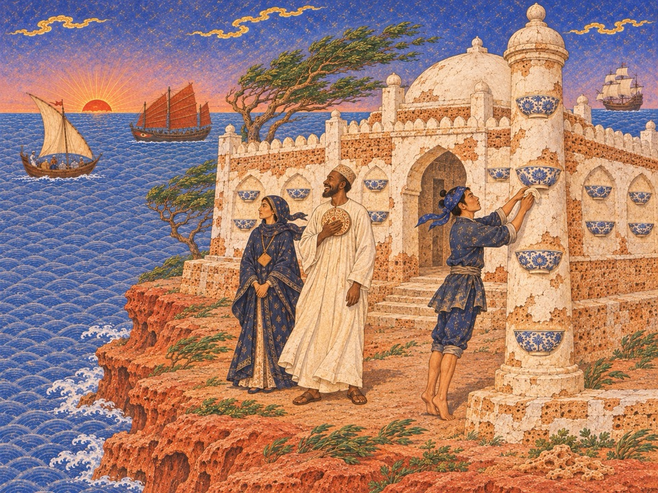
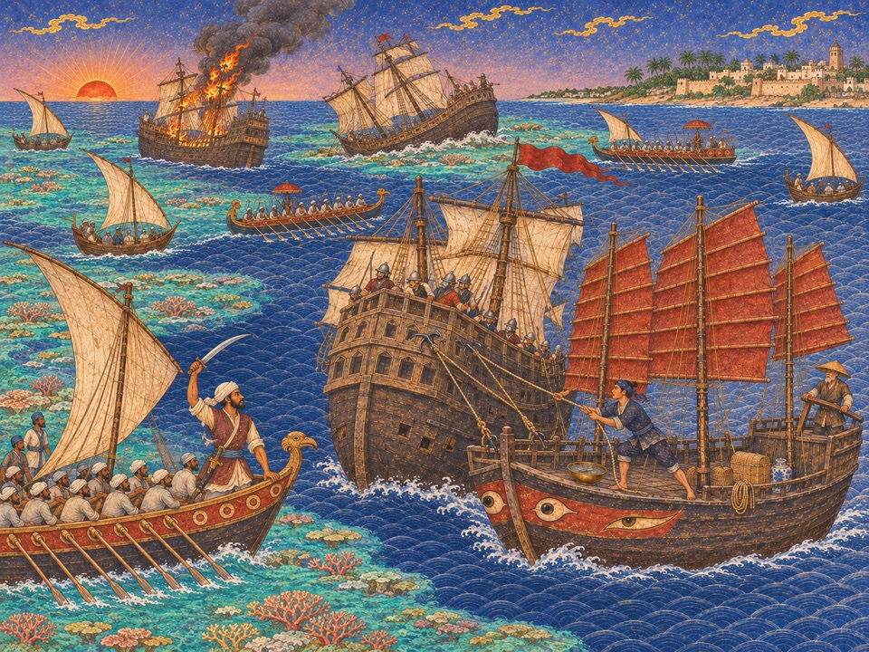
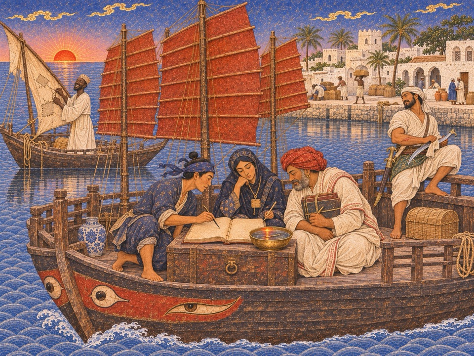

## 1. 향 통

1524년 11월, 아덴 앞바다.

북동풍이 붉은 갈색 돛 셋을 팽팽하게 밀었다.

린차오는 허리춤의 대나무 향 통을 열었다. 탄 노인이 아덴 부두에서 채워 주고 간 통이었다. 마른 향 하나를 꺼내 불을 붙이자 매운 연기가 바람에 찢겼다.

차오는 향을 놋접시에 눕혔다. 재가 한 마디 떨어질 때마다 한 경이 지난다. 지금 키를 잡은 것은 말라카 사공 리우였고, 탄 노인이 늘 걸터앉던 키 옆 궤짝은 비어 있었다.

"리우 영감, 돛줄 조금만 더 당기십시오."

"알겠습니다, 선주."

나흘째 되던 날, 소보호는 동쪽으로 길게 뻗은 바위 곶을 돌았다. 유수프가 일러 주던 큰 곶이었다. 곶을 돌아 남쪽으로 내려갈수록 북극성이 밤마다 낮아졌다.

차오는 품속에서 침로도를 꺼내 등불 아래 펼쳤다. 네 번째 빈칸 아래로 선이 흐려지다 끊긴 마지막 구간이 이어졌다. 붓글씨로 적힌 항구 이름들은 낯설었고, 굵은 먹선은 작은 점선으로 바뀌었다가 다섯 번째 빈칸 앞에서 멈추어 있었다.

「問獸」

"짐승에 물어라." 차오가 나직이 읽었다.

"무슨 짐승한테 길을 묻는다는 거요." 살마가 눈썹을 찌푸렸다. 차오는 종이를 접어 품에 넣었다.

열흘이 지나고 보름이 지났다. 보름째 밤에는 북극성이 수평선 물안개에 잠겨 보이지 않았다.

"오늘부터는 내 카말도 북쪽 별을 버리오."

살마가 뱃머리 난간에 기대어 나무판을 들어 올렸다. 그녀는 수평선 끝과 남쪽 하늘에 떠오른 붉은 별, 그리고 십자 모양으로 모인 네 개의 별을 번갈아 재었다.

뭍 쪽으로는 하얀 모래 언덕과 가시덤불 숲이 끝없이 이어졌다. 아덴에서 실은 식수 통이 바닥을 드러내 선원들은 하루에 두 번, 나무 표주박에 반씩만 물을 받아 마셨다. 입술이 틀 때마다 데브지는 말린 대추야자를 입에 물고 장부 궤짝 위에서 졸았다. 아밍과 라자, 무사는 번갈아 뱃전의 소금딱지를 긁어냈다.

스무날째 밤, 놋접시 위의 향이 다 탔다. 차오는 자다 깬 눈을 비비며 새 향에 불을 붙였다. 바람이 셀 때마다 불씨가 빨리 타 경수를 맞추기 어려웠다. 차오는 놋그릇에 뜬 쇠바늘 끝을 들여다보았다. 바늘은 흔들림 없이 남쪽을 가리키고 있었다.

## 2. 말린디의 다우

1524년 12월, 동쪽 해안의 작은 항구.

이른 아침, 소보호는 연한 옥색으로 물든 얕은 바다 앞을 지나고 있었다.

"물빛이 옅습니다. 닻을 내릴까요."

망대의 아밍이 소리쳤다. 차오가 납추 줄을 던지자 열 발도 풀리지 않아 단단한 곳에 걸렸다. 끌어올린 납추 끝 기름에는 하얗게 부서진 산호 가루가 박혀 있었다.

"리우 영감, 키를 왼쪽으로 꺾으십시오. 밑이 온통 산호초입니다."

썰물이 밀려나기 시작한 터라 뱃바닥이 물밑 돌턱으로 끌려 들어갔다. 사공들이 삿대를 들고 뱃전으로 몰려들었다.

그때 앞쪽 곶 너머에서 커다란 삼각 돛을 단 다우 한 척이 나왔다.

다우는 산호초가 거품을 무는 물살을 가로질러 소보호 곁으로 다가왔다. 뱃머리에 키가 크고 피부가 검은 사내 하나가 서 있었다. 흰 긴 옷에 실로 무늬를 수놓은 둥근 모자를 쓴 사내였다.

사내가 소보호 쪽을 향해 크게 웃었다.

"이 물때에 정크가 여기로 들어오면 산호한테 배 밑바닥을 뜯기오!"

아랍 말이었다. 살마가 손을 들어 응답하자 사내는 소보호 앞으로 뱃머리를 돌렸다.

"내 배 고물만 따라오시오. 물빛이 짙은 고랑으로 빼 주겠소."

차오는 돛을 반쯤 내리고 다우를 따랐다. 다우는 흰 포말이 이는 산호초 턱 사이를 걸음을 늦추지 않고 돌아 나갔다. 짙푸른 물고랑을 따라 반 시진 남짓 빠져나오자 잔잔한 만이 열렸다.

만 북쪽 언덕 위로 흰 성벽이 길게 뻗어 있었다. 두 배는 모가디슈 성벽 아래 남쪽 정박지로 들어가 어촌 앞 물 위에 나란히 닻을 내렸다. 사내가 거룻배로 소보호에 건너왔다. 서른다섯쯤 되어 보이는 단단한 체격이었다.

"바카리오. 말린디에서 왔소." 바카리가 갑판에 내려서며 또 껄껄 웃었다. "배 눈이 양쪽이 다르군. 한쪽은 동쪽 눈이고 한쪽은 우리 바다 눈이오."

"린차오라 하오. 산호초에서 살려 주셔서 고맙소."

"물 빠지는 시간과 바람만 알면 피해 가지만, 낯선 배는 당하기 십상이지. 이 해안은 물때를 모르면 못 지나가오."

"영주의 배를 모는 길잡이오?" 살마가 물었다.

바카리가 손을 저었다.

"나는 누구 밑에서 일하는 사람이 아니오. 내 다우를 몰고 말린디와 킬와, 몸바사를 오가며 상아와 천을 나르는 선주지. 말린디로 가는 길이니 앞장서 주겠소."

데브지가 선실 안에서 마른 대추야자 꾸러미를 들고 나와 건넸다. 바카리는 대추야자 하나를 입에 던져 넣고 다시 웃었다.

## 3. 짧은 편지

1525년 1월, 말린디.

바카리의 다우를 따라 나흘을 더 내려가자, 산호석으로 지은 하얀 집들이 야자나무 숲 사이로 줄지어 선 항구가 나타났다. 말린디였다.

부두 안쪽에는 다우 수십 척이 닻을 내리고 있었다. 뭍에서는 상아와 밀랍, 붉은 천을 나르는 짐꾼들의 말소리가 들려왔다.

차오는 성벽과 항구 어귀를 살폈다. 말린디는 오래전부터 포르투갈과 가까웠다고 들었다. 어디선가 붉은 십자 깃발을 단 군선이 보일 것이라 여겼으나, 항구에는 돌요새가 없었다. 성문 옆 허름한 창고 앞 모래밭에 수염을 기른 포르투갈 장사꾼 서넛이 앉아 상아 값을 흥정할 뿐이었다. 부두 바깥쪽에도 작은 소식선 한 척만 떠 있었다.

"포르투갈 상관은 오래전에 문을 닫았소." 바카리가 배를 대며 말했다. "수심이 얕아 다들 물러갔지. 지금은 장사꾼 몇이 남아 물건만 바꿔 가오. 저 배도 며칠 전 고아에서 온 배요."

그날 오후, 항구 서기 하나가 데브지에게 밀랍으로 봉한 얇은 종이 한 장을 건넸다. 고아에서 온 배가 말라카 정크가 닿거든 전해 달라고 맡긴 편지였다.

데브지가 봉인을 뜯고 목소리를 낮추어 읽었다.

"고아의 가스파르 누네스 어른이 보낸 편지입니다."

짧고 마른 문장이었다.

『장부 사본은 고아 관청에 올렸소. 바스쿠 살레마는 통행증 위조와 짐을 빼돌린 죄로 감독관 직위를 잃었소. 붙잡히기 직전 순찰선 세 척을 이끌고 고아를 빠져나가 사라졌소. 말린디 앞바다를 조심하시오.』

종이 끝에는 날짜와 서명뿐, 안부 인사도 없었다.

"직위를 잃었습니다. 이제 관청 사람이 아닙니다." 데브지가 숨을 내쉬었다.

"하지만 배 세 척을 몰고 사라졌습니다." 차오가 남쪽 바다를 보았다. "왕의 깃발 없이 떠도는 자라면 전보다 더 거칠어졌을 겁니다."

"고아에서 남쪽으로 달아났다면 갈 곳은 여기 아니면 몸바사뿐이오." 살마가 카말의 끈을 만지며 말했다. 차오는 편지를 접어 데브지에게 돌려주었다.

## 4. 짐승에 물어라

이튿날 아침, 차오는 바카리를 따라 말린디 성벽 바깥의 마른 풀밭으로 걸어 나갔다.

품속에는 다섯 번째 빈칸이 비어 있는 침로도가 들어 있었다. 침경에는 말린디 이후의 글자가 남아 있지 않았고, 그을린 자리에 두 자만 남았다.

「問獸」

"목 긴 짐승이 저기 있소."

바카리가 아카시아 나무 그늘 아래를 가리켰다.

울타리 안에 짐승 두 마리가 서 있었다. 다리가 어른 키보다 길고 목은 야자나무 줄기처럼 높았다. 누런 가죽 위에 붉은 갈색의 굵은 무늬가 덮여 있었다.

짐승 하나가 긴 혀를 내밀어 가시 사이에서 연한 잎사귀를 훑어 먹었다. 크고 검은 눈을 깜빡이더니 긴 목을 돌려 차오 쪽을 내려다보았다. 마른 풀 냄새와 짐승의 거친 숨소리가 났다.

"기린이라 부르는 짐승이오?" 차오가 물었다.

"우리는 트위가라 부르오." 바카리가 울타리에 기대며 말했다. "내 할아버지의 할아버지 적에, 동쪽 바다에서 산처럼 큰 배들이 와서 이 짐승을 싣고 갔다고 했소. 말린디 왕이 보냈다는 이야기가 노인들 입에 남아 있지."

데브지가 눈을 크게 뜨고 짐승을 올려다보았다.

"이 큰 짐승을 나무 배에 실어 그 먼 바다를 건너갔단 말입니까."

"그랬다더군. 하지만 노인들도 그 배들이 어느 길로 돌아갔는지는 모르오."

차오는 울타리 너머로 걸어가는 기린의 긴 다리를 바라보았다.

"바카리, 혹시 이 근처에 옛 선단이 남긴 돌이나 물건은 없소."

바카리가 모자를 밀어 올리며 생각에 잠겼다.

"돌은 모르겠소. 다만 북쪽 해안 언덕에, 이 고장 어른의 무덤에 중국 그릇이 박혀 있는 곳은 하나 있소."

## 5. 청화 그릇과 기둥 무덤

말린디 북쪽 해안은 붉은 산호 바위가 파도에 깎여 가파른 턱을 이루고 있었다.

바닷바람이 부는 풀밭 한가운데, 산호석과 흰 회반죽으로 쌓아 올린 커다란 무덤이 서 있었다. 앞쪽에는 어른 키 두 배는 될 법한 둥근 돌기둥이 솟아 있었다.

"옛날 이 고장을 다스리던 어른의 무덤이오." 바카리가 모자를 벗어 가슴에 대며 말했다.

무덤의 흰 회벽과 돌기둥 틈새마다 파란 그림이 그려진 둥근 도자기 그릇들이 박혀 있었다. 뤄 영감 가게에서 보던 것과 같은 청화 그릇들이었다.

"선단 사람들이 여기에 묻힌 거요?" 살마가 물었다.

"아니오. 무덤 주인은 우리 스와힐리 어른이오. 바다 건너온 귀한 그릇을 얻으면, 죽은 뒤에 무덤 벽에 박아 기렸소. 선단의 누군가가 건넨 그릇을 이 고장 어른이 무덤까지 가져간 게지."

차오가 회벽에 박힌 그릇들을 살폈다. 대부분 안쪽 바닥이 바깥을 향해 묻혀 깨진 가장자리만 보였다.

그런데 돌기둥 허리쯤, 어른 어깨높이에 박힌 그릇 하나가 회반죽이 떨어져 나가며 비스듬히 솟아 있었다. 그릇이 뒤집혀 박히는 바람에 파란 꽃무늬 대신 뒤쪽의 동그란 굽이 드러나 있었다.

차오가 발돋움을 하고 손가락으로 굽 위의 하얀 흙먼지를 쓸어냈다.

유약이 발리지 않은 거친 흙 바탕 위에 뾰족한 쇠끝으로 긁어 새긴 글씨가 나타났다. 한자 넉 자였다.

『永樂十六』

그 아래로 깨알 같은 한문 한 줄이 반원을 그리며 이어져 있었다.

『南行三更 見山轉西 勿近淺礁』

남쪽으로 세 경을 가다 산이 보이면 서쪽으로 돌고, 얕은 암초에 가까이 가지 말라는 뜻이었다. 영락 십육 년, 선단이 이 해안에 닿았던 해에 선단의 누군가가 남긴 침로 한 줄이었다.

차오는 무덤의 거친 돌벽에 이마를 대고 움직이지 못했다. 목구멍 안쪽이 뜨겁게 조여 들었다.

차오는 소매 끝으로 눈가를 한 번 세게 문질렀다. 짭짤한 물기가 마른 소매에 스며들었다. 바카리와 살마는 한 걸음 물러나 바다 쪽만 바라보았다.

그날 밤, 소보호의 선실 안.

차오는 등불 심지를 돋우고 먹을 갈았다. 마지막 빈칸 「問獸」 아래에 말린디의 해안선과 북쪽 기둥 무덤의 자리를 그려 넣고, 그릇 굽의 침로와 바카리에게 들은 암초 밖 물길을 이어 적었다.

『동쪽 큰 곶을 돌아 남으로 내려오다 물빛이 옅어지면 뭍에서 스무 리 밖으로 물러서고, 말린디 앞에서는 산을 보고 서쪽으로 돈다.』

먹물이 마른 뒤, 다섯 군데의 빈칸이 모두 검은 먹선으로 이어졌다. 차오는 붓을 씻어 벼루 곁에 내려놓았다.

## 6. 빈 장

이튿날 아침, 말린디 부두에는 생선 비린내와 마른 짚 냄새가 섞여 났다.

차오는 갑판 나무 상자 위에 침로도를 펼쳐 놓고 돌멩이로 네 귀퉁이를 눌렀다. 그 옆에는 실로 맨 침경이 펼쳐져 있었다.

침로도에는 그을린 빈칸이 하나도 남지 않았다. 하지만 침경의 맨 마지막 장은 여전히 텅 비어 있었다. 누런 종이 한가운데, 할아버지가 남겨 둔 「제8차」 석 자만 적혀 있었다.

살마가 갑판 위로 올라와 두 종이를 번갈아 보았다.

"빈칸 다섯 개를 다 채웠구려. 그런데 그 책의 마지막 장은 왜 아직 비어 있소."

차오는 침경의 빈 종이를 손바닥으로 쓸었다. 데브지도 옆에서 고개를 내밀고 붉은 터번을 만지작거렸다.

"할아버지가 일곱 번 가고 여덟 번째는 가지 못했다고 하셨소. 여기가 끝인데도 무엇을 적어야 할지 모르겠소."

살마가 침경의 첫 장을 몇 번 넘기더니, 다시 마지막 장을 펼쳐 손가락으로 짚었다.

"그건 지도가 아니지 않소. 항해 기록이지."

차오는 더 묻지 않았다. 자리에서 일어나 선실로 내려가더니, 쇠붙이 상자에서 가죽으로 싼 벼루와 새 먹 한 덩이를 꺼내 갑판 위로 가져왔다. 그리고 아밍을 불러 새 종이 열 장을 잘라 「제8차」 장 뒤, 침경 뒷표지 앞에 덧대고 새 끈으로 튼튼하게 꿰매어 묶었다. 바닷물에 젖지 않게 밀랍칠을 한 줄로 매듭을 지었다.

데브지가 둥근 눈을 깜빡이며 그 손을 지켜보았다. 차오는 붓 끝을 손가락으로 한 번 고른 뒤, 침경과 침로도를 함께 묶어 품속에 넣었다.

## 7. 예의 바른 편지

열흘쯤 지난 날이었다.

부두 바깥쪽에서 노를 젓던 고깃배 한 척이 급히 뱃머리를 대더니, 사내 하나가 뛰어내려 차오에게 양피지 봉투를 내밀었다.

"남쪽 몸바사 앞바다에 떠 있는 큰 배에서 보낸 편지랍니다."

차오가 붉은 밀랍을 떼어 내자 단정한 필체의 포르투갈 글씨가 나왔다. 데브지가 종이를 받아 들더니 목소리를 낮추어 옮겨 읽었다.

『말라카에서 온 정크 소보호의 린차오 선주에게. 먼 바다를 건너 말린디까지 온 것을 치하하오.』

데브지가 침을 삼키고 다음 줄을 읽었다.

『고아의 일은 서로 잊기로 합시다. 내게 필요한 것은 그대 품속의 침로도뿐이오. 그 종이를 넘겨준다면 나는 이 바다를 떠나겠소. 내 배 셋의 대포를 거두고 말린디 앞바다를 열겠소. 그렇지 않다면, 앞으로 말린디로 드나드는 모든 배는 내 대포 앞을 지나야 할 것이오.』

데브지의 손끝이 떨렸다. "관청 깃발도 없이 배 셋으로 몸바사 앞바다를 막고 있습니다."

소식이 퍼지자 부두가 술렁였다. 남쪽으로 가는 다우도 발이 묶이고, 살레마의 배가 북쪽으로 올라오면 인도에서 오는 상선도 모두 위험해질 판이었다. 포르투갈 장사꾼들 역시 낯빛이 어두워졌다.

차오는 편지를 접어 주머니에 넣었다.

"데브지, 부두 안쪽에 우리 편에 설 만한 배가 몇이나 됩니까."

"바카리의 다우 몇 척뿐입니다. 대포 열 문씩 달린 큰 배 셋은 못 당합니다."

차오는 부두 끝 수평선을 바라보았다. 북쪽에서 불어오는 겨울 바람은 아직 세차게 돛을 흔들고 있었다. 탄 노인이 아덴 부두를 떠나던 날, 맡겼던 말이 머릿속을 스쳤다.

## 8. 모이는 돛

1525년 2월, 말린디.

사흘 뒤 해 질 무렵, 수평선 위로 익숙한 모양의 큰 삼각 돛 세 개가 떠올랐다.

배 양옆으로 긴 노가 열두 개씩 뻗어 나오는 큰 돛배 셋이었다. 맨 앞선 배 뱃머리에 흰 두건을 동여맨 사내가 굽은 칼을 차고 서 있었다.

"이브라힘!"

아밍이 망대에서 소리를 지르며 내려왔다. 배가 닿기도 전에 이브라힘이 돌바닥으로 뛰어내려 차오의 어깨를 턱 밀쳤다.

"이 망할 놈의 길잡이야! 사람을 부르려면 제대로 부를 것이지!"

이브라힘이 굵은 목소리로 투덜거렸다.

"탄 노인이 캘리컷에 와서 다짜고짜 말린디로 가라더군. 이유도 안 알려 주고 겨울 바람 놓치기 전에 당장 돛 올리라고 호통만 치고 갔어. 그 성질 급한 영감 등쌀에 큰 배 셋을 끌고 이 바다를 건너왔단 말이다!"

투덜거리는 입가와 달리 이브라힘의 눈빛은 웃고 있었다.

"살레마 놈이 여기 있다고 들었어. 캘리컷 앞바다에서 빚진 포탄 값, 여기서 마저 갚아 주지."

바카리가 말린디의 다우 네 척을 불러 모았다.

"주마! 음와나!"

바카리가 부두 끝에서 부르자 다우 고물에 서 있던 선장 둘이 손을 들어 답했다. 바카리가 차오를 돌아보며 웃었다.

"가는 길 내내 주마와 음와나의 다우를 소보호 곁에 붙여 두겠소. 정크 혼자 산호초 물길에 두면 내 잠자리가 편치 않소."

다우 넷 곁에 이브라힘의 큰 돛배 셋과 차오의 소보호가 섰다. 다음 날 아침에는 항구 창고 앞에 모여 있던 말린디의 포르투갈 장사꾼 네 명도 화승총과 화약 통을 들고 다우에 올랐다. 말린디 왕도 창 든 군사 스물을 바카리의 다우에 나눠 태웠다.

"살레마는 고아 총독 이름에 먹칠을 한 도둑놈이오. 저자가 길목을 막으면 우리도 고아로 못 돌아가오." 키 큰 장사꾼 하나가 말했다.

여덟 척이 모였으나 식수와 기름 항아리가 모자랐다. 차오가 품속에서 두 가지 물건을 꺼냈다.

먼저 호르무즈 재상 샤라프 알딘이 찢어 주었던 반쪽 양피지였다. 차오가 항구 뒤편 물 창고로 가 호르무즈에서 온 늙은 아랍 창고지기에게 내밀자, 노인이 아랍 글씨를 보고는 말없이 자물쇠를 열었다. 밤새 가죽 물부대 스무 개와 대추야자 자루, 삼나무 노 열 자루가 배들로 옮겨졌다.

다음은 아덴 아미르의 나무 패찰이었다. 항구 한쪽에 정박해 있던 예멘 상선 선주가 패찰의 인장을 보더니 고개를 끄덕였다. 선주는 선창에서 기름 항아리 서른 개와 두꺼운 야자 끈 밧줄을 내어 주었다.

출항 전날 밤, 바카리는 모래바닥에 몸바사 앞바다의 산호초 지형을 그렸다. 차오는 놋그릇에 뜬 쇠바늘을 곁에 두고 모래 위 선을 하나씩 짚었다.

## 9. 몸바사 앞바다

1525년 2월, 몸바사 앞바다.

해 질 녘 말린디 부두의 배 여덟 척이 닻을 올렸다. 이튿날 밤까지 뭍을 끼고 내려가, 자정 넘어 등불을 껐다.

선두에는 바카리의 다우와 넷째 다우가 섰고, 그 뒤를 소보호가 따랐다. 주마와 음와나의 다우가 소보호 양옆에 붙었고, 이브라힘의 큰 돛배 셋은 뒤를 지켰다.

하늘에는 구름 한 점 없었으나 달이 없는 그믐밤이었다. 바람은 북동쪽에서 잔잔하게 불어와 붉은 갈색 돛을 소리 없이 밀었다. 소보호 갑판 위에서는 사공들도 말소리를 죽이고 밧줄을 잡았다. 선창 위에서 데브지가 장부 궤짝을 끈으로 한 번 더 묶고는 기둥에 등을 기댔다.

살마는 뱃머리 끝에 서서 목에 걸었던 카말을 들어 올렸다. 그녀는 짙푸른 수평선 끝에 나무판 아랫모서리를 맞추고, 매듭 하나를 입술에 물었다.

"남쪽 십자별이 세 손가락 위요. 지금부터 뭍 쪽으로 두 뼘 틀어야 얕은 물길을 타오."

살마의 낮은 목소리에 차오가 놋그릇을 들여다보았다. 놋그릇 안의 물이 흔들렸으나 바늘 끝은 정확히 남쪽을 가리키고 있었다. 차오는 그릇 테두리의 글자를 짚어 방향을 확인한 뒤 키를 잡은 리우에게 일렀다.

"리우 영감, 오른쪽으로 한 뼘만 트십시오."

"알겠습니다."

어둠 속에서 파도가 산호초에 부딪혀 부서지는 하얀 소리가 들려왔다. 맨 앞에 선 바카리의 다우가 물빛과 물살의 소리만 듣고 좁은 여울 틈을 갈랐다. 차오는 뱃머리에서 납추를 내려 얕은 모래턱과의 거리를 가늠했다. 납추 끝에 모래 대신 단단한 돌가루가 묻어 올라올 때마다 차오가 손을 들어 키를 바로잡게 했다.

새벽빛이 동쪽 수평선을 엷은 잿빛으로 물들일 무렵, 배들은 몸바사 섬 바깥쪽 산호초 지대 안으로 들어섰다.

저편 깊은 물 위에 세 척의 거대한 그림자가 떠올랐다. 돛대가 세 개씩 솟은 포르투갈 군선들이었다. 가운데 가장 큰 기함 돛대에는 붉은 띠 모양의 제 깃발이 바람에 펄럭이고 있었다. 살레마의 배들이었다.

"저놈들이 산호초 바깥 깊은 물에 닻을 내리고 있군." 차오가 눈을 좁혔다.

"배 밑이 깊어서 이 안쪽 물길로는 못 들어오오." 바카리가 다우 뱃머리에 서서 소리쳤다. "지금 물이 가장 찼소. 곧 빠지기 시작하오. 저 배들은 물이 빠지기 전에 닻을 올리고 깊은 데로 나와 우리를 에워쌀 게요."

"그래서 그 전에 들어가야 합니다." 차오가 이브라힘의 배를 향해 손을 들었다. "바카리의 다우 네 척은 동쪽 암초 뒤로 돌아 살레마의 뒤쪽 배 두 척의 발을 묶으십시오. 이브라힘의 배 셋은 기함과 나머지 배 사이를 끊고, 소보호가 기함 앞을 가로막겠습니다."

"미끼 노릇은 또 네가 하겠다는 건가." 이브라힘이 뱃머리에서 코웃음을 쳤다. "좋다. 이번엔 눈깔 깨 먹지 마라."

동이 트자마자 살레마의 기함 망대에서 나팔 소리가 길게 울려 퍼졌다. 포르투갈 배 세 척이 일제히 닻을 감아올리고 돛을 펼치기 시작했다. 거대한 뱃머리가 물살을 가르며 천천히 방향을 틀었다.

"지금이다! 돛줄을 당겨!"

차오의 외침에 아밍과 라자, 무사가 일제히 돛줄을 당겼다. 캘리컷에서 그린 짝이 다른 두 눈이 아침 물보라를 가르며 깊은 물 쪽으로 나아갔다.

기함 옆구리에서 검은 연기가 뿜어져 나오더니, 쇠공 두 개가 소보호의 뱃머리 앞 바닷물을 쳤다. 높은 물기둥이 솟아올라 갑판을 적셨다. 데브지가 선창 뚜껑 옆 기둥을 두 손으로 꽉 움켜쥐었다. 차오는 물방울이 튀는 얼굴을 닦지도 않고 앞을 보았다.

"흔들리지 마라! 아밍, 돛을 전부 올려!"

소보호는 포탄이 떨어지는 물보라를 뚫고 기함의 뱃머리 앞쪽을 비스듬히 스쳐 지나갔다. 기함의 대포들은 모두 배 양옆에 달려 있어, 정면 코앞으로 파고드는 배에는 쏠 수 없었다. 소보호가 기함 앞을 가로질러 좁은 암초 틈으로 빠지는 척하자, 살레마의 기함이 뱃머리를 돌려 뒤를 쫓기 시작했다.

기함 뒤를 따르던 포르투갈 배 두 척이 소보호를 잡으려 양옆으로 퍼졌다. 그때, 동쪽 산호초 그늘에 숨어 있던 바카리의 다우 네 척과 이브라힘의 큰 돛배 셋이 일제히 달려 나왔다.

"불화살을 쏴라!"

이브라힘이 뱃머리에서 굽은 칼을 빼 들고 고함을 질렀다. 큰 돛배의 사공들이 긴 노를 저어 포르투갈 두 번째 배의 뱃전 밑으로 파고들었다. 뱃전 위로 아덴 상선에서 얻은 기름 항아리가 날아가 깨졌다. 검은 연기와 붉은 불길이 포르투갈 배의 돛줄을 타고 순식간에 번졌다.

포르투갈 병사들이 갑판 위에서 화승총을 쏘아 댔다. 연기가 물 위를 낮게 깔렸다. 넷째 다우의 뱃전이 포탄 파편을 맞고 크게 부서졌다. 다우가 기울며 물이 차오르자, 옆에 있던 음와나의 다우가 곧장 붙어 그 선원들을 건져 올렸다. 다우에 타고 있던 말린디의 포르투갈 장사꾼들이 화승총을 쏘아 기함 뱃머리의 병사들이 고개를 들지 못하게 했다.

세 번째 포르투갈 배가 동료를 도우려 키를 돌렸으나, 썰물로 바뀌기 시작한 조류를 미처 피하지 못했다. 바카리가 노려 두었던 얕은 산호초 턱에 뱃바닥이 묵직하게 걸렸다. 배가 오른쪽으로 크게 기울며 돛대가 수면 쪽으로 처박혔다. 선원들이 갑판 난간에 매달려 비명을 질렀으나 배는 더는 움직이지 않았다.

남은 것은 살레마의 기함 한 척뿐이었다.

기함은 방향을 틀어 바깥 바다로 빠져나가려 했다. 하지만 이미 뒤쪽 물길은 이브라힘의 큰 돛배 두 척이 가로막고 있었고, 앞쪽에는 얕은 여울을 등진 소보호가 버티고 있었다. 바람을 잃은 기함의 큰 돛이 허공에서 펄럭였다.

"리우 영감! 기함 왼쪽 뱃전에 붙여!"

차오가 난간을 짚고 소리쳤다. 기함의 대포들이 다시 불을 뿜으려 포문을 여는 참이었다. 소보호가 바람을 안고 기함의 왼쪽 고물 뒤편으로 바짝 파고들었다. 캘리컷에서 야자 끈으로 꿰맨 뱃머리가 물살을 타며 유연하게 휘어졌다.

기함 위에서 살레마의 부하들이 갈고리를 던지려 밧줄을 돌렸다. 차오는 피하지 않았다. 오히려 아밍과 라자에게 쇠갈고리를 들게 했다.

"던져! 기함 난간에 걸어!"

소보호의 갈고리 세 개가 날아가 기함의 높은 뱃전에 콱 박혔다. 나무 부딪치는 둔탁한 소리와 함께 두 배가 한 덩어리로 붙었다. 소보호의 짝이 다른 두 눈이 기함의 높은 고물에 바짝 닿았다.

"올라가라!"

이브라힘의 큰 돛배 한 척이 반대편 기함 옆구리에 달라붙으며 외쳤다. 마라카르 수군의 선원들과 바카리의 뱃사람들, 그리고 말린디의 포르투갈 장사꾼들이 한꺼번에 갈고리 줄을 타고 기함 갑판으로 기어올랐다.

갑판 위에서 짧은 칼부림과 몽둥이 소리가 뒤엉켰다. 살레마의 선원들은 불타는 동료 배와 산호초에 걸린 배를 보고 이미 기세가 꺾여 있었다. 화승총 몇 발이 허공으로 빗나간 뒤, 포르투갈 갑판장 하나가 칼을 던지며 항복을 외쳤다.

기함의 선원들이 하나둘 무릎을 꿇었다. 연기가 자욱한 갑판 위에는 부러진 돛대 조각과 젖은 밧줄만 어지럽게 널려 있었다.

차오는 갈고리 줄을 밟고 기함의 갑판 위로 올라섰다. 심장이 갈비뼈를 때릴 만큼 세차게 뛰고 있었으나, 갑판 위 싸움은 이미 끝나 있었다. 뒤쪽 선실 문은 경첩 하나로 매달려 있었다.

## 10. 빈 의자

부서진 선실 문을 밀고 들어가자 화약 냄새와 눅눅한 나무 냄새가 섞여 났다.

쓰러진 활대가 내리쳤는지 선실 한쪽 벽이 부서져 아침 햇빛이 쏟아져 들어왔다. 깨진 지도 통들과 젖은 양피지들이 바닥에 흩어져 있었다.

방 안쪽 탁자 앞에 바스쿠 살레마가 서 있었다. 검은 더블릿에는 바닷물과 재가 얼룩져 있었고 붉은 띠 한쪽 끝이 늘어져 있었다. 그러나 다듬은 수염과 차분한 눈빛만은 예전과 다름없었다.

살레마는 문턱의 차오를 보더니 탁자 맞은편 나무 의자를 손바닥으로 가리켰다.

"오셨군요, 린 선주. 서 있지 말고 저 의자에 앉으시오."

차오는 선실 안으로 두 걸음 들어갔다. 의자를 한 번 내려다보았다가, 그대로 선 채로 살레마를 마주 보았다.

"서서 말씀드리겠습니다."

살레마가 권하던 손을 거두었다. 입가에 옅은 미소가 스쳤다가 사라졌다.

"그 바다 그림은 끝까지 가 보았소?"

"예. 말린디가 끝이었습니다."

살레마가 고개를 끄덕였다. 그는 탁자 위에서 뭉개진 밀랍 인장이 찍힌 빈 통행증 한 장을 집어 들더니 다시 내려놓았다.

"바다는 넓지만 길은 늘 좁더군. 내가 통행증을 팔지 않았더라도, 이 바다에는 곧 다른 통행증을 파는 자가 올 것이오. 그대도 그 종이를 쥐었으니 이제 무엇을 할지 잘 고르시오."

그때, 문밖에서 무거운 발걸음 소리가 울렸다. 바카리와 함께 온 말린디 왕의 군사들이었다. 병사 넷이 선실로 들어와 살레마의 양팔을 잡았다. 살레마는 순순히 두 손을 내밀었다.

"이자는 산 채로 말린디로 끌고 가 고아로 가는 포르투갈 배에 태울 것이오." 말린디 지휘관이 차오에게 고개를 숙이며 말했다.

병사들이 살레마를 데리고 나갔다. 살레마는 끝내 뒤를 돌아보지 않았다. 차오는 탁자 옆 빈 나무 의자만 바라보며 서 있었다.

## 11. 제8차

1525년 3월, 말린디 부두.

새벽빛이 동쪽 수평선 위로 희미하게 번져 올랐다. 항구의 물결은 잔잔했고 밤새 이슬에 젖은 부두 돌바닥이 서늘했다.

소보호의 갑판 난간 앞에는 세 사람이 나란히 서 있었다.

차오는 부두 우물에서 길어 온 말린디의 맑은 물을 둥근 놋그릇에 가득 부었다. 가죽 주머니에서 가느다란 쇠바늘을 꺼내 물 위에 조심스럽게 올려놓았다.

바늘이 한 바퀴 천천히 돌더니 남쪽 바다를 가리키며 멈췄다.

차오는 놋그릇 곁에 침경을 펼쳤다. 「제8차」 석 자 아래가 비어 있는 그 장이었다. 뒤에는 새로 꿰매 붙인 빈 종이 열 장이 이어져 있었다.

차오가 붓에 먹을 찍었다. 마른 종이 위에 검은 먹물이 스며들며 한문으로 한 줄이 적혔다.

『말라카 배 소보호가 말린디에 닿았다.』

차오가 붓을 내려놓자 살마가 대나무 펜을 집어 들었다. 그녀는 한문 줄 바로 아래에 오른쪽에서 왼쪽으로 흘러가는 아랍 글씨로 한 줄을 써넣었다.

그다음에는 데브지가 앞으로 나섰다. 데브지는 장부에서 꺼낸 대나무 펜에 먹물을 찍어, 아랍 글씨 아래에 반듯한 구자라트 글씨로 한 줄을 채웠다.

부두 위에서는 바카리가 제 다우의 돛을 손보고 있었고, 이브라힘은 갑판에 걸터앉아 칼을 닦고 있었다. 바다 너머로 첫 햇살이 비치며, 놋그릇 속 물 위에 뜬 작은 쇠바늘 끝이 붉게 빛났다.
