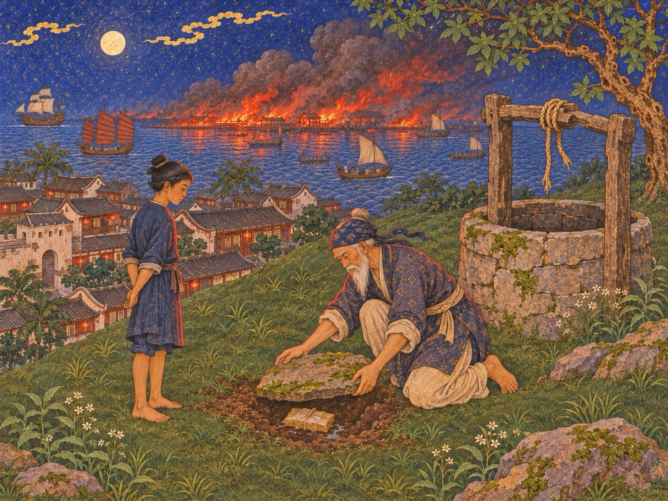

1511년 여름, 말라카.

매운 연기가 잠든 아이의 목을 찔렀다.

열한 살 린차오가 눈을 떴을 때, 들창 바깥이 한낮처럼 붉었다. 항구 쪽 하늘이 검붉은 숯덩이처럼 부풀어 올라 있었다. 바다 건너에서 쇠통이 터지는 소리가 묵직하게 울릴 때마다 마루 판자가 떨렸다.

"일어나라."

할아버지 린 노인이 아이의 손목을 잡았다. 노인의 손바닥은 그물 줄처럼 거칠고 식어 있었다. 차오가 신발을 찾으려 몸을 숙이자 노인이 고개를 저었다.

"신발은 두고 가자. 가만히, 내 뒤만 밟아라."

아버지와 어머니는 저녁나절에 짐을 챙기러 항구 창고로 나간 뒤 돌아오지 않았다. 차오는 사립문 밖을 내다보며 몇 번이나 부르려 했으나, 할아버지가 아이의 입을 손바닥으로 덮었다. 골목마다 사람들이 보따리를 이고 북쪽 숲으로 뛰고 있었다. 누구도 뒤를 돌아보지 않았다.

두 사람은 화인 마을 뒤편 가파른 언덕으로 올랐다. 풀숲이 무릎을 쳤다. 붉은 불빛이 닿지 않는 우물가에 이르자 할아버지가 걸음을 멈췄다. 오래되어 두레박 줄마저 끊어진 돌우물이었다. 노인은 우물 옆 젖은 흙을 손으로 팠다. 손톱 밑에 검은 흙이 박혔다.

노인이 품속에서 기름종이로 두텁게 싼 꾸러미를 꺼냈다. 손바닥 두 개를 포갠 만한 크기였다. 무엇이 들었는지 차오는 알지 못했다. 책인지, 패물인지, 아니면 조상의 위패인지도 몰랐다.

노인이 꾸러미를 구덩이에 넣고 흙을 덮었다. 그 위에 이끼 낀 납작한 돌을 두 손으로 꾹 눌러 얹었다. 흙을 털어낸 노인이 불타는 항구 쪽을 내려다보며 낮게 말했다.

"일곱 번 갔고, 여덟 번째는 가지 못했다."

노인의 목소리는 대포 소리보다 작았지만, 차오의 귓속에 오래 남았다. 할아버지가 누구에게 하는 말인지 아이는 묻지 못했다. 언덕 아래에서 또 한 번 붉은 불기둥이 솟았다. 그 불빛에 노인의 흰 수염이 잠깐 주홍빛으로 물들었다.

1522년 봄, 말라카.

약 달이는 쓴 냄새가 좁은 방에 고여 있었다.

열한 해가 지났다. 스물두 살이 된 차오는 낡은 침상 곁에 쪼그려 앉아 할아버지의 마른 손을 쥐었다. 그 여름밤 이후 어머니와 아버지는 끝내 돌아오지 않았고, 차오에게 남은 피붙이는 침상 위 노인뿐이었다.

할아버지는 사흘째 미음을 삼키지 못했다. 숨을 들이쉴 때마다 마른 잎이 바스락거리는 소리가 났다. 노인이 눈을 뜨지 않은 채 손가락을 움직여 베개 밑을 가리켰다.

차오가 베개 아래에서 낡은 기름종이 꾸러미를 꺼냈다. 열한 살 때 우물가 돌 밑에 묻었던 바로 그 꾸러미였다. 노인이 기력을 되찾은 뒤 몰래 파내어 열한 해 동안 머리맡에 두고 지킨 것이었다.

기름종이를 풀자 실로 맨 두꺼운 책 한 권과 여러 겹 접힌 누런 삼베 종이 한 장이 나왔다. 겉장에는 '침경'이라 적혀 있었다. 배가 나아갈 방향과 물때를 적은 책이었다.

노인이 마른 입술을 달싹였다.

"펴…… 보아라."

차오가 조심스럽게 접힌 삼베 종이를 펼쳤다. 굵은 먹선으로 바다와 뭍이 그려져 있었다. 말라카 해협에서 시작해 서쪽으로 한없이 뻗어 나간 침로도였다. 그런데 선이 이어지다가 다섯 군데가 불에 그을린 듯 검게 비어 있었다. 빈칸마다 할아버지의 굵은 붓글씨로 두 자씩 한문이 적혀 있었다.

차오는 첫 번째 빈칸부터 차례로 소리 내어 읽었다.

"우물에 물어라. 돌에 물어라. 바람에 물어라. 별에 물어라. 짐승에 물어라."

할아버지가 고개를 아주 조금 끄덕였다. 그리고 손가락 끝으로 침경의 맨 마지막 장을 짚었다. 차오가 책장을 넘겼다.

먹물이 마른 지 오래된 누런 종이 한가운데에 석 자만 적혀 있었다.

「제8차」

그 아래는 아무런 글씨도, 나침반 방위도, 날짜도 없이 텅 비어 있었다.

"할아버지, 이 빈칸들은 왜……."

차오가 고개를 들었을 때, 노인의 손이 침상 위로 힘없이 떨어졌다. 마른 입술이 닫혀 있었다. 왜 불에 그을렸는지, 누가 채워야 하는지 노인은 끝내 말하지 않았다.

방 밖에서는 갈매기가 울고, 항구 쪽에서 포르투갈 병사들의 쇠구두 소리가 멀리서 들려왔다. 차오는 노인의 식어 가는 손등을 가만히 덮어 주고, 침경과 침로도를 다시 기름종이에 싸 제 품에 넣었다.
